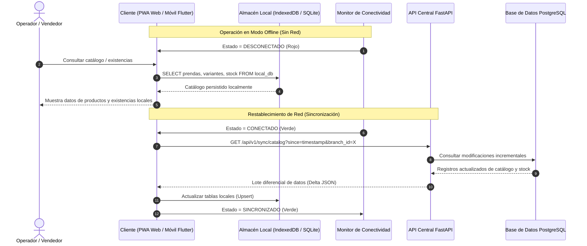
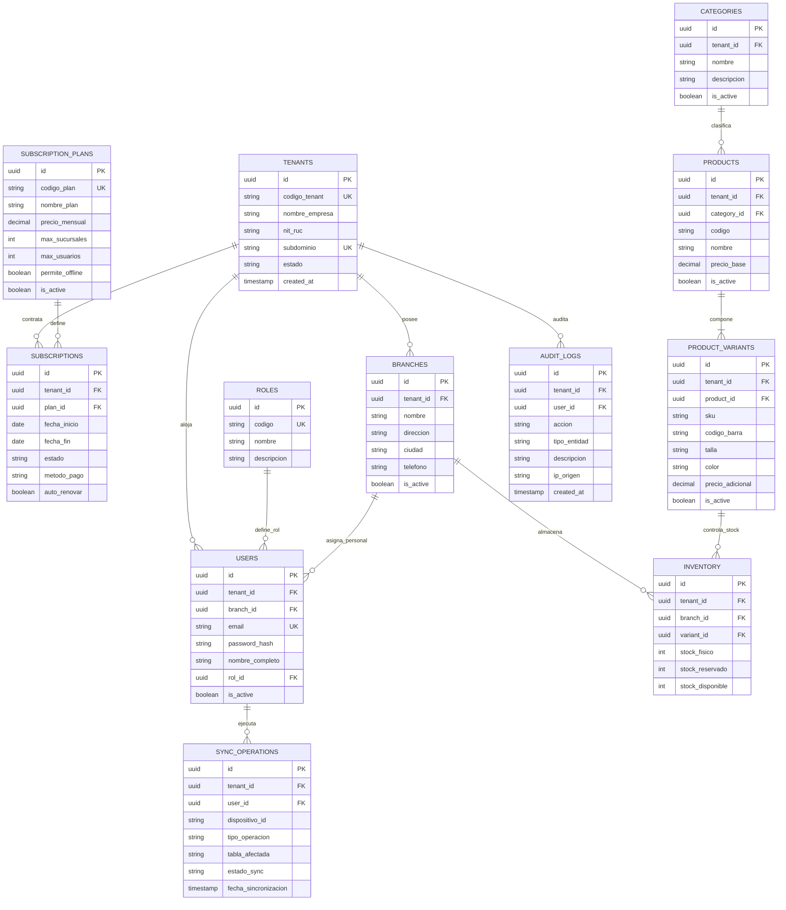

# CAPÍTULO IV. DESARROLLO E IMPLEMENTACIÓN

El presente capítulo describe en profundidad el desarrollo y la materialización técnica de la plataforma de comercio electrónico y gestión multitienda **FashionStore**, delimitado formalmente a los componentes arquitectónicos, modelos de datos, módulos de negocio y mecanismos de integración desarrollados en la **Etapa 1** (Casos de Uso CU-01 al CU-07 y CU-23 al CU-25).

---

## 4.1. Herramientas y tecnologías utilizadas

Para la construcción del sistema se ha seleccionado un conjunto de tecnologías de nivel industrial, priorizando el rendimiento, la seguridad criptográfica, el aislamiento multi-inquilino (*multi-tenancy*) y la capacidad operativa en escenarios de conectividad intermitente (*offline-first*).

### 4.1.1. Ecosistema de Backend (API REST Asíncrona)
* **Lenguaje de Programación:** Python 3.13. Se aprovechan las optimizaciones del intérprete en gestión de memoria, mejoras de rendimiento en tiempo de ejecución y tipado estático robusto.
* **Framework Web Principal:** FastAPI 0.116.1. Marco asíncrono de alto rendimiento basado en el estándar ASGI y OpenAPI (Swagger), con inyección de dependencias nativa y validación estricta de datos.
* **Servidor de Aplicaciones ASGI:** Uvicorn 0.35.0. Servidor ultrarrápido basado en `uvloop` y `httptools`, ideal para manejar alta concurrencia de peticiones concurrentes de sincronización.
* **Mapeo Objeto-Relacional (ORM):** SQLAlchemy 2.0.43. Implementa el patrón *Data Mapper / Declarative Mapping* bajo la sintaxis moderna 2.0, garantizando consultas tipadas, sesiones transaccionales atómicas y control estricto de carga de relaciones.
* **Control de Versiones de Base de Datos:** Alembic 1.16.4. Sistema de control de esquemas relacionales que asegura migraciones aditivas, idempotentes y sin tiempo de inactividad (*zero-downtime*).
* **Driver de Base de Datos:** Psycopg 3.2.9 (`psycopg[binary]`). Driver nativo y moderno para PostgreSQL con soporte avanzado de pipelines y adaptadores de tipos de datos.
* **Seguridad y Hashing Criptográfico:** Argon2-cffi 25.1.0. Algoritmo ganador de la *Password Hashing Competition* (PHC), que ofrece resistencia superior frente a ataques de fuerza bruta y hardware acelerado (GPU/ASIC).
* **Gestión de Sesiones e Identidad:** Python-Jose 3.5.0 (`cryptography`). Implementa la emisión, firmado y verificación de tokens de acceso JSON Web Tokens (JWT) utilizando el algoritmo HMAC-SHA256 (`HS256`).
* **Validación y Configuración:** Pydantic v2 y Pydantic-Settings 2.10.1. Validación rigurosa de entradas y salidas en el borde de la API mediante contratos de esquemas fuertemente tipados.
* **Generación de Reportes:** ReportLab 4.4.3 (PDF) y OpenPyXL 3.1.5 (hojas de cálculo Excel), permitiendo la exportación formal de datos administrativos.

### 4.1.2. Ecosistema de Frontend Web (Progressive Web App - PWA)
* **Framework de Aplicación Web:** Angular 21 (versión 21.0.0). Se implementa utilizando la arquitectura moderna de **Standalone Components**, eliminando los módulos tradicionales (`NgModule`) para reducir drásticamente el peso del paquete de distribución (*bundle*).
* **Gestión de Reactividad y Estado:** Angular Signals (`signal`, `computed`, `effect`) combinado con RxJS 7.8.2 para el manejo reactivo y determinista del flujo asíncrono de datos.
* **Capacidades Offline y PWA:** `@angular/service-worker` 21.0.0. Gestiona la caché del Application Shell, las fuentes tipográficas y los recursos estáticos mediante políticas `performance` y `freshness`.
* **Almacenamiento Local en Navegador:** IndexedDB (a través de la API estándar del DOM). Proporciona almacenamiento relacional indexado local en el navegador del cliente para el catálogo de prendas, variantes y colas de sincronización.
* **Pruebas Automatizadas:** Playwright 1.55.0 para pruebas de extremo a extremo (E2E) y verificación de aislamiento en modo desconectado, junto con Vitest 4.1.11 para pruebas unitarias.

### 4.1.3. Ecosistema de Aplicación Móvil (Terminal Desconectado)
* **Framework Multiplataforma:** Flutter con lenguaje Dart (SDK `>=3.12.0 <4.0.0`). Compilación nativa para dispositivos Android e iOS.
* **Gestión de Estado:** Flutter Riverpod 3.0.0. Proporciona inyección de dependencias declarativa, reactiva y desacoplada del árbol de widgets, con separación clara entre controladores y repositorios.
* **Motor de Base de Datos Local Embebido:** `sqflite` 2.4.5 y `sqflite_common_ffi`. Motor SQLite embebido que ejecuta en el almacenamiento local del dispositivo móvil para persistir el catálogo y las operaciones fuera de línea.
* **Monitoreo de Red:** `connectivity_plus` 7.3.2. Detección en tiempo real de cambios en interfaces de red (Wi-Fi, datos móviles, desconexión total) que alimenta el componente de semáforo de conectividad.
* **Cliente HTTP:** `http` 1.5.0 para la comunicación con los endpoints REST del backend.

### 4.1.4. Infraestructura, Persistencia y Herramientas de Diseño
* **Sistema Gestor de Base de Datos Central:** PostgreSQL 16. Motor relacional que garantiza integridad transaccional ACID, soporte de índices compuestos multi-tenant y particionamiento lógico de datos.
* **Modelado y Diseño de Sistemas:** Sparx Systems Enterprise Architect 16. Herramienta CASE utilizada para la construcción del Modelo de Dominio, Diagramas de Robustez/Análisis de Clases, Diagramas de Comunicación y Diagramas de Secuencia UML bajo la metodología ICONIX.
* **Contenedores y Despliegue:** Docker y Docker Compose para garantizar entornos homogéneos y reproducibles entre desarrollo y producción.

---

## 4.2. Diseño de la arquitectura del sistema

La arquitectura de FashionStore responde a un patrón de **Monolito Modular con Soporte Híbrido Multi-tenant y Operaciones Offline-First**.

### 4.2.1. Diagrama de Paquetes — Arquitectura en Capas (UML 2.5)

El **Diagrama de Paquetes** es uno de los diagramas estructurales definidos en **UML 2.5**, utilizado formalmente para representar a nivel lógico los distintos subsistemas o paquetes que conforman la aplicación y las relaciones de dependencia entre ellos, con el objetivo primordial de **maximizar la cohesión y minimizar el acoplamiento**.

Conforme a la metodología y notación oficial de la materia, se modela un paquete contenedor por cada capa lógica principal que incluye en su interior sus respectivos subpaquetes especializados:


#### 1. Capa de presentación (Paquete Contenedor Superior)
Representa la interfaz con los distintos actores del sistema y agrupa los paquetes de interacción visual:
* **`Interfaz web PWA`:** Aplicación web cliente en Angular 21 orientada a vendedores y compradores, con soporte de ejecución progresiva (PWA) e indicador reactivo de semáforo de conectividad.
* **`Interfaz móvil`:** Aplicación nativa en Flutter (Android/iOS) para vendedores en piso de venta, optimizada para terminales desconectados.
* **`Interfaz admin`:** Panel web administrativo para la parametrización de empresas SaaS (Tenants), planes comerciales, sucursales y personal.

#### 2. Capa de Lógica de Negocio (Paquete Contenedor Intermedio)
Constituye el núcleo del procesamiento del sistema y encapsula los controladores, servicios de aplicación y reglas del dominio correspondientes a la Etapa 1:
* **`Subsistema de gestión SaaS y empresas`:** Gestión del ciclo de vida del Tenant, validación de subdominios y aislamiento multi-inquilino (CU-01).
* **`Subsistema de planes y suscripciones`:** Parametrización y control de contratos comerciales y vigencias (CU-02, CU-03).
* **`Subsistema de control de límites de plan`:** Gobernanza transaccional de cuotas de sucursales y usuarios por plan (CU-04).
* **`Subsistema de gestión de sucursales`:** Administración de tiendas físicas y asignación de personal comercial por tenant (CU-05).
* **`Subsistema de catálogo y existencias`:** Gestión de categorías, prendas textiles, variantes de color/talla y stock multitienda (CU-06, CU-07).
* **`Subsistema de sincronización offline`:** Motor de sincronización diferencial, colas de contingencia y resolución de conectividad (CU-23, CU-24, CU-25).

#### 3. Paquetes de Base de Datos y Persistencia (Almacenamiento)
Representan las fuentes de datos y motores de persistencia que prestan servicio a la lógica de negocio:
* **`Base de datos central PostgreSQL`:** Base de datos relacional principal alojada en la nube, con esquema compartido y discriminador lógico `tenant_id`.
* **`Base de datos embebida SQLite móvil`:** Base de datos relacional local en terminales móviles para soporte transaccional sin internet.
* **`Almacén local IndexedDB PWA`:** Base de datos estructurada en el navegador web para la persistencia del catálogo en modo fuera de línea.

#### 4. Relaciones de Dependencia entre Paquetes
* **Dependencia de Presentación hacia Negocio (`Capa de presentación` $\dashrightarrow$ `Capa de Lógica de Negocio`):** La capa de presentación requiere de los servicios, validaciones y contratos provistos por la lógica de negocio para operar.
* **Dependencia de Persistencia hacia Negocio (`Bases de Datos` $\dashrightarrow$ `Capa de Lógica de Negocio`):** Los repositorios y adaptadores de persistencia (PostgreSQL, SQLite e IndexedDB) se estructuran y ejecutan en función de las entidades y necesidades operativas dictadas por la lógica de negocio.

### 4.2.2. Diagrama de Despliegue — Topología Cloud AWS Multi-Tenant (UML 2.5)

El **Diagrama de Despliegue** describe la infraestructura física, en la nube y los contenedores de software que soportan la operación en producción de **FashionStore**, organizado bajo la arquitectura **AWS Cloud Multi-Tenant** conforme al estándar formal de **UML 2.5**.

El diagrama ha sido modelado y persistido directamente en el repositorio de Enterprise Architect:
* **Archivo:** `CasosDeUso_SegundoParcial.eap`
* **Paquete:** `Segundo Parcial - Diagrama de Despliegue (AWS)`
* **Diagrama:** `Diagrama de Despliegue - AWS Cloud Multi-Tenant`
* **Tipo:** `Deployment Diagram` (UML 2.5)


#### Descripción de Nodos, Contenedores y Servicios Desplegados:

1. **Nodos Cliente («device»):**
   * **`Dispositivo Movil (Android / iOS)`:** Terminal móvil para vendedores y personal en piso de venta, ejecutando la aplicación nativa en **Flutter** con réplica local embebida en **SQLite** para contingencia offline.
   * **`Dispositivo del Usuario (PC / Laptop / Tablet)`:** Equipos de usuarios finales y puntos de venta en tienda.
     * **`«executionEnvironment» Navegador Web`:** Entorno de ejecución estándar (Chrome, Firefox, Edge).
     * **`Frontend Web Angular 21 («artifact»)`:** Artefacto compilado (`dist/`) de la aplicación SPA/PWA en Angular 21, descargado y ejecutado en el cliente con caché de Service Worker.

2. **Nodo de Conectividad («network»):**
   * **`Internet (HTTPS / WSS / TLS)`:** Canal público seguro de comunicación WAN. Recibe peticiones cifradas `HTTPS` (tráfico web estándar) y `HTTPS / WSS` (WebSockets para sincronización y notificaciones en tiempo real).

3. **Infraestructura en la Nube (`AWS Cloud Boundary`):**
   * **`«loadBalancer» AWS Application Load Balancer (ALB / SSL / Reverse Proxy)`:** Punto de entrada central a la nube AWS. Gestiona la terminación TLS (`TLS 443`) con certificados SSL, balanceo de carga y reenvío de tráfico (`Reverse Proxy HTTP/WSS`) hacia la subred privada de cómputo.
   * **`AWS EC2 / ECS Cluster (Docker Runtime)`:** Clúster de contenedores orquestado bajo AWS ECS (Elastic Container Service) con tiempo de ejecución Docker en subred privada VPC. Aloja dos contenedores especializados:
     * **`Contenedor Backend (FastAPI / Python 3.13 / REST & WSS)`:** Núcleo modular del sistema que procesa las APIs REST de empresas, suscripciones, sucursales, catálogo y motor de sincronización.
     * **`Contenedor Servicio IA (FastAPI / Python 3.13 / ML)`:** Microservicio analítico y de inteligencia artificial para modelos de recomendación, proyección predictiva de demanda y chat.
     * **`REST Inter-service`:** Enlace de comunicación interna de baja latencia entre ambos contenedores.

4. **Capa de Persistencia, Almacenamiento y Seguridad AWS:**
   * **`«database» Amazon RDS PostgreSQL 16 (BD Multi-Tenant Aislada)`:** Base de datos relacional central gestionada en subred privada aislada. Conectada al backend mediante pool transaccional de conexiones (`TCP 5432 / Postgres Driver`).
   * **`«security» AWS KMS (Cifrado Bitacora y Llaves)`:** Servicio de administración de claves criptográficas de AWS para el cifrado en reposo de registros de auditoría y tokens (`AWS SDK Cifrado`).
   * **`Amazon S3 Bucket (Backups y Assets)`:** Almacén de objetos de alta disponibilidad para imágenes de prendas textiles, catálogos multimedia y respaldos automáticos de base de datos (`AWS S3 SDK`).

5. **Servicios Externos Integrados («external»):**
   * **`Stripe API Cloud (Pasarela de Pagos SaaS)`:** Pasarela externa internacional para cobro recurrente de planes y pasarela de suscripciones, conectada mediante `Stripe Webhooks / HTTPS`.
   * **`Brevo Cloud API (SMTP / Email Transaccional)`:** Servicio en la nube para despacho masivo de notificaciones transaccionales y confirmación de alta de empresas (`SMTP 587 / REST`).

Para la gestión de múltiples empresas contratantes en una misma infraestructura, se seleccionó el patrón **Shared Database, Shared Schema with Discriminator Column (`tenant_id`)**:

1. **Aislamiento por Fila (*Row-Level Multitenancy*):** Cada tabla perteneciente a la lógica de negocio (sucursales, usuarios, productos, inventarios, transacciones) incluye obligatoriamente la columna `tenant_id` como clave foránea hacia la tabla `tenants`.
2. **Ciclo de Resolución de Tenant:**
   * La petición HTTP entrante es interceptada por la dependencia de seguridad `get_current_tenant` en FastAPI.
   * El tenant se resuelve prioritariamente a partir del token JWT firmado del usuario autenticado; en solicitudes administrativas de aprovisionamiento o públicas, se resuelve mediante la cabecera `X-Tenant-ID` o el subdominio de origen (`empresa1.fashionstore.com`).
3. **Gobernanza y Consultas Confinadas:** Todos los repositorios y servicios inyectan automáticamente el filtro `WHERE table.tenant_id = :current_tenant_id`. Se prohíben operaciones que crucen límites de empresas, evitando la fuga inadvertida de datos (*data leakage*).
4. **Respuestas No Enumerables:** Cualquier solicitud a un identificador perteneciente a otra empresa retorna un código HTTP `404 Not Found` en lugar de `403 Forbidden`, imposibilitando la enumeración de recursos privados entre competidores.

### 4.2.3. Arquitectura Offline-First de Doble Nivel

Para asegurar la continuidad comercial ante caídas de enlace de red, se estructuró una arquitectura desconectada dual:



---

## 4.3. Implementación de la base de datos

### 4.3.1. Modelo Físico Relacional Multi-tenant

La base de datos central en PostgreSQL se compone de tablas organizadas en esquemas normalizados con integridad referencial estricta:



### 4.3.2. Restricciones e Índices Compuestos para Aislamiento Multi-tenant

Para garantizar que los identificadores de negocio (como el código de producto, el SKU o el nombre de una sucursal) sean únicos dentro de cada empresa pero puedan coexistir entre distintos clientes sin colisionar, se aplican índices únicos compuestos:

```sql
-- Unicidad del subdominio global para enrutamiento SaaS
CREATE UNIQUE INDEX uq_tenants_subdominio ON tenants(LOWER(subdominio));

-- Restricción de SKU único POR EMPRESA
CREATE UNIQUE INDEX uq_product_variants_tenant_sku ON product_variants(tenant_id, LOWER(sku));

-- Restricción de un solo registro de inventario por variante en cada sucursal
CREATE UNIQUE INDEX uq_inventory_tenant_branch_variant ON inventory(tenant_id, branch_id, variant_id);

-- Restricción de consistencia matemática en inventario
ALTER TABLE inventory ADD CONSTRAINT chk_inventory_stock_logic 
    CHECK (stock_fisico >= 0 AND stock_reservado >= 0 AND stock_disponible = (stock_fisico - stock_reservado));
```

### 4.3.3. Base de Datos Embebida Desconectada (SQLite Móvil e IndexedDB Web)

En los dispositivos cliente, la persistencia local utiliza un esquema réplica simplificado:
* **Tabla `local_products`:** Almacena `id`, `codigo`, `nombre`, `precio_base`, `category_name`.
* **Tabla `local_variants`:** Almacena `id`, `product_id`, `sku`, `codigo_barra`, `talla`, `color`, `precio_final`.
* **Tabla `local_inventory`:** Almacena `variant_id`, `branch_id`, `stock_disponible`, `updated_at`.
* **Tabla `sync_metadata`:** Registra `key`, `value` para controlar la marca temporal `last_catalog_sync_timestamp`.

---

## 4.4. Desarrollo de los módulos del sistema (Etapa 1)

A continuación se detalla la implementación técnica de los módulos correspondientes a los 10 Casos de Uso desarrollados en la Etapa 1:

### 4.4.1. Módulo 1: Registro y Aprovisionamiento de Empresa Contratante (CU-01)
* **Objetivo:** Registrar una nueva empresa cliente en la modalidad SaaS, validando su subdominio comercial y aprovisionando su entorno inicial.
* **Componentes Backend:** Router en `app.modules.subscriptions.router`, servicio `TenantService.register_tenant()`.
* **Lógica Transaccional:**
  1. Verifica la disponibilidad del subdominio en la base de datos central.
  2. Inserta el registro del nuevo `Tenant` en estado `ACTIVO`.
  3. Asocia la suscripción inicial vinculada al plan seleccionado (por defecto Plan Básico).
  4. Crea la cuenta del Administrador de la empresa con credenciales cifradas mediante Argon2.
  5. Emite un evento inmutable a la tabla `audit_logs` con la acción `REGISTRO_TENANT`.

### 4.4.2. Módulo 2: Gestión de Planes de Suscripción (CU-02)
* **Objetivo:** Permitir al Superadministrador de la plataforma crear, parametrizar y actualizar los planes comerciales.
* **Componentes Backend:** Endpoints `GET /api/v1/saas/plans`, `POST /api/v1/saas/plans`, `PUT /api/v1/saas/plans/{id}`.
* **Lógica de Negocio:** Parametriza los límites duros del sistema:
  * `max_sucursales`: Cantidad máxima de tiendas físicas permitidas (ej. 2 para Básico, 10 para Profesional).
  * `max_usuarios`: Cuota máxima de cuentas de usuario activas.
  * `permite_offline`: Bandera booleana que habilita el acceso al módulo PWA / SQLite móvil.

### 4.4.3. Módulo 3: Asignación y Renovación de Suscripciones (CU-03)
* **Objetivo:** Formalizar la contratación, cobro y extensión del período de vigencia de las suscripciones de cada empresa.
* **Componentes Backend:** Endpoints `POST /api/v1/saas/subscriptions/assign`, `POST /api/v1/saas/subscriptions/renew`.
* **Lógica de Negocio:** Calcula automáticamente las fechas de inicio y vencimiento (`fecha_inicio = hoy`, `fecha_fin = hoy + 30 dias`). En caso de renovación, valida que la empresa no mantenga saldos pendientes y emite el comprobante de extensión correspondiente.

### 4.4.4. Módulo 4: Gobernanza y Control Transaccional de Límites por Plan (CU-04)
* **Objetivo:** Bloquear automáticamente cualquier intento de crear sucursales o registrar usuarios que superen los topes contratados en el plan activo.
* **Componentes Backend:** Middleware y dependencia de validación `verify_plan_branch_limit()`.
* **Lógica de Ejecución:**
  * Al recibir una petición para agregar una nueva sucursal (`POST /api/v1/branches`), consulta la cantidad actual: `SELECT COUNT(*) FROM branches WHERE tenant_id = :id AND is_active = true`.
  * Compara el valor obtenido contra `subscription_plans.max_sucursales`.
  * Si `conteo >= max_sucursales`, cancela la transacción e interrumpe con código HTTP `403 Forbidden` y mensaje estructurado: `"Límite de sucursales alcanzado para el plan contratado. Actualice su suscripción a un plan superior."`

### 4.4.5. Módulo 5: Gestión de Sucursales y Personal por Tenant (CU-05)
* **Objetivo:** Permitir a cada empresa configurar su red física de puntos de venta y asignar el personal autorizado.
* **Componentes Backend:** Routers `app.modules.locations.router` y `app.modules.users.router`.
* **Lógica de Negocio:** Garantiza que los usuarios asignados a una sucursal pertenezcan estrictamente al mismo `tenant_id`. Maneja la desactivación lógica (`is_active = false`) para preservar la integridad histórica de ventas pasadas.

### 4.4.6. Módulo 6: Descarga y Almacenamiento de Catálogo Offline (CU-06)
* **Objetivo:** Proporcionar al cliente desconectado (PWA o Móvil) una copia completa y ligera del catálogo y existencias de su sucursal.
* **Componentes Backend:** Endpoint `GET /api/v1/sync/catalog`.
* **Lógica de Optimización:**
  * Filtra únicamente las categorías, productos, variantes y existencias correspondientes a la sucursal del usuario solicitante.
  * Serializa el resultado en un payload JSON comprimido optimizado para almacenamiento en SQLite / IndexedDB.
  * Registra la marca temporal del servidor (`sync_timestamp`) para futuras consultas diferenciales.

### 4.4.7. Módulo 7: Consulta de Catálogo y Existencias Offline (CU-07)
* **Objetivo:** Permitir al vendedor buscar prendas, filtrar por categoría y consultar existencias por talla y color cuando el dispositivo no tiene internet.
* **Componentes Frontend / Móvil:**
  * Web: `OfflineCatalogService` (Angular) interactuando con almacenes de IndexedDB.
  * Móvil: `CatalogRepository` (Flutter) ejecutando consultas SQL en `sqflite`.
* **Lógica de Negocio:** Ejecuta búsquedas locales inmediatas con tiempo de respuesta inferior a 50 milisegundos, retornando disponibilidad real estimada en tienda sin depender del servidor central.

### 4.4.8. Módulo 8: Semáforo y Notificación de Estado de Conectividad (CU-23)
* **Objetivo:** Informar al usuario en todo momento sobre el estado de la conexión a la nube y la fiabilidad de las operaciones locales.
* **Componentes:** `ConnectivityMonitor` (Flutter) y `OfflineStatusIndicator` (Angular).
* **Lógica de Estados:**
  * **Verde (ONLINE):** Conexión activa con el backend. Consultas y mutaciones se sincronizan en tiempo real.
  * **Amarillo (SINCRONIZANDO):** Conexión restablecida; el sistema está descargando deltas o enviando operaciones locales pendientes.
  * **Rojo (OFFLINE):** Sin conexión de red; el sistema opera de forma segura sobre la base de datos embebida local.

### 4.4.9. Módulo 9: Instalación y Registro de Service Worker PWA (CU-24)
* **Objetivo:** Habilitar la ejecución de la aplicación web en modo de escritorio o aplicación móvil sin requerir conexión inicial al servidor.
* **Configuración:** `ngsw-config.json` y registro mediante `provideServiceWorker('ngsw-worker.js')`.
* **Lógica de Caching:**
  * Grupo de recursos estáticos (`app`): Archivos compilados JS, CSS e index.html bajo política `prefetch`.
  * Grupo de activos (`assets`): Logotipos, iconos e imágenes bajo política `lazy`.

### 4.4.10. Módulo 10: Persistencia y Migración SQLite Móvil (CU-25)
* **Objetivo:** Garantizar la creación y actualización determinista de la base de datos local en terminales móviles Android e iOS.
* **Componentes Móvil:** `OfflineDatabase` en `mobile/lib/core/offline/offline_database.dart`.
* **Lógica de Inicialización:**
  * Al iniciar la app, ejecuta `openDatabase(path, version: 1, onCreate: _createDb, onUpgrade: _upgradeDb)`.
  * Crea las tablas locales con claves e índices primarios y secundarios para acelerar la búsqueda por código de barras.

---

## 4.5. Integración de componentes

La integración de los distintos componentes tecnológicos y plataformas se realiza a través de contratos de interfaz rigurosos:

### 4.5.1. Integración Frontend Web (Angular) $\leftrightarrow$ Backend (FastAPI)
* **Interceptores HTTP:** Se implementa un interceptor funcional en Angular que intercepta cada petición saliente para inyectar automáticamente:
  * Cabecera de Autorización: `Authorization: Bearer <Token_JWT>`.
  * Cabecera de Inquilino: `X-Tenant-ID: <UUID_Tenant>`.
* **Gestión Unificada de Errores:** Manejo centralizado de códigos de respuesta HTTP con notificación reactiva al usuario mediante un servicio de alertas (`ToastNotificationService`).

### 4.5.2. Integración Móvil (Flutter) $\leftrightarrow$ Backend (FastAPI)
* **Cliente HTTP y Serialización:** La capa de infraestructura en Flutter utiliza el paquete `http` encapsulado en `ApiClient`, con serialización y deserialización tipada mediante modelos `CatalogModel.fromJson()`.
* **Manejo de Tiempos de Espera Resilientes:** Se configuran límites de tiempo de espera (*timeouts*) de 8 segundos en peticiones a la API; si la red falla, el cliente cambia automáticamente al modo offline sin congelar la interfaz de usuario.

### 4.5.3. Integración de Sincronización Diferencial Offline $\leftrightarrow$ Online
* **Protocolo Delta Sync:** Para minimizar el uso de datos en redes móviles, el endpoint `/api/v1/sync/catalog` acepta el parámetro opcional `since_timestamp`.
* Si se proporciona, el servidor ejecuta una consulta filtrada:
  ```sql
  SELECT * FROM products 
  WHERE tenant_id = :tid AND updated_at > :since_timestamp;
  ```
  De esta forma, únicamente se transfieren los registros nuevos o modificados, logrando sincronizaciones en menos de 2 segundos.

### 4.5.4. Integración de Auditoría y Trazabilidad Transaccional
* **Middleware de Auditoría Automática:** Un middleware asíncrono en FastAPI inspecciona las peticiones de mutación (`POST`, `PUT`, `DELETE`).
* Tras confirmarse la transacción en la base de datos, extrae el identificador del usuario, el tenant, el endpoint accedido y la dirección IP de origen, persistiendo automáticamente el registro en la tabla `audit_logs` sin requerir código redundante en cada controlador.
