# Ciclo #3 — Innovación, analítica y experiencia personalizada

Esta sección documenta el **Ciclo #3** de FashionStore siguiendo la estructura utilizada para los ciclos anteriores: detalle de casos de uso, prototipado de interfaz, análisis, diseño, implementación y pruebas.

El ciclo comprende los siguientes casos de uso:

| ID | Caso de uso | Actor principal | Finalidad |
| --- | --- | --- | --- |
| CU12 | Utilizar Vestidor Virtual | Cliente | Permitir visualizar una aproximación de cómo podría lucir una prenda mediante cámara, pose local o simulador académico. |
| CU20 | Gestionar Promociones | Administrador | Crear y administrar campañas de descuento aplicables al carrito y a las ventas. |
| CU21 | Consultar Reportes y Dashboards | Administrador | Proporcionar indicadores para analizar ventas, inventario, reservas, canales y sucursales. |
| CU22 | Obtener Recomendaciones mediante IA | Cliente | Personalizar el catálogo mediante recomendaciones explicables y compatibles con la disponibilidad real. |
| CU23 | Consultar Historial de Compras | Cliente | Permitir consultar compras propias, sus artículos, pagos y estados. |

---

## 1. Alcance del Ciclo #3

El Ciclo #3 completa las funcionalidades de innovación, análisis y personalización de FashionStore. Se apoya en los datos persistidos por el catálogo, inventario, reservas, carrito, ventas y pagos de los ciclos anteriores.

### Incluye

- Vestidor virtual web y móvil.
- Prototipo de realidad aumentada local para dispositivos móviles.
- Simulador de vestidor cuando no existe cámara o detector disponible.
- Administración de promociones y descuentos.
- Aplicación de promociones en carrito y ventas.
- Dashboard administrativo.
- Reportes de ventas, inventario, reservas, canales y productos.
- Recomendaciones personalizadas mediante un motor de puntuación explicable.
- Historial de compras web y móvil.
- Control de autorización y propiedad de los datos del cliente.

### Fuera de alcance

- Simulación fotorrealista de telas.
- Garantía de talla o ajuste físico de una prenda.
- Entrenamiento de un modelo propio de aprendizaje automático.
- Envío de imágenes de cámara a una API externa de inteligencia artificial.
- Integración productiva con Stripe.
- Sustitución de los procesos de reservas, ventas o pagos implementados en los ciclos anteriores.

---

## 2. Priorización de casos de uso

| ID | Caso de uso | Prioridad | Riesgo | Actores | Estado |
| --- | --- | --- | --- | --- | --- |
| CU12 | Utilizar Vestidor Virtual | Crítica | Alto | Cliente / cámara local | Completo como prototipo académico |
| CU20 | Gestionar Promociones | Secundaria | Medio | Administrador | Completo |
| CU21 | Consultar Reportes y Dashboards | Importante | Medio | Administrador | Completo |
| CU22 | Obtener Recomendaciones mediante IA | Crítica | Alto | Cliente / motor de recomendaciones | Completo como motor académico explicable |
| CU23 | Consultar Historial de Compras | Importante | Medio | Cliente | Completo |

---

## 3. Detalle de casos de uso

## 3.1 CU12 — Utilizar Vestidor Virtual

| Elemento | Descripción |
| --- | --- |
| Caso de uso | CU12. Utilizar Vestidor Virtual |
| Propósito | Reducir la incertidumbre del cliente al consultar una prenda sin probarla físicamente. |
| Actor principal | Cliente |
| Actores secundarios | Cámara del dispositivo, detector local de pose |
| Precondiciones | Cliente autenticado; producto activo disponible en el catálogo. |
| Disparador | El cliente selecciona la opción “Probar en vestidor virtual”. |
| Postcondición | Se registra una sesión de vestidor virtual con su producto y estado. |

### Flujo principal

1. El cliente ingresa al detalle de una prenda.
2. Selecciona la opción **Probar en vestidor virtual**.
3. El sistema crea una sesión de vestidor asociada al cliente y al producto.
4. En móvil, el sistema solicita acceso a la cámara cuando está disponible.
5. El detector local identifica puntos corporales, principalmente la posición aproximada de los hombros.
6. El sistema coloca una representación transparente de la prenda sobre la imagen.
7. El cliente puede finalizar la sesión.
8. El sistema registra la sesión como finalizada.

### Flujos alternativos

- Si el permiso de cámara es rechazado, se muestra el simulador.
- Si el dispositivo no soporta el detector de pose, se utiliza el modo de demostración.
- Si no existe conexión con el backend, se informa el error sin enviar imágenes a servicios externos.
- Si el producto deja de estar activo, no se inicia una sesión nueva.

### Limitación académica

El vestidor virtual es un prototipo de posicionamiento visual. No representa una simulación exacta de la caída de la tela ni garantiza que la talla seleccionada sea adecuada.

---

## 3.2 CU20 — Gestionar Promociones

| Elemento | Descripción |
| --- | --- |
| Caso de uso | CU20. Gestionar Promociones |
| Propósito | Permitir al administrador crear campañas comerciales y aplicar descuentos válidos. |
| Actor principal | Administrador |
| Precondiciones | Administrador autenticado con permiso de gestión de promociones. |
| Disparador | El administrador ingresa al módulo de promociones. |
| Postcondición | La promoción queda creada, actualizada, activada o desactivada según la operación realizada. |

### Flujo principal

1. El administrador consulta las promociones existentes.
2. Crea una nueva promoción indicando nombre, descripción, fechas y descuento.
3. El sistema valida que las fechas sean coherentes.
4. El administrador asigna productos a la promoción.
5. El administrador activa la promoción.
6. El cliente agrega un producto promocionado al carrito.
7. El backend recalcula el descuento en el servidor.
8. El total se actualiza sin producir valores negativos.
9. El administrador puede desactivar o modificar la promoción.

### Flujos alternativos

- Si la promoción está vencida, no se aplica al carrito.
- Si la promoción está inactiva, el producto conserva su precio normal.
- Si el descuento es inválido, el backend rechaza la operación.
- Si se intenta asignar un producto inexistente, la operación falla.
- Un cliente no puede crear ni modificar promociones.

### Reglas de negocio

- El descuento debe ser positivo.
- La fecha final debe ser posterior a la fecha inicial.
- El total de una venta nunca puede ser negativo.
- La aplicación del descuento se realiza en el backend, no solamente en la interfaz.

---

## 3.3 CU21 — Consultar Reportes y Dashboards

| Elemento | Descripción |
| --- | --- |
| Caso de uso | CU21. Consultar Reportes y Dashboards |
| Propósito | Apoyar la toma de decisiones administrativas mediante indicadores consolidados. |
| Actor principal | Administrador |
| Precondiciones | Administrador autenticado y datos comerciales disponibles. |
| Disparador | El administrador abre el dashboard o aplica filtros. |
| Postcondición | El administrador visualiza información calculada a partir de datos persistidos. |

### Flujo principal

1. El administrador ingresa al dashboard.
2. El sistema consulta los indicadores generales.
3. Se muestran ventas, ingresos, inventario y reservas.
4. El administrador selecciona un rango de fechas.
5. El administrador filtra por sucursal cuando corresponde.
6. El sistema recalcula los indicadores.
7. Se muestran tablas y tarjetas de resumen.
8. El administrador interpreta la información para apoyar decisiones comerciales.

### Reportes incluidos

- Ventas por sucursal.
- Productos más vendidos.
- Productos con bajo stock.
- Resumen de reservas.
- Ventas por canal.
- Resumen de ingresos.
- Indicadores generales del dashboard.

### Flujos alternativos

- Si no existen datos para el filtro, se muestra un estado vacío.
- Si las fechas son inválidas, el sistema rechaza el filtro.
- Si el usuario no es administrador, se deniega el acceso.
- Si falla una consulta, el dashboard informa el error sin modificar datos.

### Regla de consistencia

Los reportes deben calcularse a partir de ventas, inventario, reservas y pagos persistidos. El dashboard no debe utilizar valores simulados para reemplazar información real disponible.

---

## 3.4 CU22 — Obtener Recomendaciones mediante IA

| Elemento | Descripción |
| --- | --- |
| Caso de uso | CU22. Obtener Recomendaciones mediante IA |
| Propósito | Personalizar la exploración del catálogo mostrando prendas disponibles y explicando por qué se recomiendan. |
| Actor principal | Cliente |
| Actor secundario | Motor académico de recomendaciones |
| Precondiciones | Cliente autenticado; catálogo activo. |
| Disparador | El cliente abre la sección de recomendaciones. |
| Postcondición | El cliente recibe una lista ordenada de productos disponibles con su motivo de recomendación. |

### Flujo principal

1. El cliente ingresa a la sección de recomendaciones.
2. El sistema consulta su historial de compras cuando existe.
3. Analiza afinidad por categorías.
4. Considera popularidad, temporada y colección activa.
5. Excluye productos sin disponibilidad.
6. Calcula una puntuación para cada candidato.
7. Ordena los productos.
8. Devuelve recomendaciones con explicación.
9. El cliente puede abrir el detalle de una recomendación.

### Estrategia para cliente nuevo

Cuando el cliente no posee historial suficiente, el sistema utiliza un enfoque de arranque en frío basado en:

- Popularidad.
- Productos activos.
- Temporada vigente.
- Disponibilidad en inventario.

### Ejemplos de motivos

- “Recomendado porque compraste productos de la categoría Camisas.”
- “Popular entre clientes con preferencias similares.”
- “Disponible en la temporada actual.”
- “Producto disponible en sucursales activas.”

### Limitación académica

El motor es un sistema de puntuación explicable. Se considera asistencia inteligente porque infiere un orden de preferencia a partir de señales del catálogo y del comportamiento, pero no entrena un modelo de machine learning propio.

---

## 3.5 CU23 — Consultar Historial de Compras

| Elemento | Descripción |
| --- | --- |
| Caso de uso | CU23. Consultar Historial de Compras |
| Propósito | Permitir que el cliente consulte sus compras anteriores y sus detalles. |
| Actor principal | Cliente |
| Precondiciones | Cliente autenticado. |
| Disparador | El cliente ingresa a “Historial de compras”. |
| Postcondición | El cliente visualiza únicamente sus propias compras. |

### Flujo principal

1. El cliente abre la ruta de historial.
2. El sistema consulta las ventas asociadas a su usuario.
3. Se muestra la lista de compras.
4. El cliente selecciona una compra.
5. El sistema muestra sus artículos, cantidades, importes, descuentos y total.
6. Se muestran los pagos asociados cuando existen.
7. Se muestra el estado de la compra.

### Estados consultables

- Pendiente.
- Confirmada.
- Fallida.

### Flujos alternativos

- Si el cliente no tiene compras, se muestra un estado vacío.
- Si el identificador pertenece a otro cliente, el backend responde con acceso denegado o recurso no disponible.
- Si una compra no tiene pago asociado, se muestra el detalle sin inventar información.

### Regla de seguridad

La propiedad de la compra se valida en el backend. Ocultar una compra en la interfaz no es suficiente para proteger la información.

---

## 4. Prototipado de la interfaz de usuario

## 4.1 CU12 — Vestidor virtual

La interfaz debe incluir:

- Botón “Probar en vestidor virtual” en el detalle del producto.
- Indicador de carga mientras se inicia la sesión.
- Vista de cámara o simulador.
- Representación de la prenda sobre el usuario.
- Mensaje de fallback cuando no existe cámara compatible.
- Acción para finalizar la sesión.

**Referencia de implementación:** detalle de producto web y pantalla `VirtualFittingScreen` de Flutter.

## 4.2 CU20 — Promociones

La interfaz administrativa debe incluir:

- Listado de promociones.
- Formulario de creación y edición.
- Fechas de inicio y finalización.
- Tipo y valor del descuento.
- Selector de productos.
- Acciones de activar y desactivar.
- Mensajes de validación y resultado.

**Ruta web:** `/cycle-3-admin`.

## 4.3 CU21 — Reportes y dashboards

El dashboard debe incluir:

- Tarjetas KPI.
- Filtros de fecha.
- Filtro de sucursal.
- Ventas por sucursal.
- Productos más vendidos.
- Productos con bajo stock.
- Reservas por estado.
- Ventas por canal.
- Resumen de ingresos.

**Ruta web:** `/cycle-3-admin`.

## 4.4 CU22 — Recomendaciones

La interfaz debe incluir:

- Encabezado de recomendaciones.
- Tarjetas de productos.
- Precio y disponibilidad.
- Motivo de recomendación.
- Enlace al detalle del producto.
- Estado vacío para usuarios sin recomendaciones.

**Ruta web:** `/recommendations`.

## 4.5 CU23 — Historial de compras

La interfaz debe incluir:

- Lista de compras del cliente.
- Estado de cada compra.
- Fecha y total.
- Detalle desplegable o seleccionable.
- Productos comprados.
- Cantidades, descuentos y pagos.
- Mensaje cuando no existen compras.

**Ruta web:** `/purchase-history`.

---

## 5. Estructuración del modelo de casos de uso

El Ciclo #3 se relaciona con los actores de la siguiente manera:

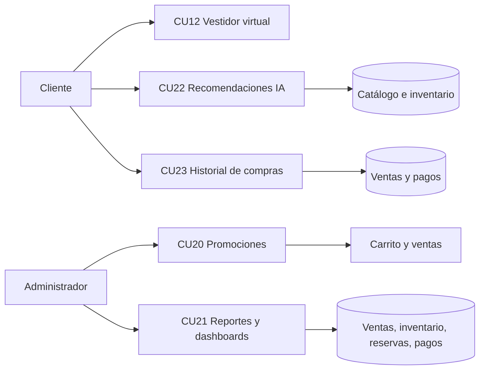

### Dependencias con ciclos anteriores

| CU | Dependencia |
| --- | --- |
| CU12 | Catálogo, autenticación y productos activos. |
| CU20 | Productos, carrito, ventas y precios. |
| CU21 | Ventas, inventario, reservas, pagos y sucursales. |
| CU22 | Catálogo, inventario, temporadas, colecciones e historial de compras. |
| CU23 | Autenticación, ventas, detalles de venta y pagos. |

---

## 6. Análisis de arquitectura

## 6.1 Paquetes involucrados

| Paquete | Responsabilidad | CU relacionados |
| --- | --- | --- |
| Auth | Autenticación, sesión y autorización. | CU12, CU20, CU21, CU22, CU23 |
| Catalog | Productos, variantes y disponibilidad. | CU12, CU20, CU22 |
| Commerce | Carrito, ventas, promociones e historial comercial. | CU20, CU21, CU23 |
| Promotions | CRUD y aplicación de promociones. | CU20 |
| Reports | Consultas agregadas para indicadores. | CU21 |
| Recommendations | Puntuación y explicación de recomendaciones. | CU22 |
| Virtual fitting | Sesiones de vestidor virtual. | CU12 |
| Reservations / Inventory | Datos operativos utilizados por reportes. | CU21 |

## 6.2 Arquitectura lógica

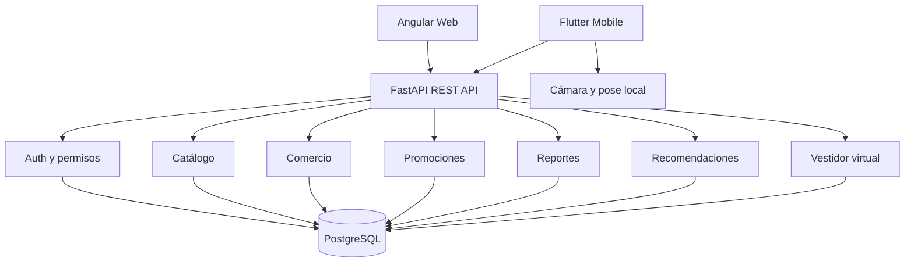

---

## 7. Análisis de los casos de uso

## 7.1 Diagrama de comunicación — CU12

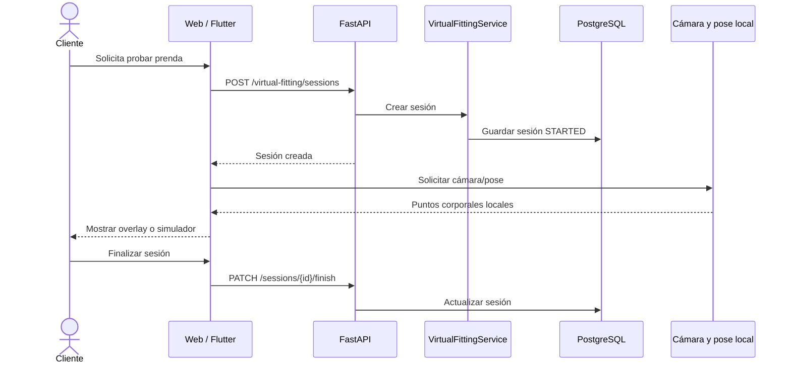

## 7.2 Diagrama de comunicación — CU20

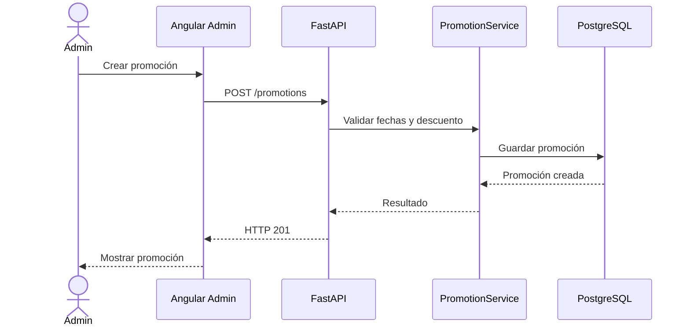

## 7.3 Diagrama de comunicación — CU21

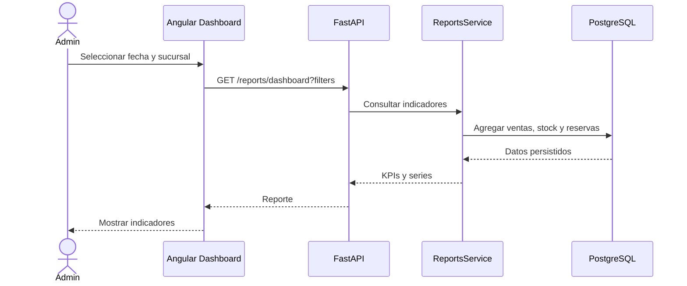

## 7.4 Diagrama de comunicación — CU22

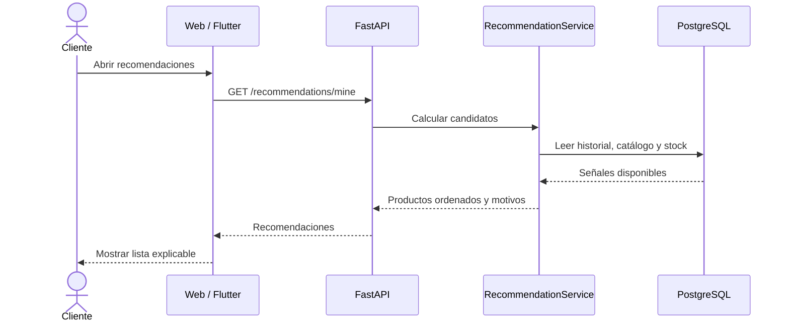

## 7.5 Diagrama de comunicación — CU23

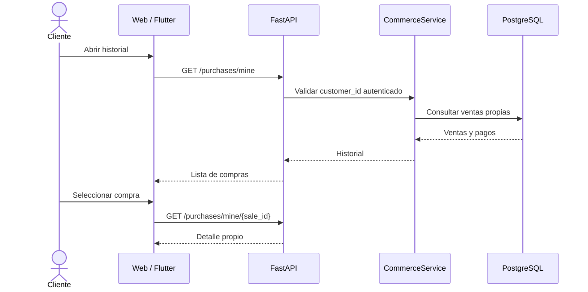

---

## 8. Análisis de clases y paquetes

## 8.1 Clases principales

| Clase o componente | Responsabilidad | Casos de uso |
| --- | --- | --- |
| `Promotion` | Representar una campaña, su vigencia, tipo, valor y estado. | CU20 |
| `PromotionProduct` | Asociar productos con promociones. | CU20 |
| `Sale` | Representar una compra y sus estados comerciales. | CU21, CU23 |
| `SaleItem` | Representar los productos, cantidades, precios y descuentos de una venta. | CU20, CU21, CU23 |
| `Payment` | Registrar método, monto, proveedor y estado del pago. | CU21, CU23 |
| `VirtualFittingSession` | Registrar inicio, finalización, producto y dispositivo de una sesión. | CU12 |
| `Recommendation` | Representar producto recomendado, motivo, puntuación y contexto. | CU22 |
| `Inventory` | Proporcionar la disponibilidad utilizada por recomendaciones y reportes. | CU21, CU22 |
| `User` | Identificar al cliente o administrador y aplicar autorización. | CU12, CU20, CU21, CU22, CU23 |

## 8.2 Relaciones principales

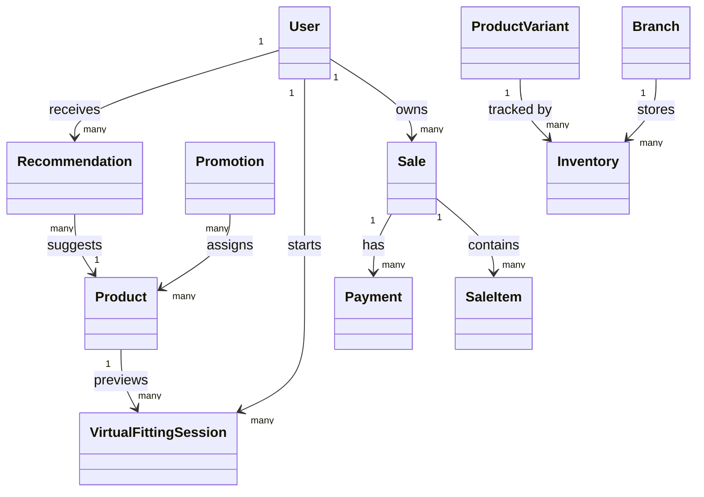

## 8.3 Paquetes y dependencias

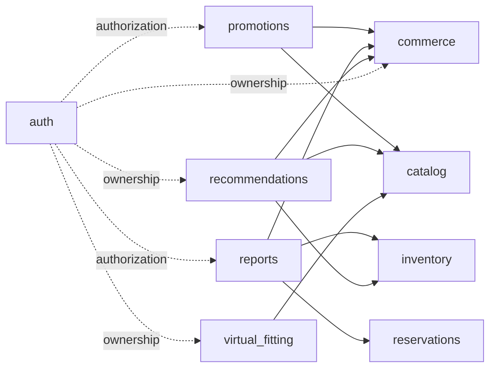

---

## 9. Diseño de datos

El Ciclo #3 reutiliza las entidades comerciales y agrega o utiliza las siguientes estructuras:

| Entidad | Uso en el Ciclo #3 |
| --- | --- |
| `promotions` | Datos de campañas, fechas, tipo, valor y estado. |
| `products_promotions` | Relación entre promociones y productos. |
| `sales` | Fuente del historial y de los reportes de ventas. |
| `sale_items` | Productos, cantidades, precios y descuentos de cada venta. |
| `payments` | Información de pagos asociados al historial y reportes. |
| `virtual_fitting_sessions` | Sesiones de vestidor por cliente y producto. |
| `recommendations` | Resultados o registros de recomendaciones, motivos y puntuaciones. |
| `inventory` | Disponibilidad utilizada para excluir productos agotados. |
| `reservations` | Datos agregados en reportes administrativos. |
| `users` | Propiedad, autenticación y autorización de operaciones. |

### Reglas de integridad

- Una promoción debe tener fechas válidas.
- Un descuento no puede producir un total negativo.
- Una sesión de vestidor debe referenciar un producto válido.
- Un cliente solo puede consultar sus propias ventas y sesiones.
- Las recomendaciones deben excluir productos sin stock disponible.
- Los reportes deben usar relaciones persistidas y no duplicar ventas por errores de agregación.

---

## 10. Diseño de arquitectura y casos de uso

## 10.1 Arquitectura física y despliegue

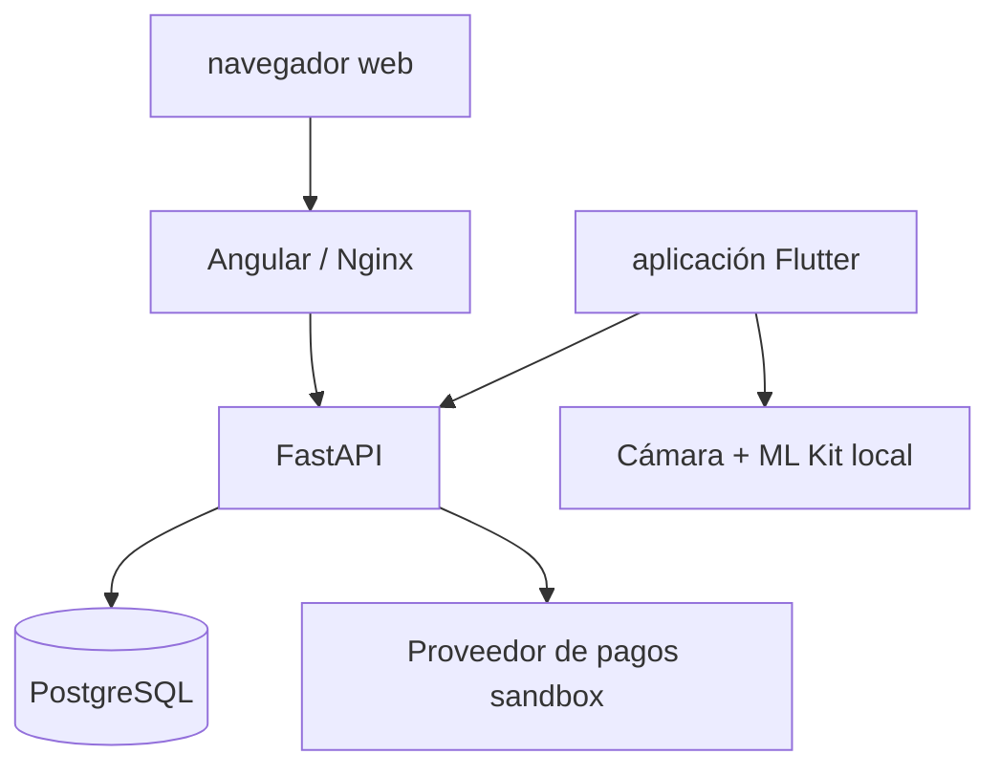

La arquitectura física mantiene los servicios separados y permite ejecutar el sistema mediante Docker Compose. El backend concentra la lógica de negocio, autorización, validaciones y consultas. PostgreSQL mantiene la persistencia transaccional.

## 10.2 Diseño de navegación

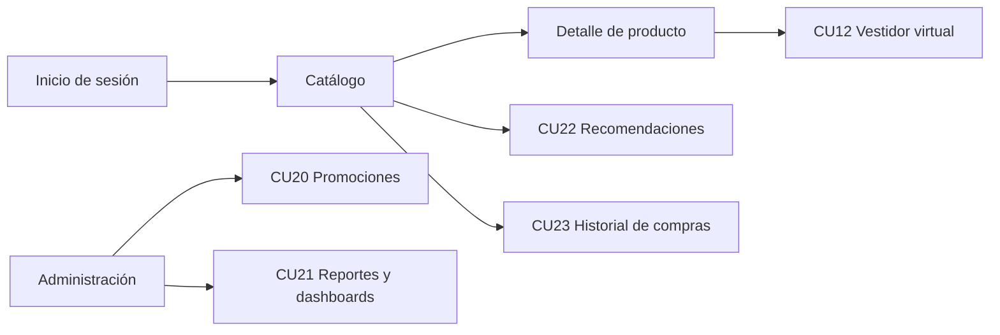

## 10.3 Diseño de caso de uso

### 10.3.1 CU12 — Diseño de vestidor virtual

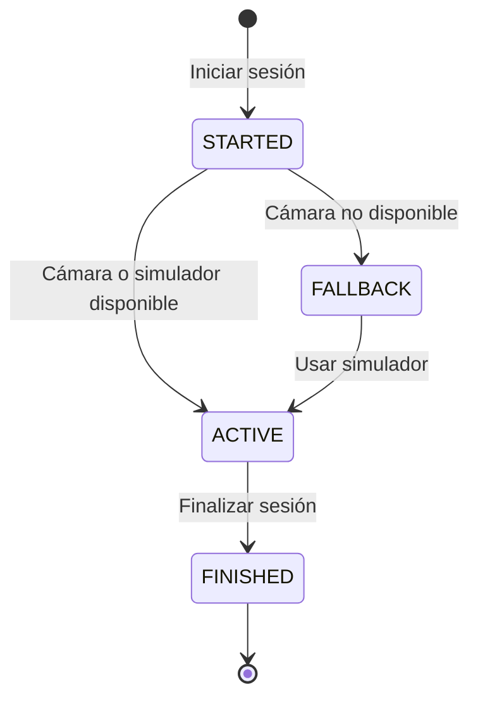

### 10.3.2 CU20 — Diseño de promoción

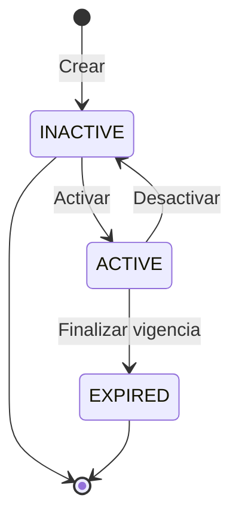

### 10.3.3 CU23 — Diseño de historial

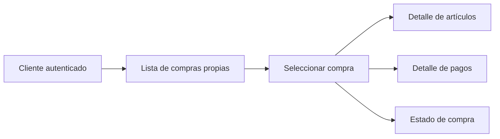

### 10.3.4 CU21 — Diseño de reportes

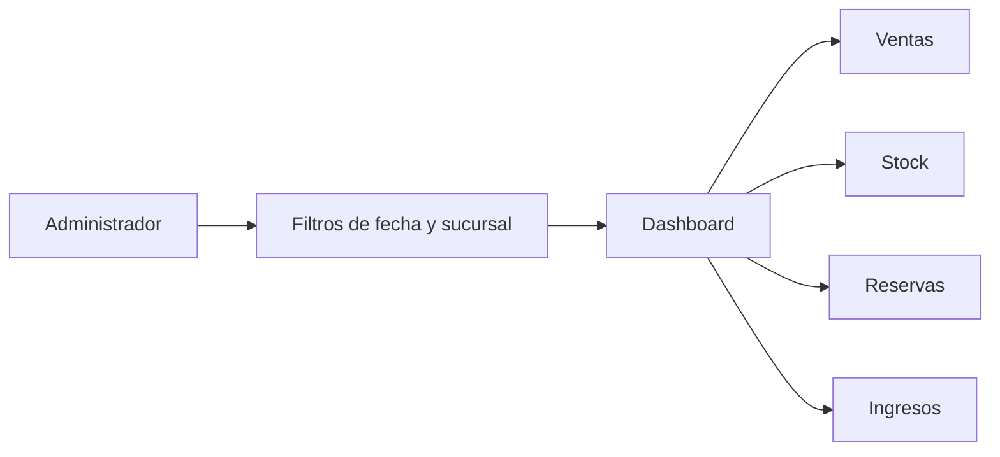

### 10.3.5 CU22 — Diseño de recomendaciones

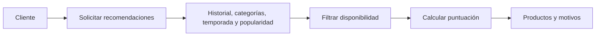

---

## 11. Implementación

## 11.1 Plataforma tecnológica

| Capa | Tecnología | Aplicación en el ciclo |
| --- | --- | --- |
| Backend | FastAPI / Python | Endpoints, autorización, reglas de negocio y consultas. |
| Web | Angular / TypeScript | Dashboard, promociones, recomendaciones, historial y acción de vestidor. |
| Móvil | Flutter / Dart | Vestidor con cámara, recomendaciones e historial. |
| Persistencia | PostgreSQL | Ventas, pagos, promociones, sesiones, inventario y reportes. |
| Pose local | Google ML Kit | Detección local de puntos corporales en móvil. |
| Despliegue | Docker Compose | Ejecución integrada de los servicios. |

## 11.2 Endpoints implementados

```text
# CU12 — Virtual fitting
POST  /api/v1/virtual-fitting/sessions
PATCH /api/v1/virtual-fitting/sessions/{session_id}/finish
GET   /api/v1/virtual-fitting/sessions/mine

# CU20 — Promotions
GET   /api/v1/promotions
POST  /api/v1/promotions
GET   /api/v1/promotions/{promotion_id}
PATCH /api/v1/promotions/{promotion_id}
PATCH /api/v1/promotions/{promotion_id}/activate
PATCH /api/v1/promotions/{promotion_id}/deactivate
POST  /api/v1/promotions/{promotion_id}/products

# CU21 — Reports
GET   /api/v1/reports/dashboard
GET   /api/v1/reports/sales-by-branch
GET   /api/v1/reports/top-products
GET   /api/v1/reports/low-stock
GET   /api/v1/reports/reservations-summary
GET   /api/v1/reports/sales-by-channel
GET   /api/v1/reports/revenue-summary

# CU22 — Recommendations
GET   /api/v1/recommendations/mine

# CU23 — Purchase history
GET   /api/v1/purchases/mine
GET   /api/v1/purchases/mine/{sale_id}
```

## 11.3 Rutas de interfaz

```text
/recommendations
/purchase-history
/cycle-3-admin
```

El vestidor virtual se inicia desde el detalle de un producto y la experiencia móvil se encuentra en la pantalla de vestidor virtual.

---

## 12. Pruebas del Ciclo #3

## 12.1 Objetivos de prueba

- Validar el flujo exitoso de cada CU.
- Validar permisos por rol.
- Validar propiedad de compras y sesiones.
- Verificar descuentos y totales.
- Verificar que los reportes coincidan con datos persistidos.
- Verificar que las recomendaciones no incluyan productos agotados.
- Verificar el fallback del vestidor virtual.
- Verificar compilación web y móvil.

## 12.2 Estrategias

| Tipo de prueba | Aplicación |
| --- | --- |
| Unidad | Servicios de promociones, recomendaciones, historial y validadores. |
| Integración | Comunicación entre Angular/Flutter, FastAPI y PostgreSQL. |
| Validación | Flujos completos desde la perspectiva del cliente o administrador. |
| Autorización | Acceso por rol y propiedad de la información. |
| Build | Compilación web, análisis móvil y APK Android. |

---

## 12.3 Caso de prueba — CU12 Vestidor Virtual

| Paso | Acción | Resultado esperado | Estado |
| --- | --- | --- | --- |
| 1 | Ingresar al detalle de un producto activo. | Se muestra la acción “Probar en vestidor virtual”. | Satisfactorio |
| 2 | Seleccionar la acción de vestidor. | Se crea una sesión para el cliente y el producto. | Satisfactorio |
| 3 | Abrir el vestidor desde móvil. | Se solicita la cámara o se muestra el simulador. | Satisfactorio |
| 4 | Rechazar el permiso de cámara. | El sistema mantiene disponible el fallback académico. | Satisfactorio |
| 5 | Finalizar la sesión. | La sesión cambia a estado finalizado. | Satisfactorio |
| 6 | Consultar las sesiones propias. | Solo se muestran sesiones del cliente autenticado. | Satisfactorio |

**Responsable:** Cliente.

**Resultado:** Satisfactorio como prototipo académico.

---

## 12.4 Caso de prueba — CU20 Promociones

| Paso | Acción | Resultado esperado | Estado |
| --- | --- | --- | --- |
| 1 | Ingresar como administrador al módulo de promociones. | Se muestra el listado administrativo. | Satisfactorio |
| 2 | Crear una promoción con fechas y descuento válidos. | El backend responde HTTP 201. | Satisfactorio |
| 3 | Asociar productos a la promoción. | Los productos quedan vinculados. | Satisfactorio |
| 4 | Activar la promoción. | La promoción queda disponible para el cálculo comercial. | Satisfactorio |
| 5 | Consultar el carrito con un producto promocionado. | El descuento se calcula en el backend. | Satisfactorio |
| 6 | Intentar crear fechas inválidas o un descuento incorrecto. | La operación es rechazada y no se guardan datos inválidos. | Satisfactorio |
| 7 | Intentar gestionar promociones como cliente. | El backend responde acceso no autorizado. | Satisfactorio |

**Responsable:** Administrador.

**Resultado:** Satisfactorio.

---

## 12.5 Caso de prueba — CU21 Reportes y Dashboards

| Paso | Acción | Resultado esperado | Estado |
| --- | --- | --- | --- |
| 1 | Ingresar como administrador a `/cycle-3-admin`. | Se carga el dashboard. | Satisfactorio |
| 2 | Consultar los indicadores generales. | Se muestran ventas, inventario, reservas e ingresos. | Satisfactorio |
| 3 | Aplicar un filtro de fechas. | Los indicadores se recalculan para el período seleccionado. | Satisfactorio |
| 4 | Aplicar un filtro de sucursal. | Se muestran datos de la sucursal seleccionada. | Satisfactorio |
| 5 | Consultar productos más vendidos y bajo stock. | Las listas coinciden con los datos persistidos. | Satisfactorio |
| 6 | Ingresar con un rol no autorizado. | El acceso administrativo es rechazado. | Satisfactorio |
| 7 | Seleccionar un período sin datos. | El sistema muestra un estado vacío sin error de cálculo. | Satisfactorio |

**Responsable:** Administrador.

**Resultado:** Satisfactorio.

---

## 12.6 Caso de prueba — CU22 Recomendaciones mediante IA

| Paso | Acción | Resultado esperado | Estado |
| --- | --- | --- | --- |
| 1 | Ingresar como cliente a `/recommendations`. | Se carga la sección de recomendaciones. | Satisfactorio |
| 2 | Consultar recomendaciones con historial de compras. | Se muestran productos relacionados y motivos explicables. | Satisfactorio |
| 3 | Consultar recomendaciones como cliente nuevo. | Se muestran productos populares disponibles. | Satisfactorio |
| 4 | Verificar productos agotados. | Los productos sin disponibilidad no aparecen. | Satisfactorio |
| 5 | Abrir una recomendación. | El sistema navega al detalle del producto. | Satisfactorio |
| 6 | Consultar recomendaciones como usuario no autenticado. | El endpoint protegido rechaza la solicitud. | Satisfactorio |

**Responsable:** Cliente.

**Resultado:** Satisfactorio como motor académico explicable.

---

## 12.7 Caso de prueba — CU23 Historial de Compras

| Paso | Acción | Resultado esperado | Estado |
| --- | --- | --- | --- |
| 1 | Ingresar como cliente a `/purchase-history`. | Se muestra la lista de compras propias. | Satisfactorio |
| 2 | Seleccionar una compra. | Se muestran artículos, cantidades, importes y estado. | Satisfactorio |
| 3 | Revisar el pago asociado. | Se muestra el método, monto y estado cuando existe. | Satisfactorio |
| 4 | Consultar una compra pendiente o fallida. | La compra aparece con su estado real. | Satisfactorio |
| 5 | Intentar consultar una compra de otro cliente. | El backend rechaza el acceso. | Satisfactorio |
| 6 | Ingresar como cliente sin compras. | Se muestra un estado vacío informativo. | Satisfactorio |

**Responsable:** Cliente.

**Resultado:** Satisfactorio.

---

## 13. Evidencia de verificación

La verificación registrada para el Ciclo #3 comprende:

| Suite | Resultado |
| --- | --- |
| Backend `cd backend && python -m pytest -q` | 24 pruebas aprobadas |
| Web `cd web && npm test -- --watch=false` | 13 pruebas aprobadas |
| Web `cd web && npm run build` | Compilación exitosa |
| Mobile `cd mobile && flutter analyze` | Sin problemas encontrados |
| Mobile `cd mobile && flutter test` | 8 pruebas aprobadas |
| Android `cd mobile && flutter build apk --debug` | Compilación exitosa |

## Definition of Done del Ciclo #3

- [x] CU12 implementado como prototipo académico.
- [x] CU20 implementado con administración y aplicación server-side.
- [x] CU21 implementado con dashboard y reportes filtrables.
- [x] CU22 implementado con recomendaciones explicables.
- [x] CU23 implementado con validación de propiedad.
- [x] Interfaces web y móvil previstas implementadas.
- [x] Pruebas y compilaciones registradas.
- [x] Limitaciones académicas documentadas.
- [x] Endpoints y rutas documentados.

---

## 14. Conclusiones del Ciclo #3
- El Ciclo #3 amplía FashionStore más allá de la operación comercial básica y agrega funciones de personalización, análisis e innovación.
- El vestidor virtual mejora la experiencia del cliente mediante una aproximación visual local y un fallback académico.
- El módulo de promociones permite administrar descuentos desde el servidor y evita depender únicamente de cálculos del frontend.
- Los reportes consolidan información de ventas, inventario y reservas para apoyar decisiones administrativas.
- El recomendador proporciona una experiencia personalizada sin ocultar el motivo de cada sugerencia.
- El historial de compras centraliza la información de cada cliente y mantiene la protección de propiedad de los datos.
- La arquitectura mantiene separadas las responsabilidades entre catálogo, comercio, promociones, reportes, recomendaciones y vestidor virtual.
- Las pruebas registradas demuestran la compilación y validación de las superficies web, backend y móvil.

## Recomendaciones

- Validar el vestidor virtual en dispositivos Android físicos de diferentes capacidades.
- Ampliar progresivamente el motor de recomendaciones con más señales de comportamiento.
- Incorporar gráficos históricos más avanzados en el dashboard.
- Ampliar las plantillas de exportación y agregar nuevos tipos de reporte si el alcance académico lo requiere.
- Integrar una pasarela productiva como Stripe únicamente con credenciales, webhooks y controles de seguridad reales.
- Mantener pruebas de regresión para promociones, recomendaciones e historial cuando se modifiquen ventas o pagos.

## 15. Ampliación analítica y generación inteligente de reportes

Después de la validación inicial del Ciclo #3 se amplió CU21 para cubrir de forma más completa el requisito de dashboards y reportes del enunciado.

### 15.1 Dashboard administrativo

La ruta `/cycle-3-admin` presenta una vista analítica para el administrador con:

- Indicadores de ventas, ingresos, descuentos y productos con bajo stock.
- Gráficos visuales de ventas por sucursal y canal.
- Productos más vendidos.
- Distribución de reservas por estado.
- Filtros por rango de fechas y sucursal.
- Estados de carga, error y ausencia de información.

La información se calcula mediante los servicios de reportes existentes y se representa con componentes SVG/CSS, sin agregar una librería gráfica pesada al frontend.

### 15.2 Exportaciones

El sistema permite descargar el resultado filtrado en tres formatos:

| Formato | Contenido |
| --- | --- |
| Excel | Resumen, productos, sucursales, canales, reservas y stock bajo. |
| PDF | Resumen ejecutivo, tablas y gráfico de ventas por sucursal. |
| PowerPoint | Diapositivas con resumen, ventas por sucursal y productos principales. |

Endpoints:

```text
GET /api/v1/reports/export/xlsx
GET /api/v1/reports/export/pdf
GET /api/v1/reports/export/pptx
```

El backend genera los archivos desde un snapshot determinístico obtenido de PostgreSQL. Por lo tanto, la exportación no depende de valores calculados en el navegador.

### 15.3 Reporte inteligente con OpenAI

Se incorporó un asistente para que el administrador pueda escribir solicitudes en lenguaje natural, por ejemplo:

```text
Genera un reporte de las prendas más vendidas de septiembre.
```

Endpoint:

```text
POST /api/v1/reports/assistant
```

La arquitectura separa interpretación y cálculo:

```text
Solicitud del administrador
        ↓
Interpretación de intención
        ↓
Consulta determinística a PostgreSQL
        ↓
Datos verificables
        ↓
Narrativa y conclusiones
```

La integración utiliza **OpenAI Responses API** con el modelo configurado mediante `OPENAI_MODEL`. La clave se mantiene en el backend mediante `OPENAI_API_KEY` y nunca se expone a Angular.

La IA no tiene autorización para ejecutar SQL ni reemplazar los valores del sistema. Si la API no está disponible, el sistema usa un parser local y genera una narrativa determinística.

### 15.4 Contratos implementados

El asistente acepta intenciones controladas:

- `dashboard`.
- `top_products`.
- `sales_by_branch`.
- `inventory`.
- `reservations`.

Esto evita que una solicitud genere operaciones arbitrarias y conserva la autorización `reports.read`.

### 15.5 Verificación ampliada

La implementación ampliada fue verificada con:

| Verificación | Resultado |
| --- | --- |
| Backend completo | 35 pruebas aprobadas |
| Exportaciones de reportes | Pruebas aprobadas para XLSX, PDF y PPTX |
| Asistente de reportes | Pruebas aprobadas con fallback local y respuesta simulada de OpenAI |
| Ruff y compilación Python | Aprobados |
| Web | 55 pruebas aprobadas |
| Build Angular | Aprobado |
| Docker | PostgreSQL, backend y web saludables |

## 16. Integración UML con MCP y Enterprise Architect

Se configuró `antigravity.jsonc` para registrar un servidor MCP local que comunica la terminal con Enterprise Architect mediante la Automation Interface COM de Windows.

El bridge permite:

- Consultar el estado y abrir/cerrar el modelo.
- Listar paquetes y elementos UML.
- Crear diagramas de clases.
- Crear diagramas de secuencia.
- Exportar diagramas a imágenes.

El modelo previsto para FashionStore es:

```text
C:\ProyectoSi2_TiendaRopa\docs\uml\FashionStore.qea
```

Por seguridad, primero debe crearse y guardarse el modelo desde Enterprise Architect. El bridge no abre archivos desconocidos ni genera un modelo vacío automáticamente.

La guía de instalación y uso se encuentra en `docs/enterprise-architect-mcp.md`.

## 17. Estado consolidado del proyecto

| Área | Estado |
| --- | --- |
| Backend FastAPI | Funcional y verificado |
| Frontend Angular | Funcional, con dashboard y exportaciones |
| Aplicación Flutter | Funcional, con vestidor virtual local |
| PostgreSQL | Integrado mediante Docker |
| IA de recomendaciones | Implementada mediante motor explicable |
| IA de reportes | Implementada con OpenAI y fallback local |
| Exportación de reportes | Excel, PDF y PowerPoint |
| UML | Bridge MCP preparado para Enterprise Architect |
| Pagos productivos Stripe | Pendiente; sandbox académico disponible |
