# Catálogo de Diagramas de Estados UML (State Machine Diagrams) — FashionStore (SI2)

Este documento contiene la especificación formal y los **Diagramas de Estados** para los Casos de Uso (CU) de los **Ciclos 1, 2 y 3** del sistema **FashionStore**.

Los diagramas están modelados siguiendo el estándar exacto de **Sistemas de Información 2 (SI2)**, donde se representa el flujo de vida y control de la transacción del Caso de Uso:
- **Estado Inicial (`Inicio`)**
- **Autenticación del Actor** con ciclo de validación de credenciales `[error]` / `[correcto]`
- **Estado Central de Navegación** (`Seleccionar opción ...`)
- **Bifurcaciones con condiciones de guarda `[...]`** para cada operación del CU
- **Puntos de control transaccional** (`Revisar Datos`, `Verificar Disponibilidad`, `Procesar Pago`, etc.)
- **Estado Final (`Fin`)** alcanzado tras la `Transacción completada`.

---

## 📑 Índice de Diagramas

- [Ciclo 1: Base de Plataforma, Seguridad y Catálogo](#ciclo-1-base-de-plataforma-seguridad-y-catálogo)
  - [CU01: Registrar Cliente](#cu01-registrar-cliente)
  - [CU02: Autenticación (Login, Logout y Refresh Token)](#cu02-autenticación-login-logout-y-refresh-token)
  - [CU03: Gestionar Usuarios y Roles](#cu03-gestionar-usuarios-y-roles)
  - [CU04: Gestionar Sucursales y Ciudades](#cu04-gestionar-sucursales-y-ciudades)
  - [CU05: Gestionar Productos y Variantes](#cu05-gestionar-productos-y-variantes)
  - [CU08 / CU09: Consultar Catálogo y Disponibilidad en Tiendas](#cu08--cu09-consultar-catálogo-y-disponibilidad-en-tiendas)
- [Ciclo 2: Operación Comercial, Logística y Reservas](#ciclo-2-operación-comercial-logística-y-reservas)
  - [CU10: Realizar Reserva de Prendas](#cu10-realizar-reserva-de-prendas)
  - [CU11: Atender Reservas en Sucursal](#cu11-atender-reservas-en-sucursal)
  - [CU13: Administrar Carrito de Compras](#cu13-administrar-carrito-de-compras)
  - [CU14: Realizar Compra Digital (Checkout E-commerce)](#cu14-realizar-compra-digital-checkout-e-commerce)
  - [CU15 / CU16: Venta Presencial y Cobro en Caja (POS)](#cu15--cu16-venta-presencial-y-cobro-en-caja-pos)
  - [CU17: Procesar Pago Electrónico (Sandbox / QR / Stripe)](#cu17-procesar-pago-electrónico-sandbox--qr--stripe)
  - [CU18: Gestionar Inventario y Movimientos (Kárdex)](#cu18-gestionar-inventario-y-movimientos-kárdex)
- [Ciclo 3: Innovación, Analítica e Inteligencia Artificial](#ciclo-3-innovación-analítica-e-inteligencia-artificial)
  - [CU12: Sesión de Probador Virtual (Fitting Room)](#cu12-sesión-de-probador-virtual-fitting-room)
  - [CU20: Gestionar Promociones y Descuentos](#cu20-gestionar-promociones-y-descuentos)
  - [CU21: Dashboards y Reportes Gerenciales con Sofía Copilot IA](#cu21-dashboards-y-reportes-gerenciales-con-sofía-copilot-ia)
  - [CU22: Obtener Recomendaciones con IA](#cu22-obtener-recomendaciones-con-ia)
  - [CU23: Consultar Historial de Compras y Devoluciones](#cu23-consultar-historial-de-compras-y-devoluciones)

---

# Ciclo 1: Base de Plataforma, Seguridad y Catálogo

---

### CU01: Registrar Cliente

Modela el proceso de creación de una nueva cuenta de cliente, asegurando la unicidad del correo electrónico y el cumplimiento de las políticas de seguridad.

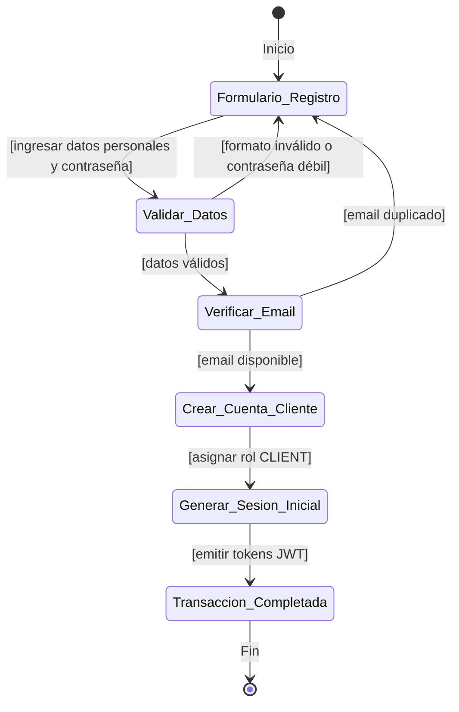

---

### CU02: Autenticación (Login, Logout y Refresh Token)

Modela el ciclo de vida de la sesión del usuario en el sistema para cualquier actor (`CLIENT`, `ADMIN`, `BRANCH_MANAGER`, `CASHIER`, `SUPPLIER`).

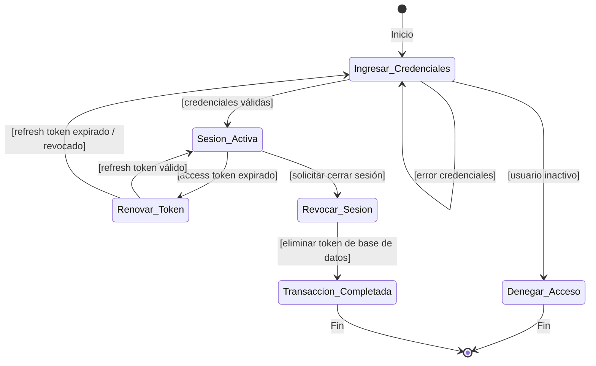

---

### CU03: Gestionar Usuarios y Roles

Corresponde al modelo administrativo de gestión de cuentas de usuario, asignación de roles y sucursales.

```mermaid
stateDiagram-v2
    [*] --> Loguear_Administrador: Inicio
    Loguear_Administrador --> Loguear_Administrador: [error]
    Loguear_Administrador --> Seleccionar_Opcion_Usuario: [correcto]

    Seleccionar_Opcion_Usuario --> Desplegar_Lista: [listar]
    Desplegar_Lista --> [*]: Fin

    Seleccionar_Opcion_Usuario --> Crear_Usuario: [crear]
    Crear_Usuario --> Revisar_Datos: [llenar datos]

    Seleccionar_Opcion_Usuario --> Modificar_Usuario: [modificar]
    Modificar_Usuario --> Revisar_Datos: [llenar datos]

    Seleccionar_Opcion_Usuario --> ID_Usuario_Eliminar: [eliminar]
    ID_Usuario_Eliminar --> Seleccionar_Opcion_Usuario: [incorrecto]
    ID_Usuario_Eliminar --> Eliminar_Usuario: [correcto]

    Revisar_Datos --> Transaccion_Completada: [datos validados]
    Eliminar_Usuario --> Transaccion_Completada: [desactivación completada]
    
    Transaccion_Completada --> [*]: Fin
```

---

### CU04: Gestionar Sucursales y Ciudades

Permite al administrador abrir nuevas tiendas físicas, asignar sucursales a ciudades y activar/desactivar locales.

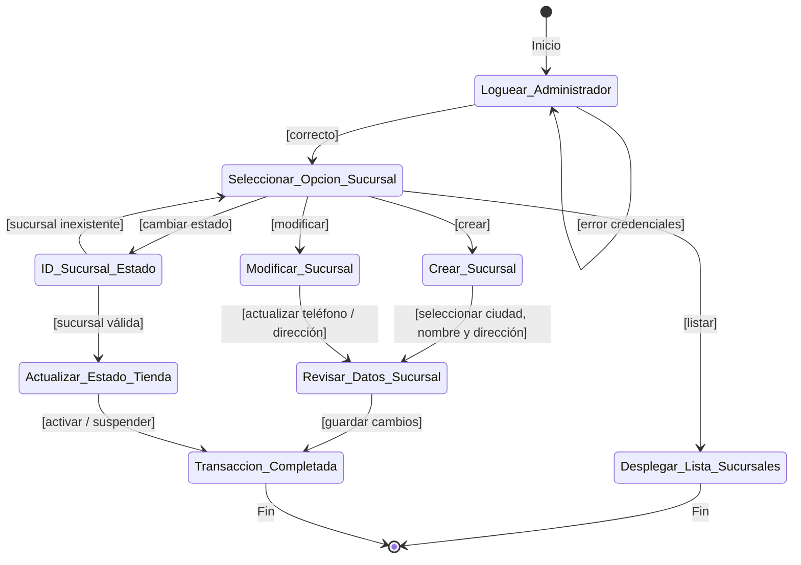

---

### CU05: Gestionar Productos y Variantes

Modela la administración integral de prendas del atelier: ficha base, combinaciones de tallas y colores, galería de imágenes y publicación.

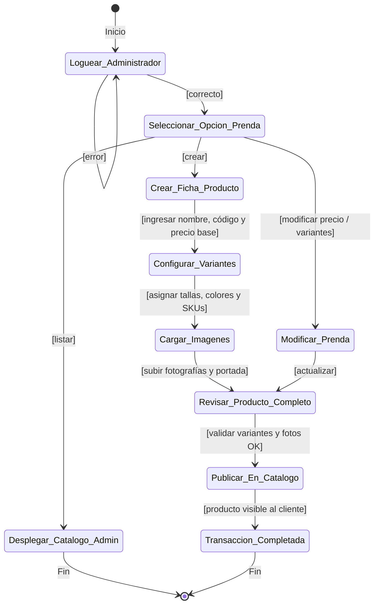

---

### CU08 / CU09: Consultar Catálogo y Disponibilidad en Tiendas

Modela la experiencia del cliente explorando prendas, aplicando filtros multivariables y verificando stock por sucursal física.

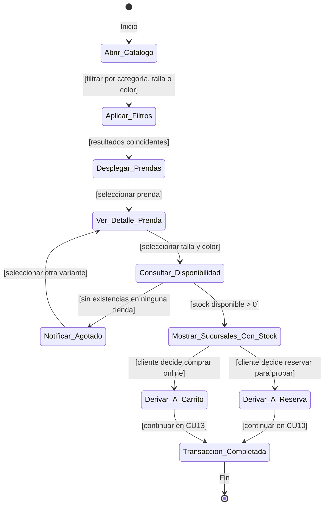

---

# Ciclo 2: Operación Comercial, Logística y Reservas

---

### CU10: Realizar Reserva de Prendas

Permite al cliente separar prendas para probárselas presencialmente en una sucursal en una fecha programada, con bloqueo temporal de inventario.

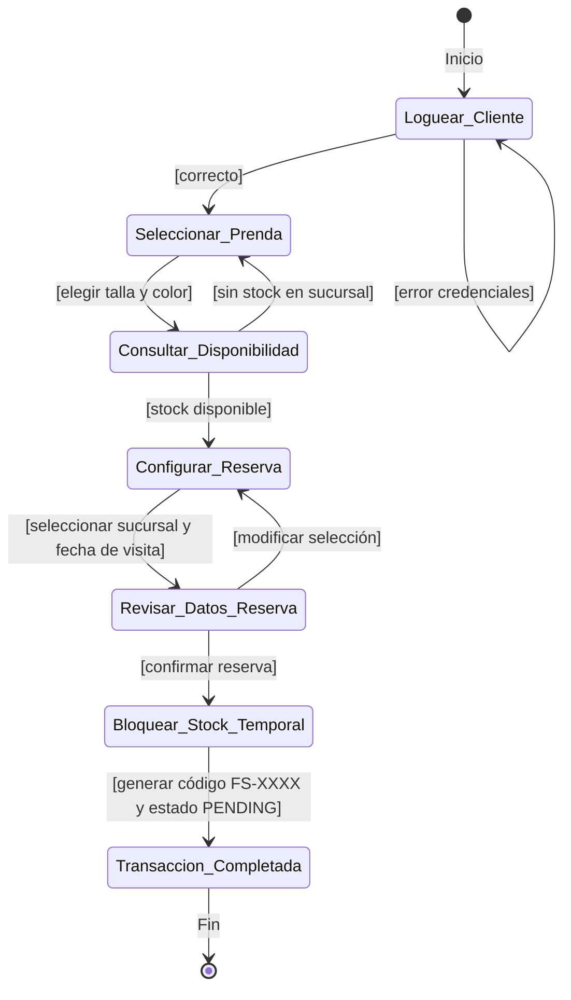

---

### CU11: Atender Reservas en Sucursal

Modela el flujo de trabajo del Encargado de Sucursal para preparar las prendas en percheros y atender al cliente cuando asiste a la tienda.

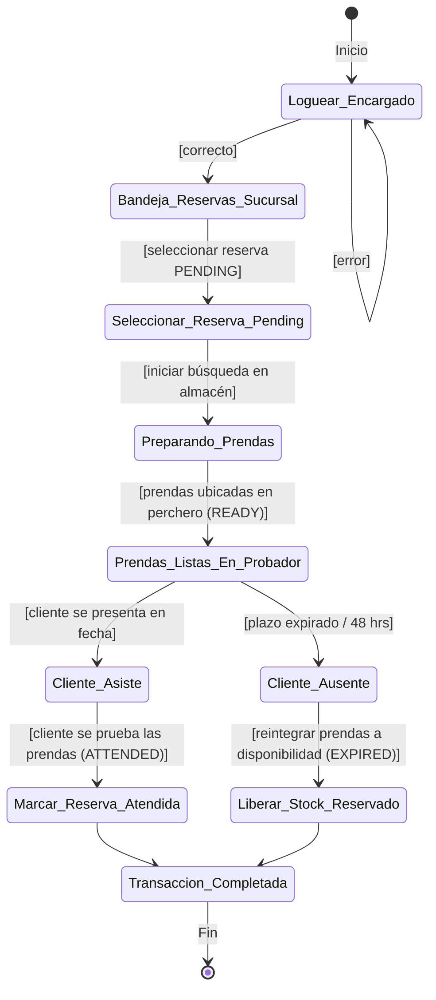

---

### CU13: Administrar Carrito de Compras

Modela el contenedor de compras en línea del cliente, asegurando la consistencia de existencias en cada adición o cambio de cantidad.

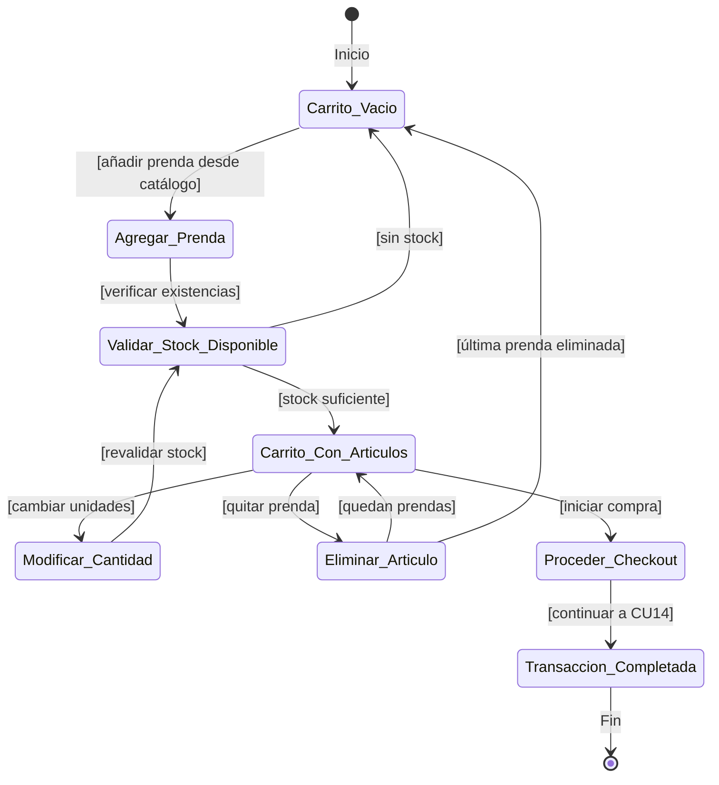

---

### CU14: Realizar Compra Digital (Checkout E-commerce)

Modela el flujo completo de compra por comercio electrónico: selección de tienda para retiro, aplicación de descuentos de temporada y pago electrónico.

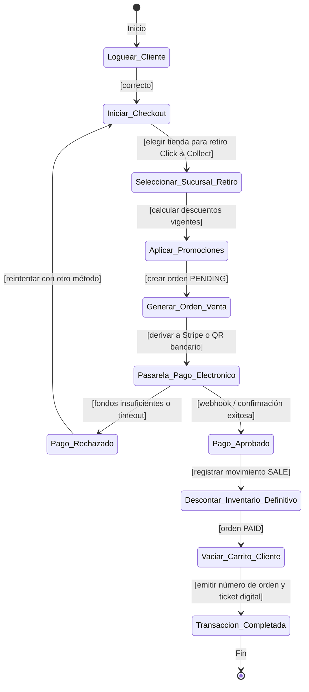

---

### CU15 / CU16: Venta Presencial y Cobro en Caja (POS)

Modela la venta física en el mostrador de una sucursal realizada por el cajero, con cobro en efectivo (cálculo de cambio), tarjeta o QR.

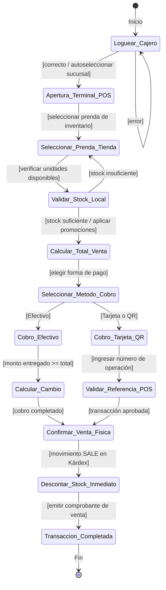

---

### CU17: Procesar Pago Electrónico (Sandbox / QR / Stripe)

Modela la máquina de estados de una transacción de pago electrónico con protección contra cobros duplicados (idempotencia).

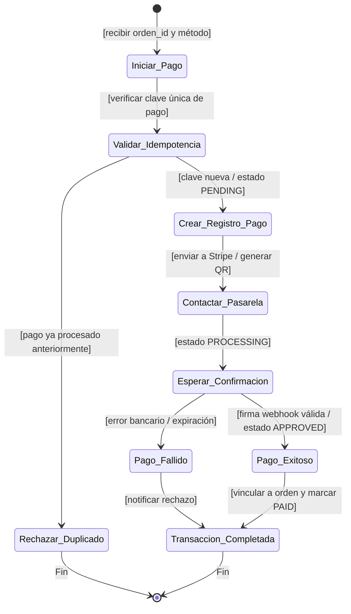

---

### CU18: Gestionar Inventario y Movimientos (Kárdex)

Modela el control de existencias físicas en bodega y tienda, garantizando la trazabilidad de entradas, salidas y devoluciones.

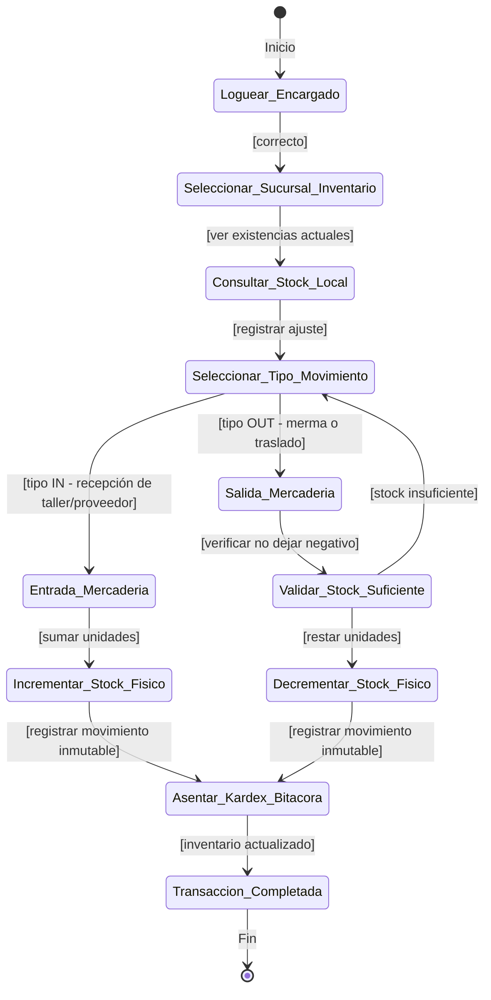

---

# Ciclo 3: Innovación, Analítica e Inteligencia Artificial

---

### CU12: Sesión de Probador Virtual (Fitting Room)

Modela la experiencia de realidad asistida para que el cliente previsualice cómo le queda una prenda en tiempo real con su cámara o en simulador.

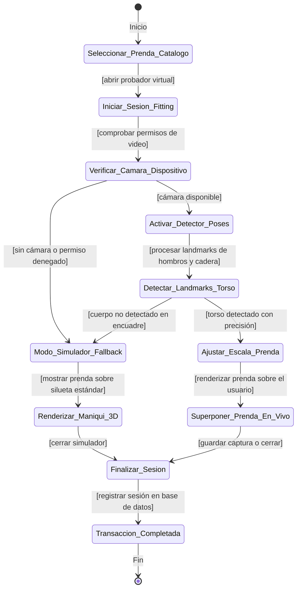

---

### CU20: Gestionar Promociones y Descuentos

Modela la configuración y puesta en marcha de campañas de descuento (porcentaje o monto fijo) asociadas a colecciones y temporadas.

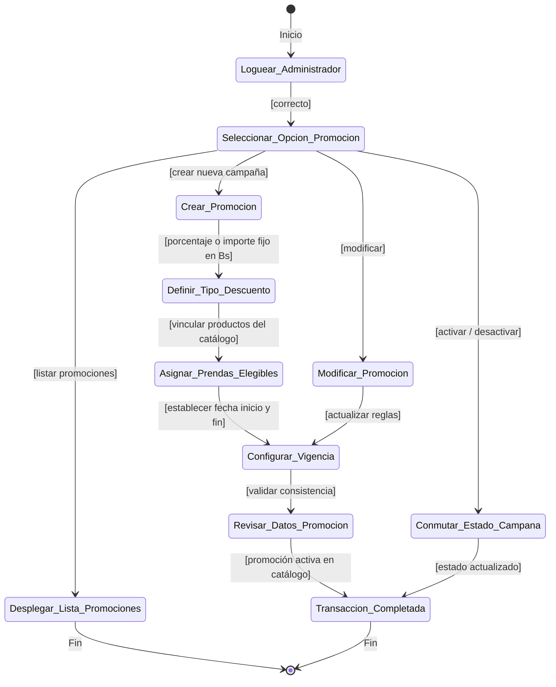

---

### CU21: Dashboards y Reportes Gerenciales con Sofía Copilot IA

Modela el análisis de datos de facturación, canales y stock, combinando consultas en lenguaje natural mediante IA y exportación ejecutiva a Excel/PDF.

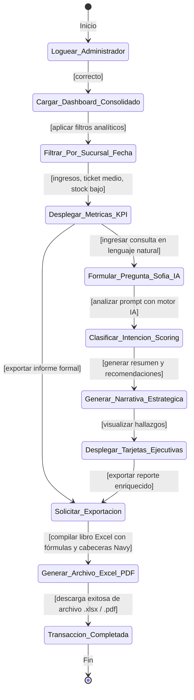

---

### CU22: Obtener Recomendaciones con IA

Modela el motor de recomendación inteligente que analiza el historial de compras del cliente, afinidad por categorías y disponibilidad en tiendas.

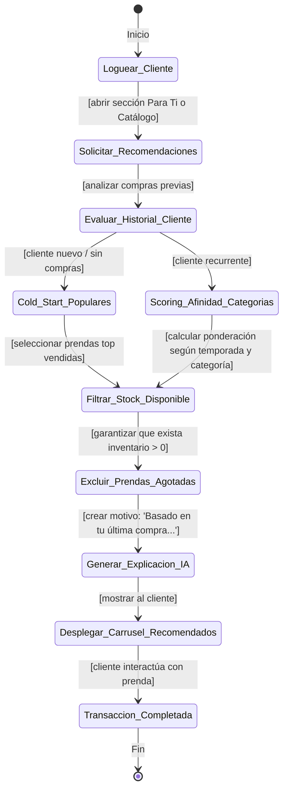

---

### CU23: Consultar Historial de Compras y Devoluciones

Modela la consulta de compras realizadas por el cliente y el proceso de devolución presencial en caja con reingreso automático al inventario.

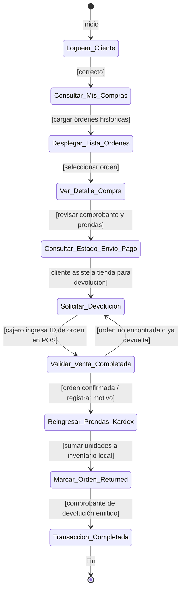
