# Especificación y Catálogo de Diagramas UML — FashionStore (SI2)

Este documento reúne la arquitectura y especificación formal de los **Diagramas UML** para el sistema **FashionStore** (Ciclos 1, 2 y 3), estructurados según el estándar **UML 2.5** y las **4+1 Vistas Arquitectónicas de Kruchten**.

---

## 1. Vista de Casos de Uso (UML Use Case Diagrams)

### 1.1 Diagrama General de Casos de Uso y Actores

FashionStore define 7 actores principales:
- **Invitado (`GUEST`)**: Usuario anónimo o visitante no autenticado que explora el catálogo o realiza su registro inicial.
- **Cliente (`CLIENT`)**: Usuario final registrado que interactúa mediante la Web o la App Móvil Flutter.
- **Administrador (`ADMIN`)**: Control total del sistema, seguridad, configuración, inventario global y analítica.
- **Encargado de Sucursal (`BRANCH_MANAGER`)**: Gestión de inventario local, transferencias y atención de reservas.
- **Cajero (`CASHIER`)**: Operación del punto de venta presencial (POS) y cobro en caja.
- **Proveedor (`SUPPLIER`)**: Abastecimiento de prendas e insumos.
- **Pasarela de Pagos (Sistema Externo)**: Procesamiento electrónico sandbox / Stripe / QR.

#### Diagrama General de Casos de Uso (UML 2.5)

A continuación se presenta el **Diagrama General de Casos de Uso** integrando la totalidad de los 23 Casos de Uso del sistema y los 7 Actores participantes, estructurado con delimitación del sistema (System Boundary) y relaciones formales `«include»` y `«extend»`:


*Exportación nativa de Enterprise Architect:* [ea-diagrama-general-casos-de-uso.png](./diagrams/ea-diagrama-general-casos-de-uso.png)

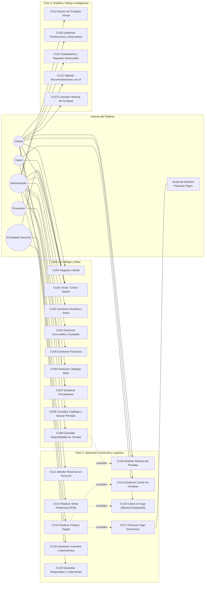

---

### 1.2 Casos de Uso — Ciclo 1 (Base de Plataforma y Catálogo)


---

### 1.3 Casos de Uso — Ciclo 2 (Comercio, Reservas e Inventario)

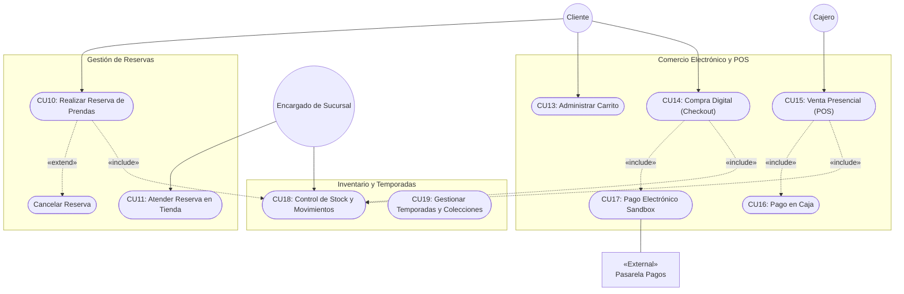

---

### 1.4 Casos de Uso — Ciclo 3 (Innovación, Analítica e IA)


---

## 2. Diagramas de Clases (UML Class Diagrams)

### 2.1 Diseño Conceptual Integral de la Base de Datos — FashionStore Completo (UML 2.5)

Este diagrama representa el diseño conceptual integral de la base de datos de FashionStore abarcando los **Ciclos 1, 2 y 3**, con las 26 entidades del sistema en español, atributos privados tipados, asociaciones con nombres de rol y multiplicidades explícitas bajo el estándar **UML 2.5** con marco (*frame*):


### 2.2 Modelo de Referencia Reducido (Plantilla Base)


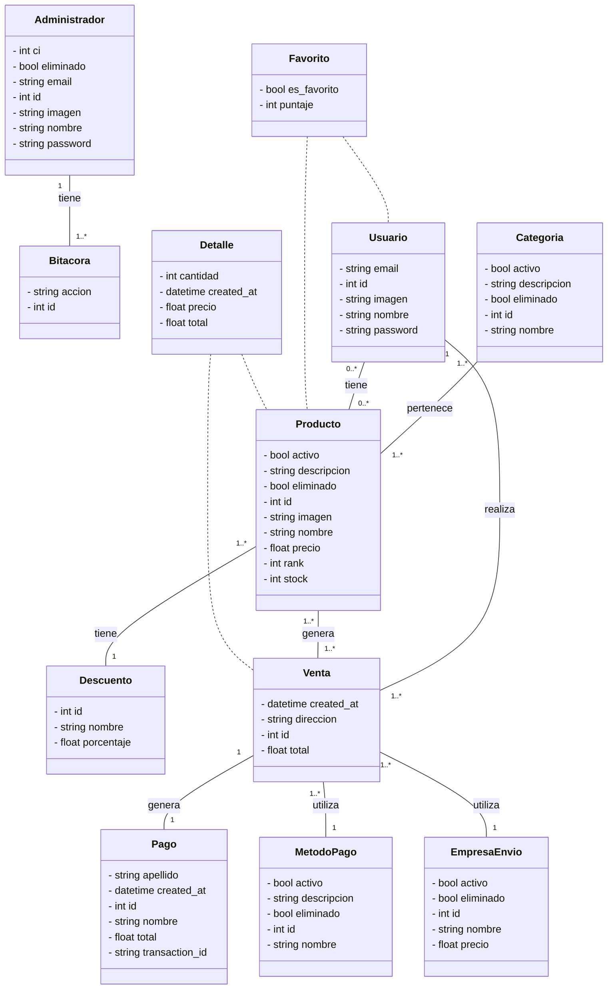

---

### 2.2 Modelo de Dominio Integral de FashionStore

El siguiente diagrama modela las entidades completas del dominio de FashionStore, incorporando sucursales, inventario, reservas y variantes:

```mermaid
classDiagram
    direction TB

    %% Módulo de Seguridad
    class User {
        +int id
        +string email
        +string hashed_password
        +string full_name
        +int role_id
        +int branch_id
        +bool is_active
        +datetime created_at
        +verify_password(plain_password) bool
        +has_permission(permission) bool
    }

    class Role {
        +int id
        +string code
        +string name
        +bool is_active
    }

    class Bitacora {
        +int id
        +int usuario_id
        +string accion
        +string tipo_entidad
        +int entidad_id
        +string descripcion
        +json valores_anteriores
        +json valores_nuevos
        +string direccion_ip
        +datetime fecha_creacion
    }

    %% Módulo Geográfico y Sucursales
    class City {
        +int id
        +string name
        +bool is_active
    }

    class Branch {
        +int id
        +int city_id
        +string name
        +string address
        +string phone
        +decimal latitude
        +decimal longitude
        +bool is_active
    }

    %% Módulo de Catálogo
    class Category {
        +int id
        +string name
        +string description
        +bool is_active
    }

    class Season {
        +int id
        +string name
        +date start_date
        +date end_date
        +bool is_active
    }

    class Collection {
        +int id
        +int season_id
        +string name
        +string description
        +bool is_active
    }

    class Product {
        +int id
        +int category_id
        +int season_id
        +int collection_id
        +string code
        +string name
        +string slug
        +decimal price
        +bool is_active
        +datetime created_at
    }

    class ProductVariant {
        +int id
        +int product_id
        +int size_id
        +int color_id
        +string sku
        +string barcode
        +decimal additional_price
        +bool is_active
    }

    class Size {
        +int id
        +string name
        +string category
        +int sort_order
        +bool is_active
    }

    class Color {
        +int id
        +string name
        +string hex_code
        +bool is_active
    }

    class ProductImage {
        +int id
        +int product_id
        +string image_url
        +bool is_primary
        +int sort_order
    }

    class Supplier {
        +int id
        +string trade_name
        +string legal_name
        +string tax_id
        +string email
        +string phone
        +bool is_active
    }

    %% Módulo de Inventario
    class Inventory {
        +int id
        +int branch_id
        +int product_variant_id
        +int stock_quantity
        +int reserved_quantity
        +get_available_stock() int
    }

    class InventoryMovement {
        +int id
        +int inventory_id
        +string movement_type
        +int quantity
        +int stock_before
        +int stock_after
        +string reason
        +int created_by
        +datetime created_at
    }

    %% Módulo Comercial: Carrito, Reservas, Ventas y Pagos
    class Cart {
        +int id
        +int customer_id
        +string status
        +datetime created_at
        +datetime updated_at
    }

    class CartItem {
        +int id
        +int cart_id
        +int product_variant_id
        +int quantity
        +decimal unit_price
    }

    class Reservation {
        +int id
        +int customer_id
        +int branch_id
        +string reservation_code
        +datetime scheduled_for
        +string status
        +string notes
        +datetime expires_at
        +confirm()
        +cancel()
        +attend()
    }

    class ReservationItem {
        +int id
        +int reservation_id
        +int product_variant_id
        +int quantity
        +decimal unit_price
    }

    class Sale {
        +int id
        +int customer_id
        +int cashier_id
        +int branch_id
        +string channel
        +string status
        +decimal subtotal
        +decimal discount
        +decimal total
        +datetime sale_date
    }

    class SaleItem {
        +int id
        +int sale_id
        +int product_variant_id
        +int quantity
        +decimal unit_price
        +decimal discount
        +decimal line_total
    }

    class Payment {
        +int id
        +int sale_id
        +string method
        +string provider
        +string transaction_reference
        +string status
        +decimal amount
        +decimal received_amount
        +decimal change_amount
        +datetime paid_at
    }

    %% Módulo de Analítica y Promociones
    class Promotion {
        +int id
        +string name
        +string discount_type
        +decimal discount_value
        +datetime starts_at
        +datetime ends_at
        +bool is_active
        +is_valid_at(date) bool
    }

    class AIRecommendation {
        +int id
        +int customer_id
        +int product_id
        +string source
        +string reason
        +decimal score
        +json context
        +datetime created_at
    }

    class VirtualFittingSession {
        +int id
        +int customer_id
        +int product_id
        +string status
        +string device_info
        +datetime started_at
        +datetime ended_at
    }

    %% Relaciones
    User "1" --> "1" Role : tiene
    User "0..1" --> "1" Branch : asignado_a
    City "1" <--> "0..*" Branch : contiene

    Product "0..*" --> "1" Category : clasificado_en
    Season "1" <--> "0..*" Collection : agrupa
    Product "0..*" --> "0..1" Season : pertenece_a
    Product "0..*" --> "0..1" Collection : pertenece_a
    Product "1" <--> "1..*" ProductVariant : posee
    Product "1" <--> "0..*" ProductImage : incluye
    Product "0..*" <--> "0..*" Supplier : suministrado_por

    ProductVariant "0..*" --> "1" Size : especifica
    ProductVariant "0..*" --> "1" Color : especifica

    Branch "1" <--> "0..*" Inventory : almacena
    ProductVariant "1" <--> "0..*" Inventory : controla
    Inventory "1" <--> "0..*" InventoryMovement : registra

    User "1" <--> "0..1" Cart : gestiona
    Cart "1" *-- "0..*" CartItem : contiene
    ProductVariant "1" <-- "0..*" CartItem : referencia

    User "1" <--> "0..*" Reservation : realiza
    Branch "1" <--> "0..*" Reservation : recibe
    Reservation "1" *-- "1..*" ReservationItem : contiene
    ProductVariant "1" <-- "0..*" ReservationItem : reserva

    User "0..1" <--> "0..*" Sale : compra_como_cliente
    User "0..1" <--> "0..*" Sale : opera_como_cajero
    Branch "1" <--> "0..*" Sale : origina
    Sale "1" *-- "1..*" SaleItem : desglosa
    ProductVariant "1" <-- "0..*" SaleItem : incluye
    Sale "1" <--> "1..*" Payment : cancelada_con

    Promotion "0..*" <--> "0..*" Product : aplica_a
    User "0..1" <--> "0..*" AIRecommendation : sugerida_a
    Product "1" <-- "0..*" AIRecommendation : producto_recomendado
    User "0..1" <--> "0..*" VirtualFittingSession : participa
    Product "1" <-- "0..*" VirtualFittingSession : prenda_probada
    User "0..1" <--> "0..*" Bitacora : genera
```

---

## 3. Diagramas de Secuencia (UML Sequence Diagrams)

### 3.1 CU10: Realizar Reserva de Prendas (Prueba en Sucursal)

El cliente reserva prendas en una sucursal física para una visita programada. El sistema bloquea el stock disponible (`reserved_quantity += cantidad`) dentro de una transacción atómica.

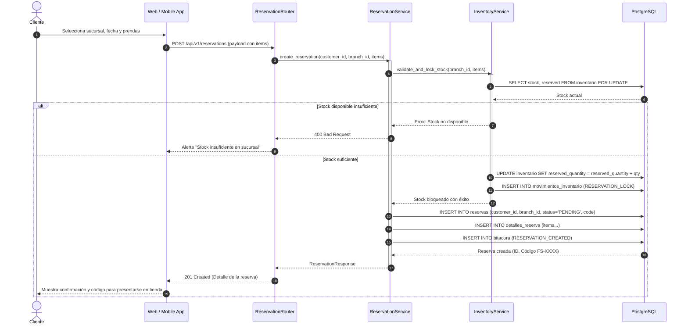

---

### 3.2 CU14 / CU17: Compra Digital con Pago Electrónico Sandbox e Idempotencia

El cliente finaliza su carrito digital, selecciona la sucursal de retiro/envío y completa el pago electrónico. El stock físico se descuenta **únicamente cuando el pago es aprobado**, garantizando idempotencia.

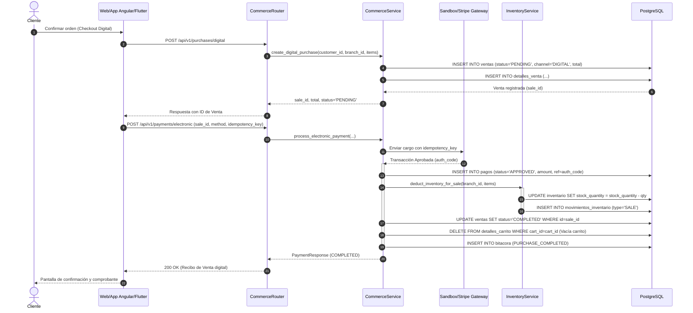

---

### 3.3 CU15 / CU16: Venta Presencial en Caja (Punto de Venta POS)

Un cajero atiende a un cliente en la tienda física, escanea códigos de barra de las prendas y procesa el cobro en efectivo, registrando el monto recibido y calculando el cambio.

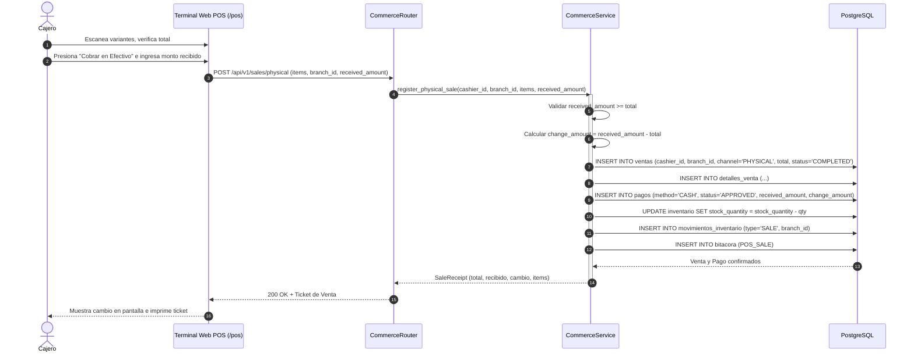

---

### 3.4 Catálogo Completo de Diagramas de Secuencia (UML 2.5 — Ciclos 1, 2 y 3)

Estos diagramas modelan la ejecución temporal y la mensajería entre capas para los **23 Casos de Uso** del sistema en Enterprise Architect, siguiendo estrictamente el estándar UML 2.5:
* **Marco pentagonal**: `sd CUxx [Nombre del Caso de Uso]`.
* **Líneas de vida**: `Actor` $\rightarrow$ `Vistas (V.xxx)` $\rightarrow$ `Controlador (xxxController)` $\rightarrow$ `Modelos (M.xxx)`.
* **Fragmentos combinados (`alt`)**: Agrupan los flujos y operaciones principales de cada caso de uso.
* **Mensajería**: Llamadas síncronas (`operacion()`), retornos tipados (`return()`) con líneas discontinuas y llamadas a interfaz (`view()`).

---

#### 3.4.1 Ciclo 1 — Catálogo y Base

##### CU01: Registrar Cliente
Modela la verificación de unicidad de email, alta de usuario y cliente, auditoría y cancelación.


* **Actor**: `Invitado`
* **Vistas**: `V.RegistroCliente`, `V.TerminosCondiciones`, `V.ConfirmacionRegistro`
* **Controlador**: `RegistroClienteController`
* **Modelos**: `M.Cliente`, `M.Usuario`, `M.Bitacora`
* **Flujos (`alt`)**:
  * `alt verificarEmail`: Consulta si el correo ingresado ya se encuentra registrado.
  * `alt registrarCliente`: Creación de la cuenta de usuario, perfil de cliente y registro en bitácora.
  * `alt cancelarRegistro`: Abandono del proceso y retorno al formulario inicial.

---

##### CU02: Iniciar y Cerrar Sesión
Modela la autenticación mediante credenciales, generación de token JWT, recuperación de contraseña y revocación de sesión.


* **Actor**: `Usuario`
* **Vistas**: `V.Login`, `V.DashboardUsuario`, `V.RecuperarPassword`
* **Controlador**: `LoginController`
* **Modelos**: `M.SesionUsuario`, `M.Usuario`, `M.Bitacora`
* **Flujos (`alt`)**:
  * `alt autenticarCredenciales`: Validación de hash de contraseña, generación de JWT y registro en bitácora.
  * `alt recuperarPassword`: Solicitud de token temporal de restablecimiento por correo.
  * `alt cerrarSesion`: Invalidación de sesión activa y auditoría de salida.

---

##### CU03: Gestionar Usuarios y Roles
Modela el listado de personal, alta de nuevo usuario con rol, modificación de perfil y alternancia de estado.


* **Actor**: `Administrador`
* **Vistas**: `V.ListadoUsuarios`, `V.FormularioUsuario`, `V.AsignarRolSucursal`
* **Controlador**: `UsuarioController`
* **Modelos**: `M.Usuario`, `M.Rol`, `M.Bitacora`
* **Flujos (`alt`)**:
  * `alt listarUsuarios`: Consulta y proyección de la lista general de usuarios y roles.
  * `alt crearUsuario`: Registro de un nuevo operador, asociación de rol y registro en bitácora.
  * `alt modificarUsuario`: Actualización de datos personales y credenciales.
  * `alt cambiarEstado`: Activación o desactivación del usuario en la plataforma.

---

##### CU04: Gestionar Sucursales y Ciudades
Modela la administración de sedes físicas, consulta de ciudades, alta de sucursal, geolocalización y desactivación.


* **Actor**: `Administrador`
* **Vistas**: `V.ListadoSucursales`, `V.FormularioSucursal`, `V.MapaUbicacion`
* **Controlador**: `SucursalController`
* **Modelos**: `M.Sucursal`, `M.Ciudad`, `M.Bitacora`
* **Flujos (`alt`)**:
  * `alt listarSucursales`: Consulta de tiendas agrupadas por ciudad.
  * `alt registrarSucursal`: Alta de nueva sede física y registro en bitácora.
  * `alt actualizarCoordenadas`: Actualización de latitud y longitud en el mapa geográfico.
  * `alt desactivarSucursal`: Cambio de estado operativo de la sucursal.

---

##### CU05: Gestionar Productos y Prendas
Modela la administración del catálogo de prendas, creación de variantes de talla/color y control de visibilidad.


* **Actor**: `Administrador`
* **Vistas**: `V.CatalogoAdmin`, `V.CrearPrenda`, `V.GestionVariantes`
* **Controlador**: `PrendaController`
* **Modelos**: `M.Producto`, `M.VarianteProducto`, `M.Bitacora`
* **Flujos (`alt`)**:
  * `alt listarPrendas`: Consulta paginada del catálogo de productos con filtros.
  * `alt crearPrenda`: Registro de la prenda maestra y generación masiva de variantes SKU.
  * `alt actualizarVariante`: Ajuste de código SKU o stock asignado a la variante.
  * `alt cambiarEstado`: Publicación o retiro de la prenda del catálogo.

---

##### CU06: Gestionar Catálogo Base (Categorías, Tallas, Colores)
Modela la administración de las taxonomías maestras del sistema textil.


* **Actor**: `Administrador`
* **Vistas**: `V.GestionCategorias`, `V.GestionTallas`, `V.GestionColores`
* **Controlador**: `CatalogoBaseController`
* **Modelos**: `M.Categoria`, `M.Talla`, `M.Color`
* **Flujos (`alt`)**:
  * `alt listarCategorias`: Consulta de la jerarquía de categorías textiles.
  * `alt crearCategoria`: Alta de nueva categoría de prendas.
  * `alt gestionarTallas`: Registro y actualización por lote de la tabla de tallas.
  * `alt gestionarColores`: Registro y actualización por lote de colores de temporada.

---

##### CU07: Gestionar Proveedores
Modela el registro de fabricantes y distribuidores textiles, consulta de órdenes de compra y actualización de datos.


* **Actor**: `Administrador`
* **Vistas**: `V.ListadoProveedores`, `V.FormularioProveedor`, `V.HistorialSuministro`
* **Controlador**: `ProveedorController`
* **Modelos**: `M.Proveedor`, `M.OrdenCompra`, `M.Bitacora`
* **Flujos (`alt`)**:
  * `alt listarProveedores`: Consulta de proveedores registrados y su estado contractual.
  * `alt registrarProveedor`: Alta del proveedor y registro en bitácora.
  * `alt consultarSuministros`: Historial de órdenes de compra y suministros recibidos.
  * `alt actualizarProveedor`: Modificación de datos de contacto o condiciones comerciales.

---

##### CU08: Consultar Catálogo y Buscar Prendas
Modela la exploración pública del catálogo por parte del cliente, filtros de búsqueda y ficha técnica.


* **Actor**: `Cliente`
* **Vistas**: `V.CatalogoPublico`, `V.FiltrosPrendas`, `V.DetallePrenda`
* **Controlador**: `CatalogoExploracionController`
* **Modelos**: `M.Producto`, `M.VarianteProducto`, `M.Categoria`
* **Flujos (`alt`)**:
  * `alt cargarCatalogo`: Consulta de categorías activas y prendas destacadas.
  * `alt filtrarYBuscar`: Búsqueda por palabra clave, rango de precio o categoría.
  * `alt verFichaTecnica`: Carga de detalles de la prenda, fotografías y variantes disponibles.

---

##### CU09: Consultar Disponibilidad en Tiendas
Modela la verificación de stock disponible en tiempo real por sucursal física y ciudad para una prenda y talla seleccionada.


* **Actor**: `Cliente`
* **Vistas**: `V.SelectorPrendaTalla`, `V.MapaStockSucursales`, `V.DetalleTienda`
* **Controlador**: `DisponibilidadStockController`
* **Modelos**: `M.Inventario`, `M.Sucursal`, `M.VarianteProducto`
* **Flujos (`alt`)**:
  * `alt seleccionarVariante`: Identificación del SKU correspondiente a la combinación talla/color.
  * `alt consultarStock`: Consulta de unidades físicas disponibles en todas las sucursales.
  * `alt verDetalleTienda`: Consulta de dirección, horario y ubicación de la tienda seleccionada.

---

#### 3.4.2 Ciclo 2 — Operación Comercial y Logística

##### CU10: Realizar Reserva de Prendas
Modela la reserva de prendas para prueba física en sucursal con bloqueo preventivo de inventario.


* **Actor**: `Cliente`
* **Vistas**: `V.FichaReserva`, `V.SeleccionSucursal`, `V.ConfirmacionTicket`
* **Controlador**: `ReservaPrendaController`
* **Modelos**: `M.Reserva`, `M.Inventario`, `M.Bitacora`
* **Flujos (`alt`)**:
  * `alt seleccionarSucursal`: Verificación de existencias de las prendas en la tienda seleccionada.
  * `alt confirmarReserva`: Bloqueo atómico de stock, creación de la reserva y ticket con código alfanumérico.
  * `alt cancelarReserva`: Cancelación anticipada por el cliente y liberación inmediata del stock.

---

##### CU11: Atender Reservas en Sucursal
Modela la recepción del cliente en tienda física, búsqueda por código alfanumérico, entrega o liberación por expiración.


* **Actor**: `Encargado de Sucursal`
* **Vistas**: `V.ListadoReservas`, `V.ValidacionCodigo`, `V.EntregaReserva`
* **Controlador**: `AtencionReservaController`
* **Modelos**: `M.Reserva`, `M.Inventario`, `M.Bitacora`
* **Flujos (`alt`)**:
  * `alt listarPendientes`: Listado de reservas programadas pendientes para la sucursal activa.
  * `alt buscarPorCodigo`: Búsqueda y validación del código presentado por el cliente.
  * `alt entregarPrenda`: Confirmación de entrega, cambio a estado ENTREGADA y auditoría.
  * `alt liberarExpirada`: Expiración de reservas no recogidas y restitución del stock bloqueado.

---

##### CU13: Administrar Carrito de Compras
Modela la gestión reactiva de prendas en el carrito virtual, cálculo de subtotales en tiempo real y persistencia.


* **Actor**: `Cliente`
* **Vistas**: `V.CarritoDrawer`, `V.ResumenPedido`, `V.AlertaStock`
* **Controlador**: `CarritoComprasController`
* **Modelos**: `M.Carrito`, `M.ItemCarrito`, `M.VarianteProducto`
* **Flujos (`alt`)**:
  * `alt agregarItem`: Comprobación de existencias y agregado de la variante al carrito.
  * `alt modificarCantidad`: Modificación de unidades y recálculo dinámico de totales.
  * `alt eliminarItem`: Eliminación de una línea de producto del carrito.
  * `alt vaciarCarrito`: Limpieza integral de todos los ítems del carrito.

---

##### CU14: Realizar Compra Digital
Modela el checkout electrónico, dirección de envío, orden de venta y creación de registro de pago pendiente.


* **Actor**: `Cliente`
* **Vistas**: `V.CheckoutEnvio`, `V.MetodoPagoDigital`, `V.ComprobanteCompra`
* **Controlador**: `CompraDigitalController`
* **Modelos**: `M.Venta`, `M.DetalleVenta`, `M.Pago`
* **Flujos (`alt`)**:
  * `alt iniciarCheckout`: Validación de inventario de los ítems del carrito y resumen de compra.
  * `alt seleccionarEnvio`: Registro de dirección de entrega y cálculo de costo de flete.
  * `alt confirmarVenta`: Generación de venta en estado PENDING, desglose de detalles y preparación de pago.

---

##### CU15: Realizar Venta Presencial (POS)
Modela la operación de caja física en sucursal, lectura por código de barras, selección de cliente y deducción inmediata de inventario.


* **Actor**: `Cajero`
* **Vistas**: `V.PuntoVentaPOS`, `V.BuscarClienteModal`, `V.TicketVenta`
* **Controlador**: `VentaPOSController`
* **Modelos**: `M.Venta`, `M.DetalleVenta`, `M.Inventario`
* **Flujos (`alt`)**:
  * `alt escanearCodigo`: Lectura del código de barras de la variante y agregación al ticket.
  * `alt asociarCliente`: Búsqueda o registro rápido del cliente por NIT/CI.
  * `alt completarVenta`: Registro de venta física, detalles e impacto en stock físico de la tienda.
  * `alt cancelarVenta`: Anulación del borrador de venta en caja.

---

##### CU16: Cobro en Caja (Efectivo/Tarjeta/QR)
Modela el procesamiento del cobro en mostrador, cálculo de cambio y emisión de comprobante fiscal.


* **Actor**: `Cajero`
* **Vistas**: `V.SelectorFormaPago`, `V.CalculoCambio`, `V.FacturaFiscal`
* **Controlador**: `CobroCajaController`
* **Modelos**: `M.Pago`, `M.Venta`, `M.Factura`
* **Flujos (`alt`)**:
  * `alt seleccionarMetodo`: Selección del medio de pago (Efectivo, Tarjeta, QR) y total adeudado.
  * `alt cobroEfectivo`: Registro de importe recibido y cálculo del cambio a devolver.
  * `alt cobroTarjetaOQR`: Registro de autorización de tarjeta o lectura de comprobante QR.
  * `alt emitirFactura`: Generación de la factura fiscal y liquidación final de la venta.

---

##### CU17: Procesar Pago Electrónico Sandbox
Modela la comunicación asíncrona con la pasarela Stripe Sandbox, intents, webhooks e idempotencia.


* **Actor**: `Pasarela de Pagos`
* **Vistas**: `V.StripeSandboxUI`, `V.WebhookReceiver`, `V.ConfirmacionPago`
* **Controlador**: `PasarelaPagoController`
* **Modelos**: `M.Pago`, `M.TransaccionGateway`, `M.Venta`
* **Flujos (`alt`)**:
  * `alt iniciarTransaccion`: Creación del PaymentIntent y retorno del client_secret al frontend.
  * `alt procesarWebhook`: Recepción del evento payment_intent.succeeded y actualización de la venta a PAID.
  * `alt pagoFallido`: Registro del error de pago y notificación para reintento.

---

##### CU18: Control de Stock y Movimientos
Modela la gestión de inventario físico, entradas por compras, transferencias entre sucursales y ajustes por recuento.


* **Actor**: `Encargado de Sucursal`
* **Vistas**: `V.KardexInventario`, `V.RegistrarMovimiento`, `V.AjusteStockModal`
* **Controlador**: `InventarioStockController`
* **Modelos**: `M.MovimientoInventario`, `M.Inventario`, `M.Bitacora`
* **Flujos (`alt`)**:
  * `alt consultarKardex`: Consulta cronológica de movimientos de entrada, salida y ajustes.
  * `alt ingresoMercaderia`: Entrada física de prendas al almacén de la tienda.
  * `alt trasladoEntreSucursales`: Despacho o recepción de prendas transferidas entre tiendas.
  * `alt ajusteFisico`: Corrección de inventario por diferencias en conteo físico o mermas.

---

##### CU19: Gestionar Temporadas y Colecciones
Modela la planificación de colecciones de moda, vigencias por año/estación y asociación de prendas.


* **Actor**: `Administrador`
* **Vistas**: `V.ListadoTemporadas`, `V.CrearColeccion`, `V.VincularPrendas`
* **Controlador**: `TemporadaController`
* **Modelos**: `M.Temporada`, `M.Coleccion`, `M.Producto`
* **Flujos (`alt`)**:
  * `alt listarTemporadas`: Consulta de temporadas históricas y activas.
  * `alt crearColeccion`: Alta de una nueva colección temática vinculada a una temporada.
  * `alt asociarPrendas`: Asignación masiva de prendas del catálogo a la colección.
  * `alt activarTemporada`: Activación de la temporada vigente para el sistema y catálogo.

---

#### 3.4.3 Ciclo 3 — Innovación, Analítica e IA

##### CU12: Sesión de Probador Virtual (Fitting Room)
Modela el inicio de sesión, selección de prenda, procesamiento del ajuste virtual VTON con landmarks y finalización de sesión.


* **Actor**: `Cliente`
* **Vistas**: `V.index`, `V.CapturaPose`, `V.ResultadoVTON`
* **Controlador**: `VestidorVirtualController`
* **Modelos**: `M.SesionVestidorVirtual`, `M.Prenda`, `M.Bitacora`
* **Flujos (`alt`)**:
  * `alt iniciarSesionProbador`: Inicia sesión en probador virtual y carga la pantalla de captura de pose.
  * `alt seleccionarPrenda`: Consulta modelo 3D/metadata de la prenda elegida en catálogo.
  * `alt procesarAjusteVTON`: Ejecuta el motor VTON, actualiza sesión y registra auditoría en bitácora.
  * `alt finalizarSesion`: Cierra la sesión activa y retorna a la vista principal.

---

##### CU20: Gestionar Promociones y Descuentos
Modela la administración CRUD completa, cálculo de descuentos y auditoría de promociones comerciales.


* **Actor**: `Administrador`
* **Vistas**: `V.index`, `V.CrearPromocion`, `V.DetallePromocion`
* **Controlador**: `PromocionController`
* **Modelos**: `M.Promocion`, `M.ProductoPromocion`, `M.Bitacora`
* **Flujos (`alt`)**:
  * `alt listarPromociones`: Consulta de catálogo de promociones activas e históricas.
  * `alt registrarPromocion`: Creación de promoción, vinculación de productos y auditoría en bitácora.
  * `alt modificarPromocion`: Actualización de vigencias, porcentaje/monto de descuento y auditoría.
  * `alt cambiarEstado`: Activación o desactivación inmediata del descuento en catálogo y POS.

---

##### CU21: Gestionar Reportes y Dashboards Gerenciales
Modela la consulta de KPIs, filtros dinámicos por sucursal, asistente IA analítico y exportación a formatos ofimáticos.


* **Actor**: `Administrador`
* **Vistas**: `V.Dashboard`, `V.FiltrosReporte`, `V.AsistenteIA`
* **Controlador**: `ReporteController`
* **Modelos**: `M.Reporte`, `M.Venta`, `M.Bitacora`
* **Flujos (`alt`)**:
  * `alt consultarDashboard`: Consolidación analítica de ventas, ingresos y reservas.
  * `alt filtrarPorSucursal`: Desglose segmentado por sucursal geográfica.
  * `alt asistenteIA`: Consulta con lenguaje natural procesada por el asistente analítico de IA.
  * `alt exportarReporte`: Generación de snapshot descargable en formato Excel / PDF y registro de evento.

---

##### CU22: Obtener Recomendaciones Personalizadas con IA
Modela el motor de afinidad de catálogo, filtros estacionales, visualización de productos afines y captura de feedback.


* **Actor**: `Cliente`
* **Vistas**: `V.CatalogoRecomendado`, `V.DetalleRecomendacion`, `V.FeedbackModal`
* **Controlador**: `RecomendacionController`
* **Modelos**: `M.RecomendacionIA`, `M.Prenda`, `M.HistorialCliente`
* **Flujos (`alt`)**:
  * `alt solicitarRecomendaciones`: Generación de ranking personalizado según historial y stock.
  * `alt filtrarPorTemporada`: Ajuste de prendas según temporada activa y clima.
  * `alt verDetalleRecomendado`: Consulta de características y variante sugerida.
  * `alt registrarFeedback`: Calificación de la sugerencia para reentrenar el modelo de scoring.

---

##### CU23: Consultar Historial y Detalle de Compras
Modela el listado de compras del cliente, desglose de ítems, descarga de comprobante y solicitud de devolución.


* **Actor**: `Cliente`
* **Vistas**: `V.HistorialCompras`, `V.DetalleCompra`, `V.ComprobanteDigital`
* **Controlador**: `HistorialComprasController`
* **Modelos**: `M.Venta`, `M.DetalleVenta`, `M.Pago`
* **Flujos (`alt`)**:
  * `alt listarCompras`: Listado paginado de órdenes y ventas del cliente autenticado.
  * `alt verDetalleCompra`: Desglose detallado de prendas, precios y descuentos por línea.
  * `alt descargarComprobante`: Generación y descarga del recibo o factura digital de pago.
  * `alt solicitarDevolucion`: Registro de solicitud de devolución y cambio de estado de la orden.

---

## 4. Diagramas de Comunicación / Colaboración (Análisis de Robustez BCE — Ciclos 1, 2 y 3)

Los Diagramas de Comunicación (UML 2.5) modelan la realización dinámica de los Casos de Uso mediante el patrón de análisis de robustez **BCE** (*Boundary-Control-Entity*). Cada diagrama presenta:
- **Actor**: Rol que desencadena el caso de uso.
- **Boundary (`|O`)**: Interfaz de usuario especializada (Angular 20 / Flutter).
- **Control (`@->`)**: Controlador de backend modular FastAPI con lógica de aplicación.
- **Entity (`O_`)**: Entidad SQLAlchemy ORM del modelo de dominio.
- **Mensajes numerados jerárquicamente**: Secuencias ordenadas `1: ...`, `1.1: ...`, `1.2: ...` con firmas y parámetros realistas.

---

### 4.1 Ciclo 1 — Catálogo y Base

#### CU01: Registrar Cliente

* **Actor**: `Invitado` | **Boundary**: `UI_RegistroCliente` | **Control**: `RegistroClienteController` | **Entity**: `Cliente`
* **Mensajes**:
  * `1: ingresarDatosRegistro(...)` $\rightarrow$ `1.1: validarCamposFormulario(...)` $\rightarrow$ `2.1: verificarDisponibilidadEmail(...)` $\rightarrow$ `2.2: findByEmail(...)`
  * `3: confirmarRegistro()` $\rightarrow$ `3.1: procesarAltaCliente(...)` $\rightarrow$ `3.2: createCliente(...)` / `3.3: hashPassword(...)` / `3.4: save(cliente)`

#### CU02: Iniciar y Cerrar Sesión

* **Actor**: `Cliente` | **Boundary**: `UI_Autenticacion` | **Control**: `AuthController` | **Entity**: `Usuario`
* **Mensajes**:
  * `1: ingresarCredenciales(...)` $\rightarrow$ `1.1: autenticarUsuario(...)` $\rightarrow$ `1.2: findByEmail(...)` / `1.3: verifyPassword(...)`
  * `2: seleccionarRecordarSesion(...)` $\rightarrow$ `2.1: generarTokenJWT(...)` $\rightarrow$ `2.2: updateUltimoAcceso(...)`
  * `3: solicitarCierreSesion(...)` $\rightarrow$ `3.1: invalidarTokenSesion(...)` $\rightarrow$ `3.2: saveBlacklistToken(...)`

#### CU03: Gestionar Usuarios y Roles

* **Actor**: `Administrador` | **Boundary**: `UI_GestionUsuarios` | **Control**: `UsuarioRolController` | **Entity**: `Usuario`
* **Mensajes**:
  * `1: listarUsuarios(...)` $\rightarrow$ `1.1: consultarUsuarios(...)` $\rightarrow$ `1.2: findWithRoles(...)`
  * `2: crearNuevoUsuario(...)` $\rightarrow$ `2.1: validarDatosUsuario(...)` $\rightarrow$ `2.2: checkEmailUnique(...)` / `2.3: save(...)`
  * `3: actualizarRolPermisos(...)` $\rightarrow$ `3.1: reasignarRol(...)` $\rightarrow$ `3.2: findById(...)` / `3.3: setRolId(...)`
  * `4: cambiarEstadoUsuario(...)` $\rightarrow$ `4.1: toggleActivo(...)` $\rightarrow$ `4.2: setEstado(...)`

#### CU04: Gestionar Sucursales y Ciudades

* **Actor**: `Administrador` | **Boundary**: `UI_GestionSucursal` | **Control**: `SucursalController` | **Entity**: `Sucursal`
* **Mensajes**:
  * `1: consultarSucursales(...)` $\rightarrow$ `1.1: listarSucursalesPorCiudad(...)` $\rightarrow$ `1.2: findByCiudad(...)`
  * `2: registrarSucursal(...)` $\rightarrow$ `2.1: validarDatosSucursal(...)` $\rightarrow$ `2.2: save(sucursal)`
  * `3: editarInformacionSucursal(...)` $\rightarrow$ `3.1: actualizarDatosSucursal(...)` $\rightarrow$ `3.2: findById(...)` / `3.3: update(...)`
  * `4: asignarEncargadoSucursal(...)` $\rightarrow$ `4.1: vincularEncargado(...)` $\rightarrow$ `4.2: setEncargadoId(...)`

#### CU05: Gestionar Productos y Prendas

* **Actor**: `Administrador` | **Boundary**: `UI_GestionPrendas` | **Control**: `PrendaController` | **Entity**: `Prenda`
* **Mensajes**:
  * `1: consultarCatalogoPrendas(...)` $\rightarrow$ `1.1: listarPrendas(...)` $\rightarrow$ `1.2: searchPrendas(...)`
  * `2: registrarPrenda(...)` $\rightarrow$ `2.1: procesarAltaPrenda(...)` $\rightarrow$ `2.2: validateSKU(...)` / `2.3: save(prenda)`
  * `3: modificarPrenda(...)` $\rightarrow$ `3.1: procesarEdicionPrenda(...)` $\rightarrow$ `3.2: findById(...)` / `3.3: update(...)`
  * `4: deshabilitarPrenda(...)` $\rightarrow$ `4.1: cambiarVisibilidadCatalogo(...)` $\rightarrow$ `4.2: setActivo(false)`

#### CU06: Gestionar Catálogo Base (Tallas/Color/Categorías)

* **Actor**: `Administrador` | **Boundary**: `UI_CatalogoBase` | **Control**: `CatalogoBaseController` | **Entity**: `Categoria`
* **Mensajes**:
  * `1: listarCategoriasYTallas()` $\rightarrow$ `1.1: obtenerEstructuraCatalogo()` $\rightarrow$ `1.2: findAllCategoriasWithTallas()`
  * `2: agregarCategoria(...)` $\rightarrow$ `2.1: crearCategoria(...)` $\rightarrow$ `2.2: save(categoria)`
  * `3: agregarTallaColor(...)` $\rightarrow$ `3.1: registrarVarianteBase(...)` $\rightarrow$ `3.2: saveVarianteBase(...)`
  * `4: actualizarCategoria(...)` $\rightarrow$ `4.1: editarCategoria(...)` $\rightarrow$ `4.2: findById(...)` / `4.3: update(...)`

#### CU07: Gestionar Proveedores

* **Actor**: `Administrador` | **Boundary**: `UI_GestionProveedores` | **Control**: `ProveedorController` | **Entity**: `Proveedor`
* **Mensajes**:
  * `1: listarProveedores(...)` $\rightarrow$ `1.1: consultarProveedores(...)` $\rightarrow$ `1.2: findAll(...)`
  * `2: registrarProveedor(...)` $\rightarrow$ `2.1: validarDatosProveedor(...)` $\rightarrow$ `2.2: checkNITUnique(...)` / `2.3: save(...)`
  * `3: modificarDatosProveedor(...)` $\rightarrow$ `3.1: actualizarProveedor(...)` $\rightarrow$ `3.2: findById(...)` / `3.3: update(...)`
  * `4: consultarHistorialSuministros(...)` $\rightarrow$ `4.1: obtenerSuministros(...)` $\rightarrow$ `4.2: getOrdenesCompra(...)`

#### CU08: Consultar Catálogo y Buscar Prendas

* **Actor**: `Cliente` | **Boundary**: `UI_CatalogoExploracion` | **Control**: `CatalogoController` | **Entity**: `Prenda`
* **Mensajes**:
  * `1: abrirCatalogo()` $\rightarrow$ `1.1: cargarPrendasDestacadas()` $\rightarrow$ `1.2: findDestacadosActivos()`
  * `2: aplicarFiltros(...)` $\rightarrow$ `2.1: filtrarCatalogo(...)` $\rightarrow$ `2.2: queryByCriteria(...)`
  * `3: buscarPorPalabraClave(...)` $\rightarrow$ `3.1: ejecutarBusquedaTexto(...)` $\rightarrow$ `3.2: searchByKeywords(...)`
  * `4: seleccionarPrenda(...)` $\rightarrow$ `4.1: obtenerFichaTecnica(...)` $\rightarrow$ `4.2: findByIdWithVariantes(...)`

#### CU09: Consultar Disponibilidad en Tiendas

* **Actor**: `Cliente` | **Boundary**: `UI_DisponibilidadStock` | **Control**: `DisponibilidadStockController` | **Entity**: `Stock`
* **Mensajes**:
  * `1: seleccionarPrendaTalla(...)` $\rightarrow$ `1.1: verificarVariantePrenda(...)` $\rightarrow$ `1.2: findVarianteId(...)`
  * `2: seleccionarCiudad(...)` $\rightarrow$ `2.1: filtrarSucursalesCiudad(...)`
  * `3: consultarStockSucursales(...)` $\rightarrow$ `3.1: consultarDisponibilidad(...)` $\rightarrow$ `3.2: getStockBySucursales(...)`
  * `4: verUbicacionTienda(...)` $\rightarrow$ `4.1: obtenerDetalleTienda(...)` $\rightarrow$ `4.2: findSucursalById(...)`

---

### 4.2 Ciclo 2 — Operación Comercial y Logística

#### CU10: Realizar Reserva de Prendas

* **Actor**: `Cliente` | **Boundary**: `UI_ReservaPrenda` | **Control**: `ReservaPrendaController` | **Entity**: `Reserva`
* **Mensajes**:
  * `1: seleccionarPrendaParaReserva(...)` $\rightarrow$ `1.1: validarStockDisponible(...)` $\rightarrow$ `1.2: checkStock(...)`
  * `2: confirmarDatosReserva(...)` $\rightarrow$ `2.1: bloquearStockTemporal(...)` $\rightarrow$ `2.2: decrementarStockDisponible(...)`
  * `3: enviarSolicitudReserva()` $\rightarrow$ `3.1: procesarCreacionReserva(...)` $\rightarrow$ `3.2: createReserva(...)` / `3.3: save(reserva)`

#### CU11: Atender Reservas en Sucursal

* **Actor**: `Encargado de Sucursal` | **Boundary**: `UI_AtencionReserva` | **Control**: `AtencionReservaController` | **Entity**: `Reserva`
* **Mensajes**:
  * `1: listarReservasPendientes(...)` $\rightarrow$ `1.1: consultarReservasSucursal(...)` $\rightarrow$ `1.2: findBySucursalAndEstado(...)`
  * `2: buscarReservaPorCodigo(...)` $\rightarrow$ `2.1: validarCodigoReserva(...)` $\rightarrow$ `2.2: findByCodigo(...)`
  * `3: registrarEntregaPrenda(...)` $\rightarrow$ `3.1: confirmarEntregaReserva(...)` $\rightarrow$ `3.2: setEstado('ENTREGADA')`
  * `4: cancelarReservaPorExpiracion(...)` $\rightarrow$ `4.1: liberarStockReserva(...)` $\rightarrow$ `4.2: setEstado('CANCELADA')` / `4.3: restaurarStockDisponible(...)`

#### CU13: Administrar Carrito de Compras

* **Actor**: `Cliente` | **Boundary**: `UI_CarritoCompras` | **Control**: `CarritoComprasController` | **Entity**: `Carrito`
* **Mensajes**:
  * `1: agregarPrendaCarrito(...)` $\rightarrow$ `1.1: validarItemStock(...)` $\rightarrow$ `1.2: findByClienteId(...)` / `1.3: addItem(...)`
  * `2: actualizarCantidadItem(...)` $\rightarrow$ `2.1: modificarCantidadItem(...)` $\rightarrow$ `2.2: updateItemCantidad(...)`
  * `3: eliminarItemCarrito(...)` $\rightarrow$ `3.1: removerItemCarrito(...)` $\rightarrow$ `3.2: deleteItem(...)`
  * `4: vaciarCarritoCompras()` $\rightarrow$ `4.1: limpiarCarrito(...)` $\rightarrow$ `4.2: clearItems(...)`

#### CU14: Realizar Compra Digital

* **Actor**: `Cliente` | **Boundary**: `UI_CheckoutDigital` | **Control**: `CompraDigitalController` | **Entity**: `Venta`
* **Mensajes**:
  * `1: iniciarCheckout(...)` $\rightarrow$ `1.1: verificarItemsValidos(...)` $\rightarrow$ `1.2: getCarritoWithPrendas(...)`
  * `2: seleccionarDireccionEnvio(...)` $\rightarrow$ `2.1: calcularCostoEnvio(...)`
  * `3: seleccionarMetodoPago(...)` $\rightarrow$ `3.1: prepararTransaccionPago(...)`
  * `4: confirmarOrdenCompra()` $\rightarrow$ `4.1: procesarCreacionVenta(...)` $\rightarrow$ `4.2: createVenta(...)` / `4.3: createDetallesVenta(...)` / `4.4: save(venta)`

#### CU15: Realizar Venta Presencial (POS)

* **Actor**: `Cajero` | **Boundary**: `UI_PuntoVentaPOS` | **Control**: `VentaPOSController` | **Entity**: `Venta`
* **Mensajes**:
  * `1: escanearCodigoBarra(...)` $\rightarrow$ `1.1: buscarPrendaPorCodigo(...)` $\rightarrow$ `1.2: findByBarcode(...)`
  * `2: identificarCliente(...)` $\rightarrow$ `2.1: buscarOcrearCliente(...)` $\rightarrow$ `2.2: findClienteByNIT(...)`
  * `3: aplicarDescuentoManual(...)` $\rightarrow$ `3.1: recalcularTotalVenta(...)`
  * `4: cerrarVentaPresencial()` $\rightarrow$ `4.1: registrarVentaFisica(...)` $\rightarrow$ `4.2: createVenta(...)` / `4.3: saveDetalles(...)` / `4.4: descontarStockFisico(...)`

#### CU16: Cobro en Caja (Efectivo/Tarjeta/QR)

* **Actor**: `Cajero` | **Boundary**: `UI_CobroCaja` | **Control**: `CobroCajaController` | **Entity**: `Pago`
* **Mensajes**:
  * `1: seleccionarFormaPago(...)` $\rightarrow$ `1.1: validarMontoCubierto(...)`
  * `2: ingresarEfectivoRecibido(...)` $\rightarrow$ `2.1: calcularCambioEfectivo(...)`
  * `3: procesarCobroTarjetaOQR(...)` $\rightarrow$ `3.1: registrarCobro(...)` $\rightarrow$ `3.2: createPago(...)` / `3.3: setEstadoPago('PAGADO')` / `3.4: save(pago)`
  * `4: emitirFacturaComprobante(...)` $\rightarrow$ `4.1: generarFacturaFiscal(...)` $\rightarrow$ `4.2: updateVentaEstado(...)`

#### CU17: Procesar Pago Electrónico Sandbox

* **Actor**: `Pasarela de Pagos` | **Boundary**: `UI_PasarelaPago` | **Control**: `PasarelaPagoController` | **Entity**: `Pago`
* **Mensajes**:
  * `1: enviarTokenPago(...)` $\rightarrow$ `1.1: conectarServicioStripe(...)` $\rightarrow$ `1.2: createTransaccion(...)`
  * `2: solicitarAutorizacionSandbox(...)` $\rightarrow$ `2.1: verificarRespuestaGateway(...)`
  * `3: notificarWebhookResultado(...)` $\rightarrow$ `3.1: procesarConfirmacionPago(...)` $\rightarrow$ `3.2: findByTransaccionId(...)` / `3.3: setEstado('CONFIRMADO')` / `3.4: update(pago)`

#### CU18: Control de Stock y Movimientos

* **Actor**: `Encargado de Sucursal` | **Boundary**: `UI_InventarioStock` | **Control**: `InventarioStockController` | **Entity**: `MovimientoInventario`
* **Mensajes**:
  * `1: consultarStockSucursal(...)` $\rightarrow$ `1.1: listarExistencias(...)` $\rightarrow$ `1.2: getStockPorSucursal(...)`
  * `2: registrarIngresoMercaderia(...)` $\rightarrow$ `2.1: procesarEntradaStock(...)` $\rightarrow$ `2.2: createMovimiento('INGRESO')` / `2.3: incrementarStock(...)`
  * `3: registrarTrasladoEntreSucursales(...)` $\rightarrow$ `3.1: procesarTransferenciaStock(...)` $\rightarrow$ `3.2: createMovimiento('TRASLADO')`
  * `4: registrarAjusteInventario(...)` $\rightarrow$ `4.1: procesarAjusteFisico(...)` $\rightarrow$ `4.2: createMovimiento('AJUSTE')` / `4.3: save(movimientoInventario)`

#### CU19: Gestionar Temporadas y Colecciones

* **Actor**: `Administrador` | **Boundary**: `UI_GestionTemporadas` | **Control**: `TemporadaController` | **Entity**: `Temporada`
* **Mensajes**:
  * `1: consultarTemporadas(...)` $\rightarrow$ `1.1: listarTemporadas(...)` $\rightarrow$ `1.2: findByAnio(...)`
  * `2: crearTemporada(...)` $\rightarrow$ `2.1: validarRangoFechas(...)` $\rightarrow$ `2.2: save(temporada)`
  * `3: asociarPrendasColeccion(...)` $\rightarrow$ `3.1: vincularPrendas(...)` $\rightarrow$ `3.2: addPrendasToTemporada(...)`
  * `4: activarTemporadaPrincipal(...)` $\rightarrow$ `4.1: establecerTemporadaActiva(...)` $\rightarrow$ `4.2: desactivarOtrasTemporadas()` / `4.3: setEstado('ACTIVA')`

---

### 4.3 Ciclo 3 — Innovación, Analítica e IA

#### CU12: Sesión de Probador Virtual (Fitting Room)

* **Actor**: `Cliente` | **Boundary**: `UI_VestidorVirtual` | **Control**: `VestidorVirtualController` | **Entity**: `SesionVestidorVirtual`
* **Mensajes**:
  * `1: iniciarSesionProbador(...)` $\rightarrow$ `1.1: iniciarSesion(...)` $\rightarrow$ `1.2: createSession(...)` / `1.3: save(sesion)`
  * `2: seleccionarPrenda(...)` $\rightarrow$ `2.1: cargarModeloPrenda(...)` $\rightarrow$ `2.2: findByPrendaId(...)`
  * `3: procesarAjusteVirtual(...)` $\rightarrow$ `3.1: calcularAjuste(...)` $\rightarrow$ `3.2: updatePuntosClave(...)`
  * `4: finalizarSesionProbador(...)` $\rightarrow$ `4.1: cerrarSesion(...)` $\rightarrow$ `4.2: findById(...)` / `4.3: setEstado('FINALIZADA')`

#### CU20: Gestionar Promociones y Descuentos

* **Actor**: `Administrador` | **Boundary**: `UI_Promocion` | **Control**: `PromocionController` | **Entity**: `Promocion`
* **Mensajes**:
  * `1: consultarPromociones(...)` $\rightarrow$ `1.1: listarPromociones(...)` $\rightarrow$ `1.2: buscarConFiltros(...)`
  * `2: registrarPromocion(...)` $\rightarrow$ `2.1: crearPromocion(...)` $\rightarrow$ `2.2: validarVigencia(...)` / `2.3: save(promocion)`
  * `3: modificarPromocion(...)` $\rightarrow$ `3.1: actualizarPromocion(...)` $\rightarrow$ `3.2: findById(...)` / `3.3: update(promocion)`
  * `4: cambiarEstadoPromocion(...)` $\rightarrow$ `4.1: modificarEstado(...)` $\rightarrow$ `4.2: findById(...)` / `4.3: setEstado(estado)`

#### CU21: Gestionar Reportes y Dashboards Gerenciales

* **Actor**: `Administrador` | **Boundary**: `UI_Reporte` | **Control**: `ReporteController` | **Entity**: `Reporte`
* **Mensajes**:
  * `1: consultarDashboard(...)` $\rightarrow$ `1.1: resumenDashboard(...)` $\rightarrow$ `1.2: calcularMetricasVentas(...)` / `1.3: queryVentasPorSucursal(...)`
  * `2: filtrarPorCategoria(...)` $\rightarrow$ `2.1: filtrarMetricas(...)` $\rightarrow$ `2.2: queryProductosMasVendidos(...)`
  * `3: exportarReporteExcel(...)` $\rightarrow$ `3.1: generarExcel(...)` $\rightarrow$ `3.2: buildExcelWorkbook(...)`
  * `4: exportarReportePDF(...)` $\rightarrow$ `4.1: generarPdf(...)` $\rightarrow$ `4.2: renderPdfDocument(...)`

#### CU22: Obtener Recomendaciones Personalizadas con IA

* **Actor**: `Cliente` | **Boundary**: `UI_Recomendacion` | **Control**: `RecomendacionController` | **Entity**: `RecomendacionIA`
* **Mensajes**:
  * `1: solicitarRecomendaciones(...)` $\rightarrow$ `1.1: obtenerRecomendaciones(...)` $\rightarrow$ `1.2: calcularAfinidades(...)` / `1.3: rankCatalogByStock()`
  * `2: filtrarPorTemporada(...)` $\rightarrow$ `2.1: filtrarCatalogoRecomendado(...)` $\rightarrow$ `2.2: filterByTemporada(...)`
  * `3: verDetalleRecomendado(...)` $\rightarrow$ `3.1: consultarDetalleProducto(...)` $\rightarrow$ `3.2: findById(...)`
  * `4: registrarInteraccion(...)` $\rightarrow$ `4.1: registrarFeedback(...)` $\rightarrow$ `4.2: save(...)` / `4.3: updateScoreModel(...)`

#### CU23: Consultar Historial y Detalle de Compras

* **Actor**: `Cliente` | **Boundary**: `UI_HistorialCompras` | **Control**: `HistorialComprasController` | **Entity**: `Venta`
* **Mensajes**:
  * `1: consultarCompras(...)` $\rightarrow$ `1.1: listarComprasCliente(...)` $\rightarrow$ `1.2: findByClienteId(...)` / `1.3: buscarConFiltros(...)`
  * `2: verDetalleCompra(...)` $\rightarrow$ `2.1: obtenerDetalleVenta(...)` $\rightarrow$ `2.2: findById(...)` / `2.3: getDetallesVenta(...)`
  * `3: descargarComprobante(...)` $\rightarrow$ `3.1: generarComprobante(...)` $\rightarrow$ `3.2: getPaymentDetails(...)`
  * `4: filtrarPorEstado(...)` $\rightarrow$ `4.1: filtrarVentas(...)` $\rightarrow$ `4.2: filterByEstado(...)`

---

## 5. Diagramas de Análisis de Clases (Realización de Casos de Uso — Ciclos 1, 2 y 3)

Estos diagramas modelan la **realización estructural orientada a clases (Boundary-Control-Entity)** bajo el estándar UML 2.5 para los **23 Casos de Uso** del sistema FashionStore en Enterprise Architect:
* **Frame**: `class Analizar una clase CUxx` delimitando el contexto del caso de uso.
* **Actor**: Rol que interactúa con el formulario (`Invitado`, `Usuario`, `Cliente`, `Cajero`, `Encargado de Sucursal`, `Administrador`, `Pasarela de Pagos`).
* **«Formulario»**: Clase Boundary de interfaz de usuario con sus atributos reactivos del formulario y métodos de interacción (`Form...`).
* **«Class»**: Clase Control / Controlador de backend FastAPI con sus atributos y métodos de negocio (`...Controller`).
* **«Entidad» Principal**: Clase Entity de persistencia central conectada directamente con el controlador (`E_...`).
* **«Entidad» Secundarias**: Clases de dominio secundarias que utiliza, referencia o audita el caso de uso, con multiplicidades explícitas (`1`, `1..*`, `*`, `0..1`).

---

### 5.1 Ciclo 1 — Catálogo y Base

#### CU01: Registrar Cliente
Modela el formulario de registro de nuevos clientes en la plataforma, creación de credenciales y auditoría de alta.


* **Actor**: `Invitado`
* **«Formulario»**: `FormRegistroCliente`
* **«Class»**: `RegistroClienteController`
* **«Entidad» Principal**: `E_Cliente`
* **«Entidad» Secundarias**:
  * `E_Usuario` (Cuenta y credenciales de acceso): Multiplicidad `1` a `1`.
  * `E_Rol` (Rol asignado al nuevo usuario): Multiplicidad `*` a `1`.
  * `E_Bitacora` (Auditoría de alta de usuario): Multiplicidad `1` a `0..*`.

---

#### CU02: Iniciar y Cerrar Sesión
Modela la autenticación mediante JWT, validación de credenciales, control de sesión activa y registro de accesos.


* **Actor**: `Usuario`
* **«Formulario»**: `FormLogin`
* **«Class»**: `LoginController`
* **«Entidad» Principal**: `E_SesionUsuario`
* **«Entidad» Secundarias**:
  * `E_Usuario` (Usuario autenticado): Multiplicidad `1` a `1`.
  * `E_Rol` (Permisos y roles asignados): Multiplicidad `*` a `1`.
  * `E_Bitacora` (Auditoría de inicio/cierre de sesión): Multiplicidad `1` a `0..*`.

---

#### CU03: Gestionar Usuarios y Roles
Modela la administración de cuentas del personal, asignación de roles RBAC y vinculación con sucursales físicas.


* **Actor**: `Administrador`
* **«Formulario»**: `FormGestionUsuarios`
* **«Class»**: `UsuarioController`
* **«Entidad» Principal**: `E_Usuario`
* **«Entidad» Secundarias**:
  * `E_Rol` (Catálogo de roles del sistema): Multiplicidad `*` a `1`.
  * `E_Sucursal` (Sucursal asignada al empleado): Multiplicidad `*` a `0..1`.
  * `E_Bitacora` (Auditoría administrativa de personal): Multiplicidad `1` a `0..*`.

---

#### CU04: Gestionar Sucursales y Ciudades
Modela el alta, edición y geolocalización de las tiendas físicas por ciudad y asignación de encargados.


* **Actor**: `Administrador`
* **«Formulario»**: `FormGestionSucursales`
* **«Class»**: `SucursalController`
* **«Entidad» Principal**: `E_Sucursal`
* **«Entidad» Secundarias**:
  * `E_Ciudad` (Jurisdicción geográfica): Multiplicidad `*` a `1`.
  * `E_Usuario` (Personal y encargado asignado): Multiplicidad `1` a `0..*`.
  * `E_Bitacora` (Auditoría de sucursales): Multiplicidad `1` a `0..*`.

---

#### CU05: Gestionar Productos y Prendas
Modela la administración del catálogo de prendas, categorización, generación de variantes de talla/color e imágenes.


* **Actor**: `Administrador`
* **«Formulario»**: `FormGestionPrendas`
* **«Class»**: `PrendaController`
* **«Entidad» Principal**: `E_Producto`
* **«Entidad» Secundarias**:
  * `E_Categoria` (Categoría de la prenda): Multiplicidad `*` a `1`.
  * `E_VarianteProducto` (SKUs por talla y color): Multiplicidad `1` a `1..*`.
  * `E_ImagenProducto` (Galería fotográfica de prendas): Multiplicidad `1` a `0..*`.

---

#### CU06: Gestionar Catálogo Base (Categorías, Tallas, Colores)
Modela la administración de los catálogos maestros y taxonomía base para prendas y variantes.


* **Actor**: `Administrador`
* **«Formulario»**: `FormCatalogoBase`
* **«Class»**: `CatalogoBaseController`
* **«Entidad» Principal**: `E_Categoria`
* **«Entidad» Secundarias**:
  * `E_Talla` (Tabla maestra de tallas): Multiplicidad `1` a `*`.
  * `E_Color` (Tabla maestra de colores): Multiplicidad `1` a `*`.
  * `E_Producto` (Prendas asociadas a la categoría): Multiplicidad `1` a `0..*`.

---

#### CU07: Gestionar Proveedores
Modela el registro, control de contratos y suministros de proveedores de telas y confección textil.


* **Actor**: `Administrador`
* **«Formulario»**: `FormGestionProveedores`
* **«Class»**: `ProveedorController`
* **«Entidad» Principal**: `E_Proveedor`
* **«Entidad» Secundarias**:
  * `E_Producto` (Prendas suministradas): Multiplicidad `*` a `0..*`.
  * `E_OrdenCompra` (Órdenes de suministro y abastecimiento): Multiplicidad `1` a `0..*`.
  * `E_Bitacora` (Auditoría de operaciones con proveedores): Multiplicidad `1` a `0..*`.

---

#### CU08: Consultar Catálogo y Buscar Prendas
Modela la navegación del catálogo público para clientes, filtros multicriterio y fichas técnicas de prendas.


* **Actor**: `Cliente`
* **«Formulario»**: `FormCatalogoExploracion`
* **«Class»**: `CatalogoExploracionController`
* **«Entidad» Principal**: `E_Producto`
* **«Entidad» Secundarias**:
  * `E_Categoria` (Categoría de exploración): Multiplicidad `*` a `1`.
  * `E_VarianteProducto` (Variantes disponibles): Multiplicidad `1` a `1..*`.
  * `E_Inventario` (Existencias en stock de variantes): Multiplicidad `1` a `0..*`.

---

#### CU09: Consultar Disponibilidad en Tiendas
Modela la verificación de stock disponible en tiempo real por sucursal física y ciudad para una prenda y talla seleccionada.


* **Actor**: `Cliente`
* **«Formulario»**: `FormDisponibilidadStock`
* **«Class»**: `DisponibilidadStockController`
* **«Entidad» Principal**: `E_Inventario`
* **«Entidad» Secundarias**:
  * `E_Sucursal` (Tienda física donde reside el stock): Multiplicidad `*` a `1`.
  * `E_VarianteProducto` (SKU consultado): Multiplicidad `*` a `1`.
  * `E_Ciudad` (Filtro por ubicación geográfica): Multiplicidad `*` a `1`.

---

### 5.2 Ciclo 2 — Operación Comercial y Logística

#### CU10: Realizar Reserva de Prendas
Modela la reserva de prendas para prueba física en sucursal con bloqueo preventivo de inventario.


* **Actor**: `Cliente`
* **«Formulario»**: `FormReservaPrenda`
* **«Class»**: `ReservaPrendaController`
* **«Entidad» Principal**: `E_Reserva`
* **«Entidad» Secundarias**:
  * `E_DetalleReserva` (Líneas de prendas reservadas): Multiplicidad `1` a `1..*`.
  * `E_Inventario` (Stock bloqueado temporalmente): Multiplicidad `1` a `1..*`.
  * `E_Bitacora` (Auditoría de creación de reserva): Multiplicidad `1` a `0..*`.

---

#### CU11: Atender Reservas en Sucursal
Modela la recepción del cliente en tienda física, búsqueda por código alfanumérico, entrega o liberación por expiración.


* **Actor**: `Encargado de Sucursal`
* **«Formulario»**: `FormAtencionReserva`
* **«Class»**: `AtencionReservaController`
* **«Entidad» Principal**: `E_Reserva`
* **«Entidad» Secundarias**:
  * `E_DetalleReserva` (Líneas verificadas): Multiplicidad `1` a `1..*`.
  * `E_Inventario` (Ajuste o confirmación de stock): Multiplicidad `1` a `1..*`.
  * `E_Bitacora` (Auditoría de despacho de reserva): Multiplicidad `1` a `0..*`.

---

#### CU13: Administrar Carrito de Compras
Modela la gestión reactiva de prendas en el carrito virtual, cálculo de totales en tiempo real y persistencia por usuario.


* **Actor**: `Cliente`
* **«Formulario»**: `FormCarritoCompras`
* **«Class»**: `CarritoComprasController`
* **«Entidad» Principal**: `E_Carrito`
* **«Entidad» Secundarias**:
  * `E_ItemCarrito` (Líneas y cantidades añadidas): Multiplicidad `1` a `0..*`.
  * `E_VarianteProducto` (Prendas y tallas referenciadas): Multiplicidad `*` a `1`.
  * `E_Usuario` (Propietario del carrito): Multiplicidad `1` a `1`.

---

#### CU14: Realizar Compra Digital
Modela el proceso de checkout electrónico, validación de inventario, cálculo de flete y creación de orden de venta online.


* **Actor**: `Cliente`
* **«Formulario»**: `FormCheckoutDigital`
* **«Class»**: `CompraDigitalController`
* **«Entidad» Principal**: `E_Venta`
* **«Entidad» Secundarias**:
  * `E_DetalleVenta` (Prendas adquiridas): Multiplicidad `1` a `1..*`.
  * `E_Pago` (Comprobante y pasarela de pago): Multiplicidad `1` a `1..*`.
  * `E_Bitacora` (Auditoría de compra digital): Multiplicidad `1` a `0..*`.

---

#### CU15: Realizar Venta Presencial (POS)
Modela el punto de venta en caja física, lectura por código de barras, selección de cliente y generación de venta física.


* **Actor**: `Cajero`
* **«Formulario»**: `FormPuntoVentaPOS`
* **«Class»**: `VentaPOSController`
* **«Entidad» Principal**: `E_Venta`
* **«Entidad» Secundarias**:
  * `E_DetalleVenta` (Items facturados en caja): Multiplicidad `1` a `1..*`.
  * `E_Inventario` (Descuento inmediato de existencias en tienda): Multiplicidad `1` a `1..*`.
  * `E_Bitacora` (Auditoría de operación de caja): Multiplicidad `1` a `0..*`.

---

#### CU16: Cobro en Caja (Efectivo/Tarjeta/QR)
Modela el procesamiento multimodal del pago en mostrador, cálculo de cambio en efectivo y emisión de factura fiscal.


* **Actor**: `Cajero`
* **«Formulario»**: `FormCobroCaja`
* **«Class»**: `CobroCajaController`
* **«Entidad» Principal**: `E_Pago`
* **«Entidad» Secundarias**:
  * `E_Venta` (Venta que cancela): Multiplicidad `*` a `1`.
  * `E_Factura` (Comprobante fiscal emitido): Multiplicidad `1` a `1`.
  * `E_Bitacora` (Auditoría financiera de caja): Multiplicidad `1` a `0..*`.

---

#### CU17: Procesar Pago Electrónico Sandbox
Modela la integración con pasarelas de pago (Stripe Sandbox), tokens bancarios, webhooks de confirmación e idempotencia.


* **Actor**: `Pasarela de Pagos`
* **«Formulario»**: `FormPasarelaPago`
* **«Class»**: `PasarelaPagoController`
* **«Entidad» Principal**: `E_Pago`
* **«Entidad» Secundarias**:
  * `E_TransaccionPasarela` (Log y token de transacción gateway): Multiplicidad `1` a `1`.
  * `E_Venta` (Orden de venta liquidada): Multiplicidad `*` a `1`.
  * `E_Bitacora` (Auditoría de webhooks y seguridad): Multiplicidad `1` a `0..*`.

---

#### CU18: Control de Stock y Movimientos
Modela el control de existencias en tiempo real, ingresos por compra, traslados entre sucursales y ajustes por inventario físico.


* **Actor**: `Encargado de Sucursal`
* **«Formulario»**: `FormInventarioStock`
* **«Class»**: `InventarioStockController`
* **«Entidad» Principal**: `E_MovimientoInventario`
* **«Entidad» Secundarias**:
  * `E_Inventario` (Registro de stock afectado): Multiplicidad `*` a `1`.
  * `E_Sucursal` (Sucursal origen/destino del movimiento): Multiplicidad `*` a `1`.
  * `E_Bitacora` (Auditoría de movimientos de almacén): Multiplicidad `1` a `0..*`.

---

#### CU19: Gestionar Temporadas y Colecciones
Modela la administración de colecciones de moda, vigencias por año y temporada, y vinculación masiva de prendas.


* **Actor**: `Administrador`
* **«Formulario»**: `FormGestionTemporadas`
* **«Class»**: `TemporadaController`
* **«Entidad» Principal**: `E_Temporada`
* **«Entidad» Secundarias**:
  * `E_Coleccion` (Colecciones agrupadas en la temporada): Multiplicidad `1` a `0..*`.
  * `E_Producto` (Prendas vinculadas a la temporada): Multiplicidad `*` a `0..*`.
  * `E_Bitacora` (Auditoría de cambios en colecciones): Multiplicidad `1` a `0..*`.

---

### 5.3 Ciclo 3 — Innovación, Analítica e IA

#### CU12: Sesión de Probador Virtual (Fitting Room)
Modela la arquitectura de clases que soporta la sesión de prueba virtual interactiva, captura de pose y motor de ajuste VTON.


* **Actor**: `Cliente`
* **«Formulario»**: `FormVestidorVirtual`
* **«Class»**: `VestidorVirtualController`
* **«Entidad» Principal**: `E_SesionVestidorVirtual`
* **«Entidad» Secundarias**:
  * `E_Producto` (Prenda del catálogo probada): Multiplicidad `*` a `1`.
  * `E_Usuario` (Cliente autenticado): Multiplicidad `0..*` a `1`.
  * `E_Bitacora` (Auditoría de eventos VTON): Multiplicidad `1` a `0..*`.

---

#### CU20: Gestionar Promociones y Descuentos
Modela la administración integral de promociones, vigencias, descuentos porcentuales/fijos y vinculación con prendas.


* **Actor**: `Administrador del Sistema`
* **«Formulario»**: `FormPromocion`
* **«Class»**: `PromocionController`
* **«Entidad» Principal**: `E_Promocion`
* **«Entidad» Secundarias**:
  * `E_ProductoPromocion` (Tabla puente de prendas asociadas): Multiplicidad `1` a `1..*`.
  * `E_Producto` (Prendas del catálogo con descuento): Multiplicidad `*` a `1..*`.
  * `E_Bitacora` (Auditoría administrativa de cambios): Multiplicidad `1` a `0..*`.

---

#### CU21: Gestionar Reportes y Dashboards Gerenciales
Modela la consolidación de métricas analíticas, filtros por fecha/sucursal, integración con asistente IA y exportación a Excel/PDF.


* **Actor**: `Administrador del Sistema`
* **«Formulario»**: `FormReporte`
* **«Class»**: `ReporteController`
* **«Entidad» Principal**: `E_Reporte`
* **«Entidad» Secundarias**:
  * `E_Venta` (Transacciones de facturación analizadas): Multiplicidad `1` a `1..*`.
  * `E_Sucursal` (Dimensión geográfica del reporte): Multiplicidad `*` a `0..1`.
  * `E_Bitacora` (Registro de exportaciones y consultas): Multiplicidad `1` a `0..*`.

---

#### CU22: Obtener Recomendaciones Personalizadas con IA
Modela el motor de scoring de afinidad y filtrado colaborativo basado en historial, stock disponible y estacionalidad.


* **Actor**: `Cliente`
* **«Formulario»**: `FormRecomendacion`
* **«Class»**: `RecomendacionController`
* **«Entidad» Principal**: `E_RecomendacionIA`
* **«Entidad» Secundarias**:
  * `E_Producto` (Prenda recomendada por afinidad): Multiplicidad `*` a `1`.
  * `E_Usuario` (Perfil y preferencias del cliente): Multiplicidad `*` a `1`.
  * `E_Temporada` (Contexto estacional de la recomendación): Multiplicidad `*` a `0..1`.

---

#### CU23: Consultar Historial y Detalle de Compras
Modela la consulta de compras digitales y presenciales realizadas por el cliente, desglose de líneas de venta y recibos de pago.


* **Actor**: `Cliente`
* **«Formulario»**: `FormHistorialCompras`
* **«Class»**: `HistorialComprasController`
* **«Entidad» Principal**: `E_Venta`
* **«Entidad» Secundarias**:
  * `E_DetalleVenta` (Líneas y variantes adquiridas): Multiplicidad `1` a `1..*`.
  * `E_Pago` (Comprobante y pasarela de pago): Multiplicidad `1` a `1..*`.
  * `E_Usuario` (Datos del cliente comprador): Multiplicidad `0..*` a `1`.

---

## 6. Diagramas de Estados (UML State Machine Diagrams)

### 6.1 Ciclo de Vida de una Reserva (`Reservation`)

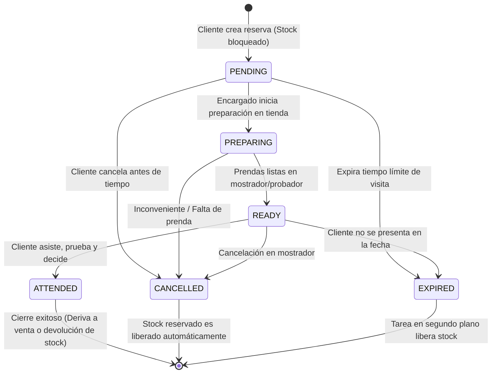

---

### 6.2 Ciclo de Vida de una Venta (`Sale`) y Pago (`Payment`)

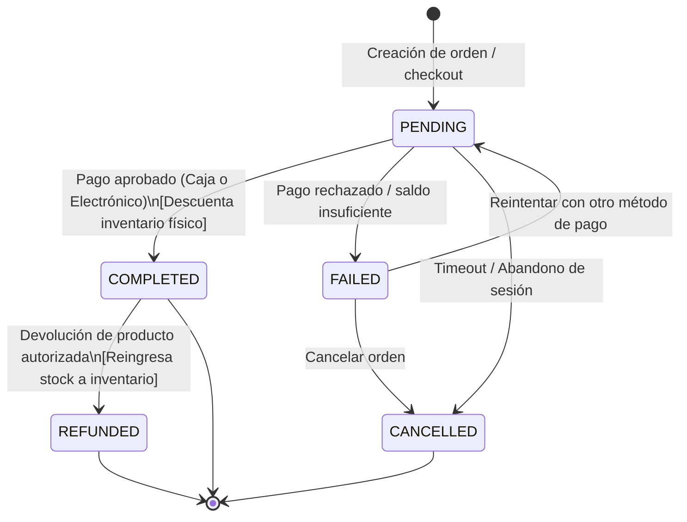

---

## 7. Diagrama de Componentes (UML Component Diagram)

Muestra la modularidad y las interfaces expuestas por el backend modular FastAPI, las aplicaciones frontend y los servicios de soporte:

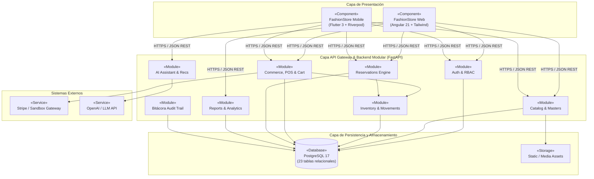

---

## 8. Diagrama de Despliegue (UML Deployment Diagram)

Estructura física de contenedores Docker y nodos cliente según `docker-compose.yml` y `docker-compose.prod.yml`:

```mermaid
graph TD
    subgraph ClientNode1["Dispositivo Cliente / Emulador"]
        AndroidDevice["«Device: Android 13+»<br/>FashionStore Mobile App<br/>(Flutter APK)"]
    end

    subgraph ClientNode2["Estación de Trabajo / Navegador"]
        Browser["«Execution Environment: Web Browser»<br/>Chrome / Firefox / Safari<br/>(Angular 21 SPA)"]
    end

    subgraph DockerHost["Servidor Host (Docker Engine / Linux o Windows)"]
        subgraph ProxyContainer["Contenedor: web (Nginx Reverse Proxy)"]
            NginxServer["«Web Server»<br/>Nginx 1.25<br/>Port: 80 / 4200"]
            WebDist["«Artifact»<br/>web/dist/browser<br/>(Archivos compilados Angular)"]
            NginxServer --- WebDist
        end

        subgraph BackendContainer["Contenedor: backend (FastAPI Application)"]
            Uvicorn["«App Server»<br/>Uvicorn + Python 3.13<br/>Port: 8000"]
            BackendCode["«Artifact»<br/>app (Monolito Modular FastAPI)<br/>SQLAlchemy 2.0 ORM"]
            Uvicorn --- BackendCode
        end

        subgraph DBContainer["Contenedor: postgres (Base de Datos)"]
            PostgresServer["«RDBMS»<br/>PostgreSQL 17.11 Alpine<br/>Port: 5432"]
            DBVolume[("«Volume»<br/>postgres_data<br/>(Almacenamiento persistente)")]
            PostgresServer --- DBVolume
        end
    end

    Browser -->|HTTP/HTTPS Port 80/4200| NginxServer
    AndroidDevice -->|HTTP/HTTPS Port 8000 (API)| Uvicorn
    NginxServer -->|Proxy Pass /api/v1| Uvicorn
    BackendCode -->|TCP / Port 5432 (psycopg2)| PostgresServer
```

---

## 7. Diagrama de Paquetes (UML Package Diagram)

Organización lógica del código por capas arquitectónicas:

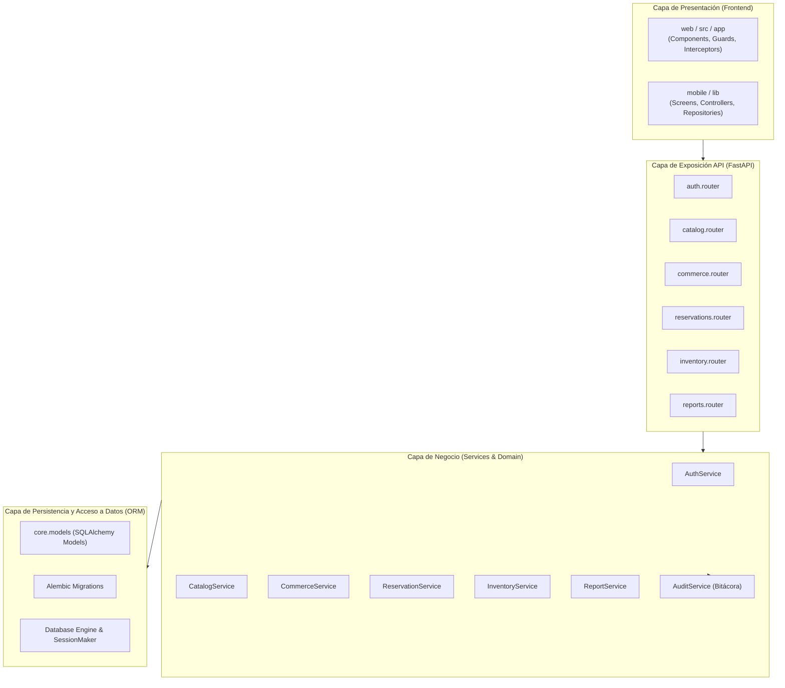

---

## 8. Trazabilidad de los 23 Casos de Uso vs. Módulos

| CU | Nombre del Caso de Uso | Ciclo | Actor Principal | Módulo Backend | Entidades Clave Afectadas |
|---|---|:---:|---|---|---|
| **CU01** | Registrar Cliente | 1 | Cliente | `auth` | `User`, `Role`, `Bitacora` |
| **CU02** | Iniciar / Cerrar Sesión | 1 | Cliente / Admin / Cajero | `auth` | `User`, `RefreshToken`, `Bitacora` |
| **CU03** | Gestionar Usuarios y Roles | 1 | Administrador | `users` | `User`, `Role`, `Bitacora` |
| **CU04** | Gestionar Sucursales y Ciudades | 1 | Administrador | `locations` | `City`, `Branch` |
| **CU05** | Gestionar Productos | 1 | Administrador | `products` | `Product`, `ProductVariant`, `ProductImage` |
| **CU06** | Gestionar Catálogo Base | 1 | Administrador | `catalog_masters` | `Category`, `Size`, `Color` |
| **CU07** | Gestionar Proveedores | 1 | Administrador / Proveedor | `suppliers` | `Supplier`, `ProductSupplier` |
| **CU08** | Consultar Catálogo y Buscar Prendas | 1 | Cliente / Público | `catalog` | `Product`, `Category`, `ProductImage` |
| **CU09** | Consultar Disponibilidad por Tienda | 1 | Cliente | `catalog` | `Branch`, `Inventory`, `ProductVariant` |
| **CU10** | Realizar Reserva de Prendas | 2 | Cliente | `reservations` | `Reservation`, `ReservationItem`, `Inventory` |
| **CU11** | Atender Reservas en Sucursal | 2 | Encargado de Sucursal | `reservations` | `Reservation`, `Inventory`, `Bitacora` |
| **CU12** | Sesión de Probador Virtual | 3 | Cliente | `virtual_fitting` | `VirtualFittingSession`, `Product` |
| **CU13** | Administrar Carrito de Compras | 2 | Cliente | `commerce` | `Cart`, `CartItem`, `ProductVariant` |
| **CU14** | Realizar Compra Digital | 2 | Cliente | `commerce` | `Sale`, `SaleItem`, `Payment`, `Inventory` |
| **CU15** | Realizar Venta Presencial (POS) | 2 | Cajero | `commerce` | `Sale`, `SaleItem`, `Payment`, `Inventory` |
| **CU16** | Cobro en Caja (Efectivo/Tarjeta/QR)| 2 | Cajero | `commerce` | `Payment`, `Sale` |
| **CU17** | Procesar Pago Electrónico Sandbox | 2 | Cliente | `commerce` | `Payment`, `Sale` |
| **CU18** | Control de Stock y Movimientos | 2 | Encargado / Admin | `inventory` | `Inventory`, `InventoryMovement` |
| **CU19** | Gestionar Temporadas y Colecciones | 2 | Administrador | `seasons` | `Season`, `Collection`, `Product` |
| **CU20** | Gestionar Promociones y Descuentos | 3 | Administrador | `promotions` | `Promotion`, `PromotionProduct` |
| **CU21** | Dashboards y Reportes Gerenciales | 3 | Administrador | `reports` | `Sale`, `Inventory`, `Reservation` |
| **CU22** | Recomendaciones Personalizadas IA | 3 | Cliente | `recommendations` | `AIRecommendation`, `Sale`, `Product` |
| **CU23** | Consultar Historial de Compras | 3 | Cliente | `commerce` | `Sale`, `SaleItem`, `Payment` |

---

## 9. Integración con Enterprise Architect (EA)

El archivo de modelo nativo de Enterprise Architect se encuentra en:
- `docs/uml/FashioStore/FashionStore.eap`

Contiene los siguientes paquetes formalizados bajo el estándar UML 2.5:
- `01 - Diagrama General de Casos de Uso` (Diagrama general con los 23 Casos de Uso y 7 Actores)
- `02 - Diseño Conceptual de la Base de Datos` (26 entidades completas)
- `03 - Diagramas de Comunicación` (BCE completo para los 23 Casos de Uso organizado en 3 subpaquetes: Ciclo 1, Ciclo 2 y Ciclo 3)
- `04 - Diagramas de Analisis de Clases` (Realización BCE para los 23 Casos de Uso organizado en 3 subpaquetes: Ciclo 1, Ciclo 2 y Ciclo 3)
- `05 - Diagramas de Secuencia` (Secuencia temporal UML 2.5 para los 23 Casos de Uso organizado en 3 subpaquetes: Ciclo 1, Ciclo 2 y Ciclo 3)
- `06 - Diagramas de Tiempo` (Diagramas de tiempo para Ciclo 1, 2 y 3)
- `07 - Diagramas de Estado` (Diagramas de estado UML 2.5 para CU03, CU05, CU10, CU14/CU17, CU20, CU12)
- `08 - Diagramas de Navegación` (Diagramas de navegación Web/App UML 2.5 para CU08, CU05, CU10, CU14/CU17, CU12, CU20)
- `09 - Diseño Lógico de la Arquitectura` (Arquitectura MVC en 3 capas: Vista, Controlador, Modelo y Base de Datos PostgreSQL)

---

## 10. Diagramas de Tiempo UML 2.5 (Timing Diagrams)

Los Diagramas de Tiempo (UML 2.5 Timing Diagrams) modelan el cambio de estados discretos de una línea de vida a lo largo de un eje temporal continuo y cuantificable, representando restricciones críticas de latencia, expiración y eventos asíncronos en el sistema **FashionStore**.

Se seleccionaron los Casos de Uso con mayor sensibilidad temporal en cada ciclo del proyecto:

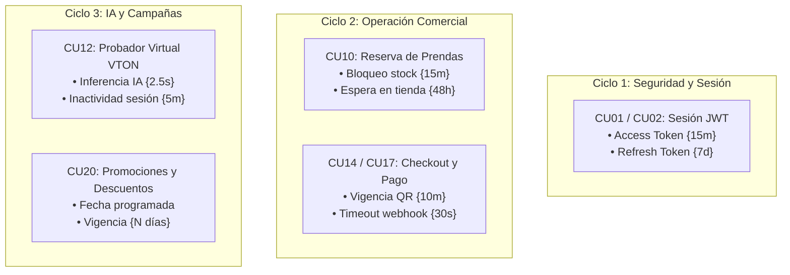

### 10.1 CU01 / CU02 — Sesión de Usuario y Tokens JWT (Ciclo 1)
- **Marco UML 2.5**: `sd CU01_CU02_SesionJWT`
- **Línea de Vida**: `TimeLine_SesionUsuario`
- **Estados Discretos**: `SinSesion`, `TokenActivo`, `TokenExpirado`, `RenovandoToken`
- **Restricciones de Duración**:
  - `{15 min}`: Vigencia del Access Token antes de requerir renovación.
  - `{< 1s}`: Latencia de validación y emisión de nuevo token criptográfico.
  - `{7 días}`: Vigencia global del Refresh Token para mantener la sesión abierta sin reingresar credenciales.
- **Imagen**: [`tiempo-cu01-sesion-jwt.png`](./diagrams/tiempo-cu01-sesion-jwt.png)

### 10.2 CU10 — Realizar Reserva de Prendas en Tienda (Ciclo 2)
- **Marco UML 2.5**: `sd CU10_ReservaPrendas`
- **Línea de Vida**: `TimeLine_ReservaPrenda`
- **Estados Discretos**: `StockDisponible`, `BloqueoTemporal`, `ReservaConfirmada`, `PrendaRecogida`
- **Restricciones de Duración**:
  - `{15 min}`: Bloqueo transaccional temporal de la prenda en base de datos mientras el cliente formaliza la reserva.
  - `{48 horas}`: Ventana máxima de retención física de la prenda en la sucursal seleccionada; tras este plazo, un proceso cron ejecuta `expirarReserva()` y devuelve la prenda a `StockDisponible`.
- **Imagen**: [`tiempo-cu10-reserva-prendas.png`](./diagrams/tiempo-cu10-reserva-prendas.png)

### 10.3 CU14 / CU17 — Compra Digital con Pago Electrónico (Ciclo 2)
- **Marco UML 2.5**: `sd CU14_CU17_PagoDigital`
- **Línea de Vida**: `TimeLine_ProcesoPago`
- **Estados Discretos**: `CarritoActivo`, `OrdenIniciada`, `EsperandoPago`, `ProcesandoWebhook`, `PagoAprobado`
- **Restricciones de Duración**:
  - `{10 min}`: Vigencia del código QR BCP o sesión de checkout Stripe antes de liberar el inventario.
  - `{30 seg}`: Timeout máximo de webhook para confirmación asíncrona de la pasarela de pagos.
- **Imagen**: [`tiempo-cu14-pago-digital.png`](./diagrams/tiempo-cu14-pago-digital.png)

### 10.4 CU12 — Sesión de Probador Virtual / VTON con IA (Ciclo 3)
- **Marco UML 2.5**: `sd CU12_ProbadorVirtualVTON`
- **Línea de Vida**: `TimeLine_ProbadorVirtual`
- **Estados Discretos**: `Inactivo`, `CamaraIniciada`, `PoseDetectada`, `InferenciaVTON`, `PrendaAjustada`
- **Restricciones de Duración**:
  - `{< 500 ms}`: Detección y normalización de puntos clave de postura mediante MediaPipe / ML Kit.
  - `{2.5 seg}`: Inferencia de IA generativa de Virtual Try-On (VTON) para renderizar la prenda adaptada a la silueta del cliente.
  - `{5 min}`: Timeout de inactividad que cierra la cámara y destruye las texturas en memoria para optimizar recursos móviles.
- **Imagen**: [`tiempo-cu12-probador-virtual.png`](./diagrams/tiempo-cu12-probador-virtual.png)

### 10.5 CU20 — Gestionar Promociones y Descuentos (Ciclo 3)
- **Marco UML 2.5**: `sd CU20_GestionPromociones`
- **Línea de Vida**: `TimeLine_CicloPromocion`
- **Estados Discretos**: `Borrador`, `Programada`, `VigenteActiva`, `Pausada`, `Expirada`
- **Restricciones de Duración**:
  - `{Programada}`: Período de espera entre la configuración administrativa y la fecha/hora de inicio automático.
  - `{Vigencia: N días}`: Duración de la campaña comercial activa aplicando descuentos en catálogo y checkout en tiempo real.
- **Imagen**: [`tiempo-cu20-promociones.png`](./diagrams/tiempo-cu20-promociones.png)

---

## 11. Diagramas de Estado UML 2.5 (Statechart Diagrams)

Los Diagramas de Estado (UML 2.5 Statechart Diagrams) modelan el ciclo de vida y los cambios de estado transaccionales por los que transitan las entidades y flujos de control dentro del sistema **FashionStore**, respondiendo a eventos específicos y guardas condicionales `[condición]`.

Todos los diagramas siguen estrictamente la sintaxis, topología y convención visual del modelo de referencia:
1. **Contenedor Canvas**: Marco redondeado con fondo tonalidad cálida (`#fbe6c3`), borde oscuro y encabezado centrado con identificador (`CUxx`).
2. **Pseudo-estado Inicial**: Círculo negro sólido rotulado `Inicio`.
3. **Pseudo-estado Final**: Círculo verde con cruz `X` rotulado `Fin`.
4. **Estados de Control y Entidad**: Rectángulos redondeados con sombra 3D suave (`#fee2af`), borde marrón oscuro y textos centrados en negrita.
5. **Transiciones con Guardas**: Flechas direccionadas con guardas entre corchetes `[condición]`.
6. **Bucle Reflexivo de Entrada**: Self-loop inferior en el estado de autenticación/inicio ante fallo o condición vacía.
7. **Bifurcaciones Operativas**:
   - **Consulta / Listado**: Transición directa a despliegue de datos.
   - **Modificación**: Transición hacia edición de atributos con posterior revisión de datos.
   - **Creación / Registro**: Transición hacia ingreso de entidad base y configuración de variantes.
   - **Baja / Cancelación / Pausa**: Transición hacia captura de identificador con bucle de reintento `[incorrecto]` y confirmación a estado de acción.
8. **Consolidación**: Convergencia de los flujos exitosos en `Transacción completada` / `Transacción Ok`, conduciendo al pseudo-estado `Fin`.

### Resumen de Casos de Uso Seleccionados

| Ciclo | Caso de Uso | Título en Modelo | Entidad Central | Vista Canvas Melocotón | Exportación Oficial EA |
| :--- | :--- | :--- | :--- | :--- | :--- |
| **Ciclo 1** | **CU03** | Gestionar Usuarios y Roles | `User` / `Role` | [`estado-cu03-gestion-usuarios.png`](./diagrams/estado-cu03-gestion-usuarios.png) | [`ea-estado-cu03-gestion-usuarios.png`](./diagrams/ea-estado-cu03-gestion-usuarios.png) |
| **Ciclo 1** | **CU05** | Gestionar Productos y Prendas | `Product` / `ProductVariant` | [`estado-cu05-gestion-productos.png`](./diagrams/estado-cu05-gestion-productos.png) | [`ea-estado-cu05-gestion-productos.png`](./diagrams/ea-estado-cu05-gestion-productos.png) |
| **Ciclo 2** | **CU10** | Realizar Reserva de Prendas en Tienda | `Reservation` / `Inventory` | [`estado-cu10-reserva-prendas.png`](./diagrams/estado-cu10-reserva-prendas.png) | [`ea-estado-cu10-reserva-prendas.png`](./diagrams/ea-estado-cu10-reserva-prendas.png) |
| **Ciclo 2** | **CU14 / CU17** | Compra Digital y Pago Electrónico | `Sale` / `Payment` | [`estado-cu14-pago-digital.png`](./diagrams/estado-cu14-pago-digital.png) | [`ea-estado-cu14-pago-digital.png`](./diagrams/ea-estado-cu14-pago-digital.png) |
| **Ciclo 3** | **CU20** | Gestionar Promociones y Descuentos | `Promotion` | [`estado-cu20-gestion-promociones.png`](./diagrams/estado-cu20-gestion-promociones.png) | [`ea-estado-cu20-gestion-promociones.png`](./diagrams/ea-estado-cu20-gestion-promociones.png) |
| **Ciclo 3** | **CU12** | Sesión de Probador Virtual (VTON IA) | `VirtualFittingSession` | [`estado-cu12-probador-virtual.png`](./diagrams/estado-cu12-probador-virtual.png) | [`ea-estado-cu12-probador-virtual.png`](./diagrams/ea-estado-cu12-probador-virtual.png) |

---

### 11.1 Ciclo 1: CU03 — Gestionar Usuarios y Roles

Modelado idéntico al estándar de referencia, controlando la seguridad de credenciales de usuario, administración de roles RBAC, bucle de invalidación de ID y desactivación lógica con auditoría en bitácora.

- **Diagrama en EA**: `CU03` (Paquete `07 - Diagramas de Estado -> CU03 - CU03 Gestionar Usuarios y Roles`)
- **Estados Clave**:
  - `Loguear Administrador`: Validación de credenciales con self-loop `[error credenciales]`.
  - `Seleccionar opcion Usuario`: Selector de operación CRUD `[modificar]`, `[crear]`, `[desactivar]`, `[listar]`.
  - `Desplegar lista usuarios`: Consulta pasiva de usuarios y roles activos.
  - `Modificar Usuario / Rol` y `Crear Nuevo Usuario`: Entrada de datos transicionales que convergen en `Revisar Datos y Roles` mediante `[llenar datos]`.
  - `ID del usuario a desactivar`: Validación con bucle de retorno `[incorrecto]` y avance `[correcto]` hacia `Desactivar Usuario`.
  - `Transaccion completada` -> `Fin`.


---

### 11.2 Ciclo 1: CU05 — Gestionar Productos y Prendas

Controla el ciclo de vida del catálogo maestro: creación de ficha técnica base, asignación multidimensional de variantes (tallas, colores, stock por sucursal), modificación de precios y descontinuación controlada.

- **Diagrama en EA**: `CU05` (Paquete `07 - Diagramas de Estado -> CU05 - CU05 Gestionar Productos y Prendas`)
- **Estados Clave**:
  - `Loguear Admin o Encargado`: Con self-loop `[error]`.
  - `Seleccionar opcion Prenda`: Selector `[catalogo]`, `[modificar]`, `[crear]`, `[descontinuar]`.
  - `Desplegar catalogo prendas`: Visualización de catálogo y existencias.
  - `Modificar Prenda y Stock` y `Registrar Prenda Base`: Flujos que pasan por `[llenar datos]` y `[configurar tallas]` hacia `Revisar Variantes y Precios`.
  - `SKU de prenda a descontinuar`: Bucle de retorno `[no encontrado]` y transición `[correcto]` hacia `Descontinuar Prenda`.
  - `Transaccion completada` -> `Fin`.


---

### 11.3 Ciclo 2: CU10 — Realizar Reserva de Prendas en Tienda

Gobierna la reserva omnicanal presencial: verificación de disponibilidad física en la sucursal seleccionada, bloqueo transaccional temporal de existencias, emisión de código QR de recogida y anulación de reserva con liberación inmediata de inventario.

- **Diagrama en EA**: `CU10` (Paquete `07 - Diagramas de Estado -> CU10 - CU10 Realizar Reserva de Prendas en Tienda`)
- **Estados Clave**:
  - `Autenticar Cliente`: Con self-loop `[error login]`.
  - `Seleccionar Prenda y Sucursal`: Selector `[consultar]`, `[modificar]`, `[reservar]`, `[cancelar]`.
  - `Ver disponibilidad en tiendas`: Consulta de stock local por sede.
  - `Modificar Talla / Sede` y `Solicitar Reserva de Prenda`: Flujos que convergen en `Generar Codigo QR de Retiro` bajo `[cambiar sede]` y `[bloquear stock]`.
  - `Codigo de reserva a cancelar`: Bucle de reintento `[codigo invalido]` y confirmación `[confirmado]` hacia `Cancelar Reserva y Liberar Stock`.
  - `Transaccion completada` -> `Fin`.


---

### 11.4 Ciclo 2: CU14 / CU17 — Compra Digital y Pago Electrónico

Regula el proceso de checkout digital: verificación de carrito, selección de canal de cobro (tarjeta tokenizada Stripe o QR Dinámico BCP), sincronización asíncrona vía webhook de la pasarela y emisión de comprobante electrónico.

- **Diagrama en EA**: `CU14_CU17` (Paquete `07 - Diagramas de Estado -> CU14_CU17 - CU14/CU17 Compra Digital y Pago Electrónico`)
- **Estados Clave**:
  - `Revisar Carrito de Compras`: Con self-loop `[carrito vacio]`.
  - `Seleccionar Metodo de Pago`: Selector `[ver orden]`, `[tarjeta]`, `[pago QR]`, `[cancelar]`.
  - `Desplegar resumen de compra`: Visualización de subtotales, descuentos e impuestos.
  - `Ingresar Tarjeta Stripe` y `Generar Cobro QR Dinamico`: Flujos de cobro con `[procesar cargo]` y `[escanear QR]` hacia `Esperar Confirmacion Webhook`.
  - `ID de orden a cancelar`: Bucle de retorno `[orden invalida]` y avance `[cancelar orden]` hacia `Cancelar Orden y Liberar Stock`.
  - `Generar Factura / Transaccion Ok` -> `Fin`.


---

### 11.5 Ciclo 3: CU20 — Gestionar Promociones y Descuentos

Administra el ciclo promocional del motor comercial: configuración de descuentos porcentuales o fijos, vinculación con prendas o categorías, vigencia de fechas y suspensión controlada de campañas.

- **Diagrama en EA**: `CU20` (Paquete `07 - Diagramas de Estado -> CU20 - CU20 Gestionar Promociones y Descuentos`)
- **Estados Clave**:
  - `Loguear Administrador`: Con self-loop `[error]`.
  - `Seleccionar opcion Promocion`: Selector `[listar]`, `[modificar]`, `[crear]`, `[pausar]`.
  - `Desplegar campañas vigentes`: Visualización del estado actual de promociones.
  - `Modificar Reglas de Descuento` y `Crear Nueva Promocion`: Flujos con `[llenar datos]` y `[asignar prendas]` hacia `Revisar Fechas y Prendas`.
  - `ID de promocion a pausar`: Bucle de retorno `[no encontrada]` y transición `[correcto]` hacia `Pausar o Finalizar Campaña`.
  - `Transaccion completada` -> `Fin`.


---

### 11.6 Ciclo 3: CU12 — Sesión de Probador Virtual (VTON con IA)

Modela la interacción con visión por computador e inteligencia artificial generativa: captura de silueta del cliente, segmentación de imagen, inferencia de adaptación de prenda (Virtual Try-On) y limpieza de búferes de memoria temporal.

- **Diagrama en EA**: `CU12` (Paquete `07 - Diagramas de Estado -> CU12 - CU12 Sesion de Probador Virtual (VTON IA)`)
- **Estados Clave**:
  - `Acceder a Probador Virtual`: Con self-loop `[error camara]`.
  - `Seleccionar opcion Probador`: Selector `[historial]`, `[nueva foto]`, `[probar]`, `[descartar]`.
  - `Desplegar pruebas guardadas`: Consulta de sesiones previas del usuario.
  - `Capturar Foto y Silueta` y `Seleccionar Prenda de Catalogo`: Convergen con `[pose valida]` y `[ejecutar ajuste]` hacia `Procesar Inferencia VTON con IA`.
  - `ID de sesion a descartar`: Bucle de reintento `[invalido]` y ejecución `[descartar]` hacia `Descartar Sesion y Cache`.
  - `Prenda Adaptada / Transaccion Ok` -> `Fin`.


---

## 12. Diagramas de Navegación UML 2.5 (Navigation Diagrams)

Los **Diagramas de Navegación** modelan la arquitectura de interacción y flujo de navegación cliente-servidor para las aplicaciones Web (Angular) y Móvil (Flutter) de **FashionStore**, formalizados bajo el estándar **UML 2.5** y la extensión **WAE (Web Application Extension)** para patrones **MVC (Model-View-Controller)**.

### 12.1 Patrón Arquitectónico y Notación Gráfica Formal

Siguiendo el modelo formal establecido para el proyecto:
- **Marco de Diagrama UML (Frame)**: Encabezado formal `class navegacion [rol] ([CUn])` (ej. `class navegacion cliente (CU08)`).
- **Actor UML (Stick Figure)**: Ubicado en el extremo izquierdo, asociado bidireccionalmente a la vista principal del caso de uso.
- **Clases de Vista (Client Pages / Components)**:
  - Compartimento superior: Nombre del componente de interfaz (ej. `catalogoPrendas`, `productosAdmin`, `probadorVirtual`).
  - Compartimento de Atributos (`- input: tipo`): Campos de entrada, filtros de búsqueda, identificadores o estados locales.
  - Compartimento de Operaciones (`+ accion(): void`): Disparadores de eventos en la UI (ej. `buscar()`, `crear()`, `abrirFiltro()`).
- **Agregación Compuesta (`Composite Aggregation ◆`)**:
  - Representa que la vista principal está compuesta estructuralmente por sub-vistas o componentes modulares empotrados (ej. filtros avanzados, selector de variantes, selección de sucursal, calibrador de cámara, asignación de fechas).
  - El rombo negro sólido (`◆`) se ancla en el borde del componente compuesto.
- **Controlador Principal (`Controller`)**:
  - Recibe la acción del usuario mediante el conector `<<submit>>` (o enlace de envío HTTP/REST).
  - Se encarga de coordinar la lógica de presentación y el re-renderizado (`build`).
- **Relaciones de Construcción (`<<build>>` / `build`)**:
  - Dependencias dirigidas discontinuas del controlador hacia la vista compuesta y hacia la vista tabular / de resultados.
- **Navegación Secundaria y Acciones de Detalle / Modificación**:
  - La vista tabular conecta mediante `submit` hacia controladores especializados (ej. `verPrendaController`, `modificarProductoController`, `inferenciaVTONController`, `wizardReglasController`).
  - Estos controladores construyen (`build`) la vista de detalle/edición correspondiente.
  - Un controlador de acción alternativa (ej. eliminar, pausar, cancelar, purgar) emite un flujo de retorno discontinuo `build` hacia el controlador principal para refrescar la lista.

### 12.2 Resumen de Diagramas de Navegación por Ciclo

| Ciclo | Caso de Uso | Actor | Diagrama EA | Vista Inicial | Sub-vista Compuesta | Controlador Principal | Vista de Detalle |
|:---:|---|:---:|---|---|---|---|---|
| **1** | **CU08**: Consultar Catálogo y Buscar Prendas | Cliente | `CU08` | `catalogoPrendas` | `prenda.filtros` | `catalogoController` | `detallePrenda` |
| **1** | **CU05**: Gestionar Productos y Prendas | Administrador | `CU05` | `productosAdmin` | `producto.variantes` | `productoController` | `fichaTecnicaProducto` |
| **2** | **CU10**: Reserva de Prendas en Tienda | Cliente | `CU10` | `reservarPrendas` | `reserva.sucursal` | `reservaController` | `confirmacionReservaQR` |
| **2** | **CU14 / CU17**: Compra Digital y Checkout | Cliente | `CU14_CU17` | `checkoutCompra` | `orden.pago` | `pagoController` | `facturaComprobante` |
| **3** | **CU12**: Sesión de Probador Virtual (VTON IA) | Cliente | `CU12` | `probadorVirtual` | `probador.camaraPose` | `probadorController` | `canvasRenderVTON` |
| **3** | **CU20**: Gestionar Promociones y Descuentos | Administrador | `CU20` | `campanasPromocion` | `promocion.fechas` | `promocionController` | `asignacionPrendasWizard` |

---

### 12.3 Ciclo 1: CU08 — Consultar Catálogo y Buscar Prendas

Modela la navegación del catálogo público y de clientes: búsqueda por texto, filtrado facetado (categoría, rango de precios, talla), despliegue de la grilla de productos, consulta detallada de ficha técnica y paginación reactiva.

- **Diagrama en EA**: `CU08` (Paquete `08 - Diagramas de Navegación -> CU08 - CU08 Consultar Catalogo y Buscar Prendas`)
- **Actor**: `Cliente`
- **Estructura de Clases y Flujos**:
  - `catalogoPrendas` (`search_query: String`, `precio_max: decimal` | `buscar(): void`, `filtrar(): void`)
  - `prenda.filtros` (`categoria_id: int`, `talla_filtro: String` | `aplicarFiltros(): void`) [Agregado con `◆`]
  - `catalogoController` (`buscarPrendas(): void`, `paginar(): void`) [Recibe `<<submit>>` y emite `build`]
  - `tabla prendas` (`items_count: int` | `seleccionarPrenda(): void`, `siguientePagina(): void`)
  - `verPrendaController` (`cargarDetalle(): void`) -> `build` -> `detallePrenda` (`sku_seleccionado: String`, `stock_disponible: int` | `agregarAlCarrito(): void`)
  - `filtroRapidoController` (`limpiarFiltros(): void`) -> `build` (retorno a `catalogoController`)


*Versión vectorizada de alta fidelidad:* [navegacion-cu08-catalogo-prendas.png](./diagrams/navegacion-cu08-catalogo-prendas.png)

---

### 12.4 Ciclo 1: CU05 — Gestionar Productos y Prendas

Modela el panel administrativo para administración del catálogo maestro: filtrado por estado, configuración de variantes matriciales (talla/color), alta/edición en ficha técnica y descontinuación controlada con refresco automático del listado.

- **Diagrama en EA**: `CU05` (Paquete `08 - Diagramas de Navegación -> CU05 - CU05 Gestionar Productos y Prendas`)
- **Actor**: `Administrador`
- **Estructura de Clases y Flujos**:
  - `productosAdmin` (`codigo_filtro: String`, `categoria_id: int` | `filtrar(): void`, `nuevoProducto(): void`)
  - `producto.variantes` (`talla: String`, `color: String` | `agregarVariante(): void`) [Agregado con `◆`]
  - `productoController` (`listar(): void`, `menu(): void`) [Recibe `<<submit>>` y emite `build`]
  - `tabla productos` (`total_registros: int` | `modificarProducto(): void`, `descontinuar(): void`)
  - `modificarProductoController` (`cargarDatos(): void`) -> `build` -> `fichaTecnicaProducto` (`precio_base: decimal`, `costo: decimal` | `guardarCambios(): void`)
  - `descontinuarProductoController` (`cambiarEstado(): void`) -> `build` (retorno a `productoController`)


*Versión vectorizada de alta fidelidad:* [navegacion-cu05-gestion-productos.png](./diagrams/navegacion-cu05-gestion-productos.png)

---

### 12.5 Ciclo 2: CU10 — Realizar Reserva de Prendas en Tienda

Gobierna la navegación del flujo omnicanal de reservas: selección de prendas de interés, verificación de stock en la sucursal elegida, emisión del comprobante digital con código QR de retiro y opción de anulación con liberación en tiempo real.

- **Diagrama en EA**: `CU10` (Paquete `08 - Diagramas de Navegación -> CU10 - CU10 Realizar Reserva de Prendas en Tienda`)
- **Actor**: `Cliente`
- **Estructura de Clases y Flujos**:
  - `reservarPrendas` (`prenda_id: int`, `cantidad: int` | `consultarStock(): void`, `reservar(): void`)
  - `reserva.sucursal` (`sucursal_id: int`, `distancia_km: float` | `seleccionarSede(): void`) [Agregado con `◆`]
  - `reservaController` (`validarDisponibilidad(): void`, `menu(): void`) [Recibe `<<submit>>` y emite `build`]
  - `tabla disponibilidad` (`stock_sucursales: int` | `confirmarReserva(): void`, `cancelarReserva(): void`)
  - `confirmarReservaController` (`bloquearStock(): void`) -> `build` -> `confirmacionReservaQR` (`codigo_reserva: String`, `expiracion: DateTime` | `descargarQR(): void`)
  - `cancelarReservaController` (`liberarInventario(): void`) -> `build` (retorno a `reservaController`)


*Versión vectorizada de alta fidelidad:* [navegacion-cu10-reserva-prendas.png](./diagrams/navegacion-cu10-reserva-prendas.png)

---

### 12.6 Ciclo 2: CU14 / CU17 — Compra Digital y Pago Electrónico

Modela la pasarela de compra digital: configuración de dirección de entrega, selección de método de cobro (Stripe / Tarjeta o QR interoperable BCP), procesamiento asíncrono con confirmación webhook y emisión de comprobante de venta.

- **Diagrama en EA**: `CU14_CU17` (Paquete `08 - Diagramas de Navegación -> CU14_CU17 - CU14/CU17 Compra Digital y Pago Electronico`)
- **Actor**: `Cliente`
- **Estructura de Clases y Flujos**:
  - `checkoutCompra` (`carrito_id: int`, `monto_total: decimal` | `iniciarPago(): void`, `modificarCarrito(): void`)
  - `orden.pago` (`tipo_metodo: String`, `token_pago: String` | `validarMetodo(): void`) [Agregado con `◆`]
  - `pagoController` (`procesarPago(): void`, `menu(): void`) [Recibe `<<submit>>` y emite `build`]
  - `tabla ordenItems` (`items_count: int` | `pagarStripe(): void`, `cancelarOrden(): void`)
  - `ejecutarPagoController` (`confirmarTransaccion(): void`) -> `build` -> `facturaComprobante` (`nro_factura: String`, `hash_qr: String` | `imprimir(): void`)
  - `anularOrdenController` (`revertirOrden(): void`) -> `build` (retorno a `pagoController`)


*Versión vectorizada de alta fidelidad:* [navegacion-cu14-pago-digital.png](./diagrams/navegacion-cu14-pago-digital.png)

---

### 12.7 Ciclo 3: CU12 — Sesión de Probador Virtual (VTON con IA)

Modela la experiencia interactiva de Virtual Try-On con Visión Artificial: calibración de pose y silueta mediante cámara, selector de catálogo de prendas compatibles, envío de datos de inferencia al pipeline de Deep Learning y renderizado del avatar con la prenda adaptada.

- **Diagrama en EA**: `CU12` (Paquete `08 - Diagramas de Navegación -> CU12 - CU12 Sesion de Probador Virtual (VTON IA)`)
- **Actor**: `Cliente`
- **Estructura de Clases y Flujos**:
  - `probadorVirtual` (`sesion_id: int`, `usuario_id: int` | `iniciarSesion(): void`, `cerrarProbador(): void`)
  - `probador.camaraPose` (`resolucion: String`, `score_silueta: float` | `capturarPose(): void`) [Agregado con `◆`]
  - `probadorController` (`calibrar(): void`, `menu(): void`) [Recibe `<<submit>>` y emite `build`]
  - `selectorPrendasVTON` (`prendas_compatibles: int` | `ajustarPrenda(): void`, `limpiarCache(): void`)
  - `inferenciaVTONController` (`ejecutarInferencia(): void`) -> `build` -> `canvasRenderVTON` (`ajuste_score: decimal`, `render_texture: Image` | `comprarPrenda(): void`)
  - `descarteSesionController` (`purgarMemoria(): void`) -> `build` (retorno a `probadorController`)


*Versión vectorizada de alta fidelidad:* [navegacion-cu12-probador-virtual.png](./diagrams/navegacion-cu12-probador-virtual.png)

---

### 12.8 Ciclo 3: CU20 — Gestionar Promociones y Descuentos

Modela el asistente de campañas promocionales: visualización de campañas activas, delimitación temporal de vigencia, wizard de asignación masiva de prendas y reglas de descuento, y alternancia de estado (pausar/activar) con refresco reactivo.

- **Diagrama en EA**: `CU20` (Paquete `08 - Diagramas de Navegación -> CU20 - CU20 Gestionar Promociones y Descuentos`)
- **Actor**: `Administrador`
- **Estructura de Clases y Flujos**:
  - `campanasPromocion` (`filtro_vigencia: String`, `search_nombre: String` | `filtrar(): void`, `nuevaCampana(): void`)
  - `promocion.fechas` (`fecha_inicio: date`, `fecha_fin: date` | `validarRango(): void`) [Agregado con `◆`]
  - `promocionController` (`listar(): void`, `menu(): void`) [Recibe `<<submit>>` y emite `build`]
  - `tabla promociones` (`campanas_count: int` | `configurarReglas(): void`, `pausarCampana(): void`)
  - `wizardReglasController` (`abrirWizard(): void`) -> `build` -> `asignacionPrendasWizard` (`descuento_pct: decimal`, `table: prendas_asignadas` | `guardarCampana(): void`)
  - `pausarPromocionController` (`alternarEstado(): void`) -> `build` (retorno a `promocionController`)


*Versión vectorizada de alta fidelidad:* [navegacion-cu20-gestion-promociones.png](./diagrams/navegacion-cu20-gestion-promociones.png)

---

## 13. Diseño Lógico de la Arquitectura

Diagrama de Paquetes UML 2.5 que representa la arquitectura lógica del sistema FashionStore siguiendo el patrón **MVC** en tres capas horizontales más la capa de persistencia.

- **Diagrama en EA**: `09 - Diseño Lógico de la Arquitectura → Diseño Lógico de la Arquitectura`
- **Tipo de diagrama**: Package Diagram
- **Patrón**: Model-View-Controller (MVC)

### Capas

| Capa | Tecnología | Paquetes |
|------|-----------|----------|
| **Vista** | Angular 20 (Web) + Flutter (Mobile) | Gestión Usuarios/Catálogo · Operación Comercial · Analítica, IA y Reportes |
| **Controlador** | FastAPI Routers | Auth/Catálogo/Proveedores · Operación Comercial · Analítica/IA/Reportes |
| **Modelo** | SQLAlchemy ORM | Usuarios/Catálogo/Stock · Ventas/Pagos/Reservas · IA/Reportes/Promociones |
| **Base de Datos** | PostgreSQL (Docker) | pg:16-alpine — persistencia de todos los modelos |

### Cobertura Total del Proyecto (23 Casos de Uso)

Los paquetes agrupan la totalidad de los módulos y casos de uso del sistema FashionStore:

1. **Paquete Actividades de usuario**:
   - `CU01` Autenticación y Autorización
   - `CU02` Recuperación y Cambio de Contraseña
   - `CU03` Gestión de Usuarios y Roles
   - `CU04` Gestión de Sucursales y Asignación de Personal
   - `CU05` Gestión de Categorías y Catálogo de Prendas
   - `CU06` Registro de Proveedores y Marcas
   - `CU07` Control de Inventario y Movimientos de Stock
   - `CU21` Gestión de Temporadas y Colecciones

2. **Paquete Venta de productos**:
   - `CU08` Exploración de Catálogo y Búsqueda Avanzada
   - `CU09` Gestión de Carrito de Compras
   - `CU10` Procesamiento de Compra y Pago Online
   - `CU11` Cobro en Caja y Emisión de Comprobantes
   - `CU18` Historial de Compras y Seguimiento de Pedidos
   - `CU19` Reserva de Prendas en Sucursal
   - `CU22` Generación y Cobro por Código QR Dinámico

3. **Paquete Reportes (e Inteligencia Artificial)**:
   - `CU12` Probador Virtual Interactivo (VTON)
   - `CU13` Recomendaciones Personalizadas de Moda
   - `CU14` Chatbot Asistente de Estilo con IA
   - `CU15` Notificaciones Predictivas y Promociones
   - `CU16` Consulta de Clima y Sugerencias de Temporada
   - `CU17` Búsqueda Visual de Prendas por Imagen
   - `CU20` Gestión de Promociones y Descuentos Masivos
   - `CU23` Dashboard Analítico y Reportes de Ventas

### Flujo de Dependencias (UML 2.5)

- **Controlador ➔ Vista** (flechas discontinuas hacia arriba): El controlador proyecta los datos y estados hacia la capa de presentación (Angular 20 y Flutter Mobile).
- **Controlador ➔ Modelo** (flechas discontinuas hacia abajo): El controlador invoca las operaciones y reglas sobre los modelos y entidades de persistencia.
- **Controlador Venta de productos ➔ Controlador actividades de usuario** (flecha horizontal hacia la izquierda): El procesamiento de compras y reservas requiere consultar la sesión activa, credenciales y datos del cliente/empleado.
- **Controlador actividades de usuario ➔ Modelo Venta de productos** (flecha diagonal hacia abajo-derecha): Operaciones de asignación de stock o catálogo desde gestión impactan los modelos comerciales.
- **Modelos ➔ Base de datos postgresql** (flechas convergentes hacia abajo): Todos los paquetes del modelo persisten sus entidades en el motor relacional PostgreSQL.


*Versión Enterprise Architect:* [ea-logical-architecture-diagram.png](./diagrams/ea-logical-architecture-diagram.png)

