# Especificación y Catálogo de Diagramas UML — FashionStore (SI2)

Este documento reúne la arquitectura y especificación formal de los **Diagramas UML** para el sistema **FashionStore** (Ciclos 1, 2 y 3), estructurados según el estándar **UML 2.5** y las **4+1 Vistas Arquitectónicas de Kruchten**.

---

## 1. Vista de Casos de Uso (UML Use Case Diagrams)

### 1.1 Diagrama General de Casos de Uso y Actores

FashionStore define 7 actores principales:
- **Invitado (`GUEST`)**: Usuario anónimo o visitante no autenticado que explora el catálogo o realiza su registro inicial.
- **Cliente (`CLIENT`)**: Usuario final registrado que interactúa mediante la Web o la App Móvil Flutter.
- **Administrador (`ADMIN`)**: Control total del sistema, seguridad, configuración, inventario global y analítica.
- **Encargado de Sucursal (`BRANCH_MANAGER`)**: Gestión de inventario local, transferencias y atención de reservas.
- **Cajero (`CASHIER`)**: Operación del punto de venta presencial (POS) y cobro en caja.
- **Proveedor (`SUPPLIER`)**: Abastecimiento de prendas e insumos.
- **Pasarela de Pagos (Sistema Externo)**: Procesamiento electrónico sandbox / Stripe / QR.

#### Diagrama General de Casos de Uso (UML 2.5)

A continuación se presenta el **Diagrama General de Casos de Uso** integrando la totalidad de los 23 Casos de Uso del sistema y los 7 Actores participantes, estructurado con delimitación del sistema (System Boundary) y relaciones formales `«include»` y `«extend»`:

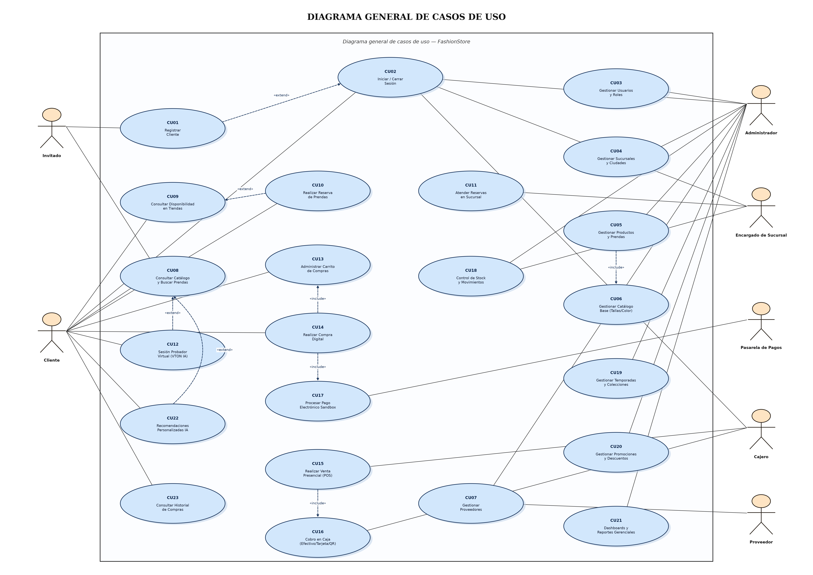

*Exportación nativa de Enterprise Architect:* [ea-diagrama-general-casos-de-uso.png](./diagrams/ea-diagrama-general-casos-de-uso.png)

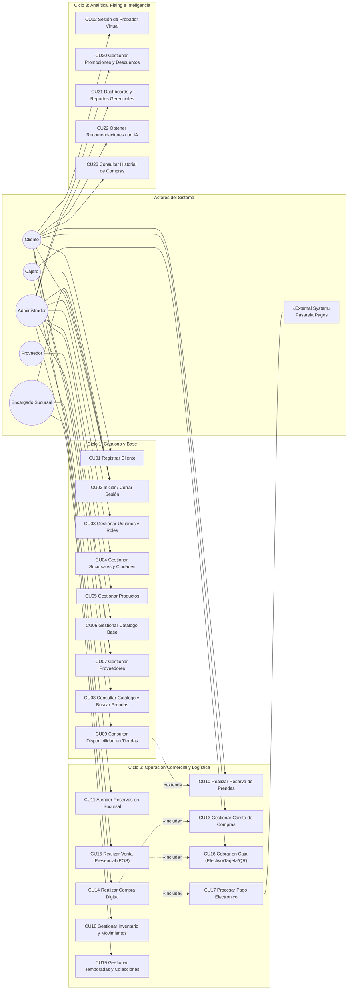

---

### 1.2 Casos de Uso — Ciclo 1 (Base de Plataforma y Catálogo)

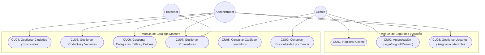

---

### 1.3 Casos de Uso — Ciclo 2 (Comercio, Reservas e Inventario)


---

### 1.4 Casos de Uso — Ciclo 3 (Innovación, Analítica e IA)

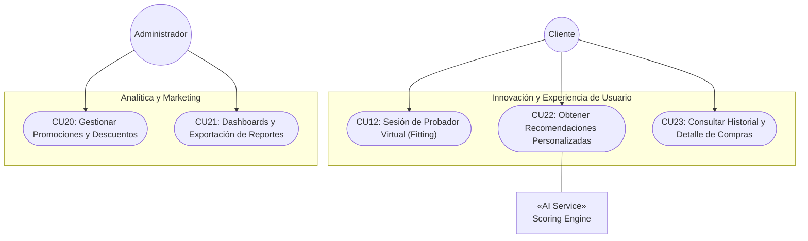

---

## 2. Diagramas de Clases (UML Class Diagrams)

### 2.1 Diseño Conceptual Integral de la Base de Datos — FashionStore Completo (UML 2.5)

Este diagrama representa el diseño conceptual integral de la base de datos de FashionStore abarcando los **Ciclos 1, 2 y 3**, con las 26 entidades del sistema en español, atributos privados tipados, asociaciones con nombres de rol y multiplicidades explícitas bajo el estándar **UML 2.5** con marco (*frame*):

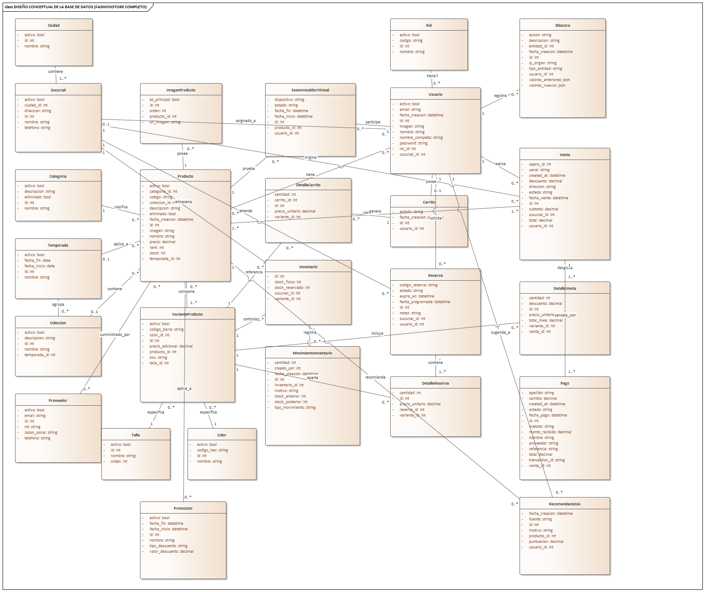

### 2.2 Modelo de Referencia Reducido (Plantilla Base)

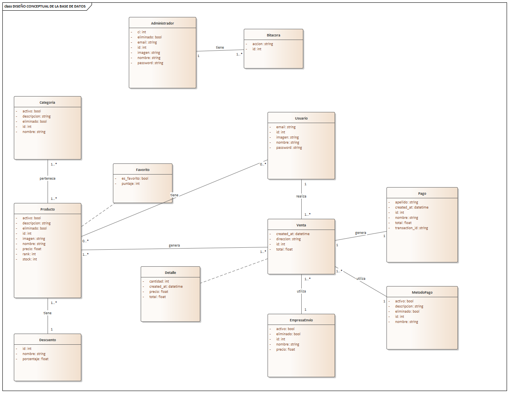

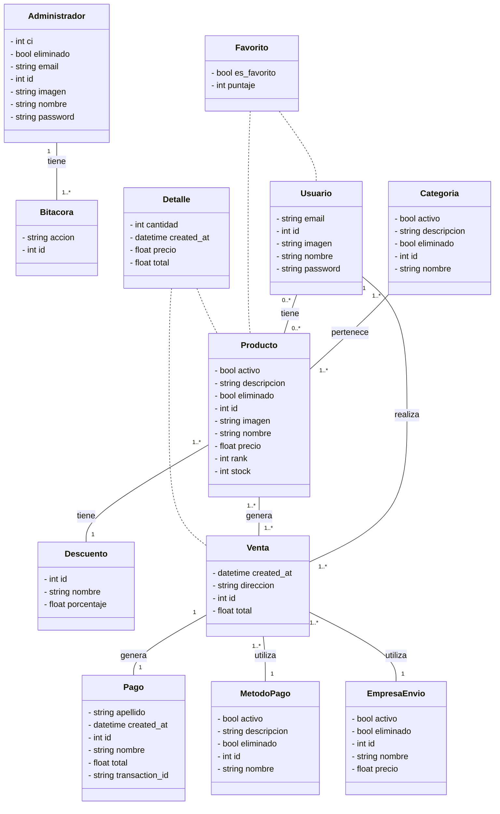

---

### 2.2 Modelo de Dominio Integral de FashionStore

El siguiente diagrama modela las entidades completas del dominio de FashionStore, incorporando sucursales, inventario, reservas y variantes:


---

## 3. Diagramas de Secuencia (UML Sequence Diagrams)

### 3.1 CU10: Realizar Reserva de Prendas (Prueba en Sucursal)

El cliente reserva prendas en una sucursal física para una visita programada. El sistema bloquea el stock disponible (`reserved_quantity += cantidad`) dentro de una transacción atómica.

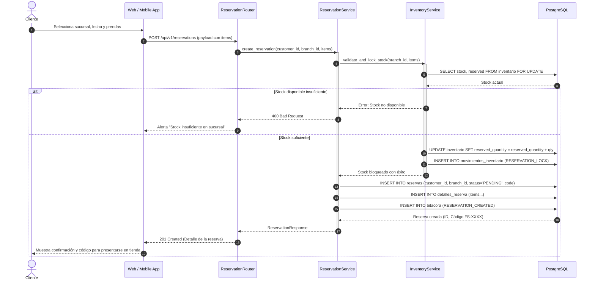

---

### 3.2 CU14 / CU17: Compra Digital con Pago Electrónico Sandbox e Idempotencia

El cliente finaliza su carrito digital, selecciona la sucursal de retiro/envío y completa el pago electrónico. El stock físico se descuenta **únicamente cuando el pago es aprobado**, garantizando idempotencia.

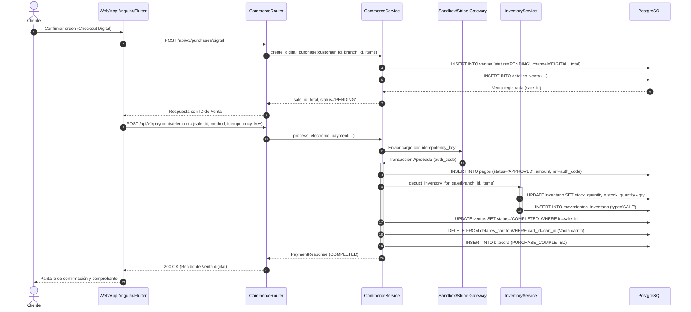

---

### 3.3 CU15 / CU16: Venta Presencial en Caja (Punto de Venta POS)

Un cajero atiende a un cliente en la tienda física, escanea códigos de barra de las prendas y procesa el cobro en efectivo, registrando el monto recibido y calculando el cambio.

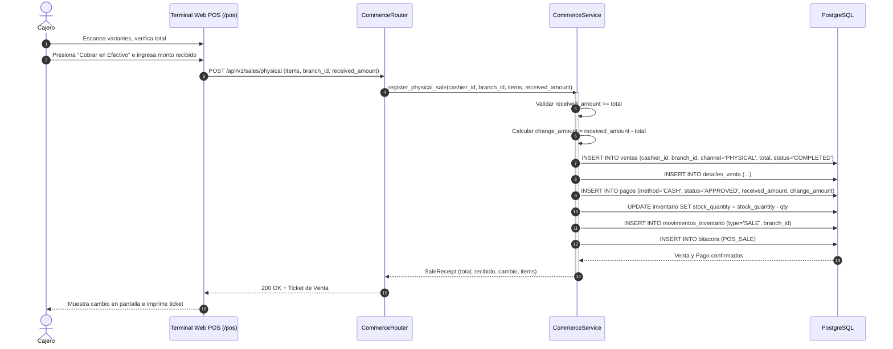

---

### 3.4 Catálogo Completo de Diagramas de Secuencia (UML 2.5 — Ciclos 1, 2 y 3)

Estos diagramas modelan la ejecución temporal y la mensajería entre capas para los **23 Casos de Uso** del sistema en Enterprise Architect, siguiendo estrictamente el estándar UML 2.5:
* **Marco pentagonal**: `sd CUxx [Nombre del Caso de Uso]`.
* **Líneas de vida**: `Actor` $\rightarrow$ `Vistas (V.xxx)` $\rightarrow$ `Controlador (xxxController)` $\rightarrow$ `Modelos (M.xxx)`.
* **Fragmentos combinados (`alt`)**: Agrupan los flujos y operaciones principales de cada caso de uso.
* **Mensajería**: Llamadas síncronas (`operacion()`), retornos tipados (`return()`) con líneas discontinuas y llamadas a interfaz (`view()`).

---

#### 3.4.1 Ciclo 1 — Catálogo y Base

##### CU01: Registrar Cliente
Modela la verificación de unicidad de email, alta de usuario y cliente, auditoría y cancelación.

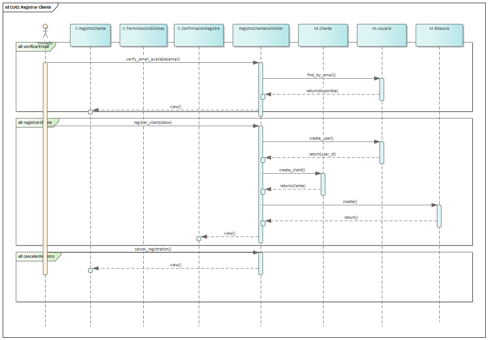

* **Actor**: `Invitado`
* **Vistas**: `V.RegistroCliente`, `V.TerminosCondiciones`, `V.ConfirmacionRegistro`
* **Controlador**: `RegistroClienteController`
* **Modelos**: `M.Cliente`, `M.Usuario`, `M.Bitacora`
* **Flujos (`alt`)**:
  * `alt verificarEmail`: Consulta si el correo ingresado ya se encuentra registrado.
  * `alt registrarCliente`: Creación de la cuenta de usuario, perfil de cliente y registro en bitácora.
  * `alt cancelarRegistro`: Abandono del proceso y retorno al formulario inicial.

---

##### CU02: Iniciar y Cerrar Sesión
Modela la autenticación mediante credenciales, generación de token JWT, recuperación de contraseña y revocación de sesión.

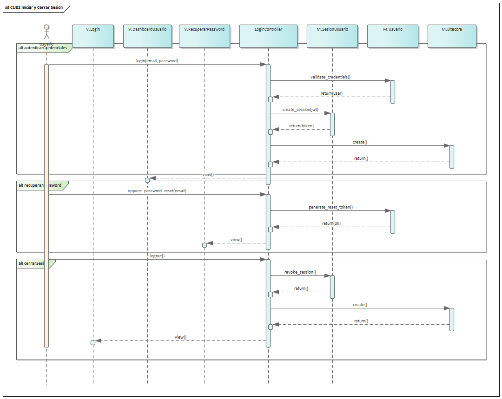

* **Actor**: `Usuario`
* **Vistas**: `V.Login`, `V.DashboardUsuario`, `V.RecuperarPassword`
* **Controlador**: `LoginController`
* **Modelos**: `M.SesionUsuario`, `M.Usuario`, `M.Bitacora`
* **Flujos (`alt`)**:
  * `alt autenticarCredenciales`: Validación de hash de contraseña, generación de JWT y registro en bitácora.
  * `alt recuperarPassword`: Solicitud de token temporal de restablecimiento por correo.
  * `alt cerrarSesion`: Invalidación de sesión activa y auditoría de salida.

---

##### CU03: Gestionar Usuarios y Roles
Modela el listado de personal, alta de nuevo usuario con rol, modificación de perfil y alternancia de estado.

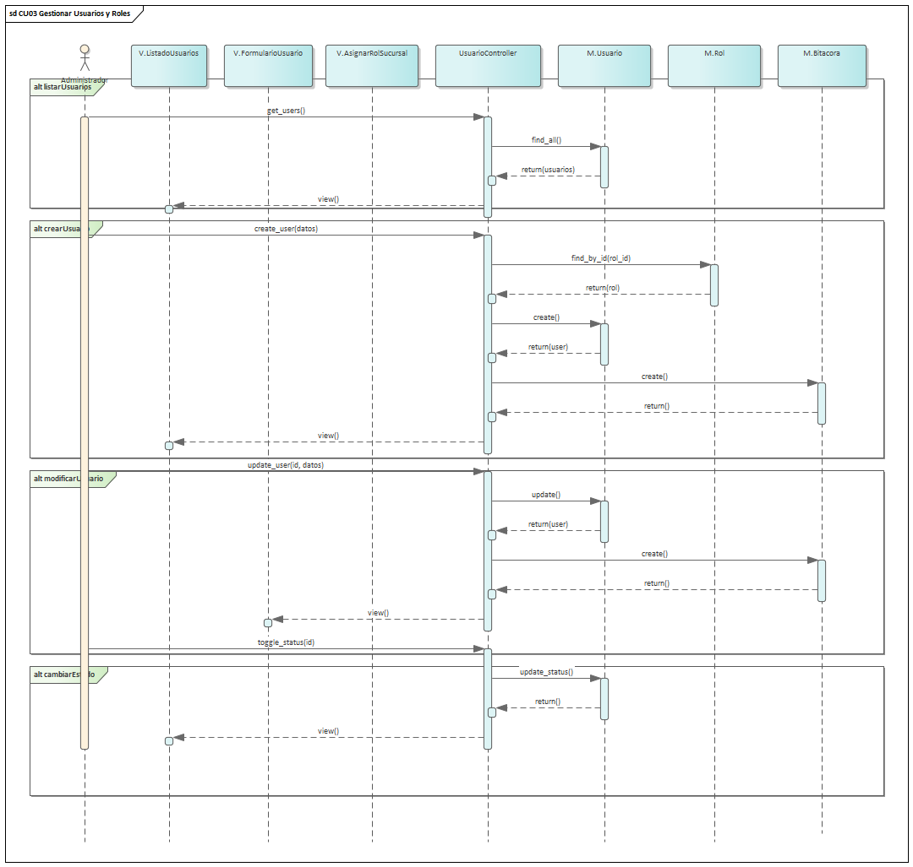

* **Actor**: `Administrador`
* **Vistas**: `V.ListadoUsuarios`, `V.FormularioUsuario`, `V.AsignarRolSucursal`
* **Controlador**: `UsuarioController`
* **Modelos**: `M.Usuario`, `M.Rol`, `M.Bitacora`
* **Flujos (`alt`)**:
  * `alt listarUsuarios`: Consulta y proyección de la lista general de usuarios y roles.
  * `alt crearUsuario`: Registro de un nuevo operador, asociación de rol y registro en bitácora.
  * `alt modificarUsuario`: Actualización de datos personales y credenciales.
  * `alt cambiarEstado`: Activación o desactivación del usuario en la plataforma.

---

##### CU04: Gestionar Sucursales y Ciudades
Modela la administración de sedes físicas, consulta de ciudades, alta de sucursal, geolocalización y desactivación.

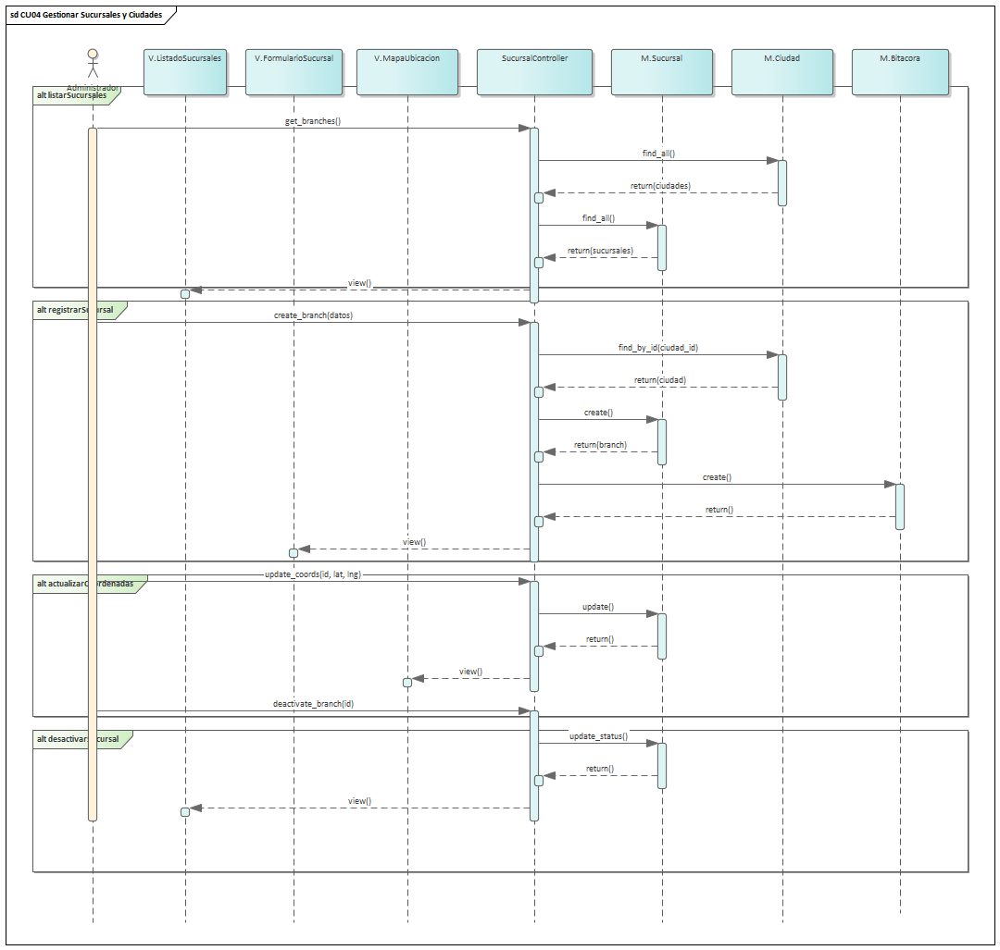

* **Actor**: `Administrador`
* **Vistas**: `V.ListadoSucursales`, `V.FormularioSucursal`, `V.MapaUbicacion`
* **Controlador**: `SucursalController`
* **Modelos**: `M.Sucursal`, `M.Ciudad`, `M.Bitacora`
* **Flujos (`alt`)**:
  * `alt listarSucursales`: Consulta de tiendas agrupadas por ciudad.
  * `alt registrarSucursal`: Alta de nueva sede física y registro en bitácora.
  * `alt actualizarCoordenadas`: Actualización de latitud y longitud en el mapa geográfico.
  * `alt desactivarSucursal`: Cambio de estado operativo de la sucursal.

---

##### CU05: Gestionar Productos y Prendas
Modela la administración del catálogo de prendas, creación de variantes de talla/color y control de visibilidad.

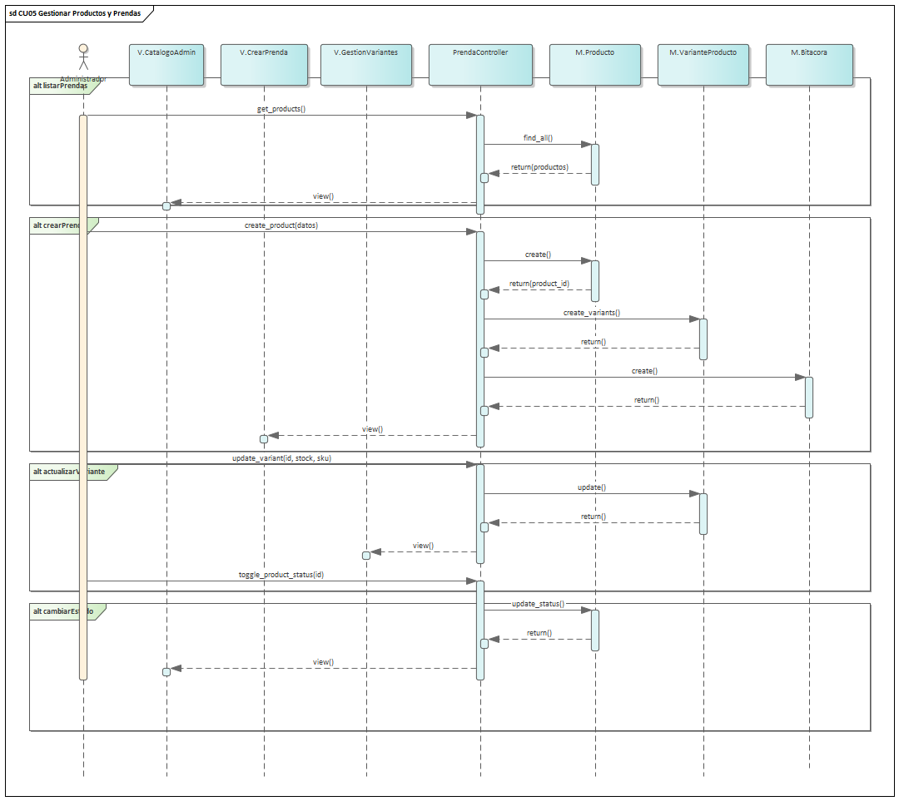

* **Actor**: `Administrador`
* **Vistas**: `V.CatalogoAdmin`, `V.CrearPrenda`, `V.GestionVariantes`
* **Controlador**: `PrendaController`
* **Modelos**: `M.Producto`, `M.VarianteProducto`, `M.Bitacora`
* **Flujos (`alt`)**:
  * `alt listarPrendas`: Consulta paginada del catálogo de productos con filtros.
  * `alt crearPrenda`: Registro de la prenda maestra y generación masiva de variantes SKU.
  * `alt actualizarVariante`: Ajuste de código SKU o stock asignado a la variante.
  * `alt cambiarEstado`: Publicación o retiro de la prenda del catálogo.

---

##### CU06: Gestionar Catálogo Base (Categorías, Tallas, Colores)
Modela la administración de las taxonomías maestras del sistema textil.

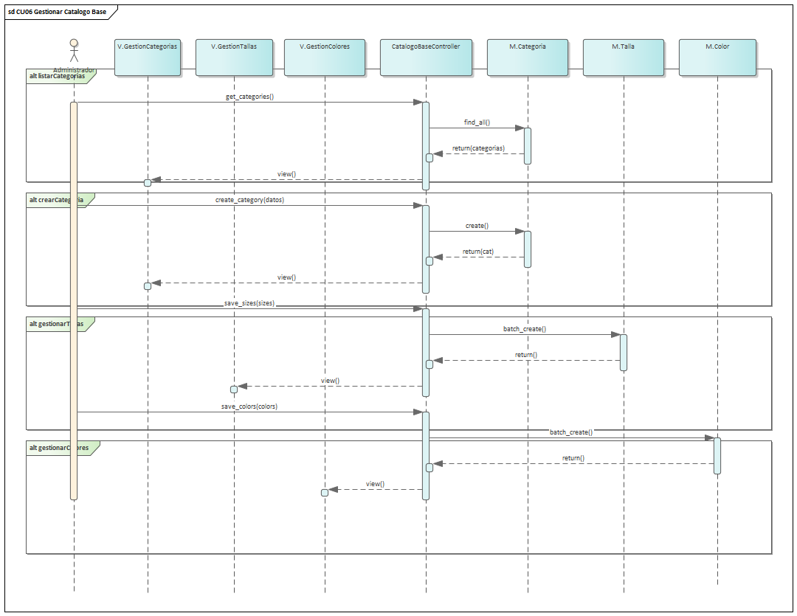

* **Actor**: `Administrador`
* **Vistas**: `V.GestionCategorias`, `V.GestionTallas`, `V.GestionColores`
* **Controlador**: `CatalogoBaseController`
* **Modelos**: `M.Categoria`, `M.Talla`, `M.Color`
* **Flujos (`alt`)**:
  * `alt listarCategorias`: Consulta de la jerarquía de categorías textiles.
  * `alt crearCategoria`: Alta de nueva categoría de prendas.
  * `alt gestionarTallas`: Registro y actualización por lote de la tabla de tallas.
  * `alt gestionarColores`: Registro y actualización por lote de colores de temporada.

---

##### CU07: Gestionar Proveedores
Modela el registro de fabricantes y distribuidores textiles, consulta de órdenes de compra y actualización de datos.

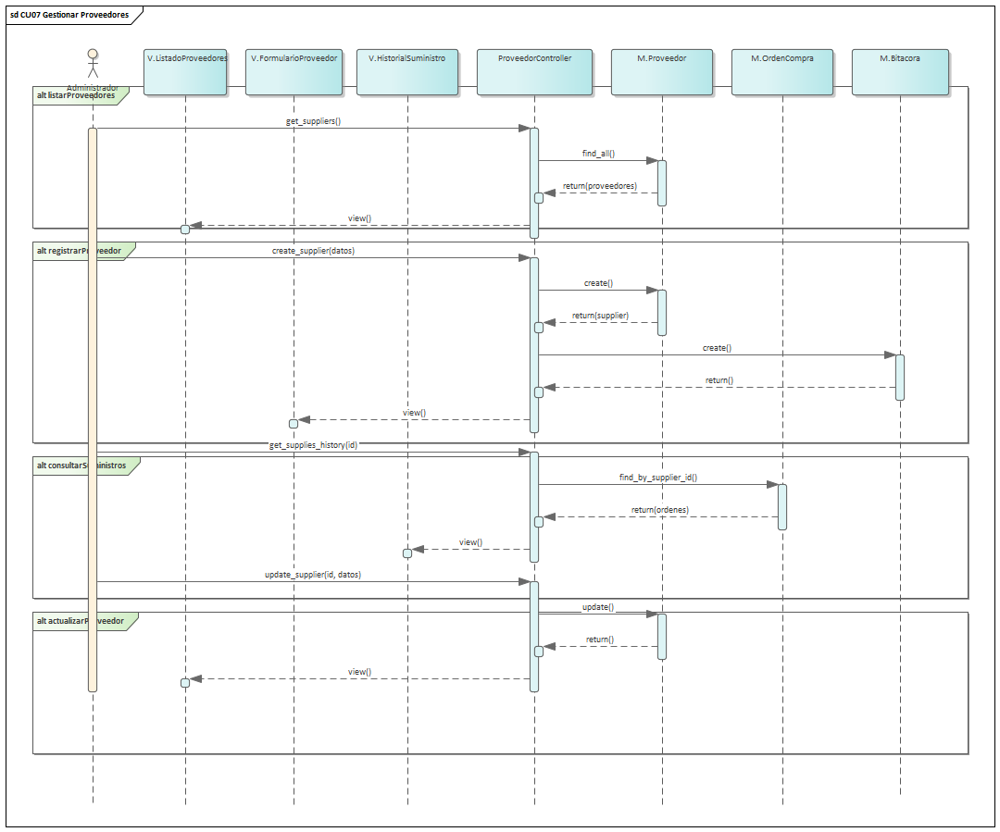

* **Actor**: `Administrador`
* **Vistas**: `V.ListadoProveedores`, `V.FormularioProveedor`, `V.HistorialSuministro`
* **Controlador**: `ProveedorController`
* **Modelos**: `M.Proveedor`, `M.OrdenCompra`, `M.Bitacora`
* **Flujos (`alt`)**:
  * `alt listarProveedores`: Consulta de proveedores registrados y su estado contractual.
  * `alt registrarProveedor`: Alta del proveedor y registro en bitácora.
  * `alt consultarSuministros`: Historial de órdenes de compra y suministros recibidos.
  * `alt actualizarProveedor`: Modificación de datos de contacto o condiciones comerciales.

---

##### CU08: Consultar Catálogo y Buscar Prendas
Modela la exploración pública del catálogo por parte del cliente, filtros de búsqueda y ficha técnica.

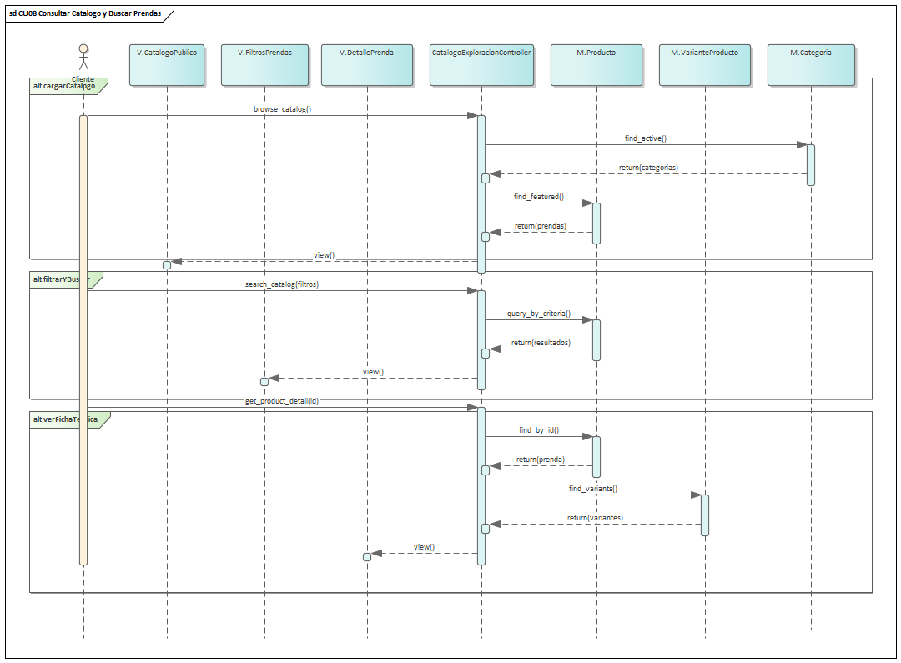

* **Actor**: `Cliente`
* **Vistas**: `V.CatalogoPublico`, `V.FiltrosPrendas`, `V.DetallePrenda`
* **Controlador**: `CatalogoExploracionController`
* **Modelos**: `M.Producto`, `M.VarianteProducto`, `M.Categoria`
* **Flujos (`alt`)**:
  * `alt cargarCatalogo`: Consulta de categorías activas y prendas destacadas.
  * `alt filtrarYBuscar`: Búsqueda por palabra clave, rango de precio o categoría.
  * `alt verFichaTecnica`: Carga de detalles de la prenda, fotografías y variantes disponibles.

---

##### CU09: Consultar Disponibilidad en Tiendas
Modela la verificación de stock disponible en tiempo real por sucursal física y ciudad para una prenda y talla seleccionada.

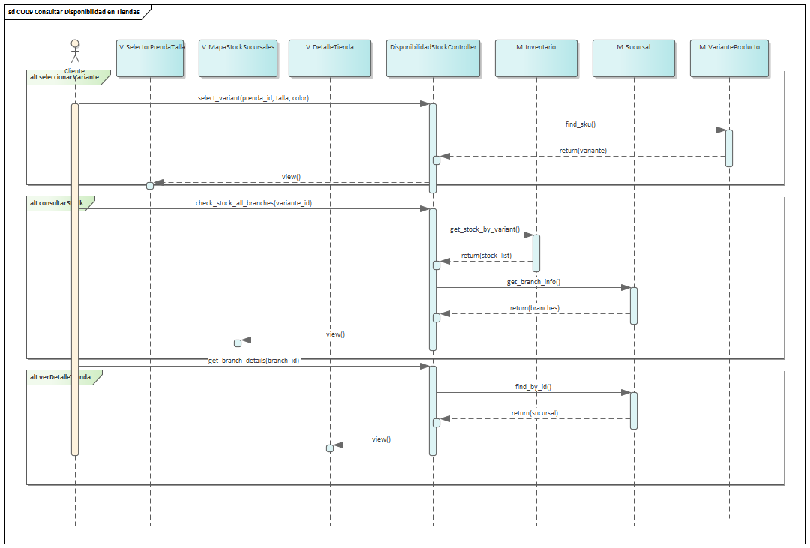

* **Actor**: `Cliente`
* **Vistas**: `V.SelectorPrendaTalla`, `V.MapaStockSucursales`, `V.DetalleTienda`
* **Controlador**: `DisponibilidadStockController`
* **Modelos**: `M.Inventario`, `M.Sucursal`, `M.VarianteProducto`
* **Flujos (`alt`)**:
  * `alt seleccionarVariante`: Identificación del SKU correspondiente a la combinación talla/color.
  * `alt consultarStock`: Consulta de unidades físicas disponibles en todas las sucursales.
  * `alt verDetalleTienda`: Consulta de dirección, horario y ubicación de la tienda seleccionada.

---

#### 3.4.2 Ciclo 2 — Operación Comercial y Logística

##### CU10: Realizar Reserva de Prendas
Modela la reserva de prendas para prueba física en sucursal con bloqueo preventivo de inventario.

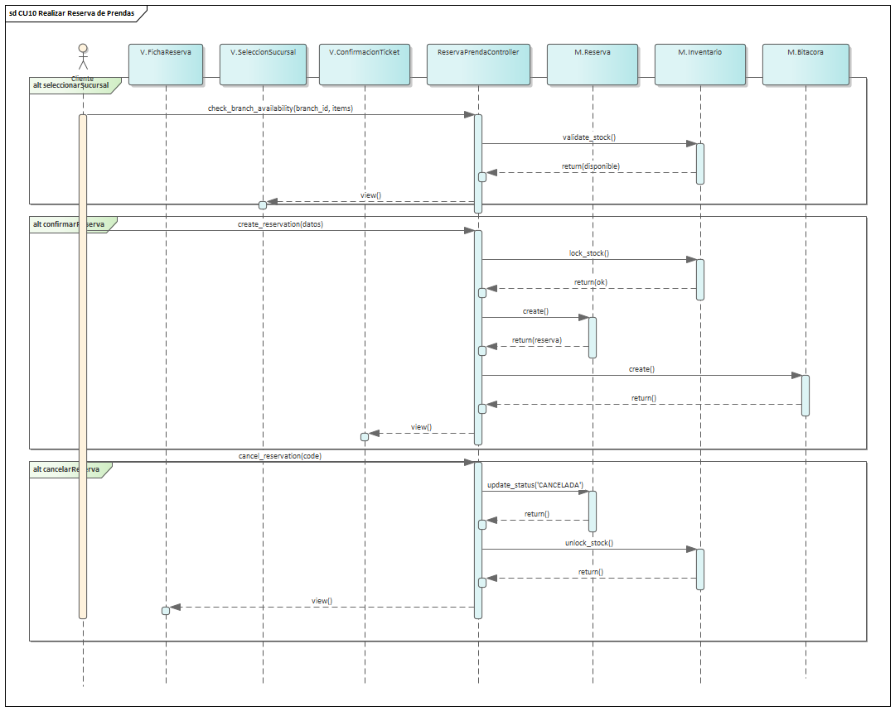

* **Actor**: `Cliente`
* **Vistas**: `V.FichaReserva`, `V.SeleccionSucursal`, `V.ConfirmacionTicket`
* **Controlador**: `ReservaPrendaController`
* **Modelos**: `M.Reserva`, `M.Inventario`, `M.Bitacora`
* **Flujos (`alt`)**:
  * `alt seleccionarSucursal`: Verificación de existencias de las prendas en la tienda seleccionada.
  * `alt confirmarReserva`: Bloqueo atómico de stock, creación de la reserva y ticket con código alfanumérico.
  * `alt cancelarReserva`: Cancelación anticipada por el cliente y liberación inmediata del stock.

---

##### CU11: Atender Reservas en Sucursal
Modela la recepción del cliente en tienda física, búsqueda por código alfanumérico, entrega o liberación por expiración.

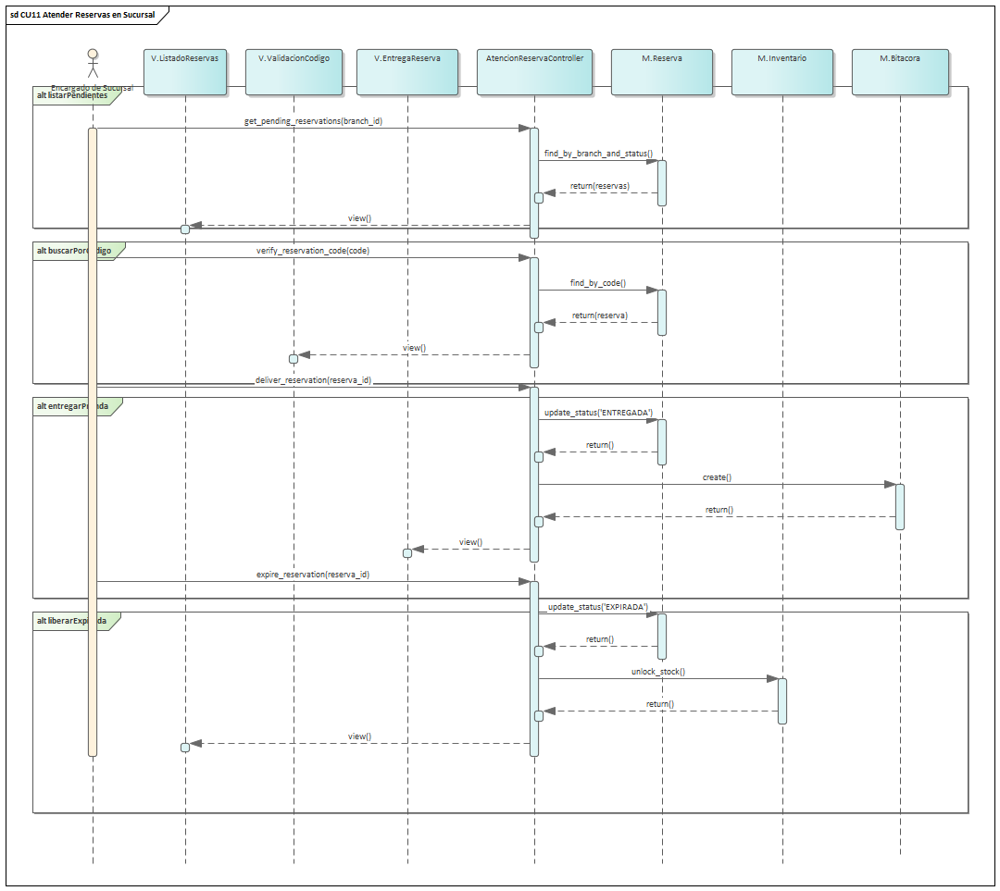

* **Actor**: `Encargado de Sucursal`
* **Vistas**: `V.ListadoReservas`, `V.ValidacionCodigo`, `V.EntregaReserva`
* **Controlador**: `AtencionReservaController`
* **Modelos**: `M.Reserva`, `M.Inventario`, `M.Bitacora`
* **Flujos (`alt`)**:
  * `alt listarPendientes`: Listado de reservas programadas pendientes para la sucursal activa.
  * `alt buscarPorCodigo`: Búsqueda y validación del código presentado por el cliente.
  * `alt entregarPrenda`: Confirmación de entrega, cambio a estado ENTREGADA y auditoría.
  * `alt liberarExpirada`: Expiración de reservas no recogidas y restitución del stock bloqueado.

---

##### CU13: Administrar Carrito de Compras
Modela la gestión reactiva de prendas en el carrito virtual, cálculo de subtotales en tiempo real y persistencia.

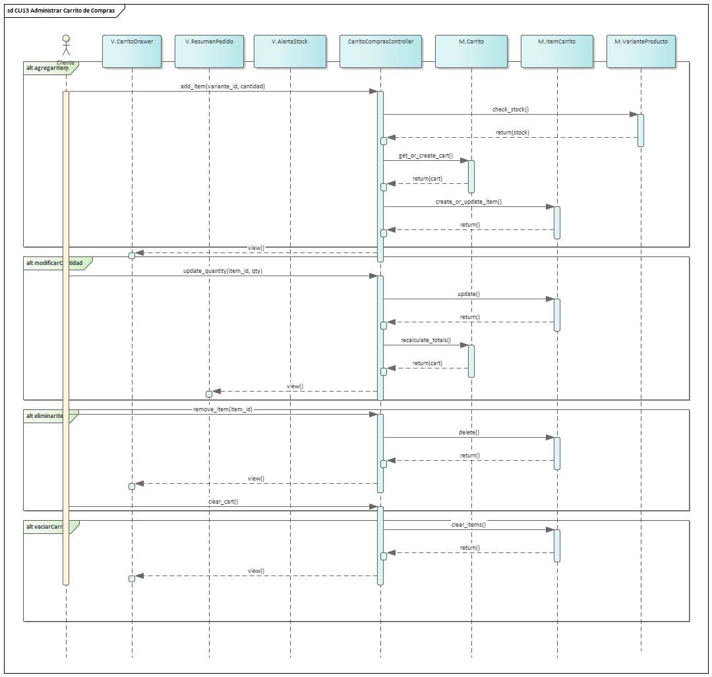

* **Actor**: `Cliente`
* **Vistas**: `V.CarritoDrawer`, `V.ResumenPedido`, `V.AlertaStock`
* **Controlador**: `CarritoComprasController`
* **Modelos**: `M.Carrito`, `M.ItemCarrito`, `M.VarianteProducto`
* **Flujos (`alt`)**:
  * `alt agregarItem`: Comprobación de existencias y agregado de la variante al carrito.
  * `alt modificarCantidad`: Modificación de unidades y recálculo dinámico de totales.
  * `alt eliminarItem`: Eliminación de una línea de producto del carrito.
  * `alt vaciarCarrito`: Limpieza integral de todos los ítems del carrito.

---

##### CU14: Realizar Compra Digital
Modela el checkout electrónico, dirección de envío, orden de venta y creación de registro de pago pendiente.

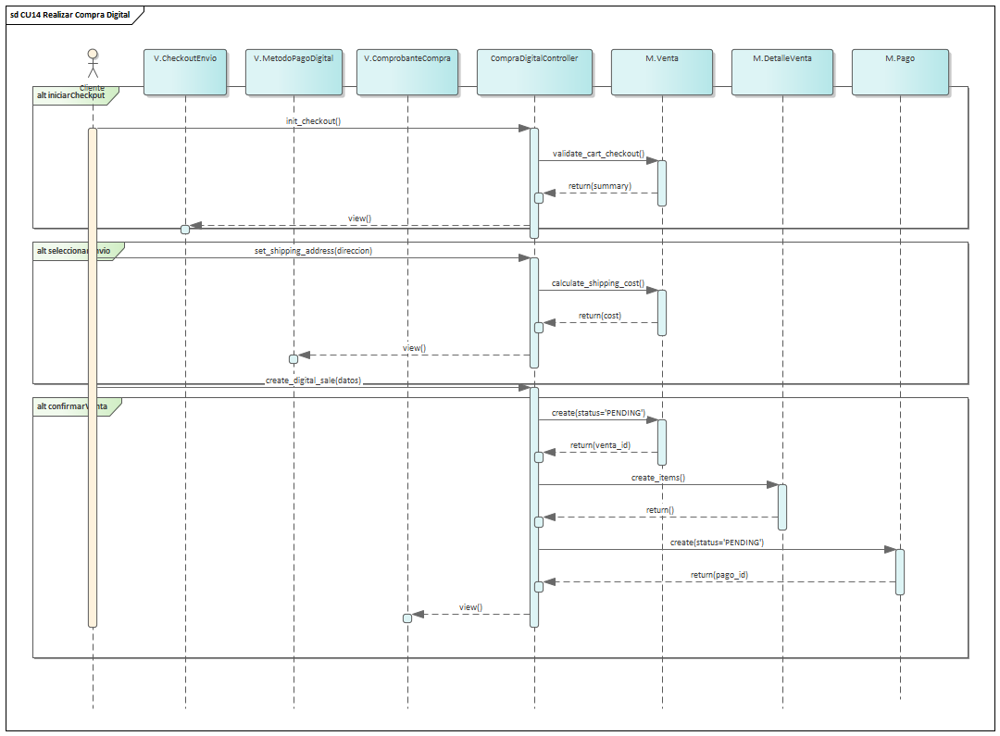

* **Actor**: `Cliente`
* **Vistas**: `V.CheckoutEnvio`, `V.MetodoPagoDigital`, `V.ComprobanteCompra`
* **Controlador**: `CompraDigitalController`
* **Modelos**: `M.Venta`, `M.DetalleVenta`, `M.Pago`
* **Flujos (`alt`)**:
  * `alt iniciarCheckout`: Validación de inventario de los ítems del carrito y resumen de compra.
  * `alt seleccionarEnvio`: Registro de dirección de entrega y cálculo de costo de flete.
  * `alt confirmarVenta`: Generación de venta en estado PENDING, desglose de detalles y preparación de pago.

---

##### CU15: Realizar Venta Presencial (POS)
Modela la operación de caja física en sucursal, lectura por código de barras, selección de cliente y deducción inmediata de inventario.

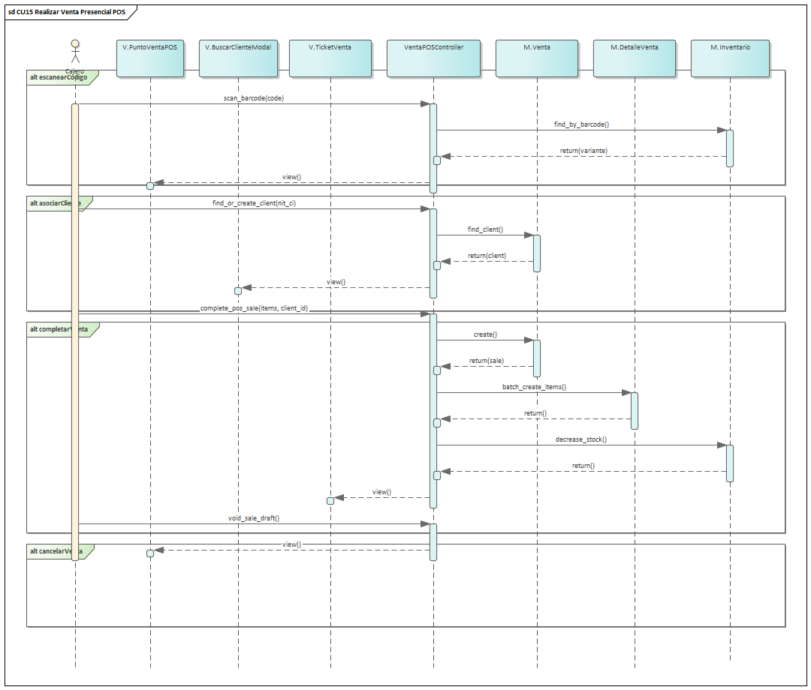

* **Actor**: `Cajero`
* **Vistas**: `V.PuntoVentaPOS`, `V.BuscarClienteModal`, `V.TicketVenta`
* **Controlador**: `VentaPOSController`
* **Modelos**: `M.Venta`, `M.DetalleVenta`, `M.Inventario`
* **Flujos (`alt`)**:
  * `alt escanearCodigo`: Lectura del código de barras de la variante y agregación al ticket.
  * `alt asociarCliente`: Búsqueda o registro rápido del cliente por NIT/CI.
  * `alt completarVenta`: Registro de venta física, detalles e impacto en stock físico de la tienda.
  * `alt cancelarVenta`: Anulación del borrador de venta en caja.

---

##### CU16: Cobro en Caja (Efectivo/Tarjeta/QR)
Modela el procesamiento del cobro en mostrador, cálculo de cambio y emisión de comprobante fiscal.

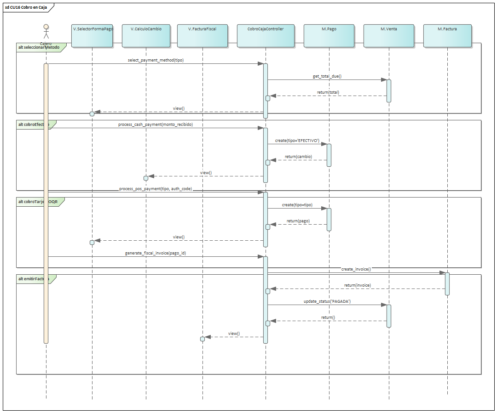

* **Actor**: `Cajero`
* **Vistas**: `V.SelectorFormaPago`, `V.CalculoCambio`, `V.FacturaFiscal`
* **Controlador**: `CobroCajaController`
* **Modelos**: `M.Pago`, `M.Venta`, `M.Factura`
* **Flujos (`alt`)**:
  * `alt seleccionarMetodo`: Selección del medio de pago (Efectivo, Tarjeta, QR) y total adeudado.
  * `alt cobroEfectivo`: Registro de importe recibido y cálculo del cambio a devolver.
  * `alt cobroTarjetaOQR`: Registro de autorización de tarjeta o lectura de comprobante QR.
  * `alt emitirFactura`: Generación de la factura fiscal y liquidación final de la venta.

---

##### CU17: Procesar Pago Electrónico Sandbox
Modela la comunicación asíncrona con la pasarela Stripe Sandbox, intents, webhooks e idempotencia.

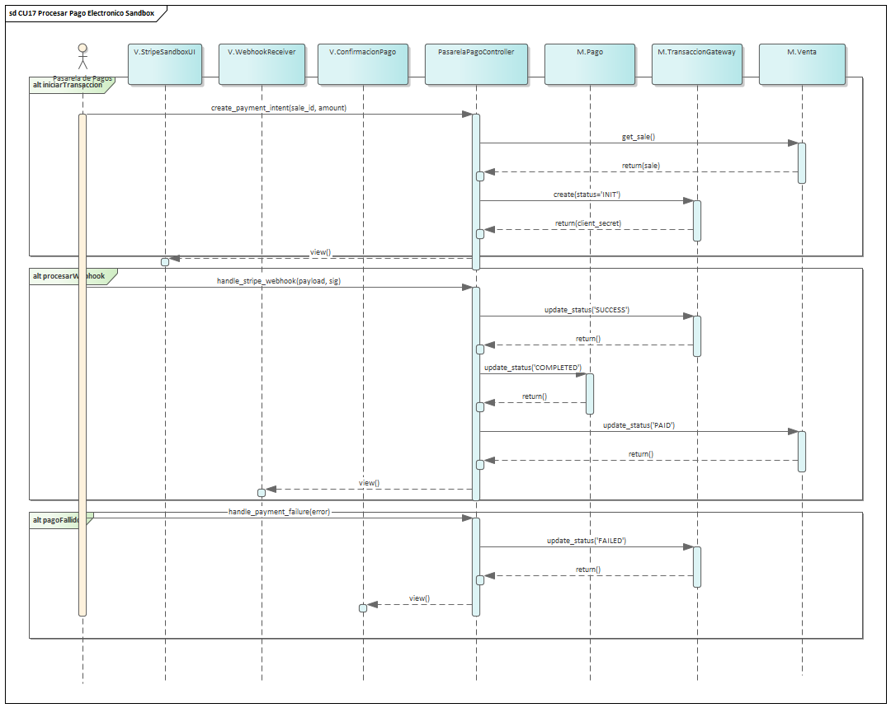

* **Actor**: `Pasarela de Pagos`
* **Vistas**: `V.StripeSandboxUI`, `V.WebhookReceiver`, `V.ConfirmacionPago`
* **Controlador**: `PasarelaPagoController`
* **Modelos**: `M.Pago`, `M.TransaccionGateway`, `M.Venta`
* **Flujos (`alt`)**:
  * `alt iniciarTransaccion`: Creación del PaymentIntent y retorno del client_secret al frontend.
  * `alt procesarWebhook`: Recepción del evento payment_intent.succeeded y actualización de la venta a PAID.
  * `alt pagoFallido`: Registro del error de pago y notificación para reintento.

---

##### CU18: Control de Stock y Movimientos
Modela la gestión de inventario físico, entradas por compras, transferencias entre sucursales y ajustes por recuento.

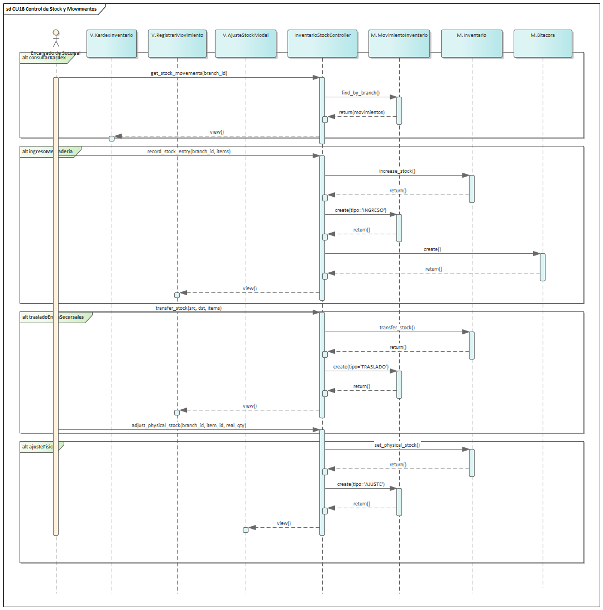

* **Actor**: `Encargado de Sucursal`
* **Vistas**: `V.KardexInventario`, `V.RegistrarMovimiento`, `V.AjusteStockModal`
* **Controlador**: `InventarioStockController`
* **Modelos**: `M.MovimientoInventario`, `M.Inventario`, `M.Bitacora`
* **Flujos (`alt`)**:
  * `alt consultarKardex`: Consulta cronológica de movimientos de entrada, salida y ajustes.
  * `alt ingresoMercaderia`: Entrada física de prendas al almacén de la tienda.
  * `alt trasladoEntreSucursales`: Despacho o recepción de prendas transferidas entre tiendas.
  * `alt ajusteFisico`: Corrección de inventario por diferencias en conteo físico o mermas.

---

##### CU19: Gestionar Temporadas y Colecciones
Modela la planificación de colecciones de moda, vigencias por año/estación y asociación de prendas.

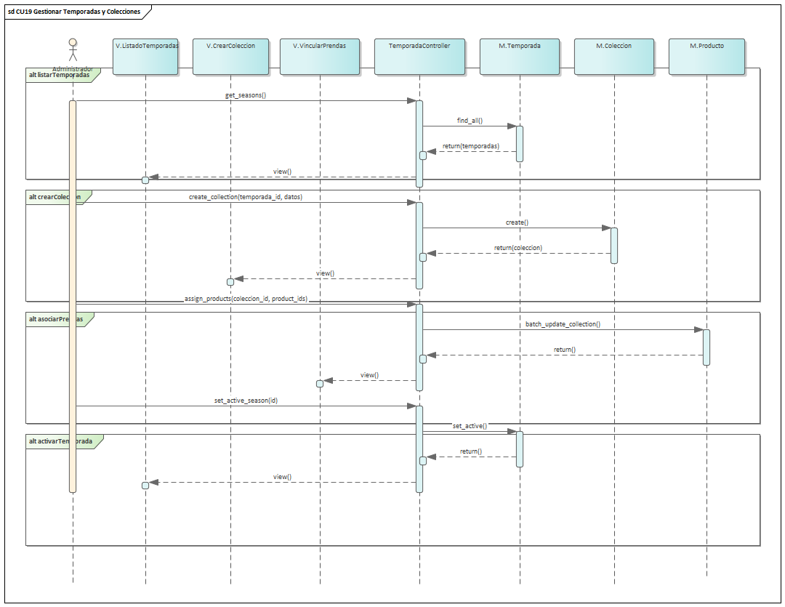

* **Actor**: `Administrador`
* **Vistas**: `V.ListadoTemporadas`, `V.CrearColeccion`, `V.VincularPrendas`
* **Controlador**: `TemporadaController`
* **Modelos**: `M.Temporada`, `M.Coleccion`, `M.Producto`
* **Flujos (`alt`)**:
  * `alt listarTemporadas`: Consulta de temporadas históricas y activas.
  * `alt crearColeccion`: Alta de una nueva colección temática vinculada a una temporada.
  * `alt asociarPrendas`: Asignación masiva de prendas del catálogo a la colección.
  * `alt activarTemporada`: Activación de la temporada vigente para el sistema y catálogo.

---

#### 3.4.3 Ciclo 3 — Innovación, Analítica e IA

##### CU12: Sesión de Probador Virtual (Fitting Room)
Modela el inicio de sesión, selección de prenda, procesamiento del ajuste virtual VTON con landmarks y finalización de sesión.

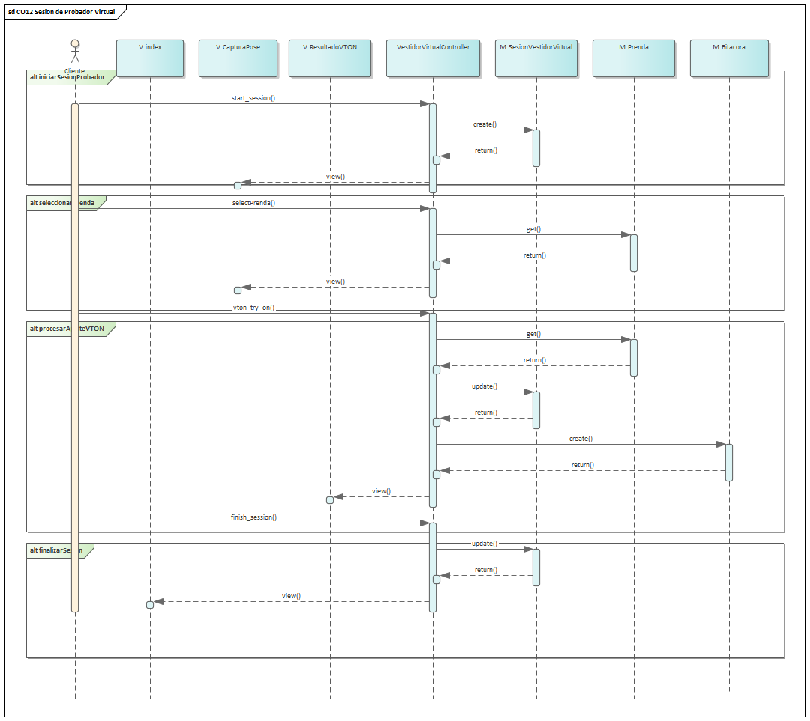

* **Actor**: `Cliente`
* **Vistas**: `V.index`, `V.CapturaPose`, `V.ResultadoVTON`
* **Controlador**: `VestidorVirtualController`
* **Modelos**: `M.SesionVestidorVirtual`, `M.Prenda`, `M.Bitacora`
* **Flujos (`alt`)**:
  * `alt iniciarSesionProbador`: Inicia sesión en probador virtual y carga la pantalla de captura de pose.
  * `alt seleccionarPrenda`: Consulta modelo 3D/metadata de la prenda elegida en catálogo.
  * `alt procesarAjusteVTON`: Ejecuta el motor VTON, actualiza sesión y registra auditoría en bitácora.
  * `alt finalizarSesion`: Cierra la sesión activa y retorna a la vista principal.

---

##### CU20: Gestionar Promociones y Descuentos
Modela la administración CRUD completa, cálculo de descuentos y auditoría de promociones comerciales.

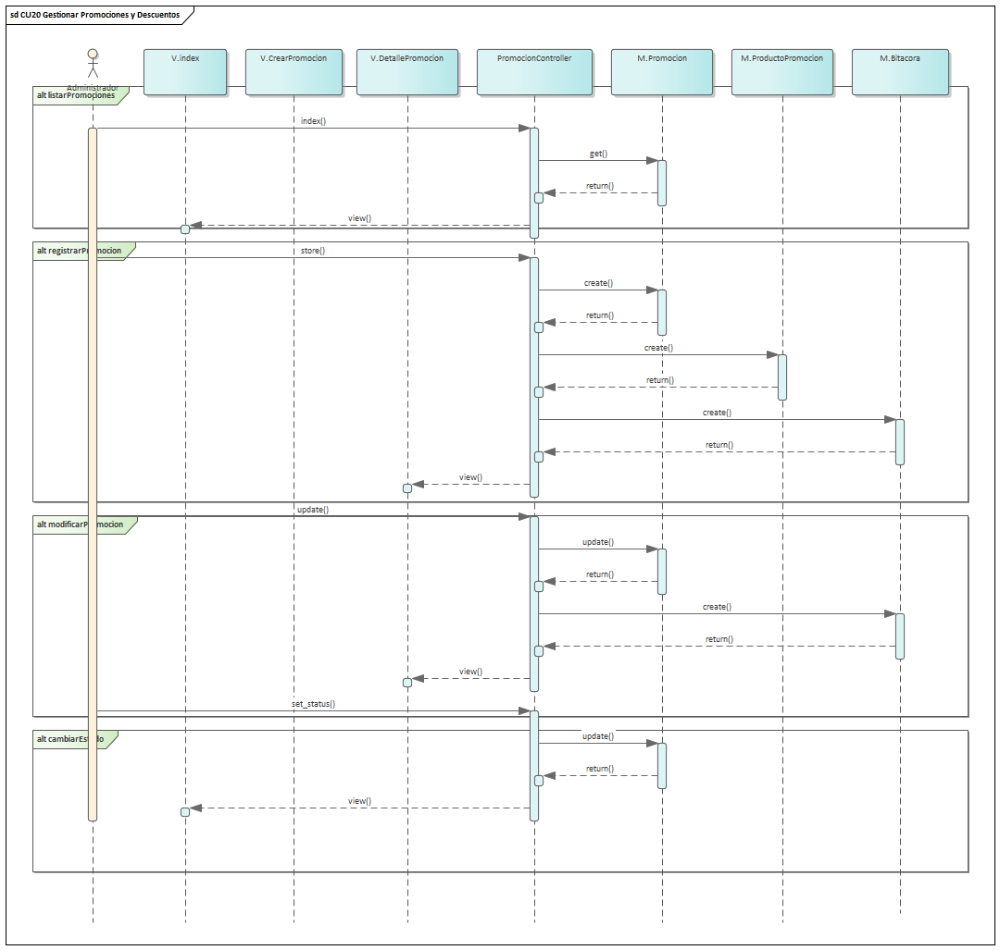

* **Actor**: `Administrador`
* **Vistas**: `V.index`, `V.CrearPromocion`, `V.DetallePromocion`
* **Controlador**: `PromocionController`
* **Modelos**: `M.Promocion`, `M.ProductoPromocion`, `M.Bitacora`
* **Flujos (`alt`)**:
  * `alt listarPromociones`: Consulta de catálogo de promociones activas e históricas.
  * `alt registrarPromocion`: Creación de promoción, vinculación de productos y auditoría en bitácora.
  * `alt modificarPromocion`: Actualización de vigencias, porcentaje/monto de descuento y auditoría.
  * `alt cambiarEstado`: Activación o desactivación inmediata del descuento en catálogo y POS.

---

##### CU21: Gestionar Reportes y Dashboards Gerenciales
Modela la consulta de KPIs, filtros dinámicos por sucursal, asistente IA analítico y exportación a formatos ofimáticos.

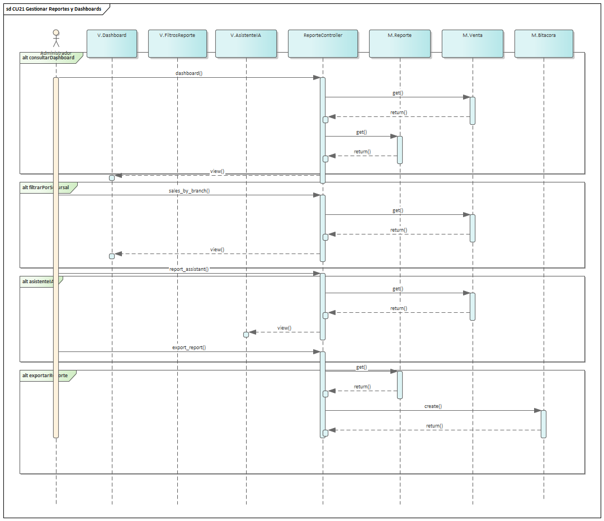

* **Actor**: `Administrador`
* **Vistas**: `V.Dashboard`, `V.FiltrosReporte`, `V.AsistenteIA`
* **Controlador**: `ReporteController`
* **Modelos**: `M.Reporte`, `M.Venta`, `M.Bitacora`
* **Flujos (`alt`)**:
  * `alt consultarDashboard`: Consolidación analítica de ventas, ingresos y reservas.
  * `alt filtrarPorSucursal`: Desglose segmentado por sucursal geográfica.
  * `alt asistenteIA`: Consulta con lenguaje natural procesada por el asistente analítico de IA.
  * `alt exportarReporte`: Generación de snapshot descargable en formato Excel / PDF y registro de evento.

---

##### CU22: Obtener Recomendaciones Personalizadas con IA
Modela el motor de afinidad de catálogo, filtros estacionales, visualización de productos afines y captura de feedback.

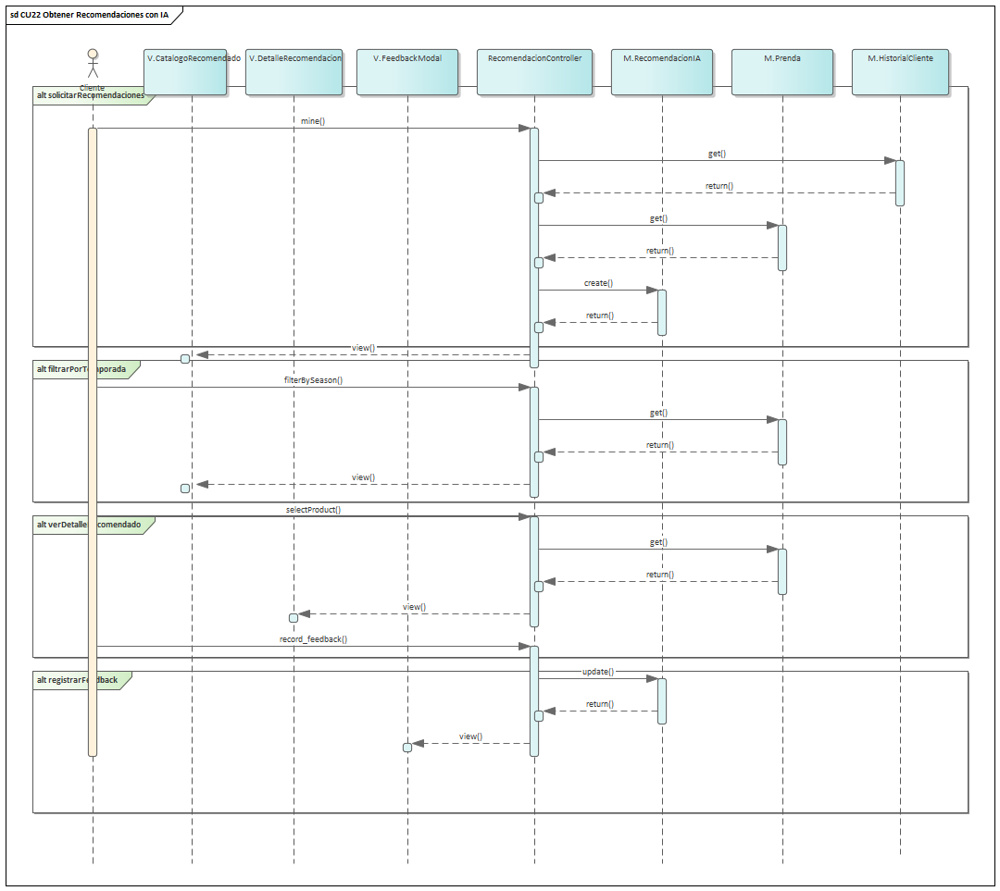

* **Actor**: `Cliente`
* **Vistas**: `V.CatalogoRecomendado`, `V.DetalleRecomendacion`, `V.FeedbackModal`
* **Controlador**: `RecomendacionController`
* **Modelos**: `M.RecomendacionIA`, `M.Prenda`, `M.HistorialCliente`
* **Flujos (`alt`)**:
  * `alt solicitarRecomendaciones`: Generación de ranking personalizado según historial y stock.
  * `alt filtrarPorTemporada`: Ajuste de prendas según temporada activa y clima.
  * `alt verDetalleRecomendado`: Consulta de características y variante sugerida.
  * `alt registrarFeedback`: Calificación de la sugerencia para reentrenar el modelo de scoring.

---

##### CU23: Consultar Historial y Detalle de Compras
Modela el listado de compras del cliente, desglose de ítems, descarga de comprobante y solicitud de devolución.

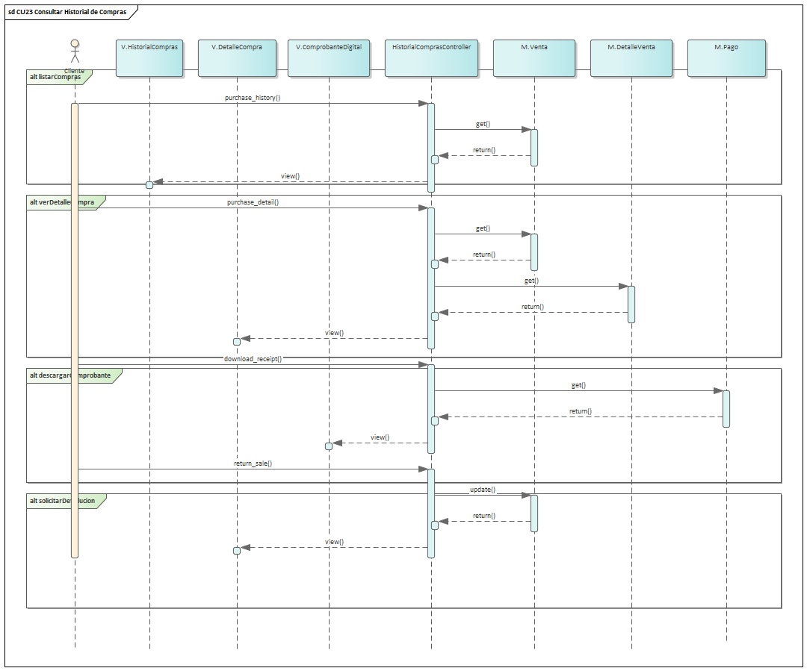

* **Actor**: `Cliente`
* **Vistas**: `V.HistorialCompras`, `V.DetalleCompra`, `V.ComprobanteDigital`
* **Controlador**: `HistorialComprasController`
* **Modelos**: `M.Venta`, `M.DetalleVenta`, `M.Pago`
* **Flujos (`alt`)**:
  * `alt listarCompras`: Listado paginado de órdenes y ventas del cliente autenticado.
  * `alt verDetalleCompra`: Desglose detallado de prendas, precios y descuentos por línea.
  * `alt descargarComprobante`: Generación y descarga del recibo o factura digital de pago.
  * `alt solicitarDevolucion`: Registro de solicitud de devolución y cambio de estado de la orden.

---

## 4. Diagramas de Comunicación / Colaboración (Análisis de Robustez BCE — Ciclos 1, 2 y 3)

Los Diagramas de Comunicación (UML 2.5) modelan la realización dinámica de los Casos de Uso mediante el patrón de análisis de robustez **BCE** (*Boundary-Control-Entity*). Cada diagrama presenta:
- **Actor**: Rol que desencadena el caso de uso.
- **Boundary (`|O`)**: Interfaz de usuario especializada (Angular 20 / Flutter).
- **Control (`@->`)**: Controlador de backend modular FastAPI con lógica de aplicación.
- **Entity (`O_`)**: Entidad SQLAlchemy ORM del modelo de dominio.
- **Mensajes numerados jerárquicamente**: Secuencias ordenadas `1: ...`, `1.1: ...`, `1.2: ...` con firmas y parámetros realistas.

---

### 4.1 Ciclo 1 — Catálogo y Base

#### CU01: Registrar Cliente
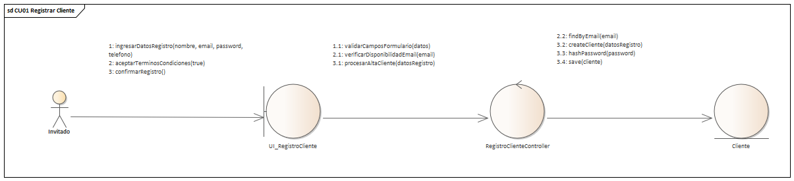
* **Actor**: `Invitado` | **Boundary**: `UI_RegistroCliente` | **Control**: `RegistroClienteController` | **Entity**: `Cliente`
* **Mensajes**:
  * `1: ingresarDatosRegistro(...)` $\rightarrow$ `1.1: validarCamposFormulario(...)` $\rightarrow$ `2.1: verificarDisponibilidadEmail(...)` $\rightarrow$ `2.2: findByEmail(...)`
  * `3: confirmarRegistro()` $\rightarrow$ `3.1: procesarAltaCliente(...)` $\rightarrow$ `3.2: createCliente(...)` / `3.3: hashPassword(...)` / `3.4: save(cliente)`

#### CU02: Iniciar y Cerrar Sesión
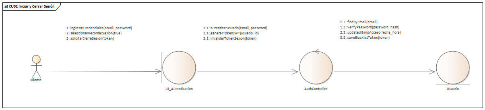
* **Actor**: `Cliente` | **Boundary**: `UI_Autenticacion` | **Control**: `AuthController` | **Entity**: `Usuario`
* **Mensajes**:
  * `1: ingresarCredenciales(...)` $\rightarrow$ `1.1: autenticarUsuario(...)` $\rightarrow$ `1.2: findByEmail(...)` / `1.3: verifyPassword(...)`
  * `2: seleccionarRecordarSesion(...)` $\rightarrow$ `2.1: generarTokenJWT(...)` $\rightarrow$ `2.2: updateUltimoAcceso(...)`
  * `3: solicitarCierreSesion(...)` $\rightarrow$ `3.1: invalidarTokenSesion(...)` $\rightarrow$ `3.2: saveBlacklistToken(...)`

#### CU03: Gestionar Usuarios y Roles
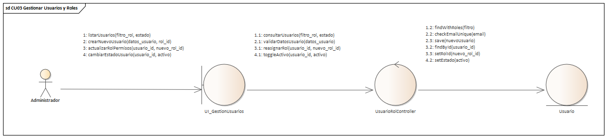
* **Actor**: `Administrador` | **Boundary**: `UI_GestionUsuarios` | **Control**: `UsuarioRolController` | **Entity**: `Usuario`
* **Mensajes**:
  * `1: listarUsuarios(...)` $\rightarrow$ `1.1: consultarUsuarios(...)` $\rightarrow$ `1.2: findWithRoles(...)`
  * `2: crearNuevoUsuario(...)` $\rightarrow$ `2.1: validarDatosUsuario(...)` $\rightarrow$ `2.2: checkEmailUnique(...)` / `2.3: save(...)`
  * `3: actualizarRolPermisos(...)` $\rightarrow$ `3.1: reasignarRol(...)` $\rightarrow$ `3.2: findById(...)` / `3.3: setRolId(...)`
  * `4: cambiarEstadoUsuario(...)` $\rightarrow$ `4.1: toggleActivo(...)` $\rightarrow$ `4.2: setEstado(...)`

#### CU04: Gestionar Sucursales y Ciudades
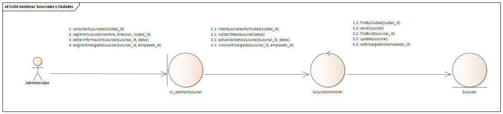
* **Actor**: `Administrador` | **Boundary**: `UI_GestionSucursal` | **Control**: `SucursalController` | **Entity**: `Sucursal`
* **Mensajes**:
  * `1: consultarSucursales(...)` $\rightarrow$ `1.1: listarSucursalesPorCiudad(...)` $\rightarrow$ `1.2: findByCiudad(...)`
  * `2: registrarSucursal(...)` $\rightarrow$ `2.1: validarDatosSucursal(...)` $\rightarrow$ `2.2: save(sucursal)`
  * `3: editarInformacionSucursal(...)` $\rightarrow$ `3.1: actualizarDatosSucursal(...)` $\rightarrow$ `3.2: findById(...)` / `3.3: update(...)`
  * `4: asignarEncargadoSucursal(...)` $\rightarrow$ `4.1: vincularEncargado(...)` $\rightarrow$ `4.2: setEncargadoId(...)`

#### CU05: Gestionar Productos y Prendas
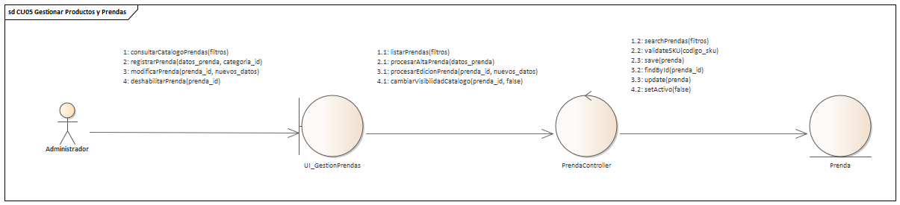
* **Actor**: `Administrador` | **Boundary**: `UI_GestionPrendas` | **Control**: `PrendaController` | **Entity**: `Prenda`
* **Mensajes**:
  * `1: consultarCatalogoPrendas(...)` $\rightarrow$ `1.1: listarPrendas(...)` $\rightarrow$ `1.2: searchPrendas(...)`
  * `2: registrarPrenda(...)` $\rightarrow$ `2.1: procesarAltaPrenda(...)` $\rightarrow$ `2.2: validateSKU(...)` / `2.3: save(prenda)`
  * `3: modificarPrenda(...)` $\rightarrow$ `3.1: procesarEdicionPrenda(...)` $\rightarrow$ `3.2: findById(...)` / `3.3: update(...)`
  * `4: deshabilitarPrenda(...)` $\rightarrow$ `4.1: cambiarVisibilidadCatalogo(...)` $\rightarrow$ `4.2: setActivo(false)`

#### CU06: Gestionar Catálogo Base (Tallas/Color/Categorías)
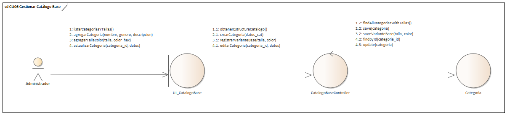
* **Actor**: `Administrador` | **Boundary**: `UI_CatalogoBase` | **Control**: `CatalogoBaseController` | **Entity**: `Categoria`
* **Mensajes**:
  * `1: listarCategoriasYTallas()` $\rightarrow$ `1.1: obtenerEstructuraCatalogo()` $\rightarrow$ `1.2: findAllCategoriasWithTallas()`
  * `2: agregarCategoria(...)` $\rightarrow$ `2.1: crearCategoria(...)` $\rightarrow$ `2.2: save(categoria)`
  * `3: agregarTallaColor(...)` $\rightarrow$ `3.1: registrarVarianteBase(...)` $\rightarrow$ `3.2: saveVarianteBase(...)`
  * `4: actualizarCategoria(...)` $\rightarrow$ `4.1: editarCategoria(...)` $\rightarrow$ `4.2: findById(...)` / `4.3: update(...)`

#### CU07: Gestionar Proveedores
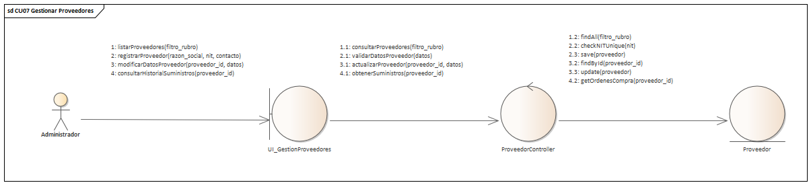
* **Actor**: `Administrador` | **Boundary**: `UI_GestionProveedores` | **Control**: `ProveedorController` | **Entity**: `Proveedor`
* **Mensajes**:
  * `1: listarProveedores(...)` $\rightarrow$ `1.1: consultarProveedores(...)` $\rightarrow$ `1.2: findAll(...)`
  * `2: registrarProveedor(...)` $\rightarrow$ `2.1: validarDatosProveedor(...)` $\rightarrow$ `2.2: checkNITUnique(...)` / `2.3: save(...)`
  * `3: modificarDatosProveedor(...)` $\rightarrow$ `3.1: actualizarProveedor(...)` $\rightarrow$ `3.2: findById(...)` / `3.3: update(...)`
  * `4: consultarHistorialSuministros(...)` $\rightarrow$ `4.1: obtenerSuministros(...)` $\rightarrow$ `4.2: getOrdenesCompra(...)`

#### CU08: Consultar Catálogo y Buscar Prendas
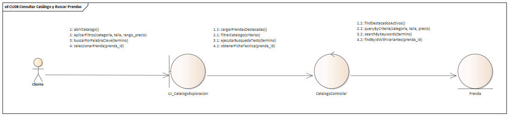
* **Actor**: `Cliente` | **Boundary**: `UI_CatalogoExploracion` | **Control**: `CatalogoController` | **Entity**: `Prenda`
* **Mensajes**:
  * `1: abrirCatalogo()` $\rightarrow$ `1.1: cargarPrendasDestacadas()` $\rightarrow$ `1.2: findDestacadosActivos()`
  * `2: aplicarFiltros(...)` $\rightarrow$ `2.1: filtrarCatalogo(...)` $\rightarrow$ `2.2: queryByCriteria(...)`
  * `3: buscarPorPalabraClave(...)` $\rightarrow$ `3.1: ejecutarBusquedaTexto(...)` $\rightarrow$ `3.2: searchByKeywords(...)`
  * `4: seleccionarPrenda(...)` $\rightarrow$ `4.1: obtenerFichaTecnica(...)` $\rightarrow$ `4.2: findByIdWithVariantes(...)`

#### CU09: Consultar Disponibilidad en Tiendas
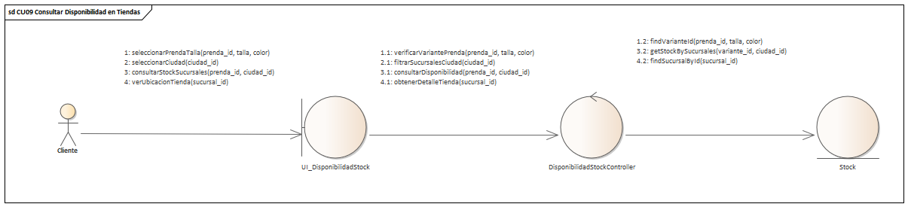
* **Actor**: `Cliente` | **Boundary**: `UI_DisponibilidadStock` | **Control**: `DisponibilidadStockController` | **Entity**: `Stock`
* **Mensajes**:
  * `1: seleccionarPrendaTalla(...)` $\rightarrow$ `1.1: verificarVariantePrenda(...)` $\rightarrow$ `1.2: findVarianteId(...)`
  * `2: seleccionarCiudad(...)` $\rightarrow$ `2.1: filtrarSucursalesCiudad(...)`
  * `3: consultarStockSucursales(...)` $\rightarrow$ `3.1: consultarDisponibilidad(...)` $\rightarrow$ `3.2: getStockBySucursales(...)`
  * `4: verUbicacionTienda(...)` $\rightarrow$ `4.1: obtenerDetalleTienda(...)` $\rightarrow$ `4.2: findSucursalById(...)`

---

### 4.2 Ciclo 2 — Operación Comercial y Logística

#### CU10: Realizar Reserva de Prendas
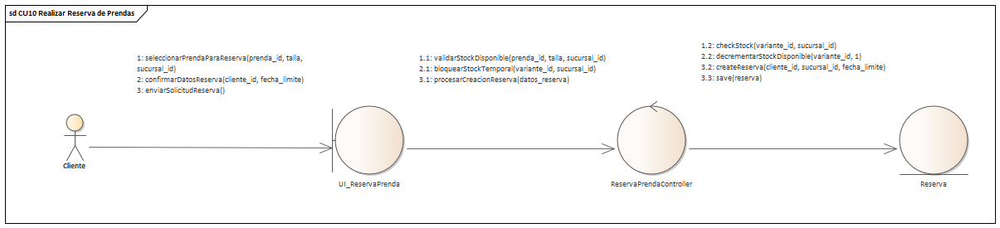
* **Actor**: `Cliente` | **Boundary**: `UI_ReservaPrenda` | **Control**: `ReservaPrendaController` | **Entity**: `Reserva`
* **Mensajes**:
  * `1: seleccionarPrendaParaReserva(...)` $\rightarrow$ `1.1: validarStockDisponible(...)` $\rightarrow$ `1.2: checkStock(...)`
  * `2: confirmarDatosReserva(...)` $\rightarrow$ `2.1: bloquearStockTemporal(...)` $\rightarrow$ `2.2: decrementarStockDisponible(...)`
  * `3: enviarSolicitudReserva()` $\rightarrow$ `3.1: procesarCreacionReserva(...)` $\rightarrow$ `3.2: createReserva(...)` / `3.3: save(reserva)`

#### CU11: Atender Reservas en Sucursal
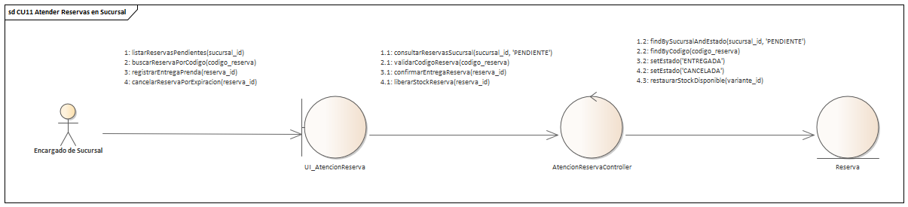
* **Actor**: `Encargado de Sucursal` | **Boundary**: `UI_AtencionReserva` | **Control**: `AtencionReservaController` | **Entity**: `Reserva`
* **Mensajes**:
  * `1: listarReservasPendientes(...)` $\rightarrow$ `1.1: consultarReservasSucursal(...)` $\rightarrow$ `1.2: findBySucursalAndEstado(...)`
  * `2: buscarReservaPorCodigo(...)` $\rightarrow$ `2.1: validarCodigoReserva(...)` $\rightarrow$ `2.2: findByCodigo(...)`
  * `3: registrarEntregaPrenda(...)` $\rightarrow$ `3.1: confirmarEntregaReserva(...)` $\rightarrow$ `3.2: setEstado('ENTREGADA')`
  * `4: cancelarReservaPorExpiracion(...)` $\rightarrow$ `4.1: liberarStockReserva(...)` $\rightarrow$ `4.2: setEstado('CANCELADA')` / `4.3: restaurarStockDisponible(...)`

#### CU13: Administrar Carrito de Compras
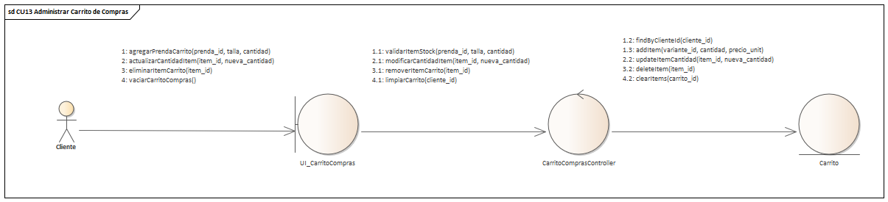
* **Actor**: `Cliente` | **Boundary**: `UI_CarritoCompras` | **Control**: `CarritoComprasController` | **Entity**: `Carrito`
* **Mensajes**:
  * `1: agregarPrendaCarrito(...)` $\rightarrow$ `1.1: validarItemStock(...)` $\rightarrow$ `1.2: findByClienteId(...)` / `1.3: addItem(...)`
  * `2: actualizarCantidadItem(...)` $\rightarrow$ `2.1: modificarCantidadItem(...)` $\rightarrow$ `2.2: updateItemCantidad(...)`
  * `3: eliminarItemCarrito(...)` $\rightarrow$ `3.1: removerItemCarrito(...)` $\rightarrow$ `3.2: deleteItem(...)`
  * `4: vaciarCarritoCompras()` $\rightarrow$ `4.1: limpiarCarrito(...)` $\rightarrow$ `4.2: clearItems(...)`

#### CU14: Realizar Compra Digital
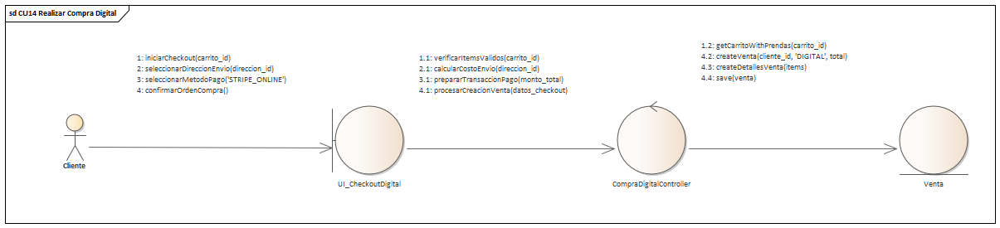
* **Actor**: `Cliente` | **Boundary**: `UI_CheckoutDigital` | **Control**: `CompraDigitalController` | **Entity**: `Venta`
* **Mensajes**:
  * `1: iniciarCheckout(...)` $\rightarrow$ `1.1: verificarItemsValidos(...)` $\rightarrow$ `1.2: getCarritoWithPrendas(...)`
  * `2: seleccionarDireccionEnvio(...)` $\rightarrow$ `2.1: calcularCostoEnvio(...)`
  * `3: seleccionarMetodoPago(...)` $\rightarrow$ `3.1: prepararTransaccionPago(...)`
  * `4: confirmarOrdenCompra()` $\rightarrow$ `4.1: procesarCreacionVenta(...)` $\rightarrow$ `4.2: createVenta(...)` / `4.3: createDetallesVenta(...)` / `4.4: save(venta)`

#### CU15: Realizar Venta Presencial (POS)
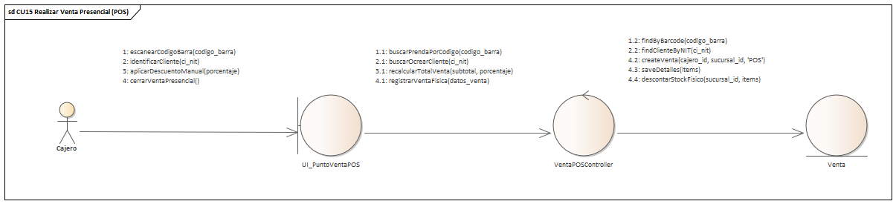
* **Actor**: `Cajero` | **Boundary**: `UI_PuntoVentaPOS` | **Control**: `VentaPOSController` | **Entity**: `Venta`
* **Mensajes**:
  * `1: escanearCodigoBarra(...)` $\rightarrow$ `1.1: buscarPrendaPorCodigo(...)` $\rightarrow$ `1.2: findByBarcode(...)`
  * `2: identificarCliente(...)` $\rightarrow$ `2.1: buscarOcrearCliente(...)` $\rightarrow$ `2.2: findClienteByNIT(...)`
  * `3: aplicarDescuentoManual(...)` $\rightarrow$ `3.1: recalcularTotalVenta(...)`
  * `4: cerrarVentaPresencial()` $\rightarrow$ `4.1: registrarVentaFisica(...)` $\rightarrow$ `4.2: createVenta(...)` / `4.3: saveDetalles(...)` / `4.4: descontarStockFisico(...)`

#### CU16: Cobro en Caja (Efectivo/Tarjeta/QR)
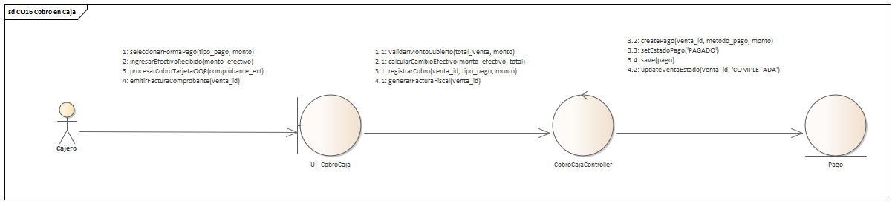
* **Actor**: `Cajero` | **Boundary**: `UI_CobroCaja` | **Control**: `CobroCajaController` | **Entity**: `Pago`
* **Mensajes**:
  * `1: seleccionarFormaPago(...)` $\rightarrow$ `1.1: validarMontoCubierto(...)`
  * `2: ingresarEfectivoRecibido(...)` $\rightarrow$ `2.1: calcularCambioEfectivo(...)`
  * `3: procesarCobroTarjetaOQR(...)` $\rightarrow$ `3.1: registrarCobro(...)` $\rightarrow$ `3.2: createPago(...)` / `3.3: setEstadoPago('PAGADO')` / `3.4: save(pago)`
  * `4: emitirFacturaComprobante(...)` $\rightarrow$ `4.1: generarFacturaFiscal(...)` $\rightarrow$ `4.2: updateVentaEstado(...)`

#### CU17: Procesar Pago Electrónico Sandbox
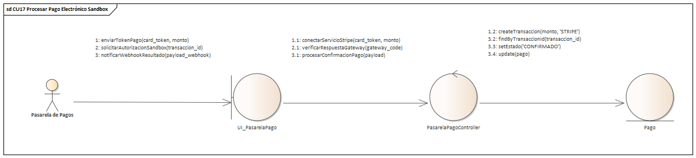
* **Actor**: `Pasarela de Pagos` | **Boundary**: `UI_PasarelaPago` | **Control**: `PasarelaPagoController` | **Entity**: `Pago`
* **Mensajes**:
  * `1: enviarTokenPago(...)` $\rightarrow$ `1.1: conectarServicioStripe(...)` $\rightarrow$ `1.2: createTransaccion(...)`
  * `2: solicitarAutorizacionSandbox(...)` $\rightarrow$ `2.1: verificarRespuestaGateway(...)`
  * `3: notificarWebhookResultado(...)` $\rightarrow$ `3.1: procesarConfirmacionPago(...)` $\rightarrow$ `3.2: findByTransaccionId(...)` / `3.3: setEstado('CONFIRMADO')` / `3.4: update(pago)`

#### CU18: Control de Stock y Movimientos
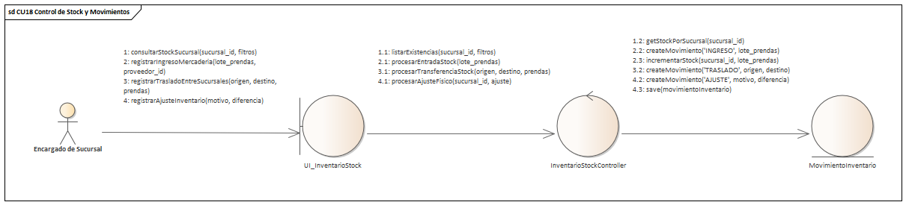
* **Actor**: `Encargado de Sucursal` | **Boundary**: `UI_InventarioStock` | **Control**: `InventarioStockController` | **Entity**: `MovimientoInventario`
* **Mensajes**:
  * `1: consultarStockSucursal(...)` $\rightarrow$ `1.1: listarExistencias(...)` $\rightarrow$ `1.2: getStockPorSucursal(...)`
  * `2: registrarIngresoMercaderia(...)` $\rightarrow$ `2.1: procesarEntradaStock(...)` $\rightarrow$ `2.2: createMovimiento('INGRESO')` / `2.3: incrementarStock(...)`
  * `3: registrarTrasladoEntreSucursales(...)` $\rightarrow$ `3.1: procesarTransferenciaStock(...)` $\rightarrow$ `3.2: createMovimiento('TRASLADO')`
  * `4: registrarAjusteInventario(...)` $\rightarrow$ `4.1: procesarAjusteFisico(...)` $\rightarrow$ `4.2: createMovimiento('AJUSTE')` / `4.3: save(movimientoInventario)`

#### CU19: Gestionar Temporadas y Colecciones

* **Actor**: `Administrador` | **Boundary**: `UI_GestionTemporadas` | **Control**: `TemporadaController` | **Entity**: `Temporada`
* **Mensajes**:
  * `1: consultarTemporadas(...)` $\rightarrow$ `1.1: listarTemporadas(...)` $\rightarrow$ `1.2: findByAnio(...)`
  * `2: crearTemporada(...)` $\rightarrow$ `2.1: validarRangoFechas(...)` $\rightarrow$ `2.2: save(temporada)`
  * `3: asociarPrendasColeccion(...)` $\rightarrow$ `3.1: vincularPrendas(...)` $\rightarrow$ `3.2: addPrendasToTemporada(...)`
  * `4: activarTemporadaPrincipal(...)` $\rightarrow$ `4.1: establecerTemporadaActiva(...)` $\rightarrow$ `4.2: desactivarOtrasTemporadas()` / `4.3: setEstado('ACTIVA')`

---

### 4.3 Ciclo 3 — Innovación, Analítica e IA

#### CU12: Sesión de Probador Virtual (Fitting Room)

* **Actor**: `Cliente` | **Boundary**: `UI_VestidorVirtual` | **Control**: `VestidorVirtualController` | **Entity**: `SesionVestidorVirtual`
* **Mensajes**:
  * `1: iniciarSesionProbador(...)` $\rightarrow$ `1.1: iniciarSesion(...)` $\rightarrow$ `1.2: createSession(...)` / `1.3: save(sesion)`
  * `2: seleccionarPrenda(...)` $\rightarrow$ `2.1: cargarModeloPrenda(...)` $\rightarrow$ `2.2: findByPrendaId(...)`
  * `3: procesarAjusteVirtual(...)` $\rightarrow$ `3.1: calcularAjuste(...)` $\rightarrow$ `3.2: updatePuntosClave(...)`
  * `4: finalizarSesionProbador(...)` $\rightarrow$ `4.1: cerrarSesion(...)` $\rightarrow$ `4.2: findById(...)` / `4.3: setEstado('FINALIZADA')`

#### CU20: Gestionar Promociones y Descuentos

* **Actor**: `Administrador` | **Boundary**: `UI_Promocion` | **Control**: `PromocionController` | **Entity**: `Promocion`
* **Mensajes**:
  * `1: consultarPromociones(...)` $\rightarrow$ `1.1: listarPromociones(...)` $\rightarrow$ `1.2: buscarConFiltros(...)`
  * `2: registrarPromocion(...)` $\rightarrow$ `2.1: crearPromocion(...)` $\rightarrow$ `2.2: validarVigencia(...)` / `2.3: save(promocion)`
  * `3: modificarPromocion(...)` $\rightarrow$ `3.1: actualizarPromocion(...)` $\rightarrow$ `3.2: findById(...)` / `3.3: update(promocion)`
  * `4: cambiarEstadoPromocion(...)` $\rightarrow$ `4.1: modificarEstado(...)` $\rightarrow$ `4.2: findById(...)` / `4.3: setEstado(estado)`

#### CU21: Gestionar Reportes y Dashboards Gerenciales

* **Actor**: `Administrador` | **Boundary**: `UI_Reporte` | **Control**: `ReporteController` | **Entity**: `Reporte`
* **Mensajes**:
  * `1: consultarDashboard(...)` $\rightarrow$ `1.1: resumenDashboard(...)` $\rightarrow$ `1.2: calcularMetricasVentas(...)` / `1.3: queryVentasPorSucursal(...)`
  * `2: filtrarPorCategoria(...)` $\rightarrow$ `2.1: filtrarMetricas(...)` $\rightarrow$ `2.2: queryProductosMasVendidos(...)`
  * `3: exportarReporteExcel(...)` $\rightarrow$ `3.1: generarExcel(...)` $\rightarrow$ `3.2: buildExcelWorkbook(...)`
  * `4: exportarReportePDF(...)` $\rightarrow$ `4.1: generarPdf(...)` $\rightarrow$ `4.2: renderPdfDocument(...)`

#### CU22: Obtener Recomendaciones Personalizadas con IA

* **Actor**: `Cliente` | **Boundary**: `UI_Recomendacion` | **Control**: `RecomendacionController` | **Entity**: `RecomendacionIA`
* **Mensajes**:
  * `1: solicitarRecomendaciones(...)` $\rightarrow$ `1.1: obtenerRecomendaciones(...)` $\rightarrow$ `1.2: calcularAfinidades(...)` / `1.3: rankCatalogByStock()`
  * `2: filtrarPorTemporada(...)` $\rightarrow$ `2.1: filtrarCatalogoRecomendado(...)` $\rightarrow$ `2.2: filterByTemporada(...)`
  * `3: verDetalleRecomendado(...)` $\rightarrow$ `3.1: consultarDetalleProducto(...)` $\rightarrow$ `3.2: findById(...)`
  * `4: registrarInteraccion(...)` $\rightarrow$ `4.1: registrarFeedback(...)` $\rightarrow$ `4.2: save(...)` / `4.3: updateScoreModel(...)`

#### CU23: Consultar Historial y Detalle de Compras

* **Actor**: `Cliente` | **Boundary**: `UI_HistorialCompras` | **Control**: `HistorialComprasController` | **Entity**: `Venta`
* **Mensajes**:
  * `1: consultarCompras(...)` $\rightarrow$ `1.1: listarComprasCliente(...)` $\rightarrow$ `1.2: findByClienteId(...)` / `1.3: buscarConFiltros(...)`
  * `2: verDetalleCompra(...)` $\rightarrow$ `2.1: obtenerDetalleVenta(...)` $\rightarrow$ `2.2: findById(...)` / `2.3: getDetallesVenta(...)`
  * `3: descargarComprobante(...)` $\rightarrow$ `3.1: generarComprobante(...)` $\rightarrow$ `3.2: getPaymentDetails(...)`
  * `4: filtrarPorEstado(...)` $\rightarrow$ `4.1: filtrarVentas(...)` $\rightarrow$ `4.2: filterByEstado(...)`

---

## 5. Diagramas de Análisis de Clases (Realización de Casos de Uso — Ciclos 1, 2 y 3)

Estos diagramas modelan la **realización estructural orientada a clases (Boundary-Control-Entity)** bajo el estándar UML 2.5 para los **23 Casos de Uso** del sistema FashionStore en Enterprise Architect:
* **Frame**: `class Analizar una clase CUxx` delimitando el contexto del caso de uso.
* **Actor**: Rol que interactúa con el formulario (`Invitado`, `Usuario`, `Cliente`, `Cajero`, `Encargado de Sucursal`, `Administrador`, `Pasarela de Pagos`).
* **«Formulario»**: Clase Boundary de interfaz de usuario con sus atributos reactivos del formulario y métodos de interacción (`Form...`).
* **«Class»**: Clase Control / Controlador de backend FastAPI con sus atributos y métodos de negocio (`...Controller`).
* **«Entidad» Principal**: Clase Entity de persistencia central conectada directamente con el controlador (`E_...`).
* **«Entidad» Secundarias**: Clases de dominio secundarias que utiliza, referencia o audita el caso de uso, con multiplicidades explícitas (`1`, `1..*`, `*`, `0..1`).

---

### 5.1 Ciclo 1 — Catálogo y Base

#### CU01: Registrar Cliente
Modela el formulario de registro de nuevos clientes en la plataforma, creación de credenciales y auditoría de alta.


* **Actor**: `Invitado`
* **«Formulario»**: `FormRegistroCliente`
* **«Class»**: `RegistroClienteController`
* **«Entidad» Principal**: `E_Cliente`
* **«Entidad» Secundarias**:
  * `E_Usuario` (Cuenta y credenciales de acceso): Multiplicidad `1` a `1`.
  * `E_Rol` (Rol asignado al nuevo usuario): Multiplicidad `*` a `1`.
  * `E_Bitacora` (Auditoría de alta de usuario): Multiplicidad `1` a `0..*`.

---

#### CU02: Iniciar y Cerrar Sesión
Modela la autenticación mediante JWT, validación de credenciales, control de sesión activa y registro de accesos.


* **Actor**: `Usuario`
* **«Formulario»**: `FormLogin`
* **«Class»**: `LoginController`
* **«Entidad» Principal**: `E_SesionUsuario`
* **«Entidad» Secundarias**:
  * `E_Usuario` (Usuario autenticado): Multiplicidad `1` a `1`.
  * `E_Rol` (Permisos y roles asignados): Multiplicidad `*` a `1`.
  * `E_Bitacora` (Auditoría de inicio/cierre de sesión): Multiplicidad `1` a `0..*`.

---

#### CU03: Gestionar Usuarios y Roles
Modela la administración de cuentas del personal, asignación de roles RBAC y vinculación con sucursales físicas.


* **Actor**: `Administrador`
* **«Formulario»**: `FormGestionUsuarios`
* **«Class»**: `UsuarioController`
* **«Entidad» Principal**: `E_Usuario`
* **«Entidad» Secundarias**:
  * `E_Rol` (Catálogo de roles del sistema): Multiplicidad `*` a `1`.
  * `E_Sucursal` (Sucursal asignada al empleado): Multiplicidad `*` a `0..1`.
  * `E_Bitacora` (Auditoría administrativa de personal): Multiplicidad `1` a `0..*`.

---

#### CU04: Gestionar Sucursales y Ciudades
Modela el alta, edición y geolocalización de las tiendas físicas por ciudad y asignación de encargados.


* **Actor**: `Administrador`
* **«Formulario»**: `FormGestionSucursales`
* **«Class»**: `SucursalController`
* **«Entidad» Principal**: `E_Sucursal`
* **«Entidad» Secundarias**:
  * `E_Ciudad` (Jurisdicción geográfica): Multiplicidad `*` a `1`.
  * `E_Usuario` (Personal y encargado asignado): Multiplicidad `1` a `0..*`.
  * `E_Bitacora` (Auditoría de sucursales): Multiplicidad `1` a `0..*`.

---

#### CU05: Gestionar Productos y Prendas
Modela la administración del catálogo de prendas, categorización, generación de variantes de talla/color e imágenes.


* **Actor**: `Administrador`
* **«Formulario»**: `FormGestionPrendas`
* **«Class»**: `PrendaController`
* **«Entidad» Principal**: `E_Producto`
* **«Entidad» Secundarias**:
  * `E_Categoria` (Categoría de la prenda): Multiplicidad `*` a `1`.
  * `E_VarianteProducto` (SKUs por talla y color): Multiplicidad `1` a `1..*`.
  * `E_ImagenProducto` (Galería fotográfica de prendas): Multiplicidad `1` a `0..*`.

---

#### CU06: Gestionar Catálogo Base (Categorías, Tallas, Colores)
Modela la administración de los catálogos maestros y taxonomía base para prendas y variantes.


* **Actor**: `Administrador`
* **«Formulario»**: `FormCatalogoBase`
* **«Class»**: `CatalogoBaseController`
* **«Entidad» Principal**: `E_Categoria`
* **«Entidad» Secundarias**:
  * `E_Talla` (Tabla maestra de tallas): Multiplicidad `1` a `*`.
  * `E_Color` (Tabla maestra de colores): Multiplicidad `1` a `*`.
  * `E_Producto` (Prendas asociadas a la categoría): Multiplicidad `1` a `0..*`.

---

#### CU07: Gestionar Proveedores
Modela el registro, control de contratos y suministros de proveedores de telas y confección textil.


* **Actor**: `Administrador`
* **«Formulario»**: `FormGestionProveedores`
* **«Class»**: `ProveedorController`
* **«Entidad» Principal**: `E_Proveedor`
* **«Entidad» Secundarias**:
  * `E_Producto` (Prendas suministradas): Multiplicidad `*` a `0..*`.
  * `E_OrdenCompra` (Órdenes de suministro y abastecimiento): Multiplicidad `1` a `0..*`.
  * `E_Bitacora` (Auditoría de operaciones con proveedores): Multiplicidad `1` a `0..*`.

---

#### CU08: Consultar Catálogo y Buscar Prendas
Modela la navegación del catálogo público para clientes, filtros multicriterio y fichas técnicas de prendas.


* **Actor**: `Cliente`
* **«Formulario»**: `FormCatalogoExploracion`
* **«Class»**: `CatalogoExploracionController`
* **«Entidad» Principal**: `E_Producto`
* **«Entidad» Secundarias**:
  * `E_Categoria` (Categoría de exploración): Multiplicidad `*` a `1`.
  * `E_VarianteProducto` (Variantes disponibles): Multiplicidad `1` a `1..*`.
  * `E_Inventario` (Existencias en stock de variantes): Multiplicidad `1` a `0..*`.

---

#### CU09: Consultar Disponibilidad en Tiendas
Modela la verificación de stock disponible en tiempo real por sucursal física y ciudad para una prenda y talla seleccionada.


* **Actor**: `Cliente`
* **«Formulario»**: `FormDisponibilidadStock`
* **«Class»**: `DisponibilidadStockController`
* **«Entidad» Principal**: `E_Inventario`
* **«Entidad» Secundarias**:
  * `E_Sucursal` (Tienda física donde reside el stock): Multiplicidad `*` a `1`.
  * `E_VarianteProducto` (SKU consultado): Multiplicidad `*` a `1`.
  * `E_Ciudad` (Filtro por ubicación geográfica): Multiplicidad `*` a `1`.

---

### 5.2 Ciclo 2 — Operación Comercial y Logística

#### CU10: Realizar Reserva de Prendas
Modela la reserva de prendas para prueba física en sucursal con bloqueo preventivo de inventario.


* **Actor**: `Cliente`
* **«Formulario»**: `FormReservaPrenda`
* **«Class»**: `ReservaPrendaController`
* **«Entidad» Principal**: `E_Reserva`
* **«Entidad» Secundarias**:
  * `E_DetalleReserva` (Líneas de prendas reservadas): Multiplicidad `1` a `1..*`.
  * `E_Inventario` (Stock bloqueado temporalmente): Multiplicidad `1` a `1..*`.
  * `E_Bitacora` (Auditoría de creación de reserva): Multiplicidad `1` a `0..*`.

---

#### CU11: Atender Reservas en Sucursal
Modela la recepción del cliente en tienda física, búsqueda por código alfanumérico, entrega o liberación por expiración.


* **Actor**: `Encargado de Sucursal`
* **«Formulario»**: `FormAtencionReserva`
* **«Class»**: `AtencionReservaController`
* **«Entidad» Principal**: `E_Reserva`
* **«Entidad» Secundarias**:
  * `E_DetalleReserva` (Líneas verificadas): Multiplicidad `1` a `1..*`.
  * `E_Inventario` (Ajuste o confirmación de stock): Multiplicidad `1` a `1..*`.
  * `E_Bitacora` (Auditoría de despacho de reserva): Multiplicidad `1` a `0..*`.

---

#### CU13: Administrar Carrito de Compras
Modela la gestión reactiva de prendas en el carrito virtual, cálculo de totales en tiempo real y persistencia por usuario.


* **Actor**: `Cliente`
* **«Formulario»**: `FormCarritoCompras`
* **«Class»**: `CarritoComprasController`
* **«Entidad» Principal**: `E_Carrito`
* **«Entidad» Secundarias**:
  * `E_ItemCarrito` (Líneas y cantidades añadidas): Multiplicidad `1` a `0..*`.
  * `E_VarianteProducto` (Prendas y tallas referenciadas): Multiplicidad `*` a `1`.
  * `E_Usuario` (Propietario del carrito): Multiplicidad `1` a `1`.

---

#### CU14: Realizar Compra Digital
Modela el proceso de checkout electrónico, validación de inventario, cálculo de flete y creación de orden de venta online.


* **Actor**: `Cliente`
* **«Formulario»**: `FormCheckoutDigital`
* **«Class»**: `CompraDigitalController`
* **«Entidad» Principal**: `E_Venta`
* **«Entidad» Secundarias**:
  * `E_DetalleVenta` (Prendas adquiridas): Multiplicidad `1` a `1..*`.
  * `E_Pago` (Comprobante y pasarela de pago): Multiplicidad `1` a `1..*`.
  * `E_Bitacora` (Auditoría de compra digital): Multiplicidad `1` a `0..*`.

---

#### CU15: Realizar Venta Presencial (POS)
Modela el punto de venta en caja física, lectura por código de barras, selección de cliente y generación de venta física.


* **Actor**: `Cajero`
* **«Formulario»**: `FormPuntoVentaPOS`
* **«Class»**: `VentaPOSController`
* **«Entidad» Principal**: `E_Venta`
* **«Entidad» Secundarias**:
  * `E_DetalleVenta` (Items facturados en caja): Multiplicidad `1` a `1..*`.
  * `E_Inventario` (Descuento inmediato de existencias en tienda): Multiplicidad `1` a `1..*`.
  * `E_Bitacora` (Auditoría de operación de caja): Multiplicidad `1` a `0..*`.

---

#### CU16: Cobro en Caja (Efectivo/Tarjeta/QR)
Modela el procesamiento multimodal del pago en mostrador, cálculo de cambio en efectivo y emisión de factura fiscal.


* **Actor**: `Cajero`
* **«Formulario»**: `FormCobroCaja`
* **«Class»**: `CobroCajaController`
* **«Entidad» Principal**: `E_Pago`
* **«Entidad» Secundarias**:
  * `E_Venta` (Venta que cancela): Multiplicidad `*` a `1`.
  * `E_Factura` (Comprobante fiscal emitido): Multiplicidad `1` a `1`.
  * `E_Bitacora` (Auditoría financiera de caja): Multiplicidad `1` a `0..*`.

---

#### CU17: Procesar Pago Electrónico Sandbox
Modela la integración con pasarelas de pago (Stripe Sandbox), tokens bancarios, webhooks de confirmación e idempotencia.


* **Actor**: `Pasarela de Pagos`
* **«Formulario»**: `FormPasarelaPago`
* **«Class»**: `PasarelaPagoController`
* **«Entidad» Principal**: `E_Pago`
* **«Entidad» Secundarias**:
  * `E_TransaccionPasarela` (Log y token de transacción gateway): Multiplicidad `1` a `1`.
  * `E_Venta` (Orden de venta liquidada): Multiplicidad `*` a `1`.
  * `E_Bitacora` (Auditoría de webhooks y seguridad): Multiplicidad `1` a `0..*`.

---

#### CU18: Control de Stock y Movimientos
Modela el control de existencias en tiempo real, ingresos por compra, traslados entre sucursales y ajustes por inventario físico.


* **Actor**: `Encargado de Sucursal`
* **«Formulario»**: `FormInventarioStock`
* **«Class»**: `InventarioStockController`
* **«Entidad» Principal**: `E_MovimientoInventario`
* **«Entidad» Secundarias**:
  * `E_Inventario` (Registro de stock afectado): Multiplicidad `*` a `1`.
  * `E_Sucursal` (Sucursal origen/destino del movimiento): Multiplicidad `*` a `1`.
  * `E_Bitacora` (Auditoría de movimientos de almacén): Multiplicidad `1` a `0..*`.

---

#### CU19: Gestionar Temporadas y Colecciones
Modela la administración de colecciones de moda, vigencias por año y temporada, y vinculación masiva de prendas.


* **Actor**: `Administrador`
* **«Formulario»**: `FormGestionTemporadas`
* **«Class»**: `TemporadaController`
* **«Entidad» Principal**: `E_Temporada`
* **«Entidad» Secundarias**:
  * `E_Coleccion` (Colecciones agrupadas en la temporada): Multiplicidad `1` a `0..*`.
  * `E_Producto` (Prendas vinculadas a la temporada): Multiplicidad `*` a `0..*`.
  * `E_Bitacora` (Auditoría de cambios en colecciones): Multiplicidad `1` a `0..*`.

---

### 5.3 Ciclo 3 — Innovación, Analítica e IA

#### CU12: Sesión de Probador Virtual (Fitting Room)
Modela la arquitectura de clases que soporta la sesión de prueba virtual interactiva, captura de pose y motor de ajuste VTON.


* **Actor**: `Cliente`
* **«Formulario»**: `FormVestidorVirtual`
* **«Class»**: `VestidorVirtualController`
* **«Entidad» Principal**: `E_SesionVestidorVirtual`
* **«Entidad» Secundarias**:
  * `E_Producto` (Prenda del catálogo probada): Multiplicidad `*` a `1`.
  * `E_Usuario` (Cliente autenticado): Multiplicidad `0..*` a `1`.
  * `E_Bitacora` (Auditoría de eventos VTON): Multiplicidad `1` a `0..*`.

---

#### CU20: Gestionar Promociones y Descuentos
Modela la administración integral de promociones, vigencias, descuentos porcentuales/fijos y vinculación con prendas.


* **Actor**: `Administrador del Sistema`
* **«Formulario»**: `FormPromocion`
* **«Class»**: `PromocionController`
* **«Entidad» Principal**: `E_Promocion`
* **«Entidad» Secundarias**:
  * `E_ProductoPromocion` (Tabla puente de prendas asociadas): Multiplicidad `1` a `1..*`.
  * `E_Producto` (Prendas del catálogo con descuento): Multiplicidad `*` a `1..*`.
  * `E_Bitacora` (Auditoría administrativa de cambios): Multiplicidad `1` a `0..*`.

---

#### CU21: Gestionar Reportes y Dashboards Gerenciales
Modela la consolidación de métricas analíticas, filtros por fecha/sucursal, integración con asistente IA y exportación a Excel/PDF.


* **Actor**: `Administrador del Sistema`
* **«Formulario»**: `FormReporte`
* **«Class»**: `ReporteController`
* **«Entidad» Principal**: `E_Reporte`
* **«Entidad» Secundarias**:
  * `E_Venta` (Transacciones de facturación analizadas): Multiplicidad `1` a `1..*`.
  * `E_Sucursal` (Dimensión geográfica del reporte): Multiplicidad `*` a `0..1`.
  * `E_Bitacora` (Registro de exportaciones y consultas): Multiplicidad `1` a `0..*`.

---

#### CU22: Obtener Recomendaciones Personalizadas con IA
Modela el motor de scoring de afinidad y filtrado colaborativo basado en historial, stock disponible y estacionalidad.


* **Actor**: `Cliente`
* **«Formulario»**: `FormRecomendacion`
* **«Class»**: `RecomendacionController`
* **«Entidad» Principal**: `E_RecomendacionIA`
* **«Entidad» Secundarias**:
  * `E_Producto` (Prenda recomendada por afinidad): Multiplicidad `*` a `1`.
  * `E_Usuario` (Perfil y preferencias del cliente): Multiplicidad `*` a `1`.
  * `E_Temporada` (Contexto estacional de la recomendación): Multiplicidad `*` a `0..1`.

---

#### CU23: Consultar Historial y Detalle de Compras
Modela la consulta de compras digitales y presenciales realizadas por el cliente, desglose de líneas de venta y recibos de pago.


* **Actor**: `Cliente`
* **«Formulario»**: `FormHistorialCompras`
* **«Class»**: `HistorialComprasController`
* **«Entidad» Principal**: `E_Venta`
* **«Entidad» Secundarias**:
  * `E_DetalleVenta` (Líneas y variantes adquiridas): Multiplicidad `1` a `1..*`.
  * `E_Pago` (Comprobante y pasarela de pago): Multiplicidad `1` a `1..*`.
  * `E_Usuario` (Datos del cliente comprador): Multiplicidad `0..*` a `1`.

---

## 6. Diagramas de Estados (UML State Machine Diagrams)

### 6.1 Ciclo de Vida de una Reserva (`Reservation`)


---

### 6.2 Ciclo de Vida de una Venta (`Sale`) y Pago (`Payment`)


---

## 7. Diagrama de Componentes (UML Component Diagram)

Muestra la modularidad y las interfaces expuestas por el backend modular FastAPI, las aplicaciones frontend y los servicios de soporte:


---

## 8. Diagrama de Despliegue (UML Deployment Diagram)

Estructura física de contenedores Docker y nodos cliente según `docker-compose.yml` y `docker-compose.prod.yml`:

```mermaid
graph TD
    subgraph ClientNode1["Dispositivo Cliente / Emulador"]
        AndroidDevice["«Device: Android 13+»<br/>FashionStore Mobile App<br/>(Flutter APK)"]
    end

    subgraph ClientNode2["Estación de Trabajo / Navegador"]
        Browser["«Execution Environment: Web Browser»<br/>Chrome / Firefox / Safari<br/>(Angular 21 SPA)"]
    end

    subgraph DockerHost["Servidor Host (Docker Engine / Linux o Windows)"]
        subgraph ProxyContainer["Contenedor: web (Nginx Reverse Proxy)"]
            NginxServer["«Web Server»<br/>Nginx 1.25<br/>Port: 80 / 4200"]
            WebDist["«Artifact»<br/>web/dist/browser<br/>(Archivos compilados Angular)"]
            NginxServer --- WebDist
        end

        subgraph BackendContainer["Contenedor: backend (FastAPI Application)"]
            Uvicorn["«App Server»<br/>Uvicorn + Python 3.13<br/>Port: 8000"]
            BackendCode["«Artifact»<br/>app (Monolito Modular FastAPI)<br/>SQLAlchemy 2.0 ORM"]
            Uvicorn --- BackendCode
        end

        subgraph DBContainer["Contenedor: postgres (Base de Datos)"]
            PostgresServer["«RDBMS»<br/>PostgreSQL 17.11 Alpine<br/>Port: 5432"]
            DBVolume[("«Volume»<br/>postgres_data<br/>(Almacenamiento persistente)")]
            PostgresServer --- DBVolume
        end
    end

    Browser -->|HTTP/HTTPS Port 80/4200| NginxServer
    AndroidDevice -->|HTTP/HTTPS Port 8000 (API)| Uvicorn
    NginxServer -->|Proxy Pass /api/v1| Uvicorn
    BackendCode -->|TCP / Port 5432 (psycopg2)| PostgresServer
```

---

## 7. Diagrama de Paquetes (UML Package Diagram)

Organización lógica del código por capas arquitectónicas:


---

## 8. Trazabilidad histórica de los 23 Casos de Uso del Primer Parcial vs. Módulos

> Esta tabla conserva la numeración del Primer Parcial; allí, CU08 significa consultar el catálogo. Para los casos del Segundo Parcial, la fuente oficial es `docs/casos-de-uso-oficiales-parcial-2.md`: Etapa 1 incluye CU-01..CU-07, CU-23, CU-24 y CU-25; CU-08 (venta offline) corresponde a Etapa 2.

| CU | Nombre del Caso de Uso | Ciclo | Actor Principal | Módulo Backend | Entidades Clave Afectadas |
|---|---|:---:|---|---|---|
| **CU01** | Registrar Cliente | 1 | Cliente | `auth` | `User`, `Role`, `Bitacora` |
| **CU02** | Iniciar / Cerrar Sesión | 1 | Cliente / Admin / Cajero | `auth` | `User`, `RefreshToken`, `Bitacora` |
| **CU03** | Gestionar Usuarios y Roles | 1 | Administrador | `users` | `User`, `Role`, `Bitacora` |
| **CU04** | Gestionar Sucursales y Ciudades | 1 | Administrador | `locations` | `City`, `Branch` |
| **CU05** | Gestionar Productos | 1 | Administrador | `products` | `Product`, `ProductVariant`, `ProductImage` |
| **CU06** | Gestionar Catálogo Base | 1 | Administrador | `catalog_masters` | `Category`, `Size`, `Color` |
| **CU07** | Gestionar Proveedores | 1 | Administrador / Proveedor | `suppliers` | `Supplier`, `ProductSupplier` |
| **CU08** | Consultar Catálogo y Buscar Prendas | 1 | Cliente / Público | `catalog` | `Product`, `Category`, `ProductImage` |
| **CU09** | Consultar Disponibilidad por Tienda | 1 | Cliente | `catalog` | `Branch`, `Inventory`, `ProductVariant` |
| **CU10** | Realizar Reserva de Prendas | 2 | Cliente | `reservations` | `Reservation`, `ReservationItem`, `Inventory` |
| **CU11** | Atender Reservas en Sucursal | 2 | Encargado de Sucursal | `reservations` | `Reservation`, `Inventory`, `Bitacora` |
| **CU12** | Sesión de Probador Virtual | 3 | Cliente | `virtual_fitting` | `VirtualFittingSession`, `Product` |
| **CU13** | Administrar Carrito de Compras | 2 | Cliente | `commerce` | `Cart`, `CartItem`, `ProductVariant` |
| **CU14** | Realizar Compra Digital | 2 | Cliente | `commerce` | `Sale`, `SaleItem`, `Payment`, `Inventory` |
| **CU15** | Realizar Venta Presencial (POS) | 2 | Cajero | `commerce` | `Sale`, `SaleItem`, `Payment`, `Inventory` |
| **CU16** | Cobro en Caja (Efectivo/Tarjeta/QR)| 2 | Cajero | `commerce` | `Payment`, `Sale` |
| **CU17** | Procesar Pago Electrónico Sandbox | 2 | Cliente | `commerce` | `Payment`, `Sale` |
| **CU18** | Control de Stock y Movimientos | 2 | Encargado / Admin | `inventory` | `Inventory`, `InventoryMovement` |
| **CU19** | Gestionar Temporadas y Colecciones | 2 | Administrador | `seasons` | `Season`, `Collection`, `Product` |
| **CU20** | Gestionar Promociones y Descuentos | 3 | Administrador | `promotions` | `Promotion`, `PromotionProduct` |
| **CU21** | Dashboards y Reportes Gerenciales | 3 | Administrador | `reports` | `Sale`, `Inventory`, `Reservation` |
| **CU22** | Recomendaciones Personalizadas IA | 3 | Cliente | `recommendations` | `AIRecommendation`, `Sale`, `Product` |
| **CU23** | Consultar Historial de Compras | 3 | Cliente | `commerce` | `Sale`, `SaleItem`, `Payment` |

---

## 9. Integración con Enterprise Architect (EA)

El archivo de modelo nativo de Enterprise Architect se encuentra en:
- `docs/uml/FashioStore/FashionStore.eap`

Contiene los siguientes paquetes formalizados bajo el estándar UML 2.5:
- `01 - Diagrama General de Casos de Uso` (Diagrama general con los 23 Casos de Uso y 7 Actores)
- `02 - Diseño Conceptual de la Base de Datos` (26 entidades completas)
- `03 - Diagramas de Comunicación` (BCE completo para los 23 Casos de Uso organizado en 3 subpaquetes: Ciclo 1, Ciclo 2 y Ciclo 3)
- `04 - Diagramas de Analisis de Clases` (Realización BCE para los 23 Casos de Uso organizado en 3 subpaquetes: Ciclo 1, Ciclo 2 y Ciclo 3)
- `05 - Diagramas de Secuencia` (Secuencia temporal UML 2.5 para los 23 Casos de Uso organizado en 3 subpaquetes: Ciclo 1, Ciclo 2 y Ciclo 3)
- `06 - Diagramas de Tiempo` (Diagramas de tiempo para Ciclo 1, 2 y 3)
- `07 - Diagramas de Estado` (Diagramas de estado UML 2.5 para CU03, CU05, CU10, CU14/CU17, CU20, CU12)
- `08 - Diagramas de Navegación` (Diagramas de navegación Web/App UML 2.5 para CU08, CU05, CU10, CU14/CU17, CU12, CU20)
- `09 - Diseño Lógico de la Arquitectura` (Arquitectura MVC en 3 capas: Vista, Controlador, Modelo y Base de Datos PostgreSQL)
- `10 - Diagrama de Red (Topologia AWS)` (Topología física y segmentación perimetral DMZ/VLANs en AWS)

---

## 10. Diagramas de Tiempo UML 2.5 (Timing Diagrams)

Los Diagramas de Tiempo (UML 2.5 Timing Diagrams) modelan el cambio de estados discretos de una línea de vida a lo largo de un eje temporal continuo y cuantificable, representando restricciones críticas de latencia, expiración y eventos asíncronos en el sistema **FashionStore**.

Se seleccionaron los Casos de Uso con mayor sensibilidad temporal en cada ciclo del proyecto:


### 10.1 CU01 / CU02 — Sesión de Usuario y Tokens JWT (Ciclo 1)
- **Marco UML 2.5**: `sd CU01_CU02_SesionJWT`
- **Línea de Vida**: `TimeLine_SesionUsuario`
- **Estados Discretos**: `SinSesion`, `TokenActivo`, `TokenExpirado`, `RenovandoToken`
- **Restricciones de Duración**:
  - `{15 min}`: Vigencia del Access Token antes de requerir renovación.
  - `{< 1s}`: Latencia de validación y emisión de nuevo token criptográfico.
  - `{7 días}`: Vigencia global del Refresh Token para mantener la sesión abierta sin reingresar credenciales.
- **Imagen**: [`tiempo-cu01-sesion-jwt.png`](./diagrams/tiempo-cu01-sesion-jwt.png)

### 10.2 CU10 — Realizar Reserva de Prendas en Tienda (Ciclo 2)
- **Marco UML 2.5**: `sd CU10_ReservaPrendas`
- **Línea de Vida**: `TimeLine_ReservaPrenda`
- **Estados Discretos**: `StockDisponible`, `BloqueoTemporal`, `ReservaConfirmada`, `PrendaRecogida`
- **Restricciones de Duración**:
  - `{15 min}`: Bloqueo transaccional temporal de la prenda en base de datos mientras el cliente formaliza la reserva.
  - `{48 horas}`: Ventana máxima de retención física de la prenda en la sucursal seleccionada; tras este plazo, un proceso cron ejecuta `expirarReserva()` y devuelve la prenda a `StockDisponible`.
- **Imagen**: [`tiempo-cu10-reserva-prendas.png`](./diagrams/tiempo-cu10-reserva-prendas.png)

### 10.3 CU14 / CU17 — Compra Digital con Pago Electrónico (Ciclo 2)
- **Marco UML 2.5**: `sd CU14_CU17_PagoDigital`
- **Línea de Vida**: `TimeLine_ProcesoPago`
- **Estados Discretos**: `CarritoActivo`, `OrdenIniciada`, `EsperandoPago`, `ProcesandoWebhook`, `PagoAprobado`
- **Restricciones de Duración**:
  - `{10 min}`: Vigencia del código QR BCP o sesión de checkout Stripe antes de liberar el inventario.
  - `{30 seg}`: Timeout máximo de webhook para confirmación asíncrona de la pasarela de pagos.
- **Imagen**: [`tiempo-cu14-pago-digital.png`](./diagrams/tiempo-cu14-pago-digital.png)

### 10.4 CU12 — Sesión de Probador Virtual / VTON con IA (Ciclo 3)
- **Marco UML 2.5**: `sd CU12_ProbadorVirtualVTON`
- **Línea de Vida**: `TimeLine_ProbadorVirtual`
- **Estados Discretos**: `Inactivo`, `CamaraIniciada`, `PoseDetectada`, `InferenciaVTON`, `PrendaAjustada`
- **Restricciones de Duración**:
  - `{< 500 ms}`: Detección y normalización de puntos clave de postura mediante MediaPipe / ML Kit.
  - `{2.5 seg}`: Inferencia de IA generativa de Virtual Try-On (VTON) para renderizar la prenda adaptada a la silueta del cliente.
  - `{5 min}`: Timeout de inactividad que cierra la cámara y destruye las texturas en memoria para optimizar recursos móviles.
- **Imagen**: [`tiempo-cu12-probador-virtual.png`](./diagrams/tiempo-cu12-probador-virtual.png)

### 10.5 CU20 — Gestionar Promociones y Descuentos (Ciclo 3)
- **Marco UML 2.5**: `sd CU20_GestionPromociones`
- **Línea de Vida**: `TimeLine_CicloPromocion`
- **Estados Discretos**: `Borrador`, `Programada`, `VigenteActiva`, `Pausada`, `Expirada`
- **Restricciones de Duración**:
  - `{Programada}`: Período de espera entre la configuración administrativa y la fecha/hora de inicio automático.
  - `{Vigencia: N días}`: Duración de la campaña comercial activa aplicando descuentos en catálogo y checkout en tiempo real.
- **Imagen**: [`tiempo-cu20-promociones.png`](./diagrams/tiempo-cu20-promociones.png)

---

## 11. Diagramas de Estado UML 2.5 (Statechart Diagrams)

Los Diagramas de Estado (UML 2.5 Statechart Diagrams) modelan el ciclo de vida y los cambios de estado transaccionales por los que transitan las entidades y flujos de control dentro del sistema **FashionStore**, respondiendo a eventos específicos y guardas condicionales `[condición]`.

Todos los diagramas siguen estrictamente la sintaxis, topología y convención visual del modelo de referencia:
1. **Contenedor Canvas**: Marco redondeado con fondo tonalidad cálida (`#fbe6c3`), borde oscuro y encabezado centrado con identificador (`CUxx`).
2. **Pseudo-estado Inicial**: Círculo negro sólido rotulado `Inicio`.
3. **Pseudo-estado Final**: Círculo verde con cruz `X` rotulado `Fin`.
4. **Estados de Control y Entidad**: Rectángulos redondeados con sombra 3D suave (`#fee2af`), borde marrón oscuro y textos centrados en negrita.
5. **Transiciones con Guardas**: Flechas direccionadas con guardas entre corchetes `[condición]`.
6. **Bucle Reflexivo de Entrada**: Self-loop inferior en el estado de autenticación/inicio ante fallo o condición vacía.
7. **Bifurcaciones Operativas**:
   - **Consulta / Listado**: Transición directa a despliegue de datos.
   - **Modificación**: Transición hacia edición de atributos con posterior revisión de datos.
   - **Creación / Registro**: Transición hacia ingreso de entidad base y configuración de variantes.
   - **Baja / Cancelación / Pausa**: Transición hacia captura de identificador con bucle de reintento `[incorrecto]` y confirmación a estado de acción.
8. **Consolidación**: Convergencia de los flujos exitosos en `Transacción completada` / `Transacción Ok`, conduciendo al pseudo-estado `Fin`.

### Resumen de Casos de Uso Seleccionados

| Ciclo | Caso de Uso | Título en Modelo | Entidad Central | Vista Canvas Melocotón | Exportación Oficial EA |
| :--- | :--- | :--- | :--- | :--- | :--- |
| **Ciclo 1** | **CU03** | Gestionar Usuarios y Roles | `User` / `Role` | [`estado-cu03-gestion-usuarios.png`](./diagrams/estado-cu03-gestion-usuarios.png) | [`ea-estado-cu03-gestion-usuarios.png`](./diagrams/ea-estado-cu03-gestion-usuarios.png) |
| **Ciclo 1** | **CU05** | Gestionar Productos y Prendas | `Product` / `ProductVariant` | [`estado-cu05-gestion-productos.png`](./diagrams/estado-cu05-gestion-productos.png) | [`ea-estado-cu05-gestion-productos.png`](./diagrams/ea-estado-cu05-gestion-productos.png) |
| **Ciclo 2** | **CU10** | Realizar Reserva de Prendas en Tienda | `Reservation` / `Inventory` | [`estado-cu10-reserva-prendas.png`](./diagrams/estado-cu10-reserva-prendas.png) | [`ea-estado-cu10-reserva-prendas.png`](./diagrams/ea-estado-cu10-reserva-prendas.png) |
| **Ciclo 2** | **CU14 / CU17** | Compra Digital y Pago Electrónico | `Sale` / `Payment` | [`estado-cu14-pago-digital.png`](./diagrams/estado-cu14-pago-digital.png) | [`ea-estado-cu14-pago-digital.png`](./diagrams/ea-estado-cu14-pago-digital.png) |
| **Ciclo 3** | **CU20** | Gestionar Promociones y Descuentos | `Promotion` | [`estado-cu20-gestion-promociones.png`](./diagrams/estado-cu20-gestion-promociones.png) | [`ea-estado-cu20-gestion-promociones.png`](./diagrams/ea-estado-cu20-gestion-promociones.png) |
| **Ciclo 3** | **CU12** | Sesión de Probador Virtual (VTON IA) | `VirtualFittingSession` | [`estado-cu12-probador-virtual.png`](./diagrams/estado-cu12-probador-virtual.png) | [`ea-estado-cu12-probador-virtual.png`](./diagrams/ea-estado-cu12-probador-virtual.png) |

---

### 11.1 Ciclo 1: CU03 — Gestionar Usuarios y Roles

Modelado idéntico al estándar de referencia, controlando la seguridad de credenciales de usuario, administración de roles RBAC, bucle de invalidación de ID y desactivación lógica con auditoría en bitácora.

- **Diagrama en EA**: `CU03` (Paquete `07 - Diagramas de Estado -> CU03 - CU03 Gestionar Usuarios y Roles`)
- **Estados Clave**:
  - `Loguear Administrador`: Validación de credenciales con self-loop `[error credenciales]`.
  - `Seleccionar opcion Usuario`: Selector de operación CRUD `[modificar]`, `[crear]`, `[desactivar]`, `[listar]`.
  - `Desplegar lista usuarios`: Consulta pasiva de usuarios y roles activos.
  - `Modificar Usuario / Rol` y `Crear Nuevo Usuario`: Entrada de datos transicionales que convergen en `Revisar Datos y Roles` mediante `[llenar datos]`.
  - `ID del usuario a desactivar`: Validación con bucle de retorno `[incorrecto]` y avance `[correcto]` hacia `Desactivar Usuario`.
  - `Transaccion completada` -> `Fin`.


---

### 11.2 Ciclo 1: CU05 — Gestionar Productos y Prendas

Controla el ciclo de vida del catálogo maestro: creación de ficha técnica base, asignación multidimensional de variantes (tallas, colores, stock por sucursal), modificación de precios y descontinuación controlada.

- **Diagrama en EA**: `CU05` (Paquete `07 - Diagramas de Estado -> CU05 - CU05 Gestionar Productos y Prendas`)
- **Estados Clave**:
  - `Loguear Admin o Encargado`: Con self-loop `[error]`.
  - `Seleccionar opcion Prenda`: Selector `[catalogo]`, `[modificar]`, `[crear]`, `[descontinuar]`.
  - `Desplegar catalogo prendas`: Visualización de catálogo y existencias.
  - `Modificar Prenda y Stock` y `Registrar Prenda Base`: Flujos que pasan por `[llenar datos]` y `[configurar tallas]` hacia `Revisar Variantes y Precios`.
  - `SKU de prenda a descontinuar`: Bucle de retorno `[no encontrado]` y transición `[correcto]` hacia `Descontinuar Prenda`.
  - `Transaccion completada` -> `Fin`.


---

### 11.3 Ciclo 2: CU10 — Realizar Reserva de Prendas en Tienda

Gobierna la reserva omnicanal presencial: verificación de disponibilidad física en la sucursal seleccionada, bloqueo transaccional temporal de existencias, emisión de código QR de recogida y anulación de reserva con liberación inmediata de inventario.

- **Diagrama en EA**: `CU10` (Paquete `07 - Diagramas de Estado -> CU10 - CU10 Realizar Reserva de Prendas en Tienda`)
- **Estados Clave**:
  - `Autenticar Cliente`: Con self-loop `[error login]`.
  - `Seleccionar Prenda y Sucursal`: Selector `[consultar]`, `[modificar]`, `[reservar]`, `[cancelar]`.
  - `Ver disponibilidad en tiendas`: Consulta de stock local por sede.
  - `Modificar Talla / Sede` y `Solicitar Reserva de Prenda`: Flujos que convergen en `Generar Codigo QR de Retiro` bajo `[cambiar sede]` y `[bloquear stock]`.
  - `Codigo de reserva a cancelar`: Bucle de reintento `[codigo invalido]` y confirmación `[confirmado]` hacia `Cancelar Reserva y Liberar Stock`.
  - `Transaccion completada` -> `Fin`.


---

### 11.4 Ciclo 2: CU14 / CU17 — Compra Digital y Pago Electrónico

Regula el proceso de checkout digital: verificación de carrito, selección de canal de cobro (tarjeta tokenizada Stripe o QR Dinámico BCP), sincronización asíncrona vía webhook de la pasarela y emisión de comprobante electrónico.

- **Diagrama en EA**: `CU14_CU17` (Paquete `07 - Diagramas de Estado -> CU14_CU17 - CU14/CU17 Compra Digital y Pago Electrónico`)
- **Estados Clave**:
  - `Revisar Carrito de Compras`: Con self-loop `[carrito vacio]`.
  - `Seleccionar Metodo de Pago`: Selector `[ver orden]`, `[tarjeta]`, `[pago QR]`, `[cancelar]`.
  - `Desplegar resumen de compra`: Visualización de subtotales, descuentos e impuestos.
  - `Ingresar Tarjeta Stripe` y `Generar Cobro QR Dinamico`: Flujos de cobro con `[procesar cargo]` y `[escanear QR]` hacia `Esperar Confirmacion Webhook`.
  - `ID de orden a cancelar`: Bucle de retorno `[orden invalida]` y avance `[cancelar orden]` hacia `Cancelar Orden y Liberar Stock`.
  - `Generar Factura / Transaccion Ok` -> `Fin`.


---

### 11.5 Ciclo 3: CU20 — Gestionar Promociones y Descuentos

Administra el ciclo promocional del motor comercial: configuración de descuentos porcentuales o fijos, vinculación con prendas o categorías, vigencia de fechas y suspensión controlada de campañas.

- **Diagrama en EA**: `CU20` (Paquete `07 - Diagramas de Estado -> CU20 - CU20 Gestionar Promociones y Descuentos`)
- **Estados Clave**:
  - `Loguear Administrador`: Con self-loop `[error]`.
  - `Seleccionar opcion Promocion`: Selector `[listar]`, `[modificar]`, `[crear]`, `[pausar]`.
  - `Desplegar campañas vigentes`: Visualización del estado actual de promociones.
  - `Modificar Reglas de Descuento` y `Crear Nueva Promocion`: Flujos con `[llenar datos]` y `[asignar prendas]` hacia `Revisar Fechas y Prendas`.
  - `ID de promocion a pausar`: Bucle de retorno `[no encontrada]` y transición `[correcto]` hacia `Pausar o Finalizar Campaña`.
  - `Transaccion completada` -> `Fin`.


---

### 11.6 Ciclo 3: CU12 — Sesión de Probador Virtual (VTON con IA)

Modela la interacción con visión por computador e inteligencia artificial generativa: captura de silueta del cliente, segmentación de imagen, inferencia de adaptación de prenda (Virtual Try-On) y limpieza de búferes de memoria temporal.

- **Diagrama en EA**: `CU12` (Paquete `07 - Diagramas de Estado -> CU12 - CU12 Sesion de Probador Virtual (VTON IA)`)
- **Estados Clave**:
  - `Acceder a Probador Virtual`: Con self-loop `[error camara]`.
  - `Seleccionar opcion Probador`: Selector `[historial]`, `[nueva foto]`, `[probar]`, `[descartar]`.
  - `Desplegar pruebas guardadas`: Consulta de sesiones previas del usuario.
  - `Capturar Foto y Silueta` y `Seleccionar Prenda de Catalogo`: Convergen con `[pose valida]` y `[ejecutar ajuste]` hacia `Procesar Inferencia VTON con IA`.
  - `ID de sesion a descartar`: Bucle de reintento `[invalido]` y ejecución `[descartar]` hacia `Descartar Sesion y Cache`.
  - `Prenda Adaptada / Transaccion Ok` -> `Fin`.


---

## 12. Diagramas de Navegación UML 2.5 (Navigation Diagrams)

Los **Diagramas de Navegación** modelan la arquitectura de interacción y flujo de navegación cliente-servidor para las aplicaciones Web (Angular) y Móvil (Flutter) de **FashionStore**, formalizados bajo el estándar **UML 2.5** y la extensión **WAE (Web Application Extension)** para patrones **MVC (Model-View-Controller)**.

### 12.1 Patrón Arquitectónico y Notación Gráfica Formal

Siguiendo el modelo formal establecido para el proyecto:
- **Marco de Diagrama UML (Frame)**: Encabezado formal `class navegacion [rol] ([CUn])` (ej. `class navegacion cliente (CU08)`).
- **Actor UML (Stick Figure)**: Ubicado en el extremo izquierdo, asociado bidireccionalmente a la vista principal del caso de uso.
- **Clases de Vista (Client Pages / Components)**:
  - Compartimento superior: Nombre del componente de interfaz (ej. `catalogoPrendas`, `productosAdmin`, `probadorVirtual`).
  - Compartimento de Atributos (`- input: tipo`): Campos de entrada, filtros de búsqueda, identificadores o estados locales.
  - Compartimento de Operaciones (`+ accion(): void`): Disparadores de eventos en la UI (ej. `buscar()`, `crear()`, `abrirFiltro()`).
- **Agregación Compuesta (`Composite Aggregation ◆`)**:
  - Representa que la vista principal está compuesta estructuralmente por sub-vistas o componentes modulares empotrados (ej. filtros avanzados, selector de variantes, selección de sucursal, calibrador de cámara, asignación de fechas).
  - El rombo negro sólido (`◆`) se ancla en el borde del componente compuesto.
- **Controlador Principal (`Controller`)**:
  - Recibe la acción del usuario mediante el conector `<<submit>>` (o enlace de envío HTTP/REST).
  - Se encarga de coordinar la lógica de presentación y el re-renderizado (`build`).
- **Relaciones de Construcción (`<<build>>` / `build`)**:
  - Dependencias dirigidas discontinuas del controlador hacia la vista compuesta y hacia la vista tabular / de resultados.
- **Navegación Secundaria y Acciones de Detalle / Modificación**:
  - La vista tabular conecta mediante `submit` hacia controladores especializados (ej. `verPrendaController`, `modificarProductoController`, `inferenciaVTONController`, `wizardReglasController`).
  - Estos controladores construyen (`build`) la vista de detalle/edición correspondiente.
  - Un controlador de acción alternativa (ej. eliminar, pausar, cancelar, purgar) emite un flujo de retorno discontinuo `build` hacia el controlador principal para refrescar la lista.

### 12.2 Resumen de Diagramas de Navegación por Ciclo

| Ciclo | Caso de Uso | Actor | Diagrama EA | Vista Inicial | Sub-vista Compuesta | Controlador Principal | Vista de Detalle |
|:---:|---|:---:|---|---|---|---|---|
| **1** | **CU08**: Consultar Catálogo y Buscar Prendas | Cliente | `CU08` | `catalogoPrendas` | `prenda.filtros` | `catalogoController` | `detallePrenda` |
| **1** | **CU05**: Gestionar Productos y Prendas | Administrador | `CU05` | `productosAdmin` | `producto.variantes` | `productoController` | `fichaTecnicaProducto` |
| **2** | **CU10**: Reserva de Prendas en Tienda | Cliente | `CU10` | `reservarPrendas` | `reserva.sucursal` | `reservaController` | `confirmacionReservaQR` |
| **2** | **CU14 / CU17**: Compra Digital y Checkout | Cliente | `CU14_CU17` | `checkoutCompra` | `orden.pago` | `pagoController` | `facturaComprobante` |
| **3** | **CU12**: Sesión de Probador Virtual (VTON IA) | Cliente | `CU12` | `probadorVirtual` | `probador.camaraPose` | `probadorController` | `canvasRenderVTON` |
| **3** | **CU20**: Gestionar Promociones y Descuentos | Administrador | `CU20` | `campanasPromocion` | `promocion.fechas` | `promocionController` | `asignacionPrendasWizard` |

---

### 12.3 Ciclo 1: CU08 — Consultar Catálogo y Buscar Prendas

Modela la navegación del catálogo público y de clientes: búsqueda por texto, filtrado facetado (categoría, rango de precios, talla), despliegue de la grilla de productos, consulta detallada de ficha técnica y paginación reactiva.

- **Diagrama en EA**: `CU08` (Paquete `08 - Diagramas de Navegación -> CU08 - CU08 Consultar Catalogo y Buscar Prendas`)
- **Actor**: `Cliente`
- **Estructura de Clases y Flujos**:
  - `catalogoPrendas` (`search_query: String`, `precio_max: decimal` | `buscar(): void`, `filtrar(): void`)
  - `prenda.filtros` (`categoria_id: int`, `talla_filtro: String` | `aplicarFiltros(): void`) [Agregado con `◆`]
  - `catalogoController` (`buscarPrendas(): void`, `paginar(): void`) [Recibe `<<submit>>` y emite `build`]
  - `tabla prendas` (`items_count: int` | `seleccionarPrenda(): void`, `siguientePagina(): void`)
  - `verPrendaController` (`cargarDetalle(): void`) -> `build` -> `detallePrenda` (`sku_seleccionado: String`, `stock_disponible: int` | `agregarAlCarrito(): void`)
  - `filtroRapidoController` (`limpiarFiltros(): void`) -> `build` (retorno a `catalogoController`)


*Versión vectorizada de alta fidelidad:* [navegacion-cu08-catalogo-prendas.png](./diagrams/navegacion-cu08-catalogo-prendas.png)

---

### 12.4 Ciclo 1: CU05 — Gestionar Productos y Prendas

Modela el panel administrativo para administración del catálogo maestro: filtrado por estado, configuración de variantes matriciales (talla/color), alta/edición en ficha técnica y descontinuación controlada con refresco automático del listado.

- **Diagrama en EA**: `CU05` (Paquete `08 - Diagramas de Navegación -> CU05 - CU05 Gestionar Productos y Prendas`)
- **Actor**: `Administrador`
- **Estructura de Clases y Flujos**:
  - `productosAdmin` (`codigo_filtro: String`, `categoria_id: int` | `filtrar(): void`, `nuevoProducto(): void`)
  - `producto.variantes` (`talla: String`, `color: String` | `agregarVariante(): void`) [Agregado con `◆`]
  - `productoController` (`listar(): void`, `menu(): void`) [Recibe `<<submit>>` y emite `build`]
  - `tabla productos` (`total_registros: int` | `modificarProducto(): void`, `descontinuar(): void`)
  - `modificarProductoController` (`cargarDatos(): void`) -> `build` -> `fichaTecnicaProducto` (`precio_base: decimal`, `costo: decimal` | `guardarCambios(): void`)
  - `descontinuarProductoController` (`cambiarEstado(): void`) -> `build` (retorno a `productoController`)


*Versión vectorizada de alta fidelidad:* [navegacion-cu05-gestion-productos.png](./diagrams/navegacion-cu05-gestion-productos.png)

---

### 12.5 Ciclo 2: CU10 — Realizar Reserva de Prendas en Tienda

Gobierna la navegación del flujo omnicanal de reservas: selección de prendas de interés, verificación de stock en la sucursal elegida, emisión del comprobante digital con código QR de retiro y opción de anulación con liberación en tiempo real.

- **Diagrama en EA**: `CU10` (Paquete `08 - Diagramas de Navegación -> CU10 - CU10 Realizar Reserva de Prendas en Tienda`)
- **Actor**: `Cliente`
- **Estructura de Clases y Flujos**:
  - `reservarPrendas` (`prenda_id: int`, `cantidad: int` | `consultarStock(): void`, `reservar(): void`)
  - `reserva.sucursal` (`sucursal_id: int`, `distancia_km: float` | `seleccionarSede(): void`) [Agregado con `◆`]
  - `reservaController` (`validarDisponibilidad(): void`, `menu(): void`) [Recibe `<<submit>>` y emite `build`]
  - `tabla disponibilidad` (`stock_sucursales: int` | `confirmarReserva(): void`, `cancelarReserva(): void`)
  - `confirmarReservaController` (`bloquearStock(): void`) -> `build` -> `confirmacionReservaQR` (`codigo_reserva: String`, `expiracion: DateTime` | `descargarQR(): void`)
  - `cancelarReservaController` (`liberarInventario(): void`) -> `build` (retorno a `reservaController`)


*Versión vectorizada de alta fidelidad:* [navegacion-cu10-reserva-prendas.png](./diagrams/navegacion-cu10-reserva-prendas.png)

---

### 12.6 Ciclo 2: CU14 / CU17 — Compra Digital y Pago Electrónico

Modela la pasarela de compra digital: configuración de dirección de entrega, selección de método de cobro (Stripe / Tarjeta o QR interoperable BCP), procesamiento asíncrono con confirmación webhook y emisión de comprobante de venta.

- **Diagrama en EA**: `CU14_CU17` (Paquete `08 - Diagramas de Navegación -> CU14_CU17 - CU14/CU17 Compra Digital y Pago Electronico`)
- **Actor**: `Cliente`
- **Estructura de Clases y Flujos**:
  - `checkoutCompra` (`carrito_id: int`, `monto_total: decimal` | `iniciarPago(): void`, `modificarCarrito(): void`)
  - `orden.pago` (`tipo_metodo: String`, `token_pago: String` | `validarMetodo(): void`) [Agregado con `◆`]
  - `pagoController` (`procesarPago(): void`, `menu(): void`) [Recibe `<<submit>>` y emite `build`]
  - `tabla ordenItems` (`items_count: int` | `pagarStripe(): void`, `cancelarOrden(): void`)
  - `ejecutarPagoController` (`confirmarTransaccion(): void`) -> `build` -> `facturaComprobante` (`nro_factura: String`, `hash_qr: String` | `imprimir(): void`)
  - `anularOrdenController` (`revertirOrden(): void`) -> `build` (retorno a `pagoController`)


*Versión vectorizada de alta fidelidad:* [navegacion-cu14-pago-digital.png](./diagrams/navegacion-cu14-pago-digital.png)

---

### 12.7 Ciclo 3: CU12 — Sesión de Probador Virtual (VTON con IA)

Modela la experiencia interactiva de Virtual Try-On con Visión Artificial: calibración de pose y silueta mediante cámara, selector de catálogo de prendas compatibles, envío de datos de inferencia al pipeline de Deep Learning y renderizado del avatar con la prenda adaptada.

- **Diagrama en EA**: `CU12` (Paquete `08 - Diagramas de Navegación -> CU12 - CU12 Sesion de Probador Virtual (VTON IA)`)
- **Actor**: `Cliente`
- **Estructura de Clases y Flujos**:
  - `probadorVirtual` (`sesion_id: int`, `usuario_id: int` | `iniciarSesion(): void`, `cerrarProbador(): void`)
  - `probador.camaraPose` (`resolucion: String`, `score_silueta: float` | `capturarPose(): void`) [Agregado con `◆`]
  - `probadorController` (`calibrar(): void`, `menu(): void`) [Recibe `<<submit>>` y emite `build`]
  - `selectorPrendasVTON` (`prendas_compatibles: int` | `ajustarPrenda(): void`, `limpiarCache(): void`)
  - `inferenciaVTONController` (`ejecutarInferencia(): void`) -> `build` -> `canvasRenderVTON` (`ajuste_score: decimal`, `render_texture: Image` | `comprarPrenda(): void`)
  - `descarteSesionController` (`purgarMemoria(): void`) -> `build` (retorno a `probadorController`)


*Versión vectorizada de alta fidelidad:* [navegacion-cu12-probador-virtual.png](./diagrams/navegacion-cu12-probador-virtual.png)

---

### 12.8 Ciclo 3: CU20 — Gestionar Promociones y Descuentos

Modela el asistente de campañas promocionales: visualización de campañas activas, delimitación temporal de vigencia, wizard de asignación masiva de prendas y reglas de descuento, y alternancia de estado (pausar/activar) con refresco reactivo.

- **Diagrama en EA**: `CU20` (Paquete `08 - Diagramas de Navegación -> CU20 - CU20 Gestionar Promociones y Descuentos`)
- **Actor**: `Administrador`
- **Estructura de Clases y Flujos**:
  - `campanasPromocion` (`filtro_vigencia: String`, `search_nombre: String` | `filtrar(): void`, `nuevaCampana(): void`)
  - `promocion.fechas` (`fecha_inicio: date`, `fecha_fin: date` | `validarRango(): void`) [Agregado con `◆`]
  - `promocionController` (`listar(): void`, `menu(): void`) [Recibe `<<submit>>` y emite `build`]
  - `tabla promociones` (`campanas_count: int` | `configurarReglas(): void`, `pausarCampana(): void`)
  - `wizardReglasController` (`abrirWizard(): void`) -> `build` -> `asignacionPrendasWizard` (`descuento_pct: decimal`, `table: prendas_asignadas` | `guardarCampana(): void`)
  - `pausarPromocionController` (`alternarEstado(): void`) -> `build` (retorno a `promocionController`)


*Versión vectorizada de alta fidelidad:* [navegacion-cu20-gestion-promociones.png](./diagrams/navegacion-cu20-gestion-promociones.png)

---

## 13. Diseño Lógico de la Arquitectura

Diagrama de Paquetes UML 2.5 que representa la arquitectura lógica del sistema FashionStore siguiendo el patrón **MVC** en tres capas horizontales más la capa de persistencia.

- **Diagrama en EA**: `09 - Diseño Lógico de la Arquitectura → Diseño Lógico de la Arquitectura`
- **Tipo de diagrama**: Package Diagram
- **Patrón**: Model-View-Controller (MVC)

### Capas

| Capa | Tecnología | Paquetes |
|------|-----------|----------|
| **Vista** | Angular 20 (Web) + Flutter (Mobile) | Gestión Usuarios/Catálogo · Operación Comercial · Analítica, IA y Reportes |
| **Controlador** | FastAPI Routers | Auth/Catálogo/Proveedores · Operación Comercial · Analítica/IA/Reportes |
| **Modelo** | SQLAlchemy ORM | Usuarios/Catálogo/Stock · Ventas/Pagos/Reservas · IA/Reportes/Promociones |
| **Base de Datos** | PostgreSQL (Docker) | pg:16-alpine — persistencia de todos los modelos |

### Cobertura Total del Proyecto (23 Casos de Uso)

Los paquetes agrupan la totalidad de los módulos y casos de uso del sistema FashionStore:

1. **Paquete Actividades de usuario**:
   - `CU01` Autenticación y Autorización
   - `CU02` Recuperación y Cambio de Contraseña
   - `CU03` Gestión de Usuarios y Roles
   - `CU04` Gestión de Sucursales y Asignación de Personal
   - `CU05` Gestión de Categorías y Catálogo de Prendas
   - `CU06` Registro de Proveedores y Marcas
   - `CU07` Control de Inventario y Movimientos de Stock
   - `CU21` Gestión de Temporadas y Colecciones

2. **Paquete Venta de productos**:
   - `CU08` Exploración de Catálogo y Búsqueda Avanzada
   - `CU09` Gestión de Carrito de Compras
   - `CU10` Procesamiento de Compra y Pago Online
   - `CU11` Cobro en Caja y Emisión de Comprobantes
   - `CU18` Historial de Compras y Seguimiento de Pedidos
   - `CU19` Reserva de Prendas en Sucursal
   - `CU22` Generación y Cobro por Código QR Dinámico

3. **Paquete Reportes (e Inteligencia Artificial)**:
   - `CU12` Probador Virtual Interactivo (VTON)
   - `CU13` Recomendaciones Personalizadas de Moda
   - `CU14` Chatbot Asistente de Estilo con IA
   - `CU15` Notificaciones Predictivas y Promociones
   - `CU16` Consulta de Clima y Sugerencias de Temporada
   - `CU17` Búsqueda Visual de Prendas por Imagen
   - `CU20` Gestión de Promociones y Descuentos Masivos
   - `CU23` Dashboard Analítico y Reportes de Ventas

### Flujo de Dependencias (UML 2.5)

- **Controlador ➔ Vista** (flechas discontinuas hacia arriba): El controlador proyecta los datos y estados hacia la capa de presentación (Angular 20 y Flutter Mobile).
- **Controlador ➔ Modelo** (flechas discontinuas hacia abajo): El controlador invoca las operaciones y reglas sobre los modelos y entidades de persistencia.
- **Controlador Venta de productos ➔ Controlador actividades de usuario** (flecha horizontal hacia la izquierda): El procesamiento de compras y reservas requiere consultar la sesión activa, credenciales y datos del cliente/empleado.
- **Controlador actividades de usuario ➔ Modelo Venta de productos** (flecha diagonal hacia abajo-derecha): Operaciones de asignación de stock o catálogo desde gestión impactan los modelos comerciales.
- **Modelos ➔ Base de datos postgresql** (flechas convergentes hacia abajo): Todos los paquetes del modelo persisten sus entidades en el motor relacional PostgreSQL.


*Versión Enterprise Architect:* [ea-logical-architecture-diagram.png](./diagrams/ea-logical-architecture-diagram.png)

---

## 14. Diagrama de Red (Topología de Despliegue en AWS — UML 2.5)

El **Diagrama de Red** modela la topología de infraestructura, segmentación de zonas y flujo de comunicaciones perimetrales para el despliegue de **FashionStore** en la nube de **Amazon Web Services (AWS)**, replicando la estructura de zonificación perimetral de dos niveles (DMZ y VLANs internas) bajo el estándar **UML 2.5**.

### 14.1 Arquitectura y Zonificación Perimetral

1. **Nivel Superior (Acceso Externo e Internet)**:
   - **Internet (`Cloud`)**: Nube pública por donde acceden los clientes y compradores web/móviles.
   - **Usuario (`Actor`)**: Clientes y visitantes accediendo a través de navegadores web o dispositivos móviles Flutter.
   - **Routers Perimetrales (AWS IGW & Route 53)**: Enrutamiento de borde perimetral que recibe las peticiones externas y realiza la traducción de direcciones / balanceo inicial.

2. **Firewall Perimetral (Inspección Norte-Sur)**:
   - Implementado mediante **AWS WAF (Web Application Firewall)** y Security Groups públicos.
   - Filtra ataques DDoS, SQL Injection, Cross-Site Scripting (XSS) y tráfico malicioso antes de ingresar a la DMZ.

3. **Zona Desmilitarizada (DMZ - Subred Pública `10.0.1.0/24`)**:
   - **Servidor de correo (`Amazon SES / Postfix Relay`)**: Orquestador de correos transaccionales (confirmación de compra, recuperación de contraseña, facturación).
   - **Servidor web (`Angular 20 SPA + Amazon CloudFront / Nginx`)**: Servidor estático y reverse-proxy que entrega la interfaz web y distribuye tráfico seguro vía HTTPS.
   - **DNS Server (`Amazon Route 53`)**: Servidor de nombres autoritativo y resolución de dominios públicos de la plataforma.

4. **Firewall Interno (Inspección Este-Oeste)**:
   - Implementado mediante **Network ACLs (NACL)** y Security Groups estrictos de subred privada.
   - Aísla la DMZ de las redes internas operativas, permitiendo únicamente tráfico filtrado hacia puertos de servicio autorizados.

5. **VLAN Usuarios (Subred Interna / Administrativa `10.0.5.0/24`)**:
   - **Equipo Administrador (`Admin Workstation / POS Terminal`)**: Terminales locales de administración de la tienda, control de inventario y puntos de venta de cajeros. Acceso autenticado vía VPN IPSec / AWS Direct Connect.

6. **VLAN Aplicación (Subred Privada de Backend `10.0.10.0/24`)**:
   - **Servidor de Aplicaciones (`FastAPI + Python 3.13 + Uvicorn`)**: Ejecutado en contenedores de alto rendimiento bajo **AWS ECS Fargate** (con Auto Scaling y Application Load Balancer interno). Procesa la lógica de negocio de los 23 Casos de Uso del sistema.

7. **VLAN Datos (Subred Aislada de Persistencia `10.0.100.0/24`)**:
   - **Base de Datos (`Amazon RDS PostgreSQL 17 Multi-AZ`)**: Persistencia relacional de alta disponibilidad, accesible exclusivamente desde la VLAN Aplicación a través del puerto 5432.

---

### 14.2 Matriz de Segmentación de Red y Subredes (VPC AWS)

| Segmento / Subred | CIDR | Zona de Red | Servicios Alojados | Exposición a Internet |
| :--- | :--- | :--- | :--- | :--- |
| **VPC FashionStore** | `10.0.0.0/16` | Global AWS Region | VPC Principal Multi-AZ (us-east-1a, 1b) | No (Solo vía IGW) |
| **DMZ Pública** | `10.0.1.0/24` | Pública (DMZ) | Servidor Web (Nginx/CloudFront), DNS (Route 53), SES Relay | Pública (Puertos 80/443, 53) |
| **VLAN Usuarios** | `10.0.5.0/24` | Privada / On-Premise | Workstations Administrativas, Terminales POS | Privada (Acceso VPN / Bastion) |
| **VLAN Aplicación** | `10.0.10.0/24` | Privada (Backend) | Clúster ECS Fargate (FastAPI / Uvicorn) | No (Sin IP pública) |
| **VLAN Datos** | `10.0.100.0/24` | Aislada (Database) | Amazon RDS PostgreSQL 17 Multi-AZ | No (Aislada completamente) |

---

### 14.3 Matriz de Tráfico, Puertos y Protocolos

| Flujo Origen | Flujo Destino | Protocolo / Puerto | Descripción y Seguridad |
| :--- | :--- | :--- | :--- |
| **Internet / Usuario** | **Servidor Web (DMZ)** | `HTTPS / TCP 443` | Descarga de la aplicación web Angular 20 y assets estáticos vía TLS 1.3. |
| **Internet / Clientes** | **DNS Server (DMZ)** | `DNS / UDP-TCP 53` | Resolución de nombres de dominio y subdominios de FashionStore. |
| **Servidor Aplicaciones** | **Servidor Correo (DMZ)** | `SMTP / TCP 587 (STARTTLS)` | Notificaciones de órdenes, facturas digitales y códigos de verificación. |
| **Servidor Web (DMZ)** | **Servidor Aplicaciones (VLAN App)** | `HTTP / TCP 8000` | Reenvío de llamadas API REST (`/api/v1/*`) desde el reverse-proxy hacia FastAPI. |
| **Equipo Administrador (VLAN Usuarios)** | **Servidor Aplicaciones (VLAN App)** | `HTTPS / TCP 8000` + `SSH / TCP 22` | Consumo de APIs administrativas, auditoría y monitoreo. |
| **Servidor Aplicaciones (VLAN App)** | **Base de Datos (VLAN Datos)** | `PostgreSQL / TCP 5432` | Consultas relacionales ORM (SQLAlchemy), transacciones de ventas y reservas. |

---

### 14.4 Diagrama Visual de Topología de Red

El siguiente diagrama representa fielmente la topología de red con simbología perimetral (nube de Internet, enrutadores de borde, firewalls perimetral e interno, DMZ y las tres VLANs segmentadas):


*Versión nativa modelada en Enterprise Architect (UML 2.5):* [ea-diagrama-red-aws.png](./diagrams/ea-diagrama-red-aws.png)


---

### 14.5 Especificación en Mermaid (UML 2.5 Deployment / Network Topology)


---

## 15. Arquitectura ICONIX — Extensión SaaS Multi-Tenant y Catálogo Offline (Etapa 1)

### 15.1 Contexto y Metodología ICONIX en la Etapa 1

En la **Etapa 1 (SaaS Multitenant y Catálogo Offline)**, la metodología ICONIX guía la transición desde los requisitos de aislamiento multi-tenant y disponibilidad sin conexión hasta el código implementado, articulando:
1. **Modelo de Dominio:** Refleja la jerarquía multi-empresa (`Tenant`, `SubscriptionPlan`, `Subscription`) que subordina a las entidades operativas, y los esquemas de persistencia offline local (`IndexedDB` en Angular PWA y `SQLite` en Flutter).
2. **Diagramas de Robustez (BCE):** Separan limpiamente las interfaces limítrofes (`Boundary`), la lógica de control y aislamiento (`Control`) y las entidades de datos (`Entity`), evidenciando los filtros automáticos y las validaciones de límites de plan.
3. **Diagramas de Secuencia:** Detallan los flujos temporales de mensajería para alta de empresa, autorización sin filtrado cruzado y sincronización/consulta local con advertencia de vigencia.

---

### 15.2 Modelo de Dominio SaaS Multitenant y Catálogo Offline


---

### 15.3 Diagramas de Análisis de Robustez BCE (ICONIX)

#### 15.3.1 CU-01/CU-03: Alta de Empresa y Suscripción SaaS (CU-02 para gestión de planes) (BCE)


#### 15.3.2 Alcance Multi-Tenant Transversal (relacionado con CU-05) (BCE)


#### 15.3.3 CU04: Creación de Sucursal con Control Transaccional de Cuota de Plan (BCE)


#### 15.3.4 CU-06/CU-07/CU-23/CU-24/CU-25: Catálogo Offline, Conectividad y Persistencia (BCE)

```mermaid
flowchart LR
    Actor["fa:fa-mobile Cliente / Cajero"]
    BoundaryApp["«boundary»<br/>CatalogScreen / SyncStatusBar"]
    ControlSync["«control»<br/>SyncCatalogService"]
    ControlApi["«control»<br/>SyncCatalogEndpoint (/sync/catalog)"]
    ControlFallback["«control»<br/>OfflineFallbackInterceptor"]
    EntityBackend[("«entity»<br/>Catalog / Inventory (Backend)")]
    EntityLocal[("«entity»<br/>IndexedDB / SQLite")]

    Actor --> BoundaryApp
    BoundaryApp -->|Descargar offline| ControlSync
    ControlSync --> ControlApi
    ControlApi --> EntityBackend
    ControlSync -->|Guardado atómico| EntityLocal

    BoundaryApp -->|Navegación / Consulta| ControlFallback
    ControlFallback -->|Online| ControlApi
    ControlFallback -->|Offline / Red inactiva| EntityLocal
```

---

### 15.4 Diagramas de Secuencia ICONIX

#### 15.4.1 Secuencia CU-01/CU-03: Alta de Empresa y Suscripción SaaS Inicial

```mermaid
sequenceDiagram
    autonumber
    actor AdminPlataforma as Administrador Plataforma
    participant UI as PlatformTenantsUI
    participant Auth as AuthDependencies
    participant Service as SubscriptionService
    participant DB as RDS PostgreSQL
    participant Audit as BitacoraService

    AdminPlataforma->>UI: Ingresar datos empresa y plan inicial
    UI->>Auth: POST /api/v1/platform/tenants (Bearer Token)
    Auth->>Auth: Validar rol PLATFORM_ADMIN y permiso saas.tenants.manage
    Auth->>Service: create_tenant(db, data, current_user)
    Service->>DB: INSERT INTO tenants (name, status=ACTIVE)
    Service->>DB: SELECT * FROM subscription_plans WHERE id = plan_id
    Service->>DB: INSERT INTO subscriptions (tenant_id, plan_id, status=ACTIVE, valid_from, valid_until)
    Service->>Audit: record_audit(action=TENANT_REGISTERED)
    Audit->>DB: INSERT INTO bitacora
    Service-->>UI: 201 Created (TenantDetailResponse)
    UI-->>AdminPlataforma: Notificar empresa y suscripción activa
```

#### 15.4.2 Secuencia: Aislamiento Multi-Tenant y Bloqueo de Infiltración Cruzada

```mermaid
sequenceDiagram
    autonumber
    actor UsuarioAlpha as Usuario Empresa Alpha
    participant API as ApiGateway / Router
    participant Auth as AuthDependencies
    participant DB as RDS PostgreSQL

    UsuarioAlpha->>API: GET /api/v1/products/200 (Producto de Beta)
    API->>Auth: Validar JWT Bearer
    Auth->>DB: SELECT * FROM usuarios WHERE id = sub
    Auth->>DB: SELECT * FROM tenants WHERE id = tenant_id AND status = ACTIVE
    Auth->>API: Contexto {tenant_id: 1}
    API->>DB: SELECT * FROM productos WHERE id = 200 AND tenant_id = 1
    Note over DB: No coincide con tenant_id = 1 (Pertenece a tenant 2)
    DB-->>API: 0 filas retornadas
    API-->>UsuarioAlpha: 404 Not Found ("Producto no encontrado")
```

#### 15.4.3 Secuencia CU-06/CU-07/CU-23/CU-24/CU-25: Sincronización y Consulta Offline con Advertencia de Vigencia

```mermaid
sequenceDiagram
    autonumber
    actor Cliente as Cliente (PWA / Flutter)
    participant UI as CatalogScreen
    participant Sync as SyncCatalogService
    participant API as SyncRouter (/api/v1/sync/catalog)
    participant LocalDB as LocalStorage (IndexedDB / SQLite)

    Cliente->>UI: Clic en "Descargar catálogo offline"
    UI->>Sync: syncCatalog(branchId)
    Sync->>API: GET /api/v1/sync/catalog?branch_id=5
    API->>API: Validar tenant_id y branch_id asignado
    API-->>Sync: 200 OK (SyncCatalogResponse normalizado)
    Sync->>LocalDB: beginTransaction()
    Sync->>LocalDB: clearPreviousData()
    Sync->>LocalDB: insertBatch(metadata, categories, products, variants, inventory)
    Sync->>LocalDB: commit()
    Sync-->>UI: Sincronización exitosa (lastSync = now)

    Note over Cliente,LocalDB: Pérdida de conexión a Internet (Offline)
    Cliente->>UI: Navegar o buscar prendas
    UI->>Sync: listProducts() (Red falla o desconectado)
    Sync->>LocalDB: SELECT * FROM products WHERE is_active=1
    LocalDB-->>Sync: Lista local de prendas
    Sync-->>UI: CatalogPage(items, isOffline=true)
    UI-->>Cliente: Mostrar catálogo local + Banner "Precios y disponibilidad locales pueden estar desactualizados"
```

---

### 15.5 Matriz de Correspondencia entre Artefactos ICONIX y Código Implementado

| Elemento ICONIX | Tipo de Artefacto | Archivo / Componente en Código | Responsabilidad Técnica |
|---|---|---|---|
| `Tenant`, `SubscriptionPlan`, `Subscription` | Modelo de Dominio / Entidad | `backend/app/core/models.py` | Modelos relacionales SaaS con claves compuestas `(tenant_id, ...)` |
| `require_platform_admin` | Control | `backend/app/modules/auth/dependencies.py` | Segregación estricta de administración SaaS vs. operativa de empresa |
| `_enforce_branch_limit` | Control | `backend/app/modules/locations/service.py` | Bloqueo transaccional con `with_for_update()` de cuotas de sucursales activas |
| `TenantLoaderCriteria` | Control | `backend/app/core/database.py` | Inyección transparente de `tenant_id` en todas las consultas ORM |
| `SyncCatalogRouter` | Control / Boundary | `backend/app/modules/sync/router.py` | Endpoint `GET /api/v1/sync/catalog` con derivación y validación de sucursal |
| `OfflineCatalogService` | Control / Entidad Local | `web/src/app/core/offline/offline-catalog.service.ts` | Almacenamiento IndexedDB v1 para catálogo offline en Angular PWA |
| `SyncCatalogService` (Web) | Control | `web/src/app/core/offline/sync-catalog.service.ts` | Sincronización reactiva y señales de estado de red (`isOnline`, `lastSync`) |
| `OfflineDatabase` | Control / Entidad Local | `mobile/lib/core/offline/offline_database.dart` | Base relacional SQLite v1 (`fashionstore_offline.db`) en Flutter |
| `SyncCatalogService` (Móvil)| Control | `mobile/lib/core/offline/sync_catalog_service.dart` | Sincronización y persistencia atómica en SQLite |
| `CatalogScreen` (Sync UI) | Boundary | `web/.../catalog.component.ts` & `mobile/.../catalog_screen.dart` | Indicador visual de conectividad, descarga manual y advertencia de vigencia |

---

## 16. Metodología ICONIX — Etapa 2: Operaciones Comerciales Offline y Sincronización Transaccional

La **Etapa 2** amplía el diseño formal ICONIX de FashionStore para dar soporte a la operación comercial en condiciones de conectividad nula o intermitente, garantizando la continuidad operativa de tiendas físicas mediante el patrón arquitectónico **Outbox Local**, sincronización transaccional idempotente en el backend y resolución determinista de conflictos de inventario.

---

### 16.1 Modelo de Dominio Ampliado (Transacciones Offline, Outbox y Resolución de Conflictos)

```mermaid
classDiagram
    class Tenant {
        +int id
        +string name
        +string status
    }

    class Branch {
        +int id
        +int tenant_id
        +string name
        +string code
    }

    class SyncOperation {
        +int id
        +int tenant_id
        +string client_operation_id
        +int branch_id
        +string operation_type
        +string status
        +dict payload
        +dict conflict_detail
        +int sale_id
        +int reservation_id
        +datetime processed_at
    }

    class LocalOutboxRecord {
        +string client_operation_id
        +int branch_id
        +string operation_type
        +string status
        +string payload_json
        +string conflict_detail_json
        +datetime created_at
        +datetime synced_at
    }

    class Sale {
        +int id
        +int tenant_id
        +int branch_id
        +string sale_type
        +string status
        +float total
    }

    class Payment {
        +int id
        +int sale_id
        +string payment_method
        +string status
        +float amount
    }

    class Reservation {
        +int id
        +int tenant_id
        +int branch_id
        +string customer_name
        +string status
    }

    class Inventory {
        +int id
        +int branch_id
        +int product_variant_id
        +int stock_quantity
        +int reserved_quantity
        +int available_quantity
    }

    class InventoryMovement {
        +int id
        +int inventory_id
        +string movement_type
        +int quantity
        +string reference_type
    }

    Tenant "1" --> "*" Branch : posee
    Tenant "1" --> "*" SyncOperation : registra
    Branch "1" --> "*" SyncOperation : origina
    SyncOperation "0..1" --> "0..1" Sale : materializa
    SyncOperation "0..1" --> "0..1" Reservation : materializa
    Sale "1" --> "1..*" Payment : cancelada por
    Branch "1" --> "*" Inventory : almacena
    Inventory "1" --> "*" InventoryMovement : registra
    LocalOutboxRecord ..> SyncOperation : sincroniza a
```

---

### 16.2 Diagramas de Robustez (Análisis BCE — Boundary, Control, Entity)

#### 16.2.1 CU15: Realizar Venta Presencial (POS) Offline con Outbox y Deducción Provisional

```mermaid
flowchart TD
    Cajero((Cajero))
    
    subgraph Boundary["Frontera (Boundary)"]
        UI_POS["POSView / POSComponent"]
        TrayModal["OfflineAlertBanner"]
    end
    
    subgraph Control["Control"]
        TxController["OfflineTransactionService"]
        LocalInvManager["decrementLocalInventory"]
        IdGen["UUID / OpId Generator"]
    end
    
    subgraph Entity["Entidad (Entity)"]
        LocalDB[("Local Outbox Store<br/>(IndexedDB / SQLite)")]
        LocalInv[("Local Inventory Cache")]
    end

    Cajero -->|1. Ingresar prendas y cobrar en efectivo| UI_POS
    UI_POS -->|2. Detectar estado offline o fallback| TxController
    TxController -->|3. Generar client_operation_id unico| IdGen
    IdGen -->|4. Retornar UUID idempotente| TxController
    TxController -->|5. Guardar operacion PENDING_SYNC| LocalDB
    TxController -->|6. Descontar stock disponible provisional| LocalInvManager
    LocalInvManager -->|7. Actualizar stock y disponible| LocalInv
    TxController -->>|8. Confirmar venta local e imprimir ticket| UI_POS
    UI_POS -->|9. Notificar venta registrada offline| TrayModal
```

#### 16.2.2 CU10: Realizar Reserva Offline de Prendas

```mermaid
flowchart TD
    Cliente((Cliente / Asesor))
    
    subgraph Boundary["Frontera (Boundary)"]
        UI_Bag["FittingBagComponent / ReservationsScreen"]
    end
    
    subgraph Control["Control"]
        ResController["recordOfflineReservation"]
        LocalResManager["reserveLocalInventory"]
    end
    
    subgraph Entity["Entidad (Entity)"]
        LocalDB[("Local Outbox Store<br/>(pending_operations)")]
        LocalInv[("Local Inventory Cache")]
    end

    Cliente -->|1. Solicitar reserva de prendas en showroom| UI_Bag
    UI_Bag -->|2. Invocar registro offline| ResController
    ResController -->|3. Crear registro PENDING_SYNC con datos cliente| LocalDB
    ResController -->|4. Incrementar reserved_quantity local| LocalResManager
    LocalResManager -->|5. Actualizar cantidades en cache| LocalInv
    ResController -->>|6. Notificar reserva offline agendada| UI_Bag
```

#### 16.2.3 CU27: Sincronización Transaccional en Lote, Idempotencia y Resolución de Conflictos

```mermaid
flowchart TD
    Scheduler((Reconexion / Usuario))

    subgraph Boundary["Frontera (Boundary)"]
        SyncClient["SyncTransactionService (PWA / Mobile)"]
        SyncAPI["SyncRouter: POST /api/v1/sync/transactions"]
    end

    subgraph Control["Control"]
        BatchService["process_sync_transactions_batch"]
        IdempotencyGuard["Verificador de Idempotencia"]
        StockCheck["StockValidator (with_for_update)"]
        SaleCreator["Confirmador de Venta y Pago CASH"]
        ResCreator["Confirmador de Reserva"]
        ConflictLogger["Registrador de Conflictos (INSUFFICIENT_STOCK)"]
    end

    subgraph Entity["Entidad (Entity)"]
        LocalDB[("Outbox Local (IndexedDB / SQLite)")]
        DBSyncOp[("Tabla sync_operations")]
        DBSale[("Tablas ventas y pagos")]
        DBRes[("Tabla reservas")]
        DBInv[("Tablas inventarios y movimientos")]
    end

    Scheduler -->|1. Evento online o sincronizacion manual| SyncClient
    SyncClient -->|2. Leer operaciones PENDING_SYNC| LocalDB
    SyncClient -->|3. Enviar lote POST /api/v1/sync/transactions| SyncAPI
    SyncAPI -->|4. Despachar a servicio transaccional| BatchService
    
    BatchService -->|5. Verificar existencia previa por client_operation_id| IdempotencyGuard
    IdempotencyGuard -->|6. Consultar registro historico| DBSyncOp

    alt Operacion ya procesada (Idempotencia)
        IdempotencyGuard -->>|7a. Retornar resultado previo almacenado| BatchService
    else Operacion nueva - Venta
        BatchService -->|7b. Bloquear y verificar stock en sucursal| StockCheck
        StockCheck -->|8b. Consultar inventario central| DBInv
        alt Stock disponible suficiente
            StockCheck -->|9b. Descontar stock y registrar movimiento| SaleCreator
            SaleCreator -->|10b. Crear venta COMPLETED y pago CASH APPROVED| DBSale
            SaleCreator -->|11b. Guardar operacion CONFIRMED| DBSyncOp
        else Stock insuficiente en servidor (Conflicto)
            StockCheck -->|9c. Detectar sobreventa concurrente| ConflictLogger
            ConflictLogger -->|10c. Guardar operacion CONFLICT y detalle INSUFFICIENT_STOCK| DBSyncOp
            Note over ConflictLogger,DBInv: No se descuenta inventario ni se crea venta invalida
        end
    else Operacion nueva - Reserva
        BatchService -->|7d. Validar y registrar reserva| ResCreator
        ResCreator -->|8d. Incrementar reserved_quantity| DBInv
        ResCreator -->|9d. Guardar operacion CONFIRMED| DBSyncOp
    end

    BatchService -->>|12. Retornar SyncTransactionBatchResponse| SyncAPI
    SyncAPI -->>|13. 200 OK con resultados individuales| SyncClient
    SyncClient -->|14. Actualizar estado local CONFIRMED o CONFLICT| LocalDB
```

#### 16.2.4 CU28: Bandeja de Operaciones Offline y Auditoría de Sincronización

```mermaid
flowchart TD
    Usuario((Usuario / Cajero))

    subgraph Boundary["Frontera (Boundary)"]
        TrayUI["OfflineTransactionsTrayComponent / OfflineOperationsScreen"]
    end

    subgraph Control["Control"]
        FilterCtrl["Filtrador por Estado (ALL, PENDING, CONFIRMED, CONFLICT)"]
        SyncTrigger["Trigger de Sincronizacion Inmediata"]
    end

    subgraph Entity["Entidad (Entity)"]
        LocalDB[("Outbox Local Store")]
    end

    Usuario -->|1. Acceder a Bandeja Offline desde Navbar/Showroom| TrayUI
    TrayUI -->|2. Consultar listado de transacciones locales| FilterCtrl
    FilterCtrl -->|3. Leer registros ordenados por fecha| LocalDB
    LocalDB -->>|4. Retornar operaciones| TrayUI
    Usuario -->|5. Seleccionar filtro 'Conflictos'| FilterCtrl
    FilterCtrl -->>|6. Renderizar causas de rechazo (INSUFFICIENT_STOCK)| TrayUI
    Usuario -->|7. Clic en 'Sincronizar ahora'| SyncTrigger
```

#### 16.2.5 CU29: Gestión de Cambios de Prendas (Ventana de 30 días)

```mermaid
flowchart TD
    Cliente((Cliente con Prenda))

    subgraph Boundary["Frontera (Boundary)"]
        ExchangeUI["ExchangeDialog / POSExchangeModal"]
        ExchangeAPI["POST /api/v1/sales/{id}/exchange"]
    end

    subgraph Control["Control"]
        ExchangeService["ExchangeService.process_item_exchange"]
        TimeValidator["Verificador de Plazo (30 Dias)"]
        StockReturn["Reintegrador de Prenda Devuelta (RETURN)"]
        StockDispatch["Despachador de Nueva Prenda (SALE)"]
    end

    subgraph Entity["Entidad (Entity)"]
        DBSale[("Venta Original")]
        DBInv[("Inventario de Sucursal")]
        DBMov[("Movimientos de Inventario")]
    end

    Cliente -->|1. Solicitar cambio de talla/color con ticket| ExchangeUI
    ExchangeUI -->|2. Invocar endpoint de cambio| ExchangeAPI
    ExchangeAPI -->|3. Validar tenant y sesion| ExchangeService
    ExchangeService -->|4. Validar fecha venta <= 30 dias| TimeValidator
    TimeValidator -->|5. Consultar venta original| DBSale

    alt Fecha excede 30 dias
        TimeValidator -->>|6a. Error 400: Plazo de cambio vencido| ExchangeAPI
    else Dentro de los 30 dias y nueva prenda disponible
        ExchangeService -->|6b. Devolver prenda anterior al stock| StockReturn
        StockReturn -->|7b. +1 en inventario y movimiento RETURN| DBMov
        ExchangeService -->|8b. Despachar nueva prenda seleccionada| StockDispatch
        StockDispatch -->|9b. -1 en inventario y movimiento SALE| DBMov
        ExchangeService -->>|10b. 200 OK con confirmacion de cambio| ExchangeAPI
        ExchangeAPI -->>|11b. Comprobante de cambio exitoso| ExchangeUI
    end
```

---

### 16.3 Diagramas de Secuencia (Diseño Preliminar y Detallado)

#### 16.3.1 Secuencia CU15: Registro de Venta Offline en POS y Deducción Provisional

```mermaid
sequenceDiagram
    autonumber
    actor Cajero as Cajero POS
    participant UI as POSComponent (Web / Mobile)
    participant TxService as OfflineTransactionService
    participant LocalDB as Outbox Local (IndexedDB / SQLite)
    participant LocalInv as Local Inventory Cache

    Cajero->>UI: Agregar prendas al carrito y presionar "Cobro Contado"
    UI->>UI: Comprobar conectividad (Sin conexion a Internet)
    UI->>TxService: recordOfflineSale(branchId, payload)
    TxService->>TxService: Generar client_operation_id ("op-web-uuid" / "op-mob-uuid")
    TxService->>LocalDB: insert({client_operation_id, status: "PENDING_SYNC", payload, created_at})
    loop Por cada item vendido
        TxService->>LocalInv: decrementLocalInventory(variantId, quantity)
        LocalInv-->>TxService: Stock local decrementado preventivamente
    end
    TxService-->>UI: OfflineOperationRecord creado
    UI-->>Cajero: Alerta visual "Venta registrada offline" + Badge pendiente +1
```

#### 16.3.2 Secuencia CU27: Sincronización Transaccional con Concurrencia y Conflicto (`INSUFFICIENT_STOCK`)

```mermaid
sequenceDiagram
    autonumber
    actor TerminalA as Terminal POS A (Offline)
    actor TerminalB as Terminal POS B (Offline)
    participant API as SyncRouter (/api/v1/sync/transactions)
    participant Service as SyncService
    participant DB as RDS PostgreSQL

    Note over TerminalA,TerminalB: Ambas terminales venden la ULTIMA unidad disponible (stock = 1) offline
    TerminalA->>TerminalA: Venta offline A guardada (op-A). Stock local = 0
    TerminalB->>TerminalB: Venta offline B guardada (op-B). Stock local = 0

    Note over TerminalA,API: Terminal A recupera conexion primero
    TerminalA->>API: POST /api/v1/sync/transactions ([op-A])
    API->>Service: process_sync_transactions_batch(tenant_id=1, [op-A])
    Service->>DB: SELECT * FROM inventarios WHERE variant_id=101 FOR UPDATE
    DB-->>Service: Stock disponible = 1
    Service->>DB: UPDATE inventarios SET stock_quantity=0, available_quantity=0
    Service->>DB: INSERT INTO ventas (PHYSICAL, COMPLETED)
    Service->>DB: INSERT INTO pagos (CASH, APPROVED)
    Service->>DB: INSERT INTO sync_operations (client_operation_id="op-A", status="CONFIRMED")
    Service-->>API: BatchResult: op-A CONFIRMED (sale_id=101)
    API-->>TerminalA: 200 OK (CONFIRMED)
    TerminalA->>TerminalA: Marcar op-A como CONFIRMADA

    Note over TerminalB,API: Terminal B sincroniza despues
    TerminalB->>API: POST /api/v1/sync/transactions ([op-B])
    API->>Service: process_sync_transactions_batch(tenant_id=1, [op-B])
    Service->>DB: SELECT * FROM inventarios WHERE variant_id=101 FOR UPDATE
    DB-->>Service: Stock disponible = 0 (Agotado por Terminal A)
    Service->>Service: Conflicto detectado: Solicitado=1, Disponible=0
    Service->>DB: INSERT INTO sync_operations (client_operation_id="op-B", status="CONFLICT", conflict_detail={code: "INSUFFICIENT_STOCK"})
    Note over DB: No se crea venta ni se descuenta inventario por debajo de 0
    Service-->>API: BatchResult: op-B CONFLICT (code: "INSUFFICIENT_STOCK")
    API-->>TerminalB: 200 OK (CONFLICT)
    TerminalB->>TerminalB: Marcar op-B como CONFLICTO con motivo visible en Bandeja
```

#### 16.3.3 Secuencia CU29: Cambio de Prenda dentro de los 30 días con Reintegro y Salida de Inventario

```mermaid
sequenceDiagram
    autonumber
    actor Cliente as Cliente / Cajero
    actor Gerente as Encargado Sucursal
    participant UI as ExchangeModal
    participant Router as CommerceRouter (/api/v1/sales/{id}/exchange)
    participant Service as CommerceService
    participant DB as RDS PostgreSQL

    Cliente->>UI: Presentar prenda y solicitar cambio de talla (dentro de los 30 dias)
    UI->>Router: POST /api/v1/sales/50/exchange {old_variant_id: 101, new_variant_id: 102}
    Router->>Service: process_item_exchange(sale_id=50, old_variant_id, new_variant_id)
    Service->>DB: SELECT * FROM ventas WHERE id = 50 AND tenant_id = 1
    Service->>Service: Validar: (now - created_at).days <= 30
    Service->>DB: SELECT * FROM inventarios WHERE variant_id=102 FOR UPDATE (Nueva prenda)
    DB-->>Service: Stock nueva prenda disponible = 5
    Service->>DB: UPDATE inventarios SET stock = stock + 1 WHERE variant_id=101 (Prenda devuelta)
    Service->>DB: INSERT INTO movimientos_inventario (RETURN, quantity=1, ref="CAMBIO_PRENDA")
    Service->>DB: UPDATE inventarios SET stock = stock - 1 WHERE variant_id=102 (Nueva prenda)
    Service->>DB: INSERT INTO movimientos_inventario (SALE, quantity=1, ref="CAMBIO_PRENDA")
    Service->>DB: INSERT INTO bitacora (action="ITEM_EXCHANGE", details={sale_id: 50})
    Service-->>Router: 200 OK (ExchangeResult)
    Router-->>UI: Cambio exitoso confirmado
    UI-->>Cliente: Entregar nueva prenda y comprobante de cambio
```

---

### 16.4 Matriz de Trazabilidad Actualizada (Etapa 2)

| Requisito Examen Parcial 2 | Caso de Uso | Elemento ICONIX (BCE) | Componente en Backend | Componente en Web (PWA) | Componente en Móvil (Flutter) |
|---|---|---|---|---|---|
| 7.2 Venta Presencial Offline | CU15 | Control: `recordOfflineSale`<br/>Entidad: `LocalOutboxRecord` | N/A (Ejecución local autónoma) | `OfflineTransactionService.recordOfflineSale`<br/>Store: `pending_operations` | `OfflineTransactionRepository.recordOfflineSale`<br/>Tabla: `offline_operations` |
| 7.2 Deducción Provisional de Stock | CU15 | Control: `decrementLocalInventory`<br/>Entidad: `LocalInventory` | N/A | `OfflineCatalogService.decrementLocalInventory` | `OfflineDatabase.decrementLocalInventory` |
| 7.2 Reserva Offline de Prendas | CU10 | Control: `recordOfflineReservation`<br/>Entidad: `LocalOutboxRecord` | N/A | `OfflineTransactionService.recordOfflineReservation` | `OfflineTransactionRepository.recordOfflineReservation` |
| 7.2 Reserva Provisional de Stock | CU10 | Control: `reserveLocalInventory`<br/>Entidad: `LocalInventory` | N/A | `OfflineCatalogService.reserveLocalInventory` | `OfflineDatabase.reserveLocalInventory` |
| 7.2 Sincronización Transaccional en Lote | CU27 | Control: `process_sync_transactions_batch`<br/>Boundary: `SyncRouter` | `backend/app/modules/sync/service.py`<br/>`router.py` (`POST /api/v1/sync/transactions`) | `SyncTransactionService.syncPendingTransactions` | `SyncTransactionService.syncPendingTransactions` |
| 7.2 Idempotencia Transaccional | CU27 | Control: `IdempotencyGuard`<br/>Entidad: `SyncOperation` | `uq_sync_operations_tenant_client_op_id`<br/>en `backend/app/core/models.py` | Generación de UUID `client_operation_id` | Generación de UUID `client_operation_id` |
| 7.2 Resolución de Conflictos (`INSUFFICIENT_STOCK`) | CU27 | Control: `ConflictDetector`<br/>Entidad: `SyncOperation` | `SyncConflictDetail`<br/>en `backend/app/modules/sync/service.py` | Mapeo a estado `CONFLICT` en IndexedDB | Mapeo a estado `CONFLICT` en SQLite |
| 7.2 Bandeja de Operaciones Offline | CU28 | Boundary: `OfflineOperationsTray`<br/>Control: `TrayFilterController` | `GET /api/v1/sync/transactions/{client_op_id}` | `OfflineTransactionsTrayComponent`<br/>(Ruta `/offline-transactions`) | `OfflineOperationsScreen`<br/>con TabBar y Badges |
| 7.2 Gestión de Cambios de Prendas (30 Días) | CU29 | Boundary: `ExchangeRouter`<br/>Control: `ExchangeService`<br/>Entidad: `InventoryMovement` | `backend/app/modules/commerce/router.py`<br/>(`POST /api/v1/sales/{id}/exchange`) | Integración en POS / Compras | Integración en Detalle de Venta |

---

## 17. Metodología ICONIX — Etapa 3: Inteligencia Artificial Generativa y Analítica Predictiva Multi-tenant

La **Etapa 3** culmina la evolución de FashionStore como plataforma SaaS empresarial avanzada, incorporando capacidades de **Inteligencia Artificial Generativa** en lenguaje natural (escrito y voz), gobernadas por el plan de suscripción del tenant (`generative_reports_enabled`), junto con un motor de **Machine Learning supervisado** (predicción de demanda semanal mediante Ridge Regression con métricas MAE, RMSE y R²) y **Machine Learning no supervisado** (segmentación de clientes RFM mediante K-Means con Silhouette Score e Inercia), visualización gráfica adaptativa (`bar`, `line`, `pie`, `table`, `kpi`) y exportación dinámica a formatos oficiales Excel (.xlsx) y PDF (.pdf).

---

### 17.1 Modelo de Dominio Ampliado (IA Generativa, Suscripciones, Predicción de Demanda y Segmentación RFM)

```mermaid
classDiagram
    class Tenant {
        +int id
        +string name
        +string status
    }

    class SubscriptionPlan {
        +int id
        +string code
        +string name
        +int max_active_branches
        +bool generative_reports_enabled
    }

    class Subscription {
        +int id
        +int tenant_id
        +int plan_id
        +string status
        +datetime valid_from
        +datetime valid_until
    }

    class Branch {
        +int id
        +int tenant_id
        +string name
    }

    class Category {
        +int id
        +int tenant_id
        +string name
    }

    class Product {
        +int id
        +int tenant_id
        +int category_id
        +string name
        +decimal price
    }

    class Sale {
        +int id
        +int tenant_id
        +int customer_id
        +int branch_id
        +string channel
        +string status
        +decimal total
        +datetime created_at
    }

    class SaleItem {
        +int id
        +int sale_id
        +int product_variant_id
        +int quantity
        +decimal unit_price
        +decimal line_total
    }

    class ReportAssistantIntent {
        +string kind
        +string chart_type
        +dict filters
        +string reasoning
    }

    class DemandForecast {
        +string target
        +int horizon_weeks
        +int branch_id
        +double mae
        +double rmse
        +double r2_score
        +list forecast_points
        +string narrative
    }

    class CustomerSegment {
        +int cluster_id
        +string name
        +int customer_count
        +double percentage
        +double avg_recency_days
        +double avg_frequency
        +double avg_monetary
        +string suggested_action
    }

    class CustomerSegmentation {
        +string algorithm
        +int clusters_count
        +double silhouette_score
        +double inertia
        +list segments
        +string narrative
    }

    Tenant "1" --> "*" Subscription : historial
    Subscription "*" --> "1" SubscriptionPlan : asigna plan
    Tenant "1" --> "*" Branch : opera
    Tenant "1" --> "*" Category : organiza
    Tenant "1" --> "*" Product : cataloga
    Tenant "1" --> "*" Sale : factura
    Sale "1" --> "*" SaleItem : contiene
    Tenant "1" ..> DemandForecast : genera proyecciones
    Tenant "1" ..> CustomerSegmentation : segmenta clientes
    CustomerSegmentation "1" --> "*" CustomerSegment : contiene clusters
    Tenant "1" ..> ReportAssistantIntent : consulta con IA
```

---

### 17.2 Diagramas de Robustez (Análisis BCE — Boundary, Control, Entity)

#### 17.2.1 CU21: Generar Reportes Empresariales con IA en Lenguaje Natural (Escrito y Voz)

```mermaid
flowchart TD
    Gerente((Gerente / Administrador))

    subgraph Boundary["Frontera (Boundary)"]
        UI_Web["Cycle3AdminComponent (Web Angular)"]
        UI_Mob["ReportsScreen (Mobile Flutter)"]
        VoiceInput["Web Speech API / Audio Recorder"]
        ExportActions["Dynamic Export Buttons (PDF / Excel)"]
    end

    subgraph Control["Control"]
        Guard["check_tenant_feature (generative_reports_enabled)"]
        AudioTranscriber["transcribe_audio_prompt (Gemini Audio)"]
        IntentClassifier["interpret_intent (Gemini LLM / Heuristic Fallback)"]
        ReportExecutor["execute_tenant_report (Filtro estricto tenant_id)"]
        NarrativeEngine["generate_executive_narrative"]
    end

    subgraph Entity["Entidad (Entity)"]
        PlanDB[("SubscriptionPlan")]
        SalesDB[("Sale / SaleItem")]
        CatDB[("Category")]
        InvDB[("Inventory")]
    end

    Gerente -->|1. Ingresar texto o dictar por voz| VoiceInput
    VoiceInput -->|2. Transcribir texto| UI_Web
    VoiceInput -->|2. Transcribir texto| UI_Mob
    UI_Web -->|3. POST /reports/assistant| Guard
    UI_Mob -->|3. POST /reports/assistant| Guard
    Guard -->|Valida suscripción| PlanDB
    Guard -->|4a. Si plan no incluye IA: HTTP 403 FEATURE_NOT_IN_PLAN| UI_Web
    Guard -->|4b. Si plan incluye IA: autorizar| IntentClassifier
    IntentClassifier -->|5. Extraer filtros y chart_type| ReportExecutor
    ReportExecutor -->|6. Consultas SQL parametrizadas por tenant_id| SalesDB
    ReportExecutor -->|6. Consultas SQL parametrizadas por tenant_id| CatDB
    ReportExecutor -->|6. Consultas SQL parametrizadas por tenant_id| InvDB
    ReportExecutor -->|7. Datos reales consolidados| NarrativeEngine
    NarrativeEngine -->|8. Respuesta estructurada con narrativa ejecutiva| UI_Web
    NarrativeEngine -->|8. Respuesta estructurada con narrativa ejecutiva| UI_Mob
    UI_Web -->|9. Exportar a formato oficial| ExportActions
```

#### 17.2.2 CU30: Proyección Supervisada de Demanda Comercial con Ridge Regression

```mermaid
flowchart TD
    Usuario((Analista / Gerente))

    subgraph Boundary["Frontera (Boundary)"]
        UI_Predictive["MLPredictiveDashboard / ReportsScreen"]
    end

    subgraph Control["Control"]
        PlanCheck["check_tenant_feature (generative_reports_enabled)"]
        DataExtractor["SyntheticDataService / RealSalesSeries"]
        FeatureBuilder["build_lag_and_rolling_features"]
        ModelTrainer["RidgeRegressionTrainer (scikit-learn)"]
        MetricsEvaluator["evaluate_metrics (MAE, RMSE, R2)"]
        Forecaster["forecast_demand (4 a 6 semanas)"]
    end

    subgraph Entity["Entidad (Entity)"]
        TenantSales[("Tenant Sales History")]
        ForecastResult[("DemandForecastResponse")]
    end

    Usuario -->|1. Solicitar proyeccion de demanda| UI_Predictive
    UI_Predictive -->|2. GET /reports/ml/demand-forecast| PlanCheck
    PlanCheck -->|3. Extraer serie temporal del tenant| DataExtractor
    DataExtractor -->|Lee historial| TenantSales
    DataExtractor -->|4. Construir rezagos temporales| FeatureBuilder
    FeatureBuilder -->|5. Entrenar y regularizar L2| ModelTrainer
    ModelTrainer -->|6. Calcular errores absolutos y cuadraticos| MetricsEvaluator
    ModelTrainer -->|7. Proyectar semanas futuras con intervalo| Forecaster
    Forecaster -->|8. Guardar resultado consolidado| ForecastResult
    ForecastResult -->|9. Renderizar barras, intervalos y metricas MAE/RMSE| UI_Predictive
```

#### 17.2.3 CU31: Segmentación No Supervisada de Clientes con K-Means RFM

```mermaid
flowchart TD
    GerenteMarketing((Gerente de Marketing))

    subgraph Boundary["Frontera (Boundary)"]
        UI_Segments["CustomerSegmentsCard / SegmentsGrid"]
    end

    subgraph Control["Control"]
        PlanGuard["check_tenant_feature (generative_reports_enabled)"]
        RFMCalculator["calculate_rfm_profiles (Recencia, Frecuencia, Valor)"]
        Scaler["StandardScaler (Normalizacion z-score)"]
        Clusterer["KMeans (n_clusters = 4)"]
        SilhouetteEngine["evaluate_silhouette_and_inertia"]
        ProfileMapper["assign_actionable_profiles"]
    end

    subgraph Entity["Entidad (Entity)"]
        CustomersDB[("Sales / Customers Profile")]
        SegmentsResult[("CustomerSegmentationResponse")]
    end

    GerenteMarketing -->|1. Consultar segmentacion de clientes| UI_Segments
    UI_Segments -->|2. GET /reports/ml/customer-segments| PlanGuard
    PlanGuard -->|3. Extraer metricas transaccionales de clientes| RFMCalculator
    RFMCalculator -->|Lee transacciones| CustomersDB
    RFMCalculator -->|4. Matriz numerica R-F-M| Scaler
    Scaler -->|5. Matriz estandarizada| Clusterer
    Clusterer -->|6. Calcular Silhouette Score e Inercia| SilhouetteEngine
    Clusterer -->|7. Mapear clusters a perfiles de negocio| ProfileMapper
    ProfileMapper -->|8. Armar respuesta con acciones recomendadas| SegmentsResult
    SegmentsResult -->|9. Visualizar tarjetas de clusters y recomendaciones| UI_Segments
```

#### 17.2.4 CU32: Exportación Dinámica de Reportes Analíticos (Excel y PDF)

```mermaid
flowchart TD
    Auditor((Auditor / Gerente))

    subgraph Boundary["Frontera (Boundary)"]
        UI_Report["AssistantReportView / Cycle3AdminComponent"]
    end

    subgraph Control["Control"]
        ExportRouter["POST /reports/assistant/export/{format}"]
        ExportService["export_dynamic_report"]
        ExcelEngine["OpenPyXL Workbook Builder (Estilos Corporativos)"]
        PDFEngine["ReportLab Canvas / Table Flowable Builder"]
    end

    subgraph Entity["Entidad (Entity)"]
        ReportContent[("Structured Report Payload")]
        BinaryOutput[("Dynamic Document Blob (.xlsx / .pdf)")]
    end

    Auditor -->|1. Clic en 'Exportar a Excel' o 'Exportar a PDF'| UI_Report
    UI_Report -->|2. POST con payload del reporte actual| ExportRouter
    ExportRouter -->|3. Despachar a generador| ExportService
    ExportService -->|Formato = xlsx| ExcelEngine
    ExportService -->|Formato = pdf| PDFEngine
    ExcelEngine -->|Generar hojas, celdas y formulas contables| BinaryOutput
    PDFEngine -->|Generar documento vectorial formal con logo y tabla| BinaryOutput
    BinaryOutput -->|4. Descargar archivo binario en el navegador o dispositivo| UI_Report
```

---

### 17.3 Diagramas de Secuencia de Diseño (Interacción Detallada)

#### 17.3.1 Secuencia CU21: Consulta de Reportes con IA, Control de Plan SaaS y Sugerencia de Gráfico

```mermaid
sequenceDiagram
    autonumber
    actor Gerente as Gerente / Administrador
    participant UI as Web / Mobile UI
    participant Router as ReportsRouter (/api/v1/reports/assistant)
    participant Auth as Auth & Subscription Guard
    participant AI as AIService (Gemini / Heuristic)
    participant Service as ReportsService
    participant DB as RDS PostgreSQL

    Gerente->>UI: Escribir o dictar: "¿Qué categorías generaron mayores ingresos este período?"
    UI->>Router: POST /reports/assistant {prompt: "..."} + JWT
    Router->>Auth: require_permission("reports.read") + check_tenant_feature("generative_reports_enabled")
    alt Plan sin suscripción generativa (Plan Básico)
        Auth-->>Router: HTTPException 403 FEATURE_NOT_IN_PLAN
        Router-->>UI: 403 Forbidden ("Los reportes generativos con IA no están incluidos en su plan")
        UI-->>Gerente: Muestra banner informativo para actualizar al Plan Profesional
    else Plan con suscripción habilitada (Plan Profesional)
        Auth-->>Router: Autorizado (tenant_id = 1)
        Router->>AI: interpret_intent(prompt, filters)
        AI->>AI: Reconoce kind = "revenue_by_category", chart_type = "pie"
        AI-->>Router: ReportAssistantIntent
        Router->>Service: revenue_by_category(db, tenant_id=1, filters)
        Service->>DB: SELECT c.name, SUM(si.quantity), SUM(si.line_total) FROM ventas v JOIN detalles_venta si JOIN ... WHERE v.tenant_id=1 AND v.status IN ('CONFIRMED','COMPLETED') GROUP BY c.id
        DB-->>Service: Lista de categorías, unidades e ingresos reales
        Service-->>Router: data: [ {category_name: "Vestidos Fiesta", total_revenue: 3500}, ... ]
        Router->>AI: generate_executive_narrative(kind, data)
        AI-->>Router: "La categoría Vestidos Fiesta lidera con Bs 3,500..."
        Router-->>UI: 200 OK {intent, chart_type: "pie", narrative, data}
        UI->>UI: Renderiza gráfico Donut/Pie con leyenda de porcentajes y síntesis ejecutiva
        UI-->>Gerente: Presentación visual interactiva y botones de exportación
    end
```

#### 17.3.2 Secuencia CU30: Inferencia y Evaluación de Modelo Supervisado de Demanda (Ridge Regression)

```mermaid
sequenceDiagram
    autonumber
    actor Analista as Analista de Operaciones
    participant UI as ML Dashboard (Web / Mobile)
    participant Router as ReportsRouter (/api/v1/reports/ml/demand-forecast)
    participant Service as DemandForecastService
    participant Synth as SyntheticDataService
    participant DB as RDS PostgreSQL

    Analista->>UI: Clic en 'Actualizar Proyección de Demanda'
    UI->>Router: GET /reports/ml/demand-forecast?weeks_ahead=6 + JWT
    Router->>Router: Validar tenant_id y entitlement
    Router->>Service: forecast_demand(db, tenant_id=1, branch_id, weeks_ahead=6)
    Service->>DB: Consultar serie histórica de ventas del tenant
    alt Datos reales insuficientes (< 30 días)
        Service->>Synth: generate_sales_series(db, tenant_id=1, days=90)
        Synth-->>Service: Serie aumentada calibrada al tenant
    end
    Service->>Service: Construir características (lag_1, lag_2, rolling_mean_7, rolling_mean_14)
    Service->>Service: train_test_split (80% train, 20% test)
    Service->>Service: Ridge(alpha=1.0).fit(X_train, y_train)
    Service->>Service: Evaluar métricas: MAE, RMSE, R²
    Service->>Service: Proyectar semanas futuras con intervalo [lower_bound, upper_bound]
    Service-->>Router: DemandForecastResponse {target, horizon_weeks: 6, metrics: {mae, rmse, r2}, forecast}
    Router-->>UI: 200 OK JSON
    UI->>UI: Renderiza chips MAE/RMSE y gráfico de barras con proyección semanal
    UI-->>Analista: Visualización ejecutiva de demanda futura
```

#### 17.3.3 Secuencia CU31: Segmentación No Supervisada K-Means RFM y Agrupación de Clientes

```mermaid
sequenceDiagram
    autonumber
    actor Marketing as Encargado de Marketing
    participant UI as CustomerSegmentsView (Web / Mobile)
    participant Router as ReportsRouter (/api/v1/reports/ml/customer-segments)
    participant Service as CustomerSegmentationService
    participant Synth as SyntheticDataService
    participant DB as RDS PostgreSQL

    Marketing->>UI: Visualizar 'Segmentación Inteligente de Clientes'
    UI->>Router: GET /reports/ml/customer-segments?n_clusters=4 + JWT
    Router->>Service: segment_customers(db, tenant_id=1, n_clusters=4)
    Service->>DB: SELECT customer_id, MAX(created_at), COUNT(id), SUM(total) FROM ventas WHERE tenant_id=1 GROUP BY customer_id
    DB-->>Service: Perfiles RFM brutos de clientes
    alt Perfiles < 20
        Service->>Synth: generate_customer_rfm_profiles(db, tenant_id=1, num_customers=60)
        Synth-->>Service: Perfiles sintéticos aumentados
    end
    Service->>Service: StandardScaler().fit_transform(RFM_matrix)
    Service->>Service: KMeans(n_clusters=4, random_state=42).fit(scaled_data)
    Service->>Service: silhouette_score(scaled_data, labels) + inertia_
    Service->>Service: Asignar nombres y acciones: VIP/Champions, Leales, En Riesgo, Ocasionales
    Service-->>Router: CustomerSegmentationResponse {algorithm, clusters_count: 4, silhouette_score, segments}
    Router-->>UI: 200 OK JSON
    UI->>UI: Renderiza tarjetas por cluster con badges RFM y recomendaciones comerciales
    UI-->>Marketing: Tablero interactivo de clientes para fidelización
```

#### 17.3.4 Secuencia CU32: Exportación Dinámica a Formatos XLSX y PDF

```mermaid
sequenceDiagram
    autonumber
    actor Auditor as Auditor / Directivo
    participant UI as Cycle3AdminComponent / ReportsScreen
    participant Router as ReportsRouter (/reports/assistant/export/{format})
    participant Export as ExportService
    participant OpenPyXL as OpenPyXL Engine
    participant ReportLab as ReportLab Engine

    Auditor->>UI: Clic en "Exportar reporte IA a Excel"
    UI->>Router: POST /reports/assistant/export/xlsx {prompt, filters}
    Router->>Router: Ejecutar reporte dinámico correspondiente
    Router->>Export: export_dynamic_report(title, headers, rows, narrative, format_name="xlsx")
    Export->>OpenPyXL: Crear libro Excel con cabecera corporativa, bordes finos y tabla con estilo
    OpenPyXL-->>Export: Bytes binarios .xlsx
    Export-->>Router: DynamicExportResult (application/vnd.openxmlformats..., bytes)
    Router-->>UI: 200 OK (Content-Disposition: attachment; filename="reporte_ejecutivo.xlsx")
    UI->>UI: saveBlob(blob, "reporte_ejecutivo.xlsx")
    UI-->>Auditor: Descarga automática de la planilla Excel con formato contable oficial
```

---

### 17.4 Matriz de Trazabilidad Actualizada (Etapa 3)

| Requisito Examen Parcial 2 | Caso de Uso | Elemento ICONIX (BCE) | Componente en Backend | Componente en Web (Angular) | Componente en Móvil (Flutter) |
|---|---|---|---|---|---|
| **7.3 Reportes Generativos con IA** | CU21 | Boundary: `CopilotUI`<br/>Control: `interpret_intent`<br/>Entidad: `ReportAssistantResponse` | `backend/app/modules/reports/ai_service.py`<br/>`router.py` (`POST /reports/assistant`) | `Cycle3AdminComponent`<br/>`AdminService.reportAssistant` | `ReportsScreen`<br/>`ReportsRepository.askAssistant` |
| **7.3 Dictado y Entrada por Voz** | CU21 | Boundary: `VoiceInputBoundary`<br/>Control: `transcribe_audio_prompt` | `backend/app/modules/reports/ai_service.py`<br/>`POST /reports/transcribe-audio` | Integración Web Speech API (`webkitSpeechRecognition`) | Botón `Icons.mic` con dictado y reconocimiento |
| **7.3 Control de Suscripciones SaaS** | CU21 | Control: `check_tenant_feature`<br/>Entidad: `SubscriptionPlan` | `backend/app/modules/subscriptions/service.py`<br/>HTTP `403 FEATURE_NOT_IN_PLAN` | Manejo de excepción 403 con alerta de upgrade | Manejo de excepción 403 con alerta de upgrade |
| **7.3 Los 4 Reportes Obligatorios Aislados** | CU21 | Control: `execute_tenant_report`<br/>Entidad: `Sale`, `Inventory`, `Category` | `backend/app/modules/reports/service.py`<br/>(ventas sucursal, top productos, bajo stock, categorías) | Pestañas y selector dinámico de intenciones | Filtro y chips de consultas rápidas |
| **7.3 Visualización Dinámica Adaptativa** | CU21 | Boundary: `DynamicChartViewer`<br/>Control: `chart_type selector` | `backend/app/modules/reports/schemas.py`<br/>(`bar`, `line`, `pie`, `table`, `kpi`) | Directiva condicional de renderizado (`pie`, `bar`, `table`) | Widgets dinámicos (`pie breakdown`, `bars`, `table`) |
| **7.3 Exportación Dinámica a PDF y Excel** | CU32 | Boundary: `ExportButtons`<br/>Control: `export_dynamic_report`<br/>Entidad: `ReportBlob` | `backend/app/modules/reports/export_service.py`<br/>`POST /reports/assistant/export/{format}` | Botones `Exportar a Excel` y `Exportar a PDF` | Endpoint parametrizado para descarga |
| **7.3 Generación de Datos Sintéticos** | CU30 / CU31 | Control: `SyntheticDataService`<br/>Entidad: `SalesSeries`, `RFMProfile` | `backend/app/modules/reports/ml_service.py`<br/>(`generate_sales_series`, `generate_customer_rfm_profiles`) | Visualización transparente en dashboard ML | Visualización transparente en dashboard ML |
| **7.3 Modelo Supervisado: Predicción Demanda** | CU30 | Control: `DemandForecastService`<br/>Entidad: `DemandForecastResponse` | `backend/app/modules/reports/ml_service.py`<br/>`GET /reports/ml/demand-forecast` (Ridge, MAE, RMSE, R²) | Tarjeta de proyección semanal con barras de progreso | Tarjeta de proyección semanal con barras de progreso |
| **7.3 Modelo No Supervisado: Segmentación RFM** | CU31 | Control: `CustomerSegmentationService`<br/>Entidad: `CustomerSegmentationResponse` | `backend/app/modules/reports/ml_service.py`<br/>`GET /reports/ml/customer-segments` (K-Means, Silhouette) | Tarjetas de perfiles (Champions, Leales, Riesgo) | Tarjetas de perfiles (Champions, Leales, Riesgo) |
| **7.3 Reentrenamiento de Modelos ML** | CU30 / CU31 | Control: `retrain_models`<br/>Boundary: `TrainButton` | `backend/app/modules/reports/router.py`<br/>`POST /reports/ml/train` | Botón `Reentrenar Modelos ML` con estado asíncrono | Botón `Reentrenar` con notificación SnackBar |


